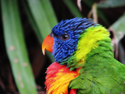
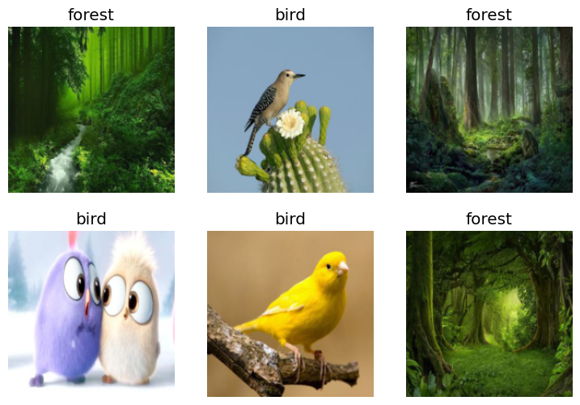

# Getting Started

Getting Started

Author

Benedict Thekkel

## Check for all installs and versions

``` python
!conda list | grep "pytorch"
```

    ffmpeg                    4.3                  hf484d3e_0    pytorch
    libjpeg-turbo             2.0.0                h9bf148f_0    pytorch
    pytorch                   2.0.1           py3.11_cuda11.8_cudnn8.7.0_0    pytorch
    pytorch-cuda              11.8                 h7e8668a_5    pytorch
    pytorch-ignite            0.4.12                   pypi_0    pypi
    pytorch-lightning         2.0.7                    pypi_0    pypi
    pytorch-mutex             1.0                        cuda    pytorch
    torchaudio                2.0.2               py311_cu118    pytorch
    torchtriton               2.0.0                     py311    pytorch
    torchvision               0.15.2              py311_cu118    pytorch

``` python
!nvcc --version
```

    /bin/bash: line 1: nvcc: command not found

``` python
!pip list | grep "fastai" 
!pip list | grep "fastbook"
```

    fastai                        2.7.12
    fastbook                      0.0.28

``` python
import torch

if torch.cuda.is_available():
    print("GPU is available.")
    num_gpu = torch.cuda.device_count()
    for i in range(num_gpu):
        gpu_name = torch.cuda.get_device_name(i)
        gpu_memory = torch.cuda.get_device_properties(i).total_memory / (1024 ** 3)  # Convert bytes to GB
        print(f"GPU {i}: {gpu_name}, Memory: {gpu_memory:.2f} GB")
else:
    print("GPU is not available.")
```

    GPU is available.
    GPU 0: NVIDIA GeForce RTX 2060, Memory: 6.00 GB

``` python
# Check if CUDA (GPU) is available
device = torch.device("cuda" if torch.cuda.is_available() else "cpu")
device
```

    device(type='cuda')

## Generate Data Images

Code

``` python
from fastbook import search_images_ddg
from fastdownload import download_url
from fastai.vision.all import *
from nbdevAuto import functions
import os
import shutil
```

Let’s start by searching for a bird photo and seeing what kind of result we get. We’ll start by getting URLs from a search:

``` python
functions.download_pic('bird', n_images = 1, folder = './Data', show_progress=True, recreate = False)
```

    Image file exists.



…and then download a URL and take a look at it:

Now let’s do the same with “forest photos”:

``` python
functions.download_pic('forest', folder = './Data')
```

    Image file exists.


``` python
searches = ('forest','bird')
path = Path('Data/bird_or_not')

functions.create_data_folder(folder_path=path,
                             searches=searches,
                             amount=200,
                            recreate= False)
```

    Folder already exists: Data/bird_or_not

## Creating the model

``` python
dls = DataBlock(
    blocks=(ImageBlock, CategoryBlock), 
    get_items=get_image_files, 
    splitter=RandomSplitter(valid_pct=0.2, seed=42),
    get_y=parent_label,
    item_tfms=[Resize(192, method='squish')],
    
)

dls = dls.dataloaders(path, bs = 16)

dls.show_batch(max_n=6)
```



Here what each of the `DataBlock` parameters means:

    blocks=(ImageBlock, CategoryBlock),

The inputs to our model are images, and the outputs are categories (in this case, “bird” or “forest”).

    get_items=get_image_files, 

To find all the inputs to our model, run the `get_image_files` function (which returns a list of all image files in a path).

    splitter=RandomSplitter(valid_pct=0.2, seed=42),

Split the data into training and validation sets randomly, using 20% of the data for the validation set.

    get_y=parent_label,

The labels (`y` values) is the name of the `parent` of each file (i.e. the name of the folder they’re in, which will be *bird* or *forest*).

    item_tfms=[Resize(192, method='squish')]

Before training, resize each image to 192x192 pixels by “squishing” it (as opposed to cropping it).

## Traning the model

Now we’re ready to train our model. The fastest widely used computer vision model is `resnet18`. You can train this in a few minutes, even on a CPU! (On a GPU, it generally takes under 10 seconds…)

`fastai` comes with a helpful `fine_tune()` method which automatically uses best practices for fine tuning a pre-trained model, so we’ll use that.1

------------------------------------------------------------------------

``` python
import timm
```

``` python
timm.list_models('resnet1*')[0:5]
```

    ['resnet10t', 'resnet14t', 'resnet18', 'resnet18d', 'resnet101']

``` python
learn = vision_learner(dls, 'resnet18', metrics=error_rate)
learn.fine_tune(5)
```

| epoch | train_loss | valid_loss | error_rate | time  |
|-------|------------|------------|------------|-------|
| 0     | 0.657275   | 0.040000   | 0.014085   | 00:05 |

| epoch | train_loss | valid_loss | error_rate | time  |
|-------|------------|------------|------------|-------|
| 0     | 0.046995   | 0.029015   | 0.014085   | 00:02 |
| 1     | 0.095600   | 0.020682   | 0.014085   | 00:01 |
| 2     | 0.145258   | 0.025311   | 0.000000   | 00:01 |
| 3     | 0.101540   | 0.023066   | 0.000000   | 00:01 |
| 4     | 0.095942   | 0.017011   | 0.000000   | 00:01 |

## Step 3: Use our model (and build your own!)

Let’s see what our model thinks about that bird we downloaded at the start:

------------------------------------------------------------------------

``` python
??PILImage
```

    Init signature: PILImage()
    Source:        
    class PILImage(PILBase): 
        "A RGB Pillow `Image` that can show itself and converts to `TensorImage`"
        pass
    File:           ~/mambaforge/envs/cfast/lib/python3.11/site-packages/fastai/vision/core.py
    Type:           BypassNewMeta
    Subclasses:     PILImageBW

``` python
is_bird,_,probs = learn.predict(PILImage.create('Data/bird0.jpg'))
print(f"This is a: {is_bird}.")
print(f"Probability it's a bird: {probs[0]:.4f}")
```

    This is a: bird.
    Probability it's a bird: 0.9932

``` python
functions.classify_images(learn, 'Data/bird0.jpg')
```

    {'bird': 99.31602, 'forest': 0.68398}

## Deep Learning Is Not Just for Image Classification

- SegmentationDataLoaders - Easier than datablocks

``` python
path = untar_data(URLs.CAMVID_TINY)
dls = SegmentationDataLoaders.from_label_func(
    path, bs=8, fnames = get_image_files(path/"images"),
    label_func = lambda o: path/'labels'/f'{o.stem}_P{o.suffix}',
    codes = np.loadtxt(path/'codes.txt', dtype=str)
)

learn = unet_learner(dls, resnet34)
learn.fine_tune(8)
```

- Tabular analysis - income prediction

``` python
from fastai.tabular.all import *
path = untar_data(URLs.ADULT_SAMPLE)

dls = TabularDataLoaders.from_csv(path/'adult.csv', path=path, y_names="salary",
    cat_names = ['workclass', 'education', 'marital-status', 'occupation',
                 'relationship', 'race'],
    cont_names = ['age', 'fnlwgt', 'education-num'],
    procs = [Categorify, FillMissing, Normalize])

learn = tabular_learner(dls, metrics=accuracy)
learn.fit_one_cycle(3)

dls.show_batch()
```

- Collaboration filtering - ratings/ recommendations

``` python
from fastai.collab import *
path = untar_data(URLs.ML_SAMPLE)
dls = CollabDataLoaders.from_csv(path/'ratings.csv')
learn = collab_learner(dls, y_range=(0.5,5.5))
learn.fine_tune(10)
learn.show_results()
```

- Example

``` python
from fastai.text.all import *

dls = TextDataLoaders.from_folder(untar_data(URLs.IMDB), valid='test', bs=32)
learn = text_classifier_learner(dls, AWD_LSTM, drop_mult=0.5, metrics=accuracy)
learn.fine_tune(4, 1e-2)
```

This reduces the batch size to 32 (we will explain this later). If you keep hitting the same error, change 32 to 16

- Example

``` python
from fastai.text.all import *

dls = TextDataLoaders.from_folder(untar_data(URLs.IMDB), valid='test')
learn = text_classifier_learner(dls, AWD_LSTM, drop_mult=0.5, 
                                metrics=accuracy)
learn.fine_tune(4, 1e-2)
```

Back to top
