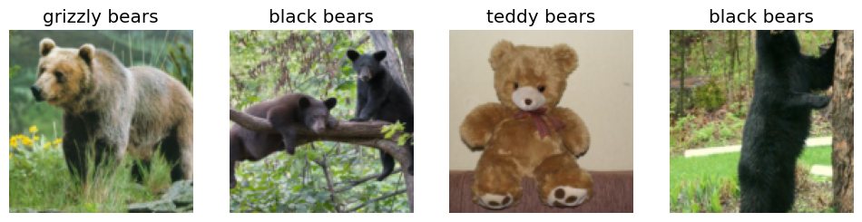
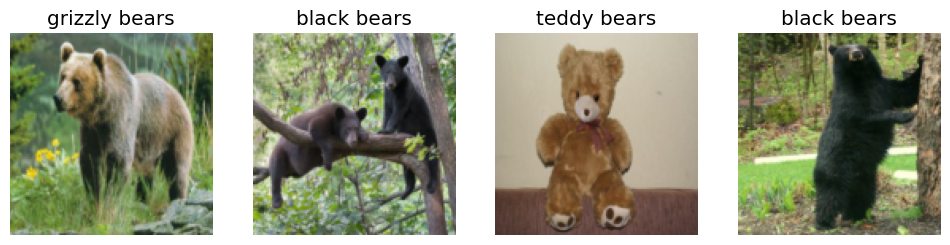
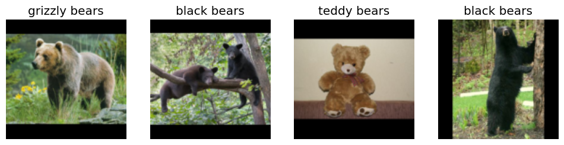
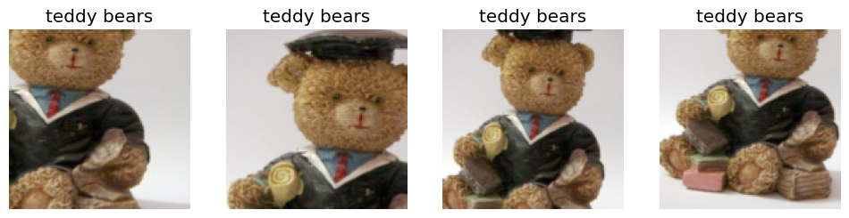
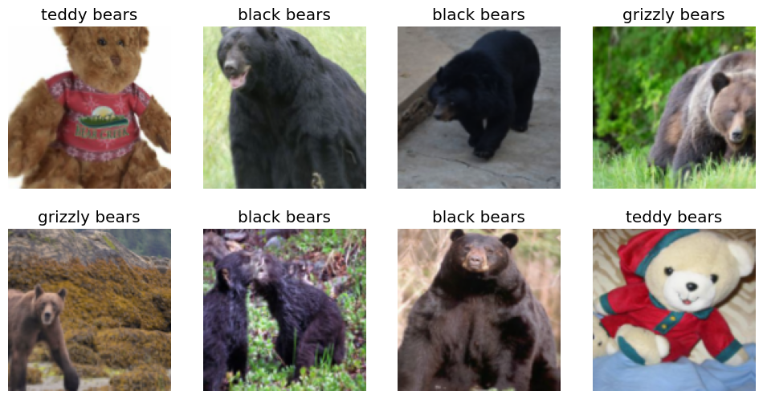
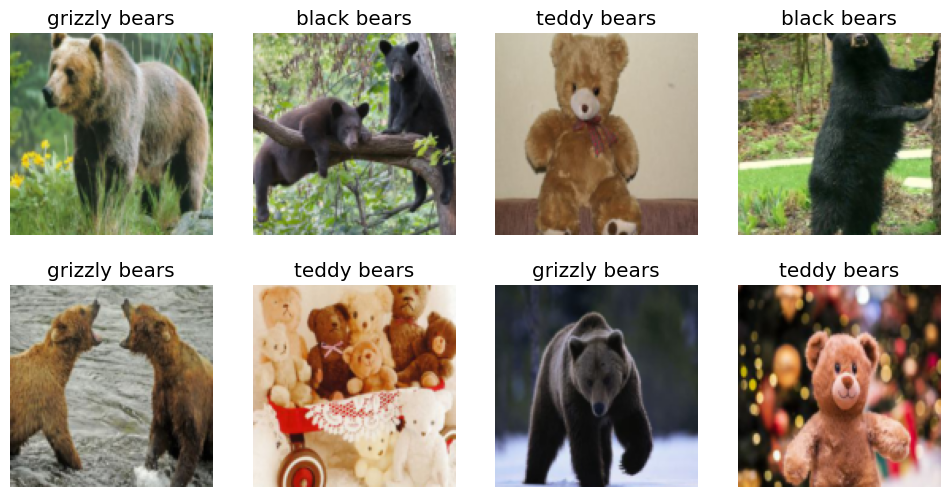
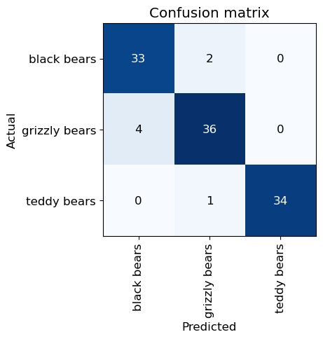
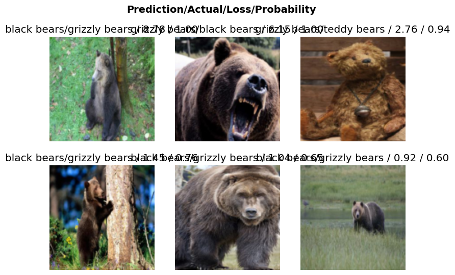

# Deployment

Putting a model into Deployment

Author

Benedict Thekkel

## Initial Checks

``` python
!conda list | grep "pytorch"
```

    ffmpeg                    4.3                  hf484d3e_0    pytorch
    libjpeg-turbo             2.0.0                h9bf148f_0    pytorch
    pytorch                   2.0.1           py3.11_cuda11.8_cudnn8.7.0_0    pytorch
    pytorch-cuda              11.8                 h7e8668a_5    pytorch
    pytorch-ignite            0.4.12                   pypi_0    pypi
    pytorch-lightning         2.0.7                    pypi_0    pypi
    pytorch-mutex             1.0                        cuda    pytorch
    torchaudio                2.0.2               py311_cu118    pytorch
    torchtriton               2.0.0                     py311    pytorch
    torchvision               0.15.2              py311_cu118    pytorch

``` python
!nvcc --version
```

    /bin/bash: line 1: nvcc: command not found

``` python
!pip list | grep "fastai" 
!pip list | grep "fastbook"
!pip list | grep "ipywidgets"
```

    fastai                        2.7.12
    fastbook                      0.0.28
    ipywidgets                    8.0.4

``` python
import torch
```

``` python
torch.cuda.is_available()
```

    True

## Gather Data

``` python
from fastbook import search_images_ddg
from fastdownload import download_url
from fastai.vision.all import *
from nbdevAuto.functions import *
import os
```

``` python
?download_pic
```

    Signature:
    download_pic(
        image: str,
        n_images: int = 1,
        name: str = '',
        folder: str = '',
        show_progress: bool = False,
        recreate: bool = False,
    )
    Docstring: Downloads the image into the folder provided and displays it
    File:      ~/mambaforge/envs/cfast/lib/python3.11/site-packages/nbdevAuto/functions.py
    Type:      function

``` python
dest = 'grizzly'
download_pic(dest, folder = './Data')
```

    Downloading image_path.0


Code

``` python
searches = ('grizzly bears','black bears','teddy bears')
path = Path('Data/bears')

create_data_folder(path, searches)
```

    created grizzly bears folder
    created black bears folder
    created teddy bears folder
    downloading 200 images for:grizzly bears
    downloading 200 images for:black bears
    downloading 200 images for:teddy bears
    Number of images failed: 31
    resizing images for: grizzly bears
    resizing images for: black bears
    resizing images for: teddy bears

## Data Augmentation and Designing model

``` python
?DataBlock
```

    Init signature:
    DataBlock(
        blocks: 'list' = None,
        dl_type: 'TfmdDL' = None,
        getters: 'list' = None,
        n_inp: 'int' = None,
        item_tfms: 'list' = None,
        batch_tfms: 'list' = None,
        *,
        get_items=None,
        splitter=None,
        get_y=None,
        get_x=None,
    )
    Docstring:      Generic container to quickly build `Datasets` and `DataLoaders`.
    File:           ~/mambaforge/envs/cfast/lib/python3.11/site-packages/fastai/data/block.py
    Type:           type
    Subclasses:     

``` python
bears = DataBlock(
    blocks=(ImageBlock, CategoryBlock), 
    get_items=get_image_files, 
    splitter=RandomSplitter(valid_pct=0.2, seed=42),
    get_y=parent_label,
    item_tfms=Resize(128))
```

``` python
dls = bears.dataloaders(path)
```

``` python
dls.valid.show_batch(max_n=4, nrows=1)
```



``` python
bears = bears.new(item_tfms=Resize(128, ResizeMethod.Squish))
dls = bears.dataloaders(path)
dls.valid.show_batch(max_n=4, nrows=1)
```



``` python
bears = bears.new(
    item_tfms=Resize(128, ResizeMethod.Pad, pad_mode='zeros'))
dls = bears.dataloaders(path)
dls.valid.show_batch(max_n=4, nrows=1)
```



``` python
bears = bears.new(item_tfms=RandomResizedCrop(128, min_scale=0.3))
dls = bears.dataloaders(path)
dls.train.show_batch(max_n=4, nrows=1, unique=True)
```



## Training Your Model, and Using It to Clean Your Data

``` python
bears = bears.new(
    item_tfms=RandomResizedCrop(128, min_scale=0.5),
    batch_tfms=aug_transforms(mult=1))
dls = bears.dataloaders(path)
dls.train.show_batch(max_n=8, nrows=2, unique=False)
```



``` python
dls.valid.show_batch(max_n=8, nrows=2, unique=False)
```



## Training Your Model

``` python
import timm
```

``` python
timm.list_models('resnet1*')[0:5]
```

    ['resnet10t', 'resnet14t', 'resnet18', 'resnet18d', 'resnet101']

``` python
learn = vision_learner(dls,  'resnet18', metrics=error_rate)
learn.fine_tune(5)
```

| epoch | train_loss | valid_loss | error_rate | time  |
|-------|------------|------------|------------|-------|
| 0     | 1.391607   | 0.352104   | 0.127273   | 00:05 |

| epoch | train_loss | valid_loss | error_rate | time  |
|-------|------------|------------|------------|-------|
| 0     | 0.575542   | 0.227657   | 0.081818   | 00:03 |
| 1     | 0.482945   | 0.238172   | 0.063636   | 00:02 |
| 2     | 0.428172   | 0.271056   | 0.090909   | 00:02 |
| 3     | 0.371018   | 0.263265   | 0.063636   | 00:02 |
| 4     | 0.326668   | 0.267179   | 0.063636   | 00:02 |

``` python
interp = ClassificationInterpretation.from_learner(learn)
interp.plot_confusion_matrix()
```



``` python
interp.plot_top_losses(6, nrows=2)
```



``` python
from fastai.vision.widgets import ImageClassifierCleaner
```

``` python
cleaner = ImageClassifierCleaner(learn)
cleaner
```

``` python
#hide
# for idx in cleaner.delete(): cleaner.fns[idx].unlink()
# for idx,cat in cleaner.change(): shutil.move(str(cleaner.fns[idx]), path/cat)
```

## Testing

``` python
searches = ('grizzly bears','black bears','teddy bears')
image= 'Data/grizzly0.jpg'


is_real,_,probs = learn.predict(PILImage.create(image))

for index, value in enumerate(searches):
    np.set_printoptions(suppress=True, precision=4)
    print(f"Probability of {value} is :{probs[index]:.5f}.")
    
max_value, max_index = torch.max(probs, dim=0)
print(f"This is a: {searches[max_index]} with probability: {max_value:.5f}.")


Image.open(image).to_thumb(256,256)
```

    Probability of grizzly bears is :0.00892.
    Probability of black bears is :0.99068.
    Probability of teddy bears is :0.00040.
    This is a: black bears with probability: 0.99068.


## Turning Your Model into an Online Application

``` python
if os.path.exists('Data/model.pkl'):
    print("model already exists")
else:
    learn.export('Data/model.pkl')
    print("model created")
```

    model created

``` python
path = Path('Data')
filename = path.ls(file_exts='.pkl')
filename[0].name
```

    'model.pkl'

``` python
learn_inf = load_learner(path/filename[0].name)
```

``` python
%time learn_inf.predict(image)
```

    CPU times: user 440 ms, sys: 14.4 ms, total: 455 ms
    Wall time: 123 ms

    ('grizzly bears', tensor(1), tensor([8.9228e-03, 9.9068e-01, 3.9536e-04]))

``` python
learn_inf.dls.vocab
```

    ['black bears', 'grizzly bears', 'teddy bears']

## Making a widget application

``` python
!pip list | grep 'ipywidgets'
!pip list | grep 'ipywidgets'
```

    ipywidgets                    8.0.4
    ipywidgets                    8.0.4

``` python
import ipywidgets as widgets
```

``` python
btn_upload = widgets.FileUpload(
    button_style='success',
    description='Upload',
    accept='',  # Accepted file extension e.g. '.txt', '.pdf', 'image/*', 'image/*,.pdf'
    multiple=False  # True to accept multiple files upload else False
)
display(btn_upload)
```

``` python
if btn_upload.value:
    uploaded_image = Image.open(io.BytesIO(btn_upload.value[-1].content)).to_thumb(256,256)
    display(uploaded_image)
```

``` python
out_pl = widgets.Output()
display(out_pl)
```

``` python
if btn_upload.value:
    out_pl = widgets.Output()
    out_pl.clear_output()
    with out_pl: display(uploaded_image)
    out_pl
```

``` python
if btn_upload.value:
    uploaded_image = Image.open(io.BytesIO(btn_upload.value[-1].content)).to_thumb(256,256)
    pred,pred_idx,probs = learn_inf.predict(uploaded_image)
```

``` python
#hide_output
if btn_upload.value:
    lbl_pred = widgets.Label()
    lbl_pred.value = f'Prediction: {pred}; Probability: {probs[pred_idx]:.04f}'
    display(lbl_pred)
```

``` python
btn_run = widgets.Button(description='Classify')
btn_run
```

``` python
def on_click_classify(change):
    if btn_upload.value:
        img = Image.open(io.BytesIO(btn_upload.value[-1].content)).to_thumb(256,256)
        out_pl.clear_output()
        with out_pl: display(img)
        pred,pred_idx,probs = learn_inf.predict(img)
        lbl_pred.value = f'Prediction: {pred}; Probability: {probs[pred_idx]:.04f}'
    else:
        lbl_pred.value = f'Select image'

btn_run.on_click(on_click_classify)
```

``` python
if btn_upload.value:
    lbl_pred
```

``` python
screen = widgets.VBox([widgets.Label('Select your bear!'), 
              btn_upload,
              btn_run,
              out_pl, 
              lbl_pred:= widgets.Label()]
            )
display(screen)
```

Back to top
