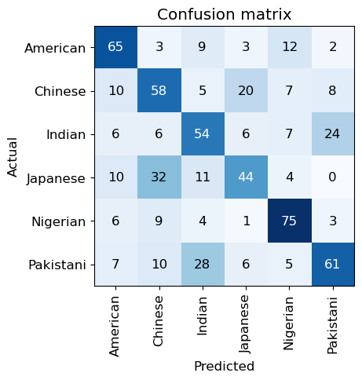
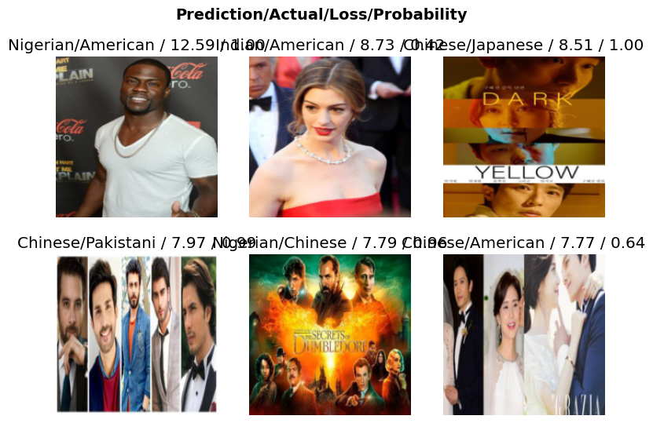
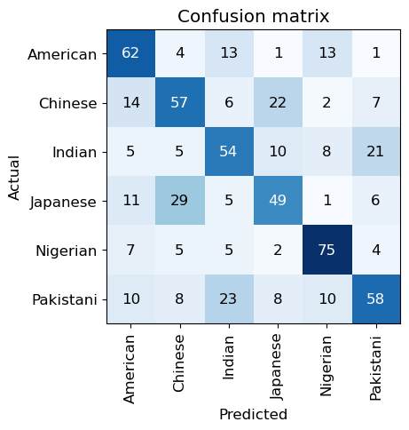
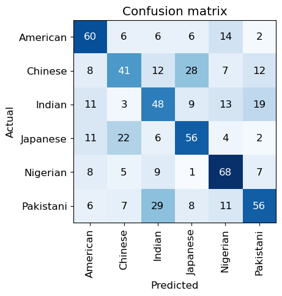
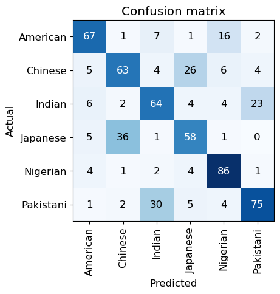

# Neural Net Foundations

mathematical foundations of deep learning: Stochastic gradient descent (SGD), and the flexibility of linear functions layered with non-linear activation functions.

Author

Benedict Thekkel

## Initial Checks

``` python
!conda list | grep "pytorch"
```

    ffmpeg                    4.3                  hf484d3e_0    pytorch
    libjpeg-turbo             2.0.0                h9bf148f_0    pytorch
    pytorch                   2.0.1           py3.11_cuda11.8_cudnn8.7.0_0    pytorch
    pytorch-cuda              11.8                 h7e8668a_5    pytorch
    pytorch-ignite            0.4.12                   pypi_0    pypi
    pytorch-lightning         2.0.7                    pypi_0    pypi
    pytorch-mutex             1.0                        cuda    pytorch
    torchaudio                2.0.2               py311_cu118    pytorch
    torchtriton               2.0.0                     py311    pytorch
    torchvision               0.15.2              py311_cu118    pytorch

``` python
!pip list | grep "fastai" 
!pip list | grep "fastbook"
!pip list | grep "ipywidgets"
!pip list | grep "fastAIcourse"
```

    fastai                        2.7.12
    fastbook                      0.0.28
    ipywidgets                    8.0.4

``` python
import torch
```

``` python
torch.cuda.is_available()
```

    True

## Gather Data

``` python
from fastbook import search_images_ddg
from fastdownload import download_url
from fastai.vision.all import *
import os
```

``` python
from nbdevAuto.functions import *
```

``` python
download_pic('indian actor close up',
             name = 'indian', 
             folder = './Data/actors_test', 
             n_images = 10)
```

    Downloading image_path.0
    Downloading image_path.1
    Downloading image_path.2
    Downloading image_path.3
    Downloading image_path.4
    Downloading image_path.5
    Downloading image_path.6
    Downloading image_path.7
    Downloading image_path.8
    Downloading image_path.9


``` python
read_from_file??
```

    Signature: read_from_file(file_path)
    Docstring: <no docstring>
    Source:   
    def read_from_file(file_path):
        from fastbook import search_images_ddg
        from fastdownload import download_url
        import os
        import shutil
        from PIL import Image
        countries = ()
        with open(file_path, 'r') as file:
            for line in file:
                # Remove any leading/trailing whitespace and newline characters
                country = line.strip()
                # Add the country to the tuple
                countries += (country,)
        return countries
    File:      ~/mambaforge/envs/cfast/lib/python3.11/site-packages/nbdevAuto/functions.py
    Type:      function

Code

``` python
searches = ('Indian', 'Chinese', 'American', 'Nigerian', 'Pakistani', 'Japanese')
path = Path('Data/actors')

create_data_folder(folder_path = path,
                   searches = searches,
                   before = 'Famous ',
                   after = ' actor close up',
                   amount = 400,
                   recreate = False
                  )
```

    created Indian folder
    created Chinese folder
    created American folder
    created Nigerian folder
    created Pakistani folder
    created Japanese folder
    Error with 400 images of Famous Indian actor close up: 'next'
    Error with 380 images of Famous Indian actor close up: 'next'
    downloading 360 images for:Famous Indian actor close up
    Error with 400 images of Famous Chinese actor close up: 'next'
    Error with 380 images of Famous Chinese actor close up: 'next'
    downloading 360 images for:Famous Chinese actor close up
    Error with 400 images of Famous American actor close up: 'next'
    Error with 380 images of Famous American actor close up: 'next'
    downloading 360 images for:Famous American actor close up
    Error with 400 images of Famous Nigerian actor close up: 'next'
    downloading 380 images for:Famous Nigerian actor close up
    Error with 400 images of Famous Pakistani actor close up: 'next'
    Error with 380 images of Famous Pakistani actor close up: 'next'
    downloading 360 images for:Famous Pakistani actor close up
    Error with 400 images of Famous Japanese actor close up: 'next'
    Error with 380 images of Famous Japanese actor close up: 'next'
    downloading 360 images for:Famous Japanese actor close up
    Number of images failed: 34
    resizing images for: Indian
    resizing images for: Chinese
    resizing images for: American
    resizing images for: Nigerian
    resizing images for: Pakistani
    resizing images for: Japanese

## Design Model

``` python
dls = DataBlock(
    blocks=(ImageBlock, CategoryBlock), 
    get_items=get_image_files, 
    splitter=RandomSplitter(valid_pct=0.3, seed=42),
    get_y=parent_label,
    item_tfms=[Resize(192, method='squish')]
).dataloaders(path)

dls.show_batch(max_n=6)
```


``` python
dls.valid.show_batch(max_n=4, nrows=1)
```


``` python
learn = vision_learner(dls, resnet18, metrics=error_rate)
learn.fine_tune(5)
```

    /home/ben/mambaforge/envs/cfast/lib/python3.11/site-packages/torchvision/models/_utils.py:208: UserWarning: The parameter 'pretrained' is deprecated since 0.13 and may be removed in the future, please use 'weights' instead.
      warnings.warn(
    /home/ben/mambaforge/envs/cfast/lib/python3.11/site-packages/torchvision/models/_utils.py:223: UserWarning: Arguments other than a weight enum or `None` for 'weights' are deprecated since 0.13 and may be removed in the future. The current behavior is equivalent to passing `weights=ResNet18_Weights.IMAGENET1K_V1`. You can also use `weights=ResNet18_Weights.DEFAULT` to get the most up-to-date weights.
      warnings.warn(msg)

| epoch | train_loss | valid_loss | error_rate | time  |
|-------|------------|------------|------------|-------|
| 0     | 2.531562   | 1.645555   | 0.533011   | 00:51 |

| epoch | train_loss | valid_loss | error_rate | time  |
|-------|------------|------------|------------|-------|
| 0     | 1.552908   | 1.435370   | 0.476651   | 00:08 |
| 1     | 1.172976   | 1.425597   | 0.462158   | 00:07 |
| 2     | 0.828362   | 1.448297   | 0.420290   | 00:07 |
| 3     | 0.590487   | 1.448689   | 0.425121   | 00:07 |
| 4     | 0.427939   | 1.446647   | 0.425121   | 00:07 |

``` python
interp = ClassificationInterpretation.from_learner(learn)
interp.plot_confusion_matrix()
```



``` python
interp.plot_top_losses(6, nrows=2)
```



## Testing

``` python
image= f'./Data/actors_test/indian{8}.jpg'

print(classify_images(learn, image))
Image.open(image).to_thumb(256,256)
```

    {'American': 0.29763, 'Chinese': 0.07823, 'Indian': 98.55846, 'Japanese': 0.02067, 'Nigerian': 0.00509, 'Pakistani': 1.03991}


## New models

``` python
!pip list | grep 'timm'
```

    timm                          0.9.5

``` python
import timm
```

``` python
timm.list_models('convnext*')[0:5]
```

    ['convnext_atto',
     'convnext_atto_ols',
     'convnext_base',
     'convnext_femto',
     'convnext_femto_ols']

``` python
timm.list_models('resnet1*')[0:5]
```

    ['resnet10t', 'resnet14t', 'resnet18', 'resnet18d', 'resnet101']

``` python
learn1 = vision_learner(dls, 'resnet26', metrics=error_rate).to_fp16()
learn1.fine_tune(5)
```

| epoch | train_loss | valid_loss | error_rate | time  |
|-------|------------|------------|------------|-------|
| 0     | 2.312677   | 1.824935   | 0.495974   | 00:07 |

| epoch | train_loss | valid_loss | error_rate | time  |
|-------|------------|------------|------------|-------|
| 0     | 1.092882   | 1.420130   | 0.436393   | 00:07 |
| 1     | 0.892234   | 1.551688   | 0.444444   | 00:07 |
| 2     | 0.667233   | 1.496551   | 0.433172   | 00:07 |
| 3     | 0.505152   | 1.428328   | 0.434783   | 00:07 |
| 4     | 0.393912   | 1.432097   | 0.428341   | 00:07 |

``` python
interp = ClassificationInterpretation.from_learner(learn1)
interp.plot_confusion_matrix()
```



``` python
print(classify_images(learn1, image))
Image.open(image).to_thumb(256,256)
```

    {'American': 1.93272, 'Chinese': 0.29763, 'Indian': 94.33807, 'Japanese': 0.74532, 'Nigerian': 0.12889, 'Pakistani': 2.55736}


``` python
learn2 = vision_learner(dls, 'resnetv2_50', metrics=error_rate).to_fp16()
learn2.fine_tune(5)
```

| epoch | train_loss | valid_loss | error_rate | time  |
|-------|------------|------------|------------|-------|
| 0     | 2.409034   | 1.555330   | 0.563607   | 00:08 |

| epoch | train_loss | valid_loss | error_rate | time  |
|-------|------------|------------|------------|-------|
| 0     | 1.257049   | 1.527638   | 0.534622   | 00:17 |
| 1     | 1.107014   | 1.643291   | 0.481481   | 00:18 |
| 2     | 0.895890   | 1.621696   | 0.471820   | 00:18 |
| 3     | 0.723650   | 1.563223   | 0.473430   | 00:18 |
| 4     | 0.597290   | 1.563260   | 0.470209   | 00:18 |

``` python
interp = ClassificationInterpretation.from_learner(learn2)
interp.plot_confusion_matrix()
```



``` python
print(classify_images(learn2, image))
Image.open(image).to_thumb(256,256)
```

    {'American': 0.3549, 'Chinese': 0.33474, 'Indian': 93.41635, 'Japanese': 5.27019, 'Nigerian': 0.00385, 'Pakistani': 0.61998}


``` python
learn3 = vision_learner(dls, 'convnextv2_tiny', metrics=error_rate).to_fp16()
learn3.fit_one_cycle(5)
```

| epoch | train_loss | valid_loss | error_rate | time  |
|-------|------------|------------|------------|-------|
| 0     | 2.345684   | 1.306399   | 0.450886   | 02:10 |
| 1     | 1.648355   | 1.032094   | 0.365539   | 02:14 |
| 2     | 1.210625   | 0.989129   | 0.338164   | 02:16 |
| 3     | 0.911790   | 0.994874   | 0.341385   | 02:13 |
| 4     | 0.740028   | 0.988997   | 0.334944   | 02:26 |

``` python
interp = ClassificationInterpretation.from_learner(learn3)
interp.plot_confusion_matrix()
```



``` python
print(classify_images(learn3, image))
Image.open(image).to_thumb(256,256)
```

    {'American': 1.42206, 'Chinese': 0.01462, 'Indian': 91.9322, 'Japanese': 1.72204, 'Nigerian': 0.01778, 'Pakistani': 4.8913}


``` python
m = learn3.model
m
```

    Sequential(
      (0): TimmBody(
        (model): ConvNeXt(
          (stem): Sequential(
            (0): Conv2d(3, 96, kernel_size=(4, 4), stride=(4, 4))
            (1): LayerNorm2d((96,), eps=1e-06, elementwise_affine=True)
          )
          (stages): Sequential(
            (0): ConvNeXtStage(
              (downsample): Identity()
              (blocks): Sequential(
                (0): ConvNeXtBlock(
                  (conv_dw): Conv2d(96, 96, kernel_size=(7, 7), stride=(1, 1), padding=(3, 3), groups=96)
                  (norm): LayerNorm((96,), eps=1e-06, elementwise_affine=True)
                  (mlp): GlobalResponseNormMlp(
                    (fc1): Linear(in_features=96, out_features=384, bias=True)
                    (act): GELU()
                    (drop1): Dropout(p=0.0, inplace=False)
                    (grn): GlobalResponseNorm()
                    (fc2): Linear(in_features=384, out_features=96, bias=True)
                    (drop2): Dropout(p=0.0, inplace=False)
                  )
                  (shortcut): Identity()
                  (drop_path): Identity()
                )
                (1): ConvNeXtBlock(
                  (conv_dw): Conv2d(96, 96, kernel_size=(7, 7), stride=(1, 1), padding=(3, 3), groups=96)
                  (norm): LayerNorm((96,), eps=1e-06, elementwise_affine=True)
                  (mlp): GlobalResponseNormMlp(
                    (fc1): Linear(in_features=96, out_features=384, bias=True)
                    (act): GELU()
                    (drop1): Dropout(p=0.0, inplace=False)
                    (grn): GlobalResponseNorm()
                    (fc2): Linear(in_features=384, out_features=96, bias=True)
                    (drop2): Dropout(p=0.0, inplace=False)
                  )
                  (shortcut): Identity()
                  (drop_path): Identity()
                )
                (2): ConvNeXtBlock(
                  (conv_dw): Conv2d(96, 96, kernel_size=(7, 7), stride=(1, 1), padding=(3, 3), groups=96)
                  (norm): LayerNorm((96,), eps=1e-06, elementwise_affine=True)
                  (mlp): GlobalResponseNormMlp(
                    (fc1): Linear(in_features=96, out_features=384, bias=True)
                    (act): GELU()
                    (drop1): Dropout(p=0.0, inplace=False)
                    (grn): GlobalResponseNorm()
                    (fc2): Linear(in_features=384, out_features=96, bias=True)
                    (drop2): Dropout(p=0.0, inplace=False)
                  )
                  (shortcut): Identity()
                  (drop_path): Identity()
                )
              )
            )
            (1): ConvNeXtStage(
              (downsample): Sequential(
                (0): LayerNorm2d((96,), eps=1e-06, elementwise_affine=True)
                (1): Conv2d(96, 192, kernel_size=(2, 2), stride=(2, 2))
              )
              (blocks): Sequential(
                (0): ConvNeXtBlock(
                  (conv_dw): Conv2d(192, 192, kernel_size=(7, 7), stride=(1, 1), padding=(3, 3), groups=192)
                  (norm): LayerNorm((192,), eps=1e-06, elementwise_affine=True)
                  (mlp): GlobalResponseNormMlp(
                    (fc1): Linear(in_features=192, out_features=768, bias=True)
                    (act): GELU()
                    (drop1): Dropout(p=0.0, inplace=False)
                    (grn): GlobalResponseNorm()
                    (fc2): Linear(in_features=768, out_features=192, bias=True)
                    (drop2): Dropout(p=0.0, inplace=False)
                  )
                  (shortcut): Identity()
                  (drop_path): Identity()
                )
                (1): ConvNeXtBlock(
                  (conv_dw): Conv2d(192, 192, kernel_size=(7, 7), stride=(1, 1), padding=(3, 3), groups=192)
                  (norm): LayerNorm((192,), eps=1e-06, elementwise_affine=True)
                  (mlp): GlobalResponseNormMlp(
                    (fc1): Linear(in_features=192, out_features=768, bias=True)
                    (act): GELU()
                    (drop1): Dropout(p=0.0, inplace=False)
                    (grn): GlobalResponseNorm()
                    (fc2): Linear(in_features=768, out_features=192, bias=True)
                    (drop2): Dropout(p=0.0, inplace=False)
                  )
                  (shortcut): Identity()
                  (drop_path): Identity()
                )
                (2): ConvNeXtBlock(
                  (conv_dw): Conv2d(192, 192, kernel_size=(7, 7), stride=(1, 1), padding=(3, 3), groups=192)
                  (norm): LayerNorm((192,), eps=1e-06, elementwise_affine=True)
                  (mlp): GlobalResponseNormMlp(
                    (fc1): Linear(in_features=192, out_features=768, bias=True)
                    (act): GELU()
                    (drop1): Dropout(p=0.0, inplace=False)
                    (grn): GlobalResponseNorm()
                    (fc2): Linear(in_features=768, out_features=192, bias=True)
                    (drop2): Dropout(p=0.0, inplace=False)
                  )
                  (shortcut): Identity()
                  (drop_path): Identity()
                )
              )
            )
            (2): ConvNeXtStage(
              (downsample): Sequential(
                (0): LayerNorm2d((192,), eps=1e-06, elementwise_affine=True)
                (1): Conv2d(192, 384, kernel_size=(2, 2), stride=(2, 2))
              )
              (blocks): Sequential(
                (0): ConvNeXtBlock(
                  (conv_dw): Conv2d(384, 384, kernel_size=(7, 7), stride=(1, 1), padding=(3, 3), groups=384)
                  (norm): LayerNorm((384,), eps=1e-06, elementwise_affine=True)
                  (mlp): GlobalResponseNormMlp(
                    (fc1): Linear(in_features=384, out_features=1536, bias=True)
                    (act): GELU()
                    (drop1): Dropout(p=0.0, inplace=False)
                    (grn): GlobalResponseNorm()
                    (fc2): Linear(in_features=1536, out_features=384, bias=True)
                    (drop2): Dropout(p=0.0, inplace=False)
                  )
                  (shortcut): Identity()
                  (drop_path): Identity()
                )
                (1): ConvNeXtBlock(
                  (conv_dw): Conv2d(384, 384, kernel_size=(7, 7), stride=(1, 1), padding=(3, 3), groups=384)
                  (norm): LayerNorm((384,), eps=1e-06, elementwise_affine=True)
                  (mlp): GlobalResponseNormMlp(
                    (fc1): Linear(in_features=384, out_features=1536, bias=True)
                    (act): GELU()
                    (drop1): Dropout(p=0.0, inplace=False)
                    (grn): GlobalResponseNorm()
                    (fc2): Linear(in_features=1536, out_features=384, bias=True)
                    (drop2): Dropout(p=0.0, inplace=False)
                  )
                  (shortcut): Identity()
                  (drop_path): Identity()
                )
                (2): ConvNeXtBlock(
                  (conv_dw): Conv2d(384, 384, kernel_size=(7, 7), stride=(1, 1), padding=(3, 3), groups=384)
                  (norm): LayerNorm((384,), eps=1e-06, elementwise_affine=True)
                  (mlp): GlobalResponseNormMlp(
                    (fc1): Linear(in_features=384, out_features=1536, bias=True)
                    (act): GELU()
                    (drop1): Dropout(p=0.0, inplace=False)
                    (grn): GlobalResponseNorm()
                    (fc2): Linear(in_features=1536, out_features=384, bias=True)
                    (drop2): Dropout(p=0.0, inplace=False)
                  )
                  (shortcut): Identity()
                  (drop_path): Identity()
                )
                (3): ConvNeXtBlock(
                  (conv_dw): Conv2d(384, 384, kernel_size=(7, 7), stride=(1, 1), padding=(3, 3), groups=384)
                  (norm): LayerNorm((384,), eps=1e-06, elementwise_affine=True)
                  (mlp): GlobalResponseNormMlp(
                    (fc1): Linear(in_features=384, out_features=1536, bias=True)
                    (act): GELU()
                    (drop1): Dropout(p=0.0, inplace=False)
                    (grn): GlobalResponseNorm()
                    (fc2): Linear(in_features=1536, out_features=384, bias=True)
                    (drop2): Dropout(p=0.0, inplace=False)
                  )
                  (shortcut): Identity()
                  (drop_path): Identity()
                )
                (4): ConvNeXtBlock(
                  (conv_dw): Conv2d(384, 384, kernel_size=(7, 7), stride=(1, 1), padding=(3, 3), groups=384)
                  (norm): LayerNorm((384,), eps=1e-06, elementwise_affine=True)
                  (mlp): GlobalResponseNormMlp(
                    (fc1): Linear(in_features=384, out_features=1536, bias=True)
                    (act): GELU()
                    (drop1): Dropout(p=0.0, inplace=False)
                    (grn): GlobalResponseNorm()
                    (fc2): Linear(in_features=1536, out_features=384, bias=True)
                    (drop2): Dropout(p=0.0, inplace=False)
                  )
                  (shortcut): Identity()
                  (drop_path): Identity()
                )
                (5): ConvNeXtBlock(
                  (conv_dw): Conv2d(384, 384, kernel_size=(7, 7), stride=(1, 1), padding=(3, 3), groups=384)
                  (norm): LayerNorm((384,), eps=1e-06, elementwise_affine=True)
                  (mlp): GlobalResponseNormMlp(
                    (fc1): Linear(in_features=384, out_features=1536, bias=True)
                    (act): GELU()
                    (drop1): Dropout(p=0.0, inplace=False)
                    (grn): GlobalResponseNorm()
                    (fc2): Linear(in_features=1536, out_features=384, bias=True)
                    (drop2): Dropout(p=0.0, inplace=False)
                  )
                  (shortcut): Identity()
                  (drop_path): Identity()
                )
                (6): ConvNeXtBlock(
                  (conv_dw): Conv2d(384, 384, kernel_size=(7, 7), stride=(1, 1), padding=(3, 3), groups=384)
                  (norm): LayerNorm((384,), eps=1e-06, elementwise_affine=True)
                  (mlp): GlobalResponseNormMlp(
                    (fc1): Linear(in_features=384, out_features=1536, bias=True)
                    (act): GELU()
                    (drop1): Dropout(p=0.0, inplace=False)
                    (grn): GlobalResponseNorm()
                    (fc2): Linear(in_features=1536, out_features=384, bias=True)
                    (drop2): Dropout(p=0.0, inplace=False)
                  )
                  (shortcut): Identity()
                  (drop_path): Identity()
                )
                (7): ConvNeXtBlock(
                  (conv_dw): Conv2d(384, 384, kernel_size=(7, 7), stride=(1, 1), padding=(3, 3), groups=384)
                  (norm): LayerNorm((384,), eps=1e-06, elementwise_affine=True)
                  (mlp): GlobalResponseNormMlp(
                    (fc1): Linear(in_features=384, out_features=1536, bias=True)
                    (act): GELU()
                    (drop1): Dropout(p=0.0, inplace=False)
                    (grn): GlobalResponseNorm()
                    (fc2): Linear(in_features=1536, out_features=384, bias=True)
                    (drop2): Dropout(p=0.0, inplace=False)
                  )
                  (shortcut): Identity()
                  (drop_path): Identity()
                )
                (8): ConvNeXtBlock(
                  (conv_dw): Conv2d(384, 384, kernel_size=(7, 7), stride=(1, 1), padding=(3, 3), groups=384)
                  (norm): LayerNorm((384,), eps=1e-06, elementwise_affine=True)
                  (mlp): GlobalResponseNormMlp(
                    (fc1): Linear(in_features=384, out_features=1536, bias=True)
                    (act): GELU()
                    (drop1): Dropout(p=0.0, inplace=False)
                    (grn): GlobalResponseNorm()
                    (fc2): Linear(in_features=1536, out_features=384, bias=True)
                    (drop2): Dropout(p=0.0, inplace=False)
                  )
                  (shortcut): Identity()
                  (drop_path): Identity()
                )
              )
            )
            (3): ConvNeXtStage(
              (downsample): Sequential(
                (0): LayerNorm2d((384,), eps=1e-06, elementwise_affine=True)
                (1): Conv2d(384, 768, kernel_size=(2, 2), stride=(2, 2))
              )
              (blocks): Sequential(
                (0): ConvNeXtBlock(
                  (conv_dw): Conv2d(768, 768, kernel_size=(7, 7), stride=(1, 1), padding=(3, 3), groups=768)
                  (norm): LayerNorm((768,), eps=1e-06, elementwise_affine=True)
                  (mlp): GlobalResponseNormMlp(
                    (fc1): Linear(in_features=768, out_features=3072, bias=True)
                    (act): GELU()
                    (drop1): Dropout(p=0.0, inplace=False)
                    (grn): GlobalResponseNorm()
                    (fc2): Linear(in_features=3072, out_features=768, bias=True)
                    (drop2): Dropout(p=0.0, inplace=False)
                  )
                  (shortcut): Identity()
                  (drop_path): Identity()
                )
                (1): ConvNeXtBlock(
                  (conv_dw): Conv2d(768, 768, kernel_size=(7, 7), stride=(1, 1), padding=(3, 3), groups=768)
                  (norm): LayerNorm((768,), eps=1e-06, elementwise_affine=True)
                  (mlp): GlobalResponseNormMlp(
                    (fc1): Linear(in_features=768, out_features=3072, bias=True)
                    (act): GELU()
                    (drop1): Dropout(p=0.0, inplace=False)
                    (grn): GlobalResponseNorm()
                    (fc2): Linear(in_features=3072, out_features=768, bias=True)
                    (drop2): Dropout(p=0.0, inplace=False)
                  )
                  (shortcut): Identity()
                  (drop_path): Identity()
                )
                (2): ConvNeXtBlock(
                  (conv_dw): Conv2d(768, 768, kernel_size=(7, 7), stride=(1, 1), padding=(3, 3), groups=768)
                  (norm): LayerNorm((768,), eps=1e-06, elementwise_affine=True)
                  (mlp): GlobalResponseNormMlp(
                    (fc1): Linear(in_features=768, out_features=3072, bias=True)
                    (act): GELU()
                    (drop1): Dropout(p=0.0, inplace=False)
                    (grn): GlobalResponseNorm()
                    (fc2): Linear(in_features=3072, out_features=768, bias=True)
                    (drop2): Dropout(p=0.0, inplace=False)
                  )
                  (shortcut): Identity()
                  (drop_path): Identity()
                )
              )
            )
          )
          (norm_pre): Identity()
          (head): NormMlpClassifierHead(
            (global_pool): SelectAdaptivePool2d (pool_type=avg, flatten=Identity())
            (norm): LayerNorm2d((768,), eps=1e-06, elementwise_affine=True)
            (flatten): Flatten(start_dim=1, end_dim=-1)
            (pre_logits): Identity()
            (drop): Dropout(p=0.0, inplace=False)
            (fc): Identity()
          )
        )
      )
      (1): Sequential(
        (0): AdaptiveConcatPool2d(
          (ap): AdaptiveAvgPool2d(output_size=1)
          (mp): AdaptiveMaxPool2d(output_size=1)
        )
        (1): fastai.layers.Flatten(full=False)
        (2): BatchNorm1d(1536, eps=1e-05, momentum=0.1, affine=True, track_running_stats=True)
        (3): Dropout(p=0.25, inplace=False)
        (4): Linear(in_features=1536, out_features=512, bias=False)
        (5): ReLU(inplace=True)
        (6): BatchNorm1d(512, eps=1e-05, momentum=0.1, affine=True, track_running_stats=True)
        (7): Dropout(p=0.5, inplace=False)
        (8): Linear(in_features=512, out_features=6, bias=False)
      )
    )

``` python
l = m.get_submodule('0.model.stem.1')
list(l.parameters())
```

    [Parameter containing:
     tensor([ 4.9317e+00, -1.9534e-03,  1.1269e+00,  3.4428e-01,  2.0585e-01,  4.7114e-01, -1.5931e-02,  1.9189e+00,  3.0262e+00,  1.5578e+00,  5.8386e-01, -2.5743e-03,  3.3899e+00,  1.2300e+00,
             -7.5090e-03,  2.1205e+00,  1.7195e+00,  7.8101e-01,  2.3211e+00,  3.1620e+00,  1.6729e+00,  1.3192e+00,  3.6899e-01,  2.2085e+00,  1.8041e-01,  1.5685e-01,  1.8197e+00, -7.1151e-03,
              2.3748e+00,  3.6727e+00,  3.9811e-01,  2.5017e-02,  3.6421e-01,  1.1991e+00,  7.3035e-01,  2.8002e-01,  2.4208e+00,  3.0896e-01,  7.0029e-01,  6.3881e-01,  7.9266e-01,  2.5648e-03,
              2.7810e-01,  5.4637e-01,  8.0494e-01,  3.3132e-01,  7.9945e-01,  5.9783e-01,  1.9429e-01,  3.4769e-01,  2.2478e+00,  7.3358e-04,  1.1625e+00,  2.1141e-03,  3.2332e+00,  5.9113e-01,
              2.1750e-01,  4.1986e+00,  2.9994e-01,  8.3881e-01, -5.9712e-03,  8.3365e-03,  6.7004e-01,  2.3832e-01,  1.2561e+00,  2.7700e-01,  6.5003e-01,  2.4996e-01,  4.6959e+00,  6.5632e-01,
              1.1964e-02,  4.7649e+00,  3.3537e+00,  2.8546e-01,  5.7686e-01,  5.2371e-01,  2.9007e+00,  4.1275e-01,  6.5497e-01,  3.0553e+00, -4.9391e-03,  1.1040e-01,  1.3789e+00,  3.0278e-01,
              3.1023e+00,  4.8067e-01,  1.2621e+00,  2.9946e-01,  3.0945e+00,  3.5589e-01,  2.8409e+00,  2.4281e-01,  2.1764e-01,  2.9489e+00,  4.3438e-01,  1.6354e-01], device='cuda:0',
            requires_grad=True),
     Parameter containing:
     tensor([ 1.2808e-02,  7.2253e-01,  3.1496e-01, -9.9257e-01,  1.2050e-02, -2.4607e+00, -8.3316e-01,  2.0556e+00,  5.7929e-02,  1.3837e-01,  1.0043e-02, -2.6629e-03,  2.5386e-02, -1.6238e+00,
              2.2846e-01,  5.1050e-02,  7.4879e-02, -4.8713e-02, -7.2320e-03,  3.4651e-02, -4.3118e-03,  6.7141e-03,  2.5983e-03, -1.2359e-01,  5.1444e-02,  4.4971e-02, -9.4435e-02,  1.2114e+00,
              2.5141e-01,  4.6139e-02, -4.3074e-03,  3.2234e-01,  7.9720e-03, -6.1009e-02,  1.9836e-02,  2.4125e-02,  5.0120e-01,  7.6677e-03, -1.9238e-02, -1.4486e-04,  3.5432e-02,  2.8747e-01,
              1.8336e-02, -6.7369e-01, -8.2248e-02,  4.9743e-02,  1.6106e-02,  2.0235e+00,  2.7785e-02, -1.1059e-02,  7.6895e-02,  5.9566e-02,  8.3243e-02, -3.7374e-03,  4.1498e-02,  1.0022e-01,
              7.8927e-03, -1.2302e-02,  2.3708e-02, -7.7988e-03,  3.3583e-01, -5.2203e-01,  3.7889e-02, -1.4866e-02,  2.2963e+00, -3.8432e-02,  1.1283e-01, -1.3709e-02, -3.0943e-03,  9.6218e-03,
             -1.4228e-02,  4.5164e-02,  3.0798e-02,  3.9817e-03,  9.9890e-02,  1.1873e+00, -1.4091e-01, -1.5202e+00,  1.4482e-01,  7.1060e-02, -5.8411e-02,  2.2041e-02, -7.0340e-02,  1.4650e-03,
              6.1044e-02, -2.2964e-01,  2.8174e-01, -2.2585e-02, -6.0580e-02, -2.3969e-02, -5.6086e-02, -2.3145e-02,  2.1335e-02, -2.9009e-02, -3.2377e-02,  1.1139e-02], device='cuda:0',
            requires_grad=True)]

Back to top
