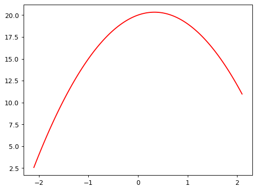
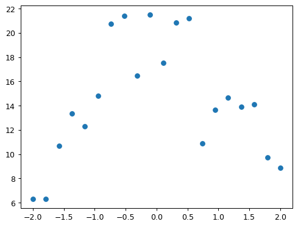
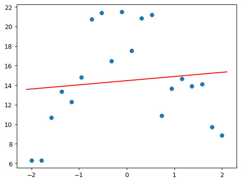
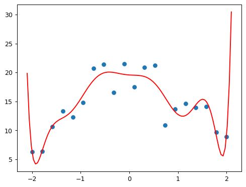
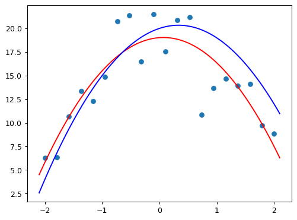
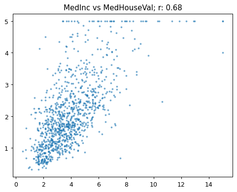
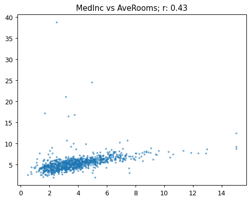
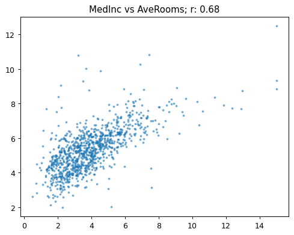
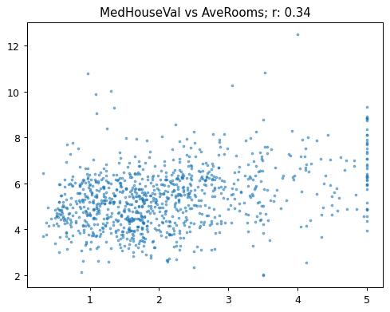
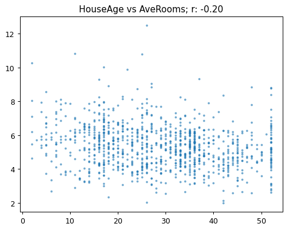

# NLP - Natural Language Processing

Natural Language Processing

Author

Benedict Thekkel

## Initial Checks

``` python
!conda list | grep "pytorch"
```

    ffmpeg                    4.3                  hf484d3e_0    pytorch
    libjpeg-turbo             2.0.0                h9bf148f_0    pytorch
    pytorch                   2.0.1           py3.11_cuda11.8_cudnn8.7.0_0    pytorch
    pytorch-cuda              11.8                 h7e8668a_5    pytorch
    pytorch-ignite            0.4.12                   pypi_0    pypi
    pytorch-lightning         2.0.7                    pypi_0    pypi
    pytorch-mutex             1.0                        cuda    pytorch
    torchaudio                2.0.2               py311_cu118    pytorch
    torchtriton               2.0.0                     py311    pytorch
    torchvision               0.15.2              py311_cu118    pytorch

``` python
!pip list | grep "fastai" 
!pip list | grep "fastbook"
!pip list | grep "ipywidgets"
```

    fastai                        2.7.12
    fastbook                      0.0.28
    ipywidgets                    8.0.4

``` python
import torch
```

``` python
torch.cuda.is_available()
```

    True

``` python
torch.cuda.device_count()
```

    1

``` python
torch.cuda.get_device_capability()
```

    (7, 5)

``` python
torch.cuda.current_device()
```

    0

``` python
import ctypes
libc = ctypes.CDLL("libc.so.6") # clearing cache 
libc.malloc_trim(0)
```

    1

``` python
import gc
import torch
torch.cuda.empty_cache()
gc.collect()
```

    11

``` python
for name in dir():
    if not name.startswith('_'):
        del globals()[name]
```

in the book, doing NLP using RNNs (recurrent neural networks).

We are using transformers, using Hugging Face Transformers.

1.  Wikitext - Language Model
2.  IMDb - Language Model - use wikitest as pretraining
3.  IMDb - Classifier - use IMDb as pretraining

``` sh
!pip install kaggle
```

## Kaggle setup

``` python
import os

# for working with paths in Python, I recommend using `pathlib.Path`
from pathlib import Path
```

``` python
iskaggle = os.environ.get('KAGGLE_KERNEL_RUN_TYPE', '')

creds = '{"username":"bensonthekkel","key":"5d0c64462ee63521393fead641685ce8"}'

cred_path = Path('~/.kaggle/kaggle.json').expanduser()
if not cred_path.exists():
    cred_path.parent.mkdir(exist_ok=True)
    cred_path.write_text(creds)
    cred_path.chmod(0o600)
```

``` python
from nbdevAuto.functions import kaggle_competition_download
from pathlib import Path
```

``` python
name = 'us-patent-phrase-to-phrase-matching'
dataPath = Path(f'./Data/{name}')

kaggle_competition_download(name)
```

    file exists

## Need libraries for data science

1.  Numpy
2.  Matplotlib
3.  pandas
4.  pytorch

``` python
import pandas as pd
```

``` python
df = pd.read_csv(dataPath/'train.csv')
df
```

|       | id               | anchor       | target                 | context | score |
|-------|------------------|--------------|------------------------|---------|-------|
| 0     | 37d61fd2272659b1 | abatement    | abatement of pollution | A47     | 0.50  |
| 1     | 7b9652b17b68b7a4 | abatement    | act of abating         | A47     | 0.75  |
| 2     | 36d72442aefd8232 | abatement    | active catalyst        | A47     | 0.25  |
| 3     | 5296b0c19e1ce60e | abatement    | eliminating process    | A47     | 0.50  |
| 4     | 54c1e3b9184cb5b6 | abatement    | forest region          | A47     | 0.00  |
| ...   | ...              | ...          | ...                    | ...     | ...   |
| 36468 | 8e1386cbefd7f245 | wood article | wooden article         | B44     | 1.00  |
| 36469 | 42d9e032d1cd3242 | wood article | wooden box             | B44     | 0.50  |
| 36470 | 208654ccb9e14fa3 | wood article | wooden handle          | B44     | 0.50  |
| 36471 | 756ec035e694722b | wood article | wooden material        | B44     | 0.75  |
| 36472 | 8d135da0b55b8c88 | wood article | wooden substrate       | B44     | 0.50  |

36473 rows × 5 columns

``` python
df.describe(include='object')
```

|        | id               | anchor                      | target      | context |
|--------|------------------|-----------------------------|-------------|---------|
| count  | 36473            | 36473                       | 36473       | 36473   |
| unique | 36473            | 733                         | 29340       | 106     |
| top    | 37d61fd2272659b1 | component composite coating | composition | H01     |
| freq   | 1                | 152                         | 24          | 2186    |

``` python
df['input'] = 'TEXT1: ' + df.context + '; TEXT2: ' + df.target + '; ANC1: ' + df.anchor
```

``` python
df.input.head()
```

    0    TEXT1: A47; TEXT2: abatement of pollution; ANC...
    1    TEXT1: A47; TEXT2: act of abating; ANC1: abate...
    2    TEXT1: A47; TEXT2: active catalyst; ANC1: abat...
    3    TEXT1: A47; TEXT2: eliminating process; ANC1: ...
    4    TEXT1: A47; TEXT2: forest region; ANC1: abatement
    Name: input, dtype: object

## Tokenization

``` python
from datasets import Dataset,DatasetDict
from transformers import AutoModelForSequenceClassification,AutoTokenizer
```

``` python
ds = Dataset.from_pandas(df)
ds
```

    Dataset({
        features: ['id', 'anchor', 'target', 'context', 'score', 'input'],
        num_rows: 36473
    })

``` python
model_nm = 'microsoft/deberta-v3-small'
tokz = AutoTokenizer.from_pretrained(model_nm)
tokz.tokenize("G'day folks, I'm Jeremy from fast.ai!")
```

    Special tokens have been added in the vocabulary, make sure the associated word embeddings are fine-tuned or trained.
    /home/ben/mambaforge/envs/cfast/lib/python3.11/site-packages/transformers/convert_slow_tokenizer.py:470: UserWarning: The sentencepiece tokenizer that you are converting to a fast tokenizer uses the byte fallback option which is not implemented in the fast tokenizers. In practice this means that the fast version of the tokenizer can produce unknown tokens whereas the sentencepiece version would have converted these unknown tokens into a sequence of byte tokens matching the original piece of text.
      warnings.warn(
    Special tokens have been added in the vocabulary, make sure the associated word embeddings are fine-tuned or trained.

    ['▁G',
     "'",
     'day',
     '▁folks',
     ',',
     '▁I',
     "'",
     'm',
     '▁Jeremy',
     '▁from',
     '▁fast',
     '.',
     'ai',
     '!']

``` python
tokz.tokenize("A platypus is an ornithorhynchus anatinus.")
```

    ['▁A',
     '▁platypus',
     '▁is',
     '▁an',
     '▁or',
     'ni',
     'tho',
     'rhynch',
     'us',
     '▁an',
     'at',
     'inus',
     '.']

``` python
def tok_func(x): return tokz(x["input"])
```

``` python
tok_ds = ds.map(tok_func, batched=True)
```

``` python
row = tok_ds[0]
row['input'], row['input_ids']
```

    ('TEXT1: A47; TEXT2: abatement of pollution; ANC1: abatement',
     [1,
      54453,
      435,
      294,
      336,
      5753,
      346,
      54453,
      445,
      294,
      47284,
      265,
      6435,
      346,
      23702,
      435,
      294,
      47284,
      2])

``` python
tokz.vocab['\u2581of']
```

    265

``` python
tok_ds = tok_ds.rename_columns({'score':'labels'})
```

``` python
eval_df = pd.read_csv(dataPath/'test.csv')
eval_df.describe()
```

|        | id               | anchor     | target                        | context |
|--------|------------------|------------|-------------------------------|---------|
| count  | 36               | 36         | 36                            | 36      |
| unique | 36               | 34         | 36                            | 29      |
| top    | 4112d61851461f60 | el display | inorganic photoconductor drum | G02     |
| freq   | 1                | 2          | 1                             | 3       |

``` python
dds = tok_ds.train_test_split(0.25, seed=42)
dds
```

    DatasetDict({
        train: Dataset({
            features: ['id', 'anchor', 'target', 'context', 'labels', 'input', 'input_ids', 'token_type_ids', 'attention_mask'],
            num_rows: 27354
        })
        test: Dataset({
            features: ['id', 'anchor', 'target', 'context', 'labels', 'input', 'input_ids', 'token_type_ids', 'attention_mask'],
            num_rows: 9119
        })
    })

``` python
eval_df['input'] = 'TEXT1: ' + eval_df.context + '; TEXT2: ' + eval_df.target + '; ANC1: ' + eval_df.anchor
eval_ds = Dataset.from_pandas(eval_df).map(tok_func, batched=True)
```

## Understanding Overfitting

``` python
from fastAIcourse.neuralnet import *
```

``` python
def f(x): return -3*x**2 + 2*x + 20
```

``` python
plot_function(f)
```



``` python
from numpy.random import normal,seed,uniform
import numpy as np
import matplotlib.pyplot as plt
```

``` python
np.random.seed(42)
```

``` python
def noise(x, scale): return normal(scale=scale, size=x.shape)
def add_noise(x, mult, add): return x * (1+noise(x,mult)) + noise(x,add)
```

``` python
x = np.linspace(-2, 2, num=20)[:,None]
y = add_noise(f(x), 0.2, 1.3)
plt.scatter(x,y);
```



``` python
from sklearn.linear_model import LinearRegression
from sklearn.preprocessing import PolynomialFeatures
from sklearn.pipeline import make_pipeline
```

``` python
def plot_poly(degree):
    model = make_pipeline(PolynomialFeatures(degree), LinearRegression())
    model.fit(x, y)
    plt.scatter(x,y)
    plot_function(model.predict)
```

``` python
plot_poly(1)
```



``` python
plot_poly(10)
```



``` python
plot_poly(2)
plot_function(f, color='b')
```



## Validation Set

FastAI always uses a validation set. HUgging face is also good

### Creating a good validation set

- be careful of randow data split (sin functions)
- be careful of cross-validation
- be careful of overfitting in the validation set

### Test set

- basically another validation set
- ex. trying 180 models will give you a good accuracy for some validation set by chance or coincidence
- Hence, test set for the real test

Metrics - accruacy - error - pearson correlation coefficient

`metrics is not same as loss function` - loss function used for calculating gradient descent - if using accuracy, function is too bumpy - we want a function that is nice and smooth like average absolute error, mean absolute error

loss function - average absolute error - mean absolute error

In real life, trial and error

## Pearson Correlation Coefficient

``` python
from sklearn.datasets import fetch_california_housing
```

``` python
housing = fetch_california_housing(as_frame=True)
housing = housing['data'].join(housing['target']).sample(1000, random_state=52)
housing.head()
```

|  | MedInc | HouseAge | AveRooms | AveBedrms | Population | AveOccup | Latitude | Longitude | MedHouseVal |
|----|----|----|----|----|----|----|----|----|----|
| 7506 | 3.0550 | 37.0 | 5.152778 | 1.048611 | 729.0 | 5.062500 | 33.92 | -118.28 | 1.054 |
| 4720 | 3.0862 | 35.0 | 4.697897 | 1.055449 | 1159.0 | 2.216061 | 34.05 | -118.37 | 3.453 |
| 12888 | 2.5556 | 24.0 | 4.864905 | 1.129222 | 1631.0 | 2.395007 | 38.66 | -121.35 | 1.057 |
| 13344 | 3.0057 | 32.0 | 4.212687 | 0.936567 | 1378.0 | 5.141791 | 34.05 | -117.64 | 0.969 |
| 7173 | 1.9083 | 42.0 | 3.888554 | 1.039157 | 1535.0 | 4.623494 | 34.05 | -118.19 | 1.192 |

``` python
np.set_printoptions(precision=2, suppress=True)
np.corrcoef(housing, rowvar=False)
```

    array([[ 1.  , -0.12,  0.43, -0.08,  0.01, -0.07, -0.12,  0.04,  0.68],
           [-0.12,  1.  , -0.17, -0.06, -0.31,  0.  ,  0.03, -0.13,  0.12],
           [ 0.43, -0.17,  1.  ,  0.76, -0.09, -0.07,  0.12, -0.03,  0.21],
           [-0.08, -0.06,  0.76,  1.  , -0.08, -0.07,  0.09,  0.  , -0.04],
           [ 0.01, -0.31, -0.09, -0.08,  1.  ,  0.16, -0.15,  0.13,  0.  ],
           [-0.07,  0.  , -0.07, -0.07,  0.16,  1.  , -0.16,  0.17, -0.27],
           [-0.12,  0.03,  0.12,  0.09, -0.15, -0.16,  1.  , -0.93, -0.16],
           [ 0.04, -0.13, -0.03,  0.  ,  0.13,  0.17, -0.93,  1.  , -0.03],
           [ 0.68,  0.12,  0.21, -0.04,  0.  , -0.27, -0.16, -0.03,  1.  ]])

``` python
np.corrcoef(housing.MedInc, housing.MedHouseVal)
```

    array([[1.  , 0.68],
           [0.68, 1.  ]])

``` python
def corr(x,y): return np.corrcoef(x,y)[0][1]

def show_corr(df, a, b):
    x,y = df[a],df[b]
    plt.scatter(x,y, alpha=0.5, s=4)
    plt.title(f'{a} vs {b}; r: {corr(x, y):.2f}')
```

``` python
corr(housing.MedInc, housing.MedHouseVal)
show_corr(housing, 'MedInc', 'MedHouseVal')
```



``` python
show_corr(housing, 'MedInc', 'AveRooms')
```



``` python
subset = housing[housing.AveRooms<15]
show_corr(subset, 'MedInc', 'AveRooms')
```



``` python
show_corr(subset, 'MedHouseVal', 'AveRooms')
```



``` python
show_corr(subset, 'HouseAge', 'AveRooms')
```



``` python
def corr_d(eval_pred): return {'pearson': corr(*eval_pred)}
```

## Training our Model

To train a model in Transformers we’ll need this:

``` python
from transformers import TrainingArguments,Trainer
```

    comet_ml is installed but `COMET_API_KEY` is not set.

We pick a batch size that fits our GPU, and small number of epochs so we can run experiments quickly:

``` python
bs = 128
epochs = 5
```

The most important hyperparameter is the learning rate. fastai provides a learning rate finder to help you figure this out, but Transformers doesn’t, so you’ll just have to use trial and error. The idea is to find the largest value you can, but which doesn’t result in training failing.

``` python
lr = 8e-5
```

Transformers uses the TrainingArguments class to set up arguments. Don’t worry too much about the values we’re using here – they should generally work fine in most cases. It’s just the 3 parameters above that you may need to change for different models.

``` python
args = TrainingArguments('outputs', learning_rate=lr,
                         warmup_ratio=0.1,
                         lr_scheduler_type='cosine',
                         fp16=True,
                         evaluation_strategy="epoch",
                         per_device_train_batch_size=bs,
                         per_device_eval_batch_size=bs*2,
                         num_train_epochs=epochs,
                         weight_decay=0.01,
                         report_to='none'
                        )
```

We can now create our model, and Trainer, which is a class which combines the data and model together (just like Learner in fastai):

``` python
model = AutoModelForSequenceClassification.from_pretrained(model_nm,
                                                           num_labels=1
                                                          )
trainer = Trainer(model,
                  args,
                  train_dataset=dds['train'],
                  eval_dataset=dds['test'],
                  tokenizer=tokz,
                  compute_metrics=corr_d
                 )
```

    Some weights of DebertaV2ForSequenceClassification were not initialized from the model checkpoint at microsoft/deberta-v3-small and are newly initialized: ['pooler.dense.weight', 'pooler.dense.bias', 'classifier.bias', 'classifier.weight']
    You should probably TRAIN this model on a down-stream task to be able to use it for predictions and inference.

``` python
trainer.train();
```

    You're using a DebertaV2TokenizerFast tokenizer. Please note that with a fast tokenizer, using the `__call__` method is faster than using a method to encode the text followed by a call to the `pad` method to get a padded encoding.

\[1070/1070 18:00, Epoch 5/5\]

| Epoch | Training Loss | Validation Loss | Pearson  |
|-------|---------------|-----------------|----------|
| 1     | No log        | 0.026321        | 0.802121 |
| 2     | No log        | 0.021985        | 0.819910 |
| 3     | 0.030600      | 0.021005        | 0.832954 |
| 4     | 0.030600      | 0.022370        | 0.836500 |
| 5     | 0.012300      | 0.022081        | 0.836393 |

``` python
preds = trainer.predict(eval_ds).predictions.astype(float)
preds
```

    array([[ 0.47],
           [ 0.57],
           [ 0.55],
           [ 0.36],
           [-0.05],
           [ 0.53],
           [ 0.53],
           [-0.03],
           [ 0.32],
           [ 1.12],
           [ 0.22],
           [ 0.24],
           [ 0.77],
           [ 0.96],
           [ 0.76],
           [ 0.39],
           [ 0.33],
           [-0.01],
           [ 0.65],
           [ 0.4 ],
           [ 0.48],
           [ 0.26],
           [ 0.17],
           [ 0.26],
           [ 0.56],
           [-0.03],
           [-0.04],
           [-0.04],
           [-0.05],
           [ 0.57],
           [ 0.32],
           [-0.03],
           [ 0.7 ],
           [ 0.49],
           [ 0.43],
           [ 0.22]])

``` python
preds = np.clip(preds, 0, 1)
```

``` python
preds
```

    array([[0.47],
           [0.57],
           [0.55],
           [0.36],
           [0.  ],
           [0.53],
           [0.53],
           [0.  ],
           [0.32],
           [1.  ],
           [0.22],
           [0.24],
           [0.77],
           [0.96],
           [0.76],
           [0.39],
           [0.33],
           [0.  ],
           [0.65],
           [0.4 ],
           [0.48],
           [0.26],
           [0.17],
           [0.26],
           [0.56],
           [0.  ],
           [0.  ],
           [0.  ],
           [0.  ],
           [0.57],
           [0.32],
           [0.  ],
           [0.7 ],
           [0.49],
           [0.43],
           [0.22]])

``` python
import datasets
```

``` python
submission = datasets.Dataset.from_dict({
    'id': eval_ds['id'],
    'score': preds
})

submission.to_csv('Data/submission.csv', index=False)
```

    853

Back to top
