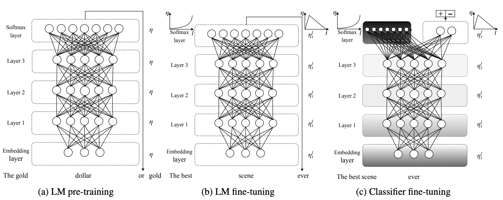
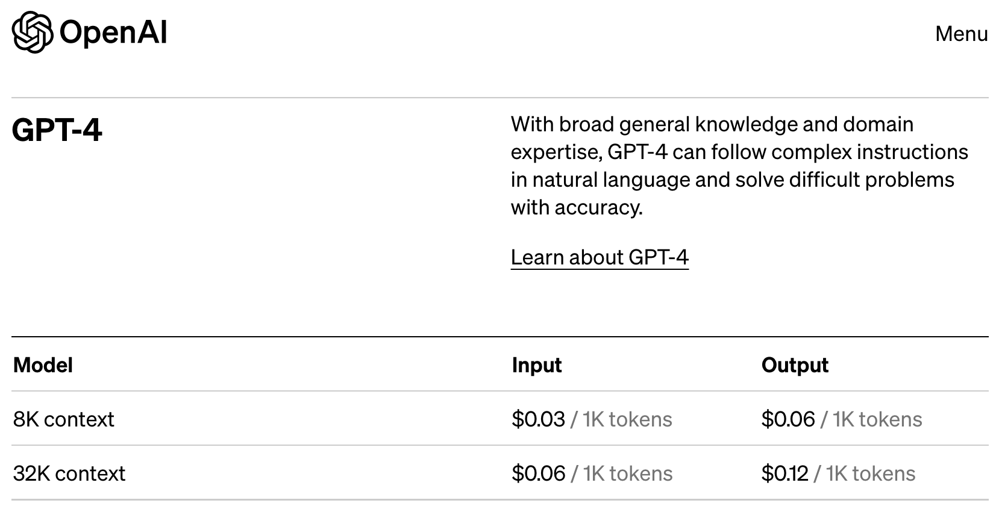
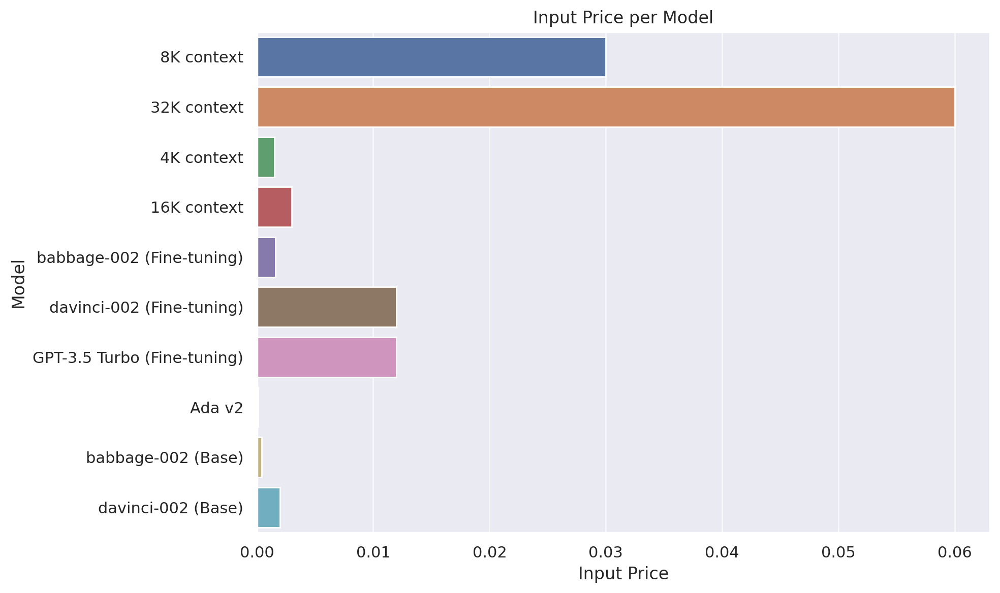

# A hacker’s guide to Language Models

What LLMs are and how to actually use them

Author

Benedict Thekkel

``` python
import tokenize, ast
from io import BytesIO
```

## What is a language model?

[course.fast.ai](https://course.fast.ai)

### Base models

[nat.dev text-davinci-003](https://nat.dev/)

*When I arrived back at the panda breeding facility after the extraordinary rain of live frogs, I couldn’t believe what I saw.*

### Tokens

``` python
from tiktoken import encoding_for_model
enc = encoding_for_model("text-davinci-003")
toks = enc.encode("They are splashing")
toks
```

    [2990, 389, 4328, 2140]

``` python
[enc.decode_single_token_bytes(o).decode('utf-8') for o in toks]
```

    ['They', ' are', ' spl', 'ashing']

### The ULMFiT 3-step approach



- Trained on Wikipedia
- “The Birds is a 1963 American natural horror-thriller film produced and directed by Alfred …”
- “Annie previously dated Mitch but ended it due to Mitch’s cold, overbearing mother, Lydia, who dislikes any woman in Mitch’s …”
- This is a form of compression

### Instruction tuning

[OpenOrca](https://huggingface.co/datasets/Open-Orca/OpenOrca)

- “Does the sentence”In the Iron Age” answer the question “The period of time from 1200 to 1000 BCE is known as what?” Available choices: 1. yes 2. no”
- “Question: who is the girl in more than you know? Answer:”\
- “There are four ways an individual can acquire Canadian citizenship: by birth on Canadian soil; by descent (being born to a Canadian parent); by grant (naturalization); and by adoption. Among them, only citizenship by birth is granted automatically with limited exceptions, while citizenship by descent or adoption is acquired automatically if the specified conditions have been met. Citizenship by grant, on the other hand, must be approved by the Minister of Immigration, Refugees and Citizenship. See options at the end. Can we conclude that can i get canadian citizenship if my grandfather was canadian? pick from the following. A). no. B). yes.”

### RLHF and friends

- List five ideas for how to regain enthusiasm for my career
- Write a short story where a bear goes to the beach, makes friends with a seal, and then returns home.
- This is the summary of a Broadway play: “{summary}” This is the outline of the commercial for that play:

## Start with ChatGPT GPT 4

### What GPT 4 can do

[GPT 4 can’t reason - paper](https://arxiv.org/abs/2308.03762)

[GPT 4 can’t reason - test](https://chat.openai.com/share/4211a605-751e-4fea-8a6f-378966abdcaa)

[Basic reasoning 1](https://chat.openai.com/share/323bb7d1-f049-4d9a-a905-5dd5acb58fc0)

[Basic reasoning 2](https://chat.openai.com/share/ce2f8580-4f66-4da4-8ad5-a303334706f0)


> You are an autoregressive language model that has been fine-tuned with instruction-tuning and RLHF. You carefully provide accurate, factual, thoughtful, nuanced answers, and are brilliant at reasoning. If you think there might not be a correct answer, you say so.
>
> Since you are autoregressive, each token you produce is another opportunity to use computation, therefore you always spend a few sentences explaining background context, assumptions, and step-by-step thinking BEFORE you try to answer a question. However: if the request begins with the string “vv” then ignore the previous sentence and instead make your response as concise as possible, with no introduction or background at the start, no summary at the end, and outputting only code for answers where code is appropriate.
>
> Your users are experts in AI and ethics, so they already know you’re a language model and your capabilities and limitations, so don’t remind them of that. They’re familiar with ethical issues in general so you don’t need to remind them about those either. Don’t be verbose in your answers, but do provide details and examples where it might help the explanation. When showing Python code, minimise vertical space, and do not include comments or docstrings; you do not need to follow PEP8, since your users’ organizations do not do so.

[Verbose mode](https://chat.openai.com/share/a1c16d93-19d2-41bb-a2f1-2fc05392893a)

[Brief mode](https://chat.openai.com/share/eab33d0a-8d06-4387-8c31-da12ad5d0a9d)

### What GPT 4 can’t do

- Hallucinations
- It doesn’t know about itself. (Why not?)
- It doesn’t know about URLs.
- Knowledge cutoff

[Bad pattern recognition](https://chat.openai.com/share/3051f878-2817-4291-a66f-192ce7b0cb34) - thanks to Steve Newman

- [Fixing it](https://chat.openai.com/share/05abd87a-165e-4b7b-895f-b4ec0d62e0e1)

### Advanced data analysis

[re.split try 1](https://chat.openai.com/share/143a0f09-bd3e-488f-8890-340d3f30afec)

[re.split try 2](https://chat.openai.com/share/907ca9c7-549a-410f-9ecb-0f17f1a16f51)

[OCR](https://chat.openai.com/share/2bb6caad-fd10-438b-9d92-1cb8b340998a)

- See also Bard



| Model                  | Training | Input  | Output Usage |
|------------------------|----------|--------|--------------|
| **GPT-4**              |          |        |              |
| 8K context             |          | 0.03   | 0.06         |
| 32K context            |          | 0.06   | 0.12         |
| **GPT-3.5 Turbo**      |          |        |              |
| 4K context             |          | 0.0015 | 0.002        |
| 16K context            |          | 0.003  | 0.004        |
| **Fine-tuning models** |          |        |              |
| babbage-002            | 0.0004   | 0.0016 | 0.0016       |
| davinci-002            | 0.0060   | 0.0120 | 0.0120       |
| GPT-3.5 Turbo          | 0.0080   | 0.0120 | 0.0160       |
| **Embedding models**   |          |        |              |
| Ada v2                 |          | 0.0001 |              |
| **Base models**        |          |        |              |
| babbage-002            |          | 0.0004 |              |
| davinci-002            |          | 0.0020 |              |



[Create pricing table](https://chat.openai.com/share/86b879bd-7834-4a37-85ae-c90b956837d2)

## The OpenAI API

``` python
from openai import ChatCompletion,Completion
```

``` python
aussie_sys = "You are an Aussie LLM that uses Aussie slang and analogies whenever possible."

c = ChatCompletion.create(
    model="gpt-3.5-turbo",
    messages=[{"role": "system", "content": aussie_sys},
              {"role": "user", "content": "What is money?"}])
```

- [Model options](https://platform.openai.com/docs/models)

``` python
c['choices'][0]['message']['content']
```

``` python
from fastcore.utils import nested_idx
```

``` python
def response(compl): print(nested_idx(compl, 'choices', 0, 'message', 'content'))
```

``` python
response(c)
```

``` python
print(c.usage)
```

``` python
0.002 / 1000 * 150 # GPT 3.5
```

``` python
0.03 / 1000 * 150 # GPT 4
```

``` python
c = ChatCompletion.create(
    model="gpt-3.5-turbo",
    messages=[{"role": "system", "content": aussie_sys},
              {"role": "user", "content": "What is money?"},
              {"role": "assistant", "content": "Well, mate, money is like kangaroos actually."},
              {"role": "user", "content": "Really? In what way?"}])
```

``` python
response(c)
```

``` python
def askgpt(user, system=None, model="gpt-3.5-turbo", **kwargs):
    msgs = []
    if system: msgs.append({"role": "system", "content": system})
    msgs.append({"role": "user", "content": user})
    return ChatCompletion.create(model=model, messages=msgs, **kwargs)
```

``` python
response(askgpt('What is the meaning of life?', system=aussie_sys))
```

- [Limits](https://platform.openai.com/docs/guides/rate-limits/what-are-the-rate-limits-for-our-api)

Created by Bing:

``` python
def call_api(prompt, model="gpt-3.5-turbo"):
    msgs = [{"role": "user", "content": prompt}]
    try: return ChatCompletion.create(model=model, messages=msgs)
    except openai.error.RateLimitError as e:
        retry_after = int(e.headers.get("retry-after", 60))
        print(f"Rate limit exceeded, waiting for {retry_after} seconds...")
        time.sleep(retry_after)
        return call_api(params, model=model)
```

``` python
call_api("What's the world's funniest joke? Has there ever been any scientific analysis?")
```

``` python
c = Completion.create(prompt="Australian Jeremy Howard is ",
                      model="gpt-3.5-turbo-instruct", echo=True, logprobs=5)
```

### Create our own code interpreter

``` python
from pydantic import create_model
import inspect, json
from inspect import Parameter
```

``` python
def sums(a:int, b:int=1):
    "Adds a + b"
    return a + b
```

``` python
def schema(f):
    kw = {n:(o.annotation, ... if o.default==Parameter.empty else o.default)
          for n,o in inspect.signature(f).parameters.items()}
    s = create_model(f'Input for `{f.__name__}`', **kw).schema()
    return dict(name=f.__name__, description=f.__doc__, parameters=s)
```

``` python
schema(sums)
```

``` python
c = askgpt("Use the `sum` function to solve this: What is 6+3?",
           system = "You must use the `sum` function instead of adding yourself.",
           functions=[schema(sums)])
```

``` python
m = c.choices[0].message
m
```

``` python
k = m.function_call.arguments
print(k)
```

``` python
funcs_ok = {'sums', 'python'}
```

``` python
def call_func(c):
    fc = c.choices[0].message.function_call
    if fc.name not in funcs_ok: return print(f'Not allowed: {fc.name}')
    f = globals()[fc.name]
    return f(**json.loads(fc.arguments))
```

``` python
call_func(c)
```

``` python
def run(code):
    tree = ast.parse(code)
    last_node = tree.body[-1] if tree.body else None
    
    # If the last node is an expression, modify the AST to capture the result
    if isinstance(last_node, ast.Expr):
        tgts = [ast.Name(id='_result', ctx=ast.Store())]
        assign = ast.Assign(targets=tgts, value=last_node.value)
        tree.body[-1] = ast.fix_missing_locations(assign)

    ns = {}
    exec(compile(tree, filename='<ast>', mode='exec'), ns)
    return ns.get('_result', None)
```

``` python
run("""
a=1
b=2
a+b
""")
```

``` python
def python(code:str):
    "Return result of executing `code` using python. If execution not permitted, returns `#FAIL#`"
    go = input(f'Proceed with execution?\n```\n{code}\n```\n')
    if go.lower()!='y': return '#FAIL#'
    return run(code)
```

``` python
c = askgpt("What is 12 factorial?",
           system = "Use python for any required computations.",
           functions=[schema(python)])
```

``` python
call_func(c)
```

``` python
c = ChatCompletion.create(
    model="gpt-3.5-turbo",
    functions=[schema(python)],
    messages=[{"role": "user", "content": "What is 12 factorial?"},
              {"role": "function", "name": "python", "content": "479001600"}])
```

``` python
response(c)
```

``` python
c = askgpt("What is the capital of France?",
           system = "Use python for any required computations.",
           functions=[schema(python)])
```

``` python
response(c)
```

## PyTorch and Huggingface

### Your GPU options

Free:

- Kaggle (2 GPUs, low RAM)
- Colab

Buy:

- Buy 1-2 NVIDIA 24GB GPUs
  - GTX 3090 used (USD700-USD800), or 4090 new (USD2000)
- Alternatively buy one NVIDIA A6000 with 48GB RAM (but this mightn’t be faster than 3090/4090)
- Mac with lots of RAM (much slower than NVIDIA; M2 Ultra is best)

``` python
from transformers import AutoModelForCausalLM,AutoTokenizer
import torch
```

- [HF leaderboard](https://huggingface.co/spaces/HuggingFaceH4/open_llm_leaderboard)
- [fasteval](https://fasteval.github.io/FastEval/)

``` python
mn = "meta-llama/Llama-2-7b-hf"
```

``` python
model = AutoModelForCausalLM.from_pretrained(mn, device_map=0, load_in_8bit=True)
```

``` python
tokr = AutoTokenizer.from_pretrained(mn)
prompt = "Jeremy Howard is a "
toks = tokr(prompt, return_tensors="pt")
```

``` python
toks
```

``` python
tokr.batch_decode(toks['input_ids'])
```

``` python
res = model.generate(**toks.to("cuda"), max_new_tokens=15).to('cpu')
res
```

``` python
tokr.batch_decode(res)
```

``` python
model = AutoModelForCausalLM.from_pretrained(mn, device_map=0, torch_dtype=torch.bfloat16)
```

``` python
%%time
#| eval: false
res = model.generate(**toks.to("cuda"), max_new_tokens=15).to('cpu')
res
```

``` python
model = AutoModelForCausalLM.from_pretrained('TheBloke/Llama-2-7b-Chat-GPTQ', device_map=0, torch_dtype=torch.float16)
```

``` python
%%time
#| eval: false
res = model.generate(**toks.to("cuda"), max_new_tokens=15).to('cpu')
res
```

``` python
mn = 'TheBloke/Llama-2-13B-GPTQ'
model = AutoModelForCausalLM.from_pretrained(mn, device_map=0, torch_dtype=torch.bfloat16)
```

``` python
%%time
#| eval: false
res = model.generate(**toks.to("cuda"), max_new_tokens=15).to('cpu')
res
```

``` python
def gen(p, maxlen=15, sample=True):
    toks = tokr(p, return_tensors="pt")
    res = model.generate(**toks.to("cuda"), max_new_tokens=maxlen, do_sample=sample).to('cpu')
    return tokr.batch_decode(res)
```

``` python
gen(prompt, 50)
```

[StableBeluga-7B](https://huggingface.co/stabilityai/StableBeluga-7B)

``` python
mn = "stabilityai/StableBeluga-7B"

model = AutoModelForCausalLM.from_pretrained(mn, device_map=0, torch_dtype=torch.bfloat16)
```

``` python
sb_sys = "### System:\nYou are Stable Beluga, an AI that follows instructions extremely well. Help as much as you can.\n\n"
```

``` python
def mk_prompt(user, syst=sb_sys): return f"{syst}### User: {user}\n\n### Assistant:\n"
```

``` python
ques = "Who is Jeremy Howard?"
```

``` python
gen(mk_prompt(ques), 150)
```

[OpenOrca/Platypus 2](https://huggingface.co/Open-Orca/OpenOrca-Platypus2-13B)

``` python
mn = 'TheBloke/OpenOrca-Platypus2-13B-GPTQ'
model = AutoModelForCausalLM.from_pretrained(mn, device_map=0, torch_dtype=torch.float16)
```

``` python
def mk_oo_prompt(user): return f"### Instruction: {user}\n\n### Response:\n"
```

``` python
gen(mk_oo_prompt(ques), 150)
```

### Retrieval augmented generation

``` python
from wikipediaapi import Wikipedia
```

``` python
wiki = Wikipedia('JeremyHowardBot/0.0', 'en')
jh_page = wiki.page('Jeremy_Howard_(entrepreneur)').text
jh_page = jh_page.split('\nReferences\n')[0]
```

``` python
print(jh_page[:500])
```

``` python
len(jh_page.split())
```

``` python
ques = "Who is Jeremy Howard"
```

``` python
ques_ctx = f"""Answer the question with the help of the provided context.

## Context

{jh_page}

## Question

{ques}"""
```

``` python
res = gen(mk_prompt(ques_ctx), 300)
```

``` python
print(res[0].split('### Assistant:\n')[1])
```

``` python
from sentence_transformers import SentenceTransformer
```

``` python
emb_model = SentenceTransformer("BAAI/bge-small-en-v1.5", device=0)
```

``` python
jh = jh_page.split('\n\n')[0]
print(jh)
```

``` python
tb_page = wiki.page('Tony_Blair').text.split('\nReferences\n')[0]
```

``` python
tb = tb_page.split('\n\n')[0]
print(tb[:380])
```

``` python
q_emb,jh_emb,tb_emb = emb_model.encode([ques,jh,tb], convert_to_tensor=True)
```

``` python
tb_emb.shape
```

``` python
import torch.nn.functional as F
```

``` python
F.cosine_similarity(q_emb, jh_emb, dim=0)
```

``` python
F.cosine_similarity(q_emb, tb_emb, dim=0)
```

### Private GPTs

- [Sooo many](https://github.com/h2oai/h2ogpt/blob/main/docs/README_LangChain.md#what-is-h2ogpts-langchain-integration-like)

## Fine tuning

``` python
import datasets
```

[knowrohit07/know_sql](https://huggingface.co/datasets/knowrohit07/know_sql)

``` python
ds = datasets.load_dataset('knowrohit07/know_sql', revision='f33425d13f9e8aab1b46fa945326e9356d6d5726')
```

``` python
ds
```

``` python
trn = ds['train']
trn[3]
```

`accelerate launch -m axolotl.cli.train sql.yml`

``` python
tst = dict(**trn[3])
tst['question'] = 'Get the count of competition hosts by theme.'
tst
```

``` python
fmt = """SYSTEM: Use the following contextual information to concisely answer the question.

USER: {}
===
{}
ASSISTANT:"""
```

``` python
def sql_prompt(d): return fmt.format(d["context"], d["question"])
```

``` python
print(sql_prompt(tst))
```

``` python
import torch
from peft import PeftModel
from transformers import AutoTokenizer, AutoModelForCausalLM, BitsAndBytesConfig
```

``` python
ax_model = '/home/jhoward/git/ext/axolotl/qlora-out'
```

``` python
tokr = AutoTokenizer.from_pretrained('meta-llama/Llama-2-7b-hf')
```

``` python
model = AutoModelForCausalLM.from_pretrained('meta-llama/Llama-2-7b-hf',
                                             torch_dtype=torch.bfloat16, device_map=0)
model = PeftModel.from_pretrained(model, ax_model)
model = model.merge_and_unload()
model.save_pretrained('sql-model')
```

``` python
toks = tokr(sql_prompt(tst), return_tensors="pt")
```

``` python
res = model.generate(**toks.to("cuda"), max_new_tokens=250).to('cpu')
```

``` python
print(tokr.batch_decode(res)[0])
```

## [llama.cpp](https://github.com/abetlen/llama-cpp-python)

[TheBloke/Llama-2-7b-Chat-GGUF](https://huggingface.co/TheBloke/Llama-2-7b-Chat-GGUF)

``` python
from llama_cpp import Llama
```

``` python
llm = Llama(model_path="./Data/llama-2-7b-chat.Q2_K.gguf")
```

    llama_model_loader: loaded meta data with 19 key-value pairs and 291 tensors from ./Data/llama-2-7b-chat.Q2_K.gguf (version GGUF V2 (latest))
    llama_model_loader: - tensor    0:                token_embd.weight q2_K     [  4096, 32000,     1,     1 ]
    llama_model_loader: - tensor    1:           blk.0.attn_norm.weight f32      [  4096,     1,     1,     1 ]
    llama_model_loader: - tensor    2:            blk.0.ffn_down.weight q3_K     [ 11008,  4096,     1,     1 ]
    llama_model_loader: - tensor    3:            blk.0.ffn_gate.weight q3_K     [  4096, 11008,     1,     1 ]
    llama_model_loader: - tensor    4:              blk.0.ffn_up.weight q3_K     [  4096, 11008,     1,     1 ]
    llama_model_loader: - tensor    5:            blk.0.ffn_norm.weight f32      [  4096,     1,     1,     1 ]
    llama_model_loader: - tensor    6:              blk.0.attn_k.weight q2_K     [  4096,  4096,     1,     1 ]
    llama_model_loader: - tensor    7:         blk.0.attn_output.weight q3_K     [  4096,  4096,     1,     1 ]
    llama_model_loader: - tensor    8:              blk.0.attn_q.weight q2_K     [  4096,  4096,     1,     1 ]
    llama_model_loader: - tensor    9:              blk.0.attn_v.weight q3_K     [  4096,  4096,     1,     1 ]
    llama_model_loader: - tensor   10:           blk.1.attn_norm.weight f32      [  4096,     1,     1,     1 ]
    llama_model_loader: - tensor   11:            blk.1.ffn_down.weight q3_K     [ 11008,  4096,     1,     1 ]
    llama_model_loader: - tensor   12:            blk.1.ffn_gate.weight q3_K     [  4096, 11008,     1,     1 ]
    llama_model_loader: - tensor   13:              blk.1.ffn_up.weight q3_K     [  4096, 11008,     1,     1 ]
    llama_model_loader: - tensor   14:            blk.1.ffn_norm.weight f32      [  4096,     1,     1,     1 ]
    llama_model_loader: - tensor   15:              blk.1.attn_k.weight q2_K     [  4096,  4096,     1,     1 ]
    llama_model_loader: - tensor   16:         blk.1.attn_output.weight q3_K     [  4096,  4096,     1,     1 ]
    llama_model_loader: - tensor   17:              blk.1.attn_q.weight q2_K     [  4096,  4096,     1,     1 ]
    llama_model_loader: - tensor   18:              blk.1.attn_v.weight q3_K     [  4096,  4096,     1,     1 ]
    llama_model_loader: - tensor   19:          blk.10.attn_norm.weight f32      [  4096,     1,     1,     1 ]
    llama_model_loader: - tensor   20:           blk.10.ffn_down.weight q3_K     [ 11008,  4096,     1,     1 ]
    llama_model_loader: - tensor   21:           blk.10.ffn_gate.weight q3_K     [  4096, 11008,     1,     1 ]
    llama_model_loader: - tensor   22:             blk.10.ffn_up.weight q3_K     [  4096, 11008,     1,     1 ]
    llama_model_loader: - tensor   23:           blk.10.ffn_norm.weight f32      [  4096,     1,     1,     1 ]
    llama_model_loader: - tensor   24:             blk.10.attn_k.weight q2_K     [  4096,  4096,     1,     1 ]
    llama_model_loader: - tensor   25:        blk.10.attn_output.weight q3_K     [  4096,  4096,     1,     1 ]
    llama_model_loader: - tensor   26:             blk.10.attn_q.weight q2_K     [  4096,  4096,     1,     1 ]
    llama_model_loader: - tensor   27:             blk.10.attn_v.weight q3_K     [  4096,  4096,     1,     1 ]
    llama_model_loader: - tensor   28:          blk.11.attn_norm.weight f32      [  4096,     1,     1,     1 ]
    llama_model_loader: - tensor   29:           blk.11.ffn_down.weight q3_K     [ 11008,  4096,     1,     1 ]
    llama_model_loader: - tensor   30:           blk.11.ffn_gate.weight q3_K     [  4096, 11008,     1,     1 ]
    llama_model_loader: - tensor   31:             blk.11.ffn_up.weight q3_K     [  4096, 11008,     1,     1 ]
    llama_model_loader: - tensor   32:           blk.11.ffn_norm.weight f32      [  4096,     1,     1,     1 ]
    llama_model_loader: - tensor   33:             blk.11.attn_k.weight q2_K     [  4096,  4096,     1,     1 ]
    llama_model_loader: - tensor   34:        blk.11.attn_output.weight q3_K     [  4096,  4096,     1,     1 ]
    llama_model_loader: - tensor   35:             blk.11.attn_q.weight q2_K     [  4096,  4096,     1,     1 ]
    llama_model_loader: - tensor   36:             blk.11.attn_v.weight q3_K     [  4096,  4096,     1,     1 ]
    llama_model_loader: - tensor   37:          blk.12.attn_norm.weight f32      [  4096,     1,     1,     1 ]
    llama_model_loader: - tensor   38:           blk.12.ffn_down.weight q3_K     [ 11008,  4096,     1,     1 ]
    llama_model_loader: - tensor   39:           blk.12.ffn_gate.weight q3_K     [  4096, 11008,     1,     1 ]
    llama_model_loader: - tensor   40:             blk.12.ffn_up.weight q3_K     [  4096, 11008,     1,     1 ]
    llama_model_loader: - tensor   41:           blk.12.ffn_norm.weight f32      [  4096,     1,     1,     1 ]
    llama_model_loader: - tensor   42:             blk.12.attn_k.weight q2_K     [  4096,  4096,     1,     1 ]
    llama_model_loader: - tensor   43:        blk.12.attn_output.weight q3_K     [  4096,  4096,     1,     1 ]
    llama_model_loader: - tensor   44:             blk.12.attn_q.weight q2_K     [  4096,  4096,     1,     1 ]
    llama_model_loader: - tensor   45:             blk.12.attn_v.weight q3_K     [  4096,  4096,     1,     1 ]
    llama_model_loader: - tensor   46:          blk.13.attn_norm.weight f32      [  4096,     1,     1,     1 ]
    llama_model_loader: - tensor   47:           blk.13.ffn_down.weight q3_K     [ 11008,  4096,     1,     1 ]
    llama_model_loader: - tensor   48:           blk.13.ffn_gate.weight q3_K     [  4096, 11008,     1,     1 ]
    llama_model_loader: - tensor   49:             blk.13.ffn_up.weight q3_K     [  4096, 11008,     1,     1 ]
    llama_model_loader: - tensor   50:           blk.13.ffn_norm.weight f32      [  4096,     1,     1,     1 ]
    llama_model_loader: - tensor   51:             blk.13.attn_k.weight q2_K     [  4096,  4096,     1,     1 ]
    llama_model_loader: - tensor   52:        blk.13.attn_output.weight q3_K     [  4096,  4096,     1,     1 ]
    llama_model_loader: - tensor   53:             blk.13.attn_q.weight q2_K     [  4096,  4096,     1,     1 ]
    llama_model_loader: - tensor   54:             blk.13.attn_v.weight q3_K     [  4096,  4096,     1,     1 ]
    llama_model_loader: - tensor   55:          blk.14.attn_norm.weight f32      [  4096,     1,     1,     1 ]
    llama_model_loader: - tensor   56:           blk.14.ffn_down.weight q3_K     [ 11008,  4096,     1,     1 ]
    llama_model_loader: - tensor   57:           blk.14.ffn_gate.weight q3_K     [  4096, 11008,     1,     1 ]
    llama_model_loader: - tensor   58:             blk.14.ffn_up.weight q3_K     [  4096, 11008,     1,     1 ]
    llama_model_loader: - tensor   59:           blk.14.ffn_norm.weight f32      [  4096,     1,     1,     1 ]
    llama_model_loader: - tensor   60:             blk.14.attn_k.weight q2_K     [  4096,  4096,     1,     1 ]
    llama_model_loader: - tensor   61:        blk.14.attn_output.weight q3_K     [  4096,  4096,     1,     1 ]
    llama_model_loader: - tensor   62:             blk.14.attn_q.weight q2_K     [  4096,  4096,     1,     1 ]
    llama_model_loader: - tensor   63:             blk.14.attn_v.weight q3_K     [  4096,  4096,     1,     1 ]
    llama_model_loader: - tensor   64:          blk.15.attn_norm.weight f32      [  4096,     1,     1,     1 ]
    llama_model_loader: - tensor   65:           blk.15.ffn_down.weight q3_K     [ 11008,  4096,     1,     1 ]
    llama_model_loader: - tensor   66:           blk.15.ffn_gate.weight q3_K     [  4096, 11008,     1,     1 ]
    llama_model_loader: - tensor   67:             blk.15.ffn_up.weight q3_K     [  4096, 11008,     1,     1 ]
    llama_model_loader: - tensor   68:           blk.15.ffn_norm.weight f32      [  4096,     1,     1,     1 ]
    llama_model_loader: - tensor   69:             blk.15.attn_k.weight q2_K     [  4096,  4096,     1,     1 ]
    llama_model_loader: - tensor   70:        blk.15.attn_output.weight q3_K     [  4096,  4096,     1,     1 ]
    llama_model_loader: - tensor   71:             blk.15.attn_q.weight q2_K     [  4096,  4096,     1,     1 ]
    llama_model_loader: - tensor   72:             blk.15.attn_v.weight q3_K     [  4096,  4096,     1,     1 ]
    llama_model_loader: - tensor   73:          blk.16.attn_norm.weight f32      [  4096,     1,     1,     1 ]
    llama_model_loader: - tensor   74:           blk.16.ffn_down.weight q3_K     [ 11008,  4096,     1,     1 ]
    llama_model_loader: - tensor   75:           blk.16.ffn_gate.weight q3_K     [  4096, 11008,     1,     1 ]
    llama_model_loader: - tensor   76:             blk.16.ffn_up.weight q3_K     [  4096, 11008,     1,     1 ]
    llama_model_loader: - tensor   77:           blk.16.ffn_norm.weight f32      [  4096,     1,     1,     1 ]
    llama_model_loader: - tensor   78:             blk.16.attn_k.weight q2_K     [  4096,  4096,     1,     1 ]
    llama_model_loader: - tensor   79:        blk.16.attn_output.weight q3_K     [  4096,  4096,     1,     1 ]
    llama_model_loader: - tensor   80:             blk.16.attn_q.weight q2_K     [  4096,  4096,     1,     1 ]
    llama_model_loader: - tensor   81:             blk.16.attn_v.weight q3_K     [  4096,  4096,     1,     1 ]
    llama_model_loader: - tensor   82:          blk.17.attn_norm.weight f32      [  4096,     1,     1,     1 ]
    llama_model_loader: - tensor   83:           blk.17.ffn_down.weight q3_K     [ 11008,  4096,     1,     1 ]
    llama_model_loader: - tensor   84:           blk.17.ffn_gate.weight q3_K     [  4096, 11008,     1,     1 ]
    llama_model_loader: - tensor   85:             blk.17.ffn_up.weight q3_K     [  4096, 11008,     1,     1 ]
    llama_model_loader: - tensor   86:           blk.17.ffn_norm.weight f32      [  4096,     1,     1,     1 ]
    llama_model_loader: - tensor   87:             blk.17.attn_k.weight q2_K     [  4096,  4096,     1,     1 ]
    llama_model_loader: - tensor   88:        blk.17.attn_output.weight q3_K     [  4096,  4096,     1,     1 ]
    llama_model_loader: - tensor   89:             blk.17.attn_q.weight q2_K     [  4096,  4096,     1,     1 ]
    llama_model_loader: - tensor   90:             blk.17.attn_v.weight q3_K     [  4096,  4096,     1,     1 ]
    llama_model_loader: - tensor   91:          blk.18.attn_norm.weight f32      [  4096,     1,     1,     1 ]
    llama_model_loader: - tensor   92:           blk.18.ffn_down.weight q3_K     [ 11008,  4096,     1,     1 ]
    llama_model_loader: - tensor   93:           blk.18.ffn_gate.weight q3_K     [  4096, 11008,     1,     1 ]
    llama_model_loader: - tensor   94:             blk.18.ffn_up.weight q3_K     [  4096, 11008,     1,     1 ]
    llama_model_loader: - tensor   95:           blk.18.ffn_norm.weight f32      [  4096,     1,     1,     1 ]
    llama_model_loader: - tensor   96:             blk.18.attn_k.weight q2_K     [  4096,  4096,     1,     1 ]
    llama_model_loader: - tensor   97:        blk.18.attn_output.weight q3_K     [  4096,  4096,     1,     1 ]
    llama_model_loader: - tensor   98:             blk.18.attn_q.weight q2_K     [  4096,  4096,     1,     1 ]
    llama_model_loader: - tensor   99:             blk.18.attn_v.weight q3_K     [  4096,  4096,     1,     1 ]
    llama_model_loader: - tensor  100:          blk.19.attn_norm.weight f32      [  4096,     1,     1,     1 ]
    llama_model_loader: - tensor  101:           blk.19.ffn_down.weight q3_K     [ 11008,  4096,     1,     1 ]
    llama_model_loader: - tensor  102:           blk.19.ffn_gate.weight q3_K     [  4096, 11008,     1,     1 ]
    llama_model_loader: - tensor  103:             blk.19.ffn_up.weight q3_K     [  4096, 11008,     1,     1 ]
    llama_model_loader: - tensor  104:           blk.19.ffn_norm.weight f32      [  4096,     1,     1,     1 ]
    llama_model_loader: - tensor  105:             blk.19.attn_k.weight q2_K     [  4096,  4096,     1,     1 ]
    llama_model_loader: - tensor  106:        blk.19.attn_output.weight q3_K     [  4096,  4096,     1,     1 ]
    llama_model_loader: - tensor  107:             blk.19.attn_q.weight q2_K     [  4096,  4096,     1,     1 ]
    llama_model_loader: - tensor  108:             blk.19.attn_v.weight q3_K     [  4096,  4096,     1,     1 ]
    llama_model_loader: - tensor  109:           blk.2.attn_norm.weight f32      [  4096,     1,     1,     1 ]
    llama_model_loader: - tensor  110:            blk.2.ffn_down.weight q3_K     [ 11008,  4096,     1,     1 ]
    llama_model_loader: - tensor  111:            blk.2.ffn_gate.weight q3_K     [  4096, 11008,     1,     1 ]
    llama_model_loader: - tensor  112:              blk.2.ffn_up.weight q3_K     [  4096, 11008,     1,     1 ]
    llama_model_loader: - tensor  113:            blk.2.ffn_norm.weight f32      [  4096,     1,     1,     1 ]
    llama_model_loader: - tensor  114:              blk.2.attn_k.weight q2_K     [  4096,  4096,     1,     1 ]
    llama_model_loader: - tensor  115:         blk.2.attn_output.weight q3_K     [  4096,  4096,     1,     1 ]
    llama_model_loader: - tensor  116:              blk.2.attn_q.weight q2_K     [  4096,  4096,     1,     1 ]
    llama_model_loader: - tensor  117:              blk.2.attn_v.weight q3_K     [  4096,  4096,     1,     1 ]
    llama_model_loader: - tensor  118:          blk.20.attn_norm.weight f32      [  4096,     1,     1,     1 ]
    llama_model_loader: - tensor  119:           blk.20.ffn_down.weight q3_K     [ 11008,  4096,     1,     1 ]
    llama_model_loader: - tensor  120:           blk.20.ffn_gate.weight q3_K     [  4096, 11008,     1,     1 ]
    llama_model_loader: - tensor  121:             blk.20.ffn_up.weight q3_K     [  4096, 11008,     1,     1 ]
    llama_model_loader: - tensor  122:           blk.20.ffn_norm.weight f32      [  4096,     1,     1,     1 ]
    llama_model_loader: - tensor  123:             blk.20.attn_k.weight q2_K     [  4096,  4096,     1,     1 ]
    llama_model_loader: - tensor  124:        blk.20.attn_output.weight q3_K     [  4096,  4096,     1,     1 ]
    llama_model_loader: - tensor  125:             blk.20.attn_q.weight q2_K     [  4096,  4096,     1,     1 ]
    llama_model_loader: - tensor  126:             blk.20.attn_v.weight q3_K     [  4096,  4096,     1,     1 ]
    llama_model_loader: - tensor  127:          blk.21.attn_norm.weight f32      [  4096,     1,     1,     1 ]
    llama_model_loader: - tensor  128:           blk.21.ffn_down.weight q3_K     [ 11008,  4096,     1,     1 ]
    llama_model_loader: - tensor  129:           blk.21.ffn_gate.weight q3_K     [  4096, 11008,     1,     1 ]
    llama_model_loader: - tensor  130:             blk.21.ffn_up.weight q3_K     [  4096, 11008,     1,     1 ]
    llama_model_loader: - tensor  131:           blk.21.ffn_norm.weight f32      [  4096,     1,     1,     1 ]
    llama_model_loader: - tensor  132:             blk.21.attn_k.weight q2_K     [  4096,  4096,     1,     1 ]
    llama_model_loader: - tensor  133:        blk.21.attn_output.weight q3_K     [  4096,  4096,     1,     1 ]
    llama_model_loader: - tensor  134:             blk.21.attn_q.weight q2_K     [  4096,  4096,     1,     1 ]
    llama_model_loader: - tensor  135:             blk.21.attn_v.weight q3_K     [  4096,  4096,     1,     1 ]
    llama_model_loader: - tensor  136:          blk.22.attn_norm.weight f32      [  4096,     1,     1,     1 ]
    llama_model_loader: - tensor  137:           blk.22.ffn_down.weight q3_K     [ 11008,  4096,     1,     1 ]
    llama_model_loader: - tensor  138:           blk.22.ffn_gate.weight q3_K     [  4096, 11008,     1,     1 ]
    llama_model_loader: - tensor  139:             blk.22.ffn_up.weight q3_K     [  4096, 11008,     1,     1 ]
    llama_model_loader: - tensor  140:           blk.22.ffn_norm.weight f32      [  4096,     1,     1,     1 ]
    llama_model_loader: - tensor  141:             blk.22.attn_k.weight q2_K     [  4096,  4096,     1,     1 ]
    llama_model_loader: - tensor  142:        blk.22.attn_output.weight q3_K     [  4096,  4096,     1,     1 ]
    llama_model_loader: - tensor  143:             blk.22.attn_q.weight q2_K     [  4096,  4096,     1,     1 ]
    llama_model_loader: - tensor  144:             blk.22.attn_v.weight q3_K     [  4096,  4096,     1,     1 ]
    llama_model_loader: - tensor  145:          blk.23.attn_norm.weight f32      [  4096,     1,     1,     1 ]
    llama_model_loader: - tensor  146:           blk.23.ffn_down.weight q3_K     [ 11008,  4096,     1,     1 ]
    llama_model_loader: - tensor  147:           blk.23.ffn_gate.weight q3_K     [  4096, 11008,     1,     1 ]
    llama_model_loader: - tensor  148:             blk.23.ffn_up.weight q3_K     [  4096, 11008,     1,     1 ]
    llama_model_loader: - tensor  149:           blk.23.ffn_norm.weight f32      [  4096,     1,     1,     1 ]
    llama_model_loader: - tensor  150:             blk.23.attn_k.weight q2_K     [  4096,  4096,     1,     1 ]
    llama_model_loader: - tensor  151:        blk.23.attn_output.weight q3_K     [  4096,  4096,     1,     1 ]
    llama_model_loader: - tensor  152:             blk.23.attn_q.weight q2_K     [  4096,  4096,     1,     1 ]
    llama_model_loader: - tensor  153:             blk.23.attn_v.weight q3_K     [  4096,  4096,     1,     1 ]
    llama_model_loader: - tensor  154:           blk.3.attn_norm.weight f32      [  4096,     1,     1,     1 ]
    llama_model_loader: - tensor  155:            blk.3.ffn_down.weight q3_K     [ 11008,  4096,     1,     1 ]
    llama_model_loader: - tensor  156:            blk.3.ffn_gate.weight q3_K     [  4096, 11008,     1,     1 ]
    llama_model_loader: - tensor  157:              blk.3.ffn_up.weight q3_K     [  4096, 11008,     1,     1 ]
    llama_model_loader: - tensor  158:            blk.3.ffn_norm.weight f32      [  4096,     1,     1,     1 ]
    llama_model_loader: - tensor  159:              blk.3.attn_k.weight q2_K     [  4096,  4096,     1,     1 ]
    llama_model_loader: - tensor  160:         blk.3.attn_output.weight q3_K     [  4096,  4096,     1,     1 ]
    llama_model_loader: - tensor  161:              blk.3.attn_q.weight q2_K     [  4096,  4096,     1,     1 ]
    llama_model_loader: - tensor  162:              blk.3.attn_v.weight q3_K     [  4096,  4096,     1,     1 ]
    llama_model_loader: - tensor  163:           blk.4.attn_norm.weight f32      [  4096,     1,     1,     1 ]
    llama_model_loader: - tensor  164:            blk.4.ffn_down.weight q3_K     [ 11008,  4096,     1,     1 ]
    llama_model_loader: - tensor  165:            blk.4.ffn_gate.weight q3_K     [  4096, 11008,     1,     1 ]
    llama_model_loader: - tensor  166:              blk.4.ffn_up.weight q3_K     [  4096, 11008,     1,     1 ]
    llama_model_loader: - tensor  167:            blk.4.ffn_norm.weight f32      [  4096,     1,     1,     1 ]
    llama_model_loader: - tensor  168:              blk.4.attn_k.weight q2_K     [  4096,  4096,     1,     1 ]
    llama_model_loader: - tensor  169:         blk.4.attn_output.weight q3_K     [  4096,  4096,     1,     1 ]
    llama_model_loader: - tensor  170:              blk.4.attn_q.weight q2_K     [  4096,  4096,     1,     1 ]
    llama_model_loader: - tensor  171:              blk.4.attn_v.weight q3_K     [  4096,  4096,     1,     1 ]
    llama_model_loader: - tensor  172:           blk.5.attn_norm.weight f32      [  4096,     1,     1,     1 ]
    llama_model_loader: - tensor  173:            blk.5.ffn_down.weight q3_K     [ 11008,  4096,     1,     1 ]
    llama_model_loader: - tensor  174:            blk.5.ffn_gate.weight q3_K     [  4096, 11008,     1,     1 ]
    llama_model_loader: - tensor  175:              blk.5.ffn_up.weight q3_K     [  4096, 11008,     1,     1 ]
    llama_model_loader: - tensor  176:            blk.5.ffn_norm.weight f32      [  4096,     1,     1,     1 ]
    llama_model_loader: - tensor  177:              blk.5.attn_k.weight q2_K     [  4096,  4096,     1,     1 ]
    llama_model_loader: - tensor  178:         blk.5.attn_output.weight q3_K     [  4096,  4096,     1,     1 ]
    llama_model_loader: - tensor  179:              blk.5.attn_q.weight q2_K     [  4096,  4096,     1,     1 ]
    llama_model_loader: - tensor  180:              blk.5.attn_v.weight q3_K     [  4096,  4096,     1,     1 ]
    llama_model_loader: - tensor  181:           blk.6.attn_norm.weight f32      [  4096,     1,     1,     1 ]
    llama_model_loader: - tensor  182:            blk.6.ffn_down.weight q3_K     [ 11008,  4096,     1,     1 ]
    llama_model_loader: - tensor  183:            blk.6.ffn_gate.weight q3_K     [  4096, 11008,     1,     1 ]
    llama_model_loader: - tensor  184:              blk.6.ffn_up.weight q3_K     [  4096, 11008,     1,     1 ]
    llama_model_loader: - tensor  185:            blk.6.ffn_norm.weight f32      [  4096,     1,     1,     1 ]
    llama_model_loader: - tensor  186:              blk.6.attn_k.weight q2_K     [  4096,  4096,     1,     1 ]
    llama_model_loader: - tensor  187:         blk.6.attn_output.weight q3_K     [  4096,  4096,     1,     1 ]
    llama_model_loader: - tensor  188:              blk.6.attn_q.weight q2_K     [  4096,  4096,     1,     1 ]
    llama_model_loader: - tensor  189:              blk.6.attn_v.weight q3_K     [  4096,  4096,     1,     1 ]
    llama_model_loader: - tensor  190:           blk.7.attn_norm.weight f32      [  4096,     1,     1,     1 ]
    llama_model_loader: - tensor  191:            blk.7.ffn_down.weight q3_K     [ 11008,  4096,     1,     1 ]
    llama_model_loader: - tensor  192:            blk.7.ffn_gate.weight q3_K     [  4096, 11008,     1,     1 ]
    llama_model_loader: - tensor  193:              blk.7.ffn_up.weight q3_K     [  4096, 11008,     1,     1 ]
    llama_model_loader: - tensor  194:            blk.7.ffn_norm.weight f32      [  4096,     1,     1,     1 ]
    llama_model_loader: - tensor  195:              blk.7.attn_k.weight q2_K     [  4096,  4096,     1,     1 ]
    llama_model_loader: - tensor  196:         blk.7.attn_output.weight q3_K     [  4096,  4096,     1,     1 ]
    llama_model_loader: - tensor  197:              blk.7.attn_q.weight q2_K     [  4096,  4096,     1,     1 ]
    llama_model_loader: - tensor  198:              blk.7.attn_v.weight q3_K     [  4096,  4096,     1,     1 ]
    llama_model_loader: - tensor  199:           blk.8.attn_norm.weight f32      [  4096,     1,     1,     1 ]
    llama_model_loader: - tensor  200:            blk.8.ffn_down.weight q3_K     [ 11008,  4096,     1,     1 ]
    llama_model_loader: - tensor  201:            blk.8.ffn_gate.weight q3_K     [  4096, 11008,     1,     1 ]
    llama_model_loader: - tensor  202:              blk.8.ffn_up.weight q3_K     [  4096, 11008,     1,     1 ]
    llama_model_loader: - tensor  203:            blk.8.ffn_norm.weight f32      [  4096,     1,     1,     1 ]
    llama_model_loader: - tensor  204:              blk.8.attn_k.weight q2_K     [  4096,  4096,     1,     1 ]
    llama_model_loader: - tensor  205:         blk.8.attn_output.weight q3_K     [  4096,  4096,     1,     1 ]
    llama_model_loader: - tensor  206:              blk.8.attn_q.weight q2_K     [  4096,  4096,     1,     1 ]
    llama_model_loader: - tensor  207:              blk.8.attn_v.weight q3_K     [  4096,  4096,     1,     1 ]
    llama_model_loader: - tensor  208:           blk.9.attn_norm.weight f32      [  4096,     1,     1,     1 ]
    llama_model_loader: - tensor  209:            blk.9.ffn_down.weight q3_K     [ 11008,  4096,     1,     1 ]
    llama_model_loader: - tensor  210:            blk.9.ffn_gate.weight q3_K     [  4096, 11008,     1,     1 ]
    llama_model_loader: - tensor  211:              blk.9.ffn_up.weight q3_K     [  4096, 11008,     1,     1 ]
    llama_model_loader: - tensor  212:            blk.9.ffn_norm.weight f32      [  4096,     1,     1,     1 ]
    llama_model_loader: - tensor  213:              blk.9.attn_k.weight q2_K     [  4096,  4096,     1,     1 ]
    llama_model_loader: - tensor  214:         blk.9.attn_output.weight q3_K     [  4096,  4096,     1,     1 ]
    llama_model_loader: - tensor  215:              blk.9.attn_q.weight q2_K     [  4096,  4096,     1,     1 ]
    llama_model_loader: - tensor  216:              blk.9.attn_v.weight q3_K     [  4096,  4096,     1,     1 ]
    llama_model_loader: - tensor  217:                    output.weight q6_K     [  4096, 32000,     1,     1 ]
    llama_model_loader: - tensor  218:          blk.24.attn_norm.weight f32      [  4096,     1,     1,     1 ]
    llama_model_loader: - tensor  219:           blk.24.ffn_down.weight q3_K     [ 11008,  4096,     1,     1 ]
    llama_model_loader: - tensor  220:           blk.24.ffn_gate.weight q3_K     [  4096, 11008,     1,     1 ]
    llama_model_loader: - tensor  221:             blk.24.ffn_up.weight q3_K     [  4096, 11008,     1,     1 ]
    llama_model_loader: - tensor  222:           blk.24.ffn_norm.weight f32      [  4096,     1,     1,     1 ]
    llama_model_loader: - tensor  223:             blk.24.attn_k.weight q2_K     [  4096,  4096,     1,     1 ]
    llama_model_loader: - tensor  224:        blk.24.attn_output.weight q3_K     [  4096,  4096,     1,     1 ]
    llama_model_loader: - tensor  225:             blk.24.attn_q.weight q2_K     [  4096,  4096,     1,     1 ]
    llama_model_loader: - tensor  226:             blk.24.attn_v.weight q3_K     [  4096,  4096,     1,     1 ]
    llama_model_loader: - tensor  227:          blk.25.attn_norm.weight f32      [  4096,     1,     1,     1 ]
    llama_model_loader: - tensor  228:           blk.25.ffn_down.weight q3_K     [ 11008,  4096,     1,     1 ]
    llama_model_loader: - tensor  229:           blk.25.ffn_gate.weight q3_K     [  4096, 11008,     1,     1 ]
    llama_model_loader: - tensor  230:             blk.25.ffn_up.weight q3_K     [  4096, 11008,     1,     1 ]
    llama_model_loader: - tensor  231:           blk.25.ffn_norm.weight f32      [  4096,     1,     1,     1 ]
    llama_model_loader: - tensor  232:             blk.25.attn_k.weight q2_K     [  4096,  4096,     1,     1 ]
    llama_model_loader: - tensor  233:        blk.25.attn_output.weight q3_K     [  4096,  4096,     1,     1 ]
    llama_model_loader: - tensor  234:             blk.25.attn_q.weight q2_K     [  4096,  4096,     1,     1 ]
    llama_model_loader: - tensor  235:             blk.25.attn_v.weight q3_K     [  4096,  4096,     1,     1 ]
    llama_model_loader: - tensor  236:          blk.26.attn_norm.weight f32      [  4096,     1,     1,     1 ]
    llama_model_loader: - tensor  237:           blk.26.ffn_down.weight q3_K     [ 11008,  4096,     1,     1 ]
    llama_model_loader: - tensor  238:           blk.26.ffn_gate.weight q3_K     [  4096, 11008,     1,     1 ]
    llama_model_loader: - tensor  239:             blk.26.ffn_up.weight q3_K     [  4096, 11008,     1,     1 ]
    llama_model_loader: - tensor  240:           blk.26.ffn_norm.weight f32      [  4096,     1,     1,     1 ]
    llama_model_loader: - tensor  241:             blk.26.attn_k.weight q2_K     [  4096,  4096,     1,     1 ]
    llama_model_loader: - tensor  242:        blk.26.attn_output.weight q3_K     [  4096,  4096,     1,     1 ]
    llama_model_loader: - tensor  243:             blk.26.attn_q.weight q2_K     [  4096,  4096,     1,     1 ]
    llama_model_loader: - tensor  244:             blk.26.attn_v.weight q3_K     [  4096,  4096,     1,     1 ]
    llama_model_loader: - tensor  245:          blk.27.attn_norm.weight f32      [  4096,     1,     1,     1 ]
    llama_model_loader: - tensor  246:           blk.27.ffn_down.weight q3_K     [ 11008,  4096,     1,     1 ]
    llama_model_loader: - tensor  247:           blk.27.ffn_gate.weight q3_K     [  4096, 11008,     1,     1 ]
    llama_model_loader: - tensor  248:             blk.27.ffn_up.weight q3_K     [  4096, 11008,     1,     1 ]
    llama_model_loader: - tensor  249:           blk.27.ffn_norm.weight f32      [  4096,     1,     1,     1 ]
    llama_model_loader: - tensor  250:             blk.27.attn_k.weight q2_K     [  4096,  4096,     1,     1 ]
    llama_model_loader: - tensor  251:        blk.27.attn_output.weight q3_K     [  4096,  4096,     1,     1 ]
    llama_model_loader: - tensor  252:             blk.27.attn_q.weight q2_K     [  4096,  4096,     1,     1 ]
    llama_model_loader: - tensor  253:             blk.27.attn_v.weight q3_K     [  4096,  4096,     1,     1 ]
    llama_model_loader: - tensor  254:          blk.28.attn_norm.weight f32      [  4096,     1,     1,     1 ]
    llama_model_loader: - tensor  255:           blk.28.ffn_down.weight q3_K     [ 11008,  4096,     1,     1 ]
    llama_model_loader: - tensor  256:           blk.28.ffn_gate.weight q3_K     [  4096, 11008,     1,     1 ]
    llama_model_loader: - tensor  257:             blk.28.ffn_up.weight q3_K     [  4096, 11008,     1,     1 ]
    llama_model_loader: - tensor  258:           blk.28.ffn_norm.weight f32      [  4096,     1,     1,     1 ]
    llama_model_loader: - tensor  259:             blk.28.attn_k.weight q2_K     [  4096,  4096,     1,     1 ]
    llama_model_loader: - tensor  260:        blk.28.attn_output.weight q3_K     [  4096,  4096,     1,     1 ]
    llama_model_loader: - tensor  261:             blk.28.attn_q.weight q2_K     [  4096,  4096,     1,     1 ]
    llama_model_loader: - tensor  262:             blk.28.attn_v.weight q3_K     [  4096,  4096,     1,     1 ]
    llama_model_loader: - tensor  263:          blk.29.attn_norm.weight f32      [  4096,     1,     1,     1 ]
    llama_model_loader: - tensor  264:           blk.29.ffn_down.weight q3_K     [ 11008,  4096,     1,     1 ]
    llama_model_loader: - tensor  265:           blk.29.ffn_gate.weight q3_K     [  4096, 11008,     1,     1 ]
    llama_model_loader: - tensor  266:             blk.29.ffn_up.weight q3_K     [  4096, 11008,     1,     1 ]
    llama_model_loader: - tensor  267:           blk.29.ffn_norm.weight f32      [  4096,     1,     1,     1 ]
    llama_model_loader: - tensor  268:             blk.29.attn_k.weight q2_K     [  4096,  4096,     1,     1 ]
    llama_model_loader: - tensor  269:        blk.29.attn_output.weight q3_K     [  4096,  4096,     1,     1 ]
    llama_model_loader: - tensor  270:             blk.29.attn_q.weight q2_K     [  4096,  4096,     1,     1 ]
    llama_model_loader: - tensor  271:             blk.29.attn_v.weight q3_K     [  4096,  4096,     1,     1 ]
    llama_model_loader: - tensor  272:          blk.30.attn_norm.weight f32      [  4096,     1,     1,     1 ]
    llama_model_loader: - tensor  273:           blk.30.ffn_down.weight q3_K     [ 11008,  4096,     1,     1 ]
    llama_model_loader: - tensor  274:           blk.30.ffn_gate.weight q3_K     [  4096, 11008,     1,     1 ]
    llama_model_loader: - tensor  275:             blk.30.ffn_up.weight q3_K     [  4096, 11008,     1,     1 ]
    llama_model_loader: - tensor  276:           blk.30.ffn_norm.weight f32      [  4096,     1,     1,     1 ]
    llama_model_loader: - tensor  277:             blk.30.attn_k.weight q2_K     [  4096,  4096,     1,     1 ]
    llama_model_loader: - tensor  278:        blk.30.attn_output.weight q3_K     [  4096,  4096,     1,     1 ]
    llama_model_loader: - tensor  279:             blk.30.attn_q.weight q2_K     [  4096,  4096,     1,     1 ]
    llama_model_loader: - tensor  280:             blk.30.attn_v.weight q3_K     [  4096,  4096,     1,     1 ]
    llama_model_loader: - tensor  281:          blk.31.attn_norm.weight f32      [  4096,     1,     1,     1 ]
    llama_model_loader: - tensor  282:           blk.31.ffn_down.weight q3_K     [ 11008,  4096,     1,     1 ]
    llama_model_loader: - tensor  283:           blk.31.ffn_gate.weight q3_K     [  4096, 11008,     1,     1 ]
    llama_model_loader: - tensor  284:             blk.31.ffn_up.weight q3_K     [  4096, 11008,     1,     1 ]
    llama_model_loader: - tensor  285:           blk.31.ffn_norm.weight f32      [  4096,     1,     1,     1 ]
    llama_model_loader: - tensor  286:             blk.31.attn_k.weight q2_K     [  4096,  4096,     1,     1 ]
    llama_model_loader: - tensor  287:        blk.31.attn_output.weight q3_K     [  4096,  4096,     1,     1 ]
    llama_model_loader: - tensor  288:             blk.31.attn_q.weight q2_K     [  4096,  4096,     1,     1 ]
    llama_model_loader: - tensor  289:             blk.31.attn_v.weight q3_K     [  4096,  4096,     1,     1 ]
    llama_model_loader: - tensor  290:               output_norm.weight f32      [  4096,     1,     1,     1 ]
    llama_model_loader: - kv   0:                       general.architecture str     
    llama_model_loader: - kv   1:                               general.name str     
    llama_model_loader: - kv   2:                       llama.context_length u32     
    llama_model_loader: - kv   3:                     llama.embedding_length u32     
    llama_model_loader: - kv   4:                          llama.block_count u32     
    llama_model_loader: - kv   5:                  llama.feed_forward_length u32     
    llama_model_loader: - kv   6:                 llama.rope.dimension_count u32     
    llama_model_loader: - kv   7:                 llama.attention.head_count u32     
    llama_model_loader: - kv   8:              llama.attention.head_count_kv u32     
    llama_model_loader: - kv   9:     llama.attention.layer_norm_rms_epsilon f32     
    llama_model_loader: - kv  10:                          general.file_type u32     
    llama_model_loader: - kv  11:                       tokenizer.ggml.model str     
    llama_model_loader: - kv  12:                      tokenizer.ggml.tokens arr     
    llama_model_loader: - kv  13:                      tokenizer.ggml.scores arr     
    llama_model_loader: - kv  14:                  tokenizer.ggml.token_type arr     
    llama_model_loader: - kv  15:                tokenizer.ggml.bos_token_id u32     
    llama_model_loader: - kv  16:                tokenizer.ggml.eos_token_id u32     
    llama_model_loader: - kv  17:            tokenizer.ggml.unknown_token_id u32     
    llama_model_loader: - kv  18:               general.quantization_version u32     
    llama_model_loader: - type  f32:   65 tensors
    llama_model_loader: - type q2_K:   65 tensors
    llama_model_loader: - type q3_K:  160 tensors
    llama_model_loader: - type q6_K:    1 tensors
    llm_load_print_meta: format         = GGUF V2 (latest)
    llm_load_print_meta: arch           = llama
    llm_load_print_meta: vocab type     = SPM
    llm_load_print_meta: n_vocab        = 32000
    llm_load_print_meta: n_merges       = 0
    llm_load_print_meta: n_ctx_train    = 4096
    llm_load_print_meta: n_ctx          = 512
    llm_load_print_meta: n_embd         = 4096
    llm_load_print_meta: n_head         = 32
    llm_load_print_meta: n_head_kv      = 32
    llm_load_print_meta: n_layer        = 32
    llm_load_print_meta: n_rot          = 128
    llm_load_print_meta: n_gqa          = 1
    llm_load_print_meta: f_norm_eps     = 0.0e+00
    llm_load_print_meta: f_norm_rms_eps = 1.0e-06
    llm_load_print_meta: n_ff           = 11008
    llm_load_print_meta: freq_base      = 10000.0
    llm_load_print_meta: freq_scale     = 1
    llm_load_print_meta: model type     = 7B
    llm_load_print_meta: model ftype    = mostly Q2_K
    llm_load_print_meta: model params   = 6.74 B
    llm_load_print_meta: model size     = 2.63 GiB (3.35 BPW) 
    llm_load_print_meta: general.name   = LLaMA v2
    llm_load_print_meta: BOS token = 1 '<s>'
    llm_load_print_meta: EOS token = 2 '</s>'
    llm_load_print_meta: UNK token = 0 '<unk>'
    llm_load_print_meta: LF token  = 13 '<0x0A>'
    llm_load_tensors: ggml ctx size =    0.09 MB
    llm_load_tensors: mem required  = 2694.41 MB (+  256.00 MB per state)
    .................................................................................................
    llama_new_context_with_model: kv self size  =  256.00 MB
    AVX = 1 | AVX2 = 1 | AVX512 = 0 | AVX512_VBMI = 0 | AVX512_VNNI = 0 | FMA = 1 | NEON = 0 | ARM_FMA = 0 | F16C = 1 | FP16_VA = 0 | WASM_SIMD = 0 | BLAS = 0 | SSE3 = 1 | SSSE3 = 1 | VSX = 0 | 
    llama_new_context_with_model: compute buffer total size =   71.97 MB

``` python
output = llm("Q: Name the planets in the solar system in english? A: ", max_tokens=128, stop=["Q:", "\n"], echo=True)
```

    Llama.generate: prefix-match hit

    llama_print_timings:        load time =  2121.60 ms
    llama_print_timings:      sample time =    18.04 ms /    48 runs   (    0.38 ms per token,  2661.49 tokens per second)
    llama_print_timings: prompt eval time =   750.75 ms /     7 tokens (  107.25 ms per token,     9.32 tokens per second)
    llama_print_timings:        eval time =  8113.82 ms /    47 runs   (  172.63 ms per token,     5.79 tokens per second)
    llama_print_timings:       total time =  8972.69 ms

``` python
print(output['choices'])
```

    [{'text': 'Q: Name the planets in the solar system in english? A: 1.ἱ Mars. 2. Mercury . 3. Venus. 4. Earth. 5. Jupiter. 6. Saturn. 7. Uranus. 8. Neptune', 'index': 0, 'logprobs': None, 'finish_reason': 'stop'}]

## [MLC](https://mlc.ai/mlc-llm/docs/get_started/try_out.html#get-started)

Back to top
