# Stable Diffusion with 🤗 Diffusers

Driving Stable Diffusion through Hugging Face diffusers: guidance, negative prompts, image to image and fine-tuning

Author

Benedict Thekkel

**Pedro Cuenca, Patrick von Platen, Suraj Patil, Jeremy Howard**

Chances are you’ll have seen examples in Twitter (and elsewhere) of images generated by typing a short description of the scene you want to create. This is the culmination of years of work in generative models. This notebook introduces Stable Diffusion, the highest-quality open source text to image model as of now. It’s also small enough to run in consumer GPUs rather than in a datacenter. We use the 🤗 Hugging Face [🧨 Diffusers library](https://github.com/huggingface/diffusers), which is currently our recommended library for using diffusion models.

As we’ll see during the course, understanding state-of-the-art generative models requires a deep understanding of many of the fundamental blocks in modern machine learning models. This notebook shows what Stable Diffusion can do and a glimpse of its main components.

*If you open this notebook in Colab, or if you get type errors when generating your first image, please uncomment and run the following cell.*

``` python
# !pip install -Uq diffusers transformers fastcore
```

## Using Stable Diffusion

To run Stable Diffusion on your computer you have to accept the model license. It’s an open CreativeML OpenRail-M license that claims no rights on the outputs you generate and prohibits you from deliberately producing illegal or harmful content. The [model card](https://huggingface.co/CompVis/stable-diffusion-v1-4) provides more details. If you do accept the license, you need to be a registered user in 🤗 Hugging Face Hub and use an access token for the code to work. You have two options to provide your access token:

- Use the `huggingface-cli login` command-line tool in your terminal and paste your token when prompted. It will be saved in a file in your computer.
- Or use `notebook_login()` in a notebook, which does the same thing.

``` python
import logging
from pathlib import Path

import matplotlib.pyplot as plt
import torch
from diffusers import StableDiffusionPipeline
from fastcore.all import concat
from huggingface_hub import notebook_login
from PIL import Image

logging.disable(logging.WARNING)

torch.manual_seed(1)
if not (Path.home()/'.cache/huggingface'/'token').exists(): notebook_login()
```

### Stable Diffusion Pipeline

[`StableDiffusionPipeline`](https://huggingface.co/docs/diffusers/main/en/api/pipelines/stable_diffusion#diffusers.StableDiffusionPipeline) is an end-to-end [diffusion inference pipeline](https://huggingface.co/docs/diffusers/main/en/api/pipelines/stable_diffusion) that allows you to start generating images with just a few lines of code. Many Hugging Face libraries (along with other libraries such as scikit-learn) use the concept of a “pipeline” to indicate a sequence of steps that when combined complete some task. We’ll look at the individual steps of the pipeline later – for now though, let’s just use it to see what it can do.

When we say “inference” we’re referring to using an existing model to generate samples (in this case, images), as opposed to “training” (or fine-tuning) models using new data.

We use [`from_pretrained`](https://huggingface.co/docs/diffusers/main/en/api/diffusion_pipeline#diffusers.DiffusionPipeline.from_pretrained) to create the pipeline and download the pretrained weights. We indicate that we want to use the `fp16` (half-precision) version of the weights, and we tell `diffusers` to expect the weights in that format. This allows us to perform much faster inference with almost no discernible difference in quality. The string passed to `from_pretrained` in this case (`CompVis/stable-diffusion-v1-4`) is the repo id of a pretrained pipeline hosted on [Hugging Face Hub](https://huggingface.co/models); it can also be a path to a directory containing pipeline weights. The weights for all the models in the pipeline will be downloaded and cached the first time you run this cell.

``` python
model_id = "CompVis/stable-diffusion-v1-4"
device = "cuda"


pipe = StableDiffusionPipeline.from_pretrained(model_id, torch_dtype=torch.float16)
pipe = pipe.to(device)
```

``` python
# pipe = StableDiffusionPipeline.from_pretrained("CompVis/stable-diffusion-v1-4", torch_dtype=torch.float16).to("cuda")
```

The weights are cached in your home directory by default.

``` python
!ls ~/.cache/huggingface/hub
```

    models--CompVis--stable-diffusion-v1-4         tmpbcmkgd67
    models--microsoft--deberta-v3-small        tmpfwxfw6s8
    models--openai--clip-vit-large-patch14         tmpgu008ffm
    models--pcuenq--jh_dreambooth_1000         tmphitm4qcc
    models--stabilityai--sd-vae-ft-ema         tmpkk9wq4ly
    models--timm--convnext_small.in12k_ft_in1k     tmpswqhersp
    models--timm--convnextv2_tiny.fcmae_ft_in22k_in1k  tmptew2r7yz
    models--timm--resnet18.a1_in1k             tmp_wkryxpx
    models--timm--resnet26.bt_in1k             version_diffusers_cache.txt
    models--timm--resnet26d.bt_in1k            version.txt
    models--timm--resnetv2_50.a1h_in1k

We are now ready to use the pipeline to start creating images.

If your GPU is not big enough to use `pipe`, run `pipe.enable_attention_slicing()`\
As described in the docs:\
\> When this option is enabled, the attention module will split the input tensor in slices, to compute attention in several steps. This is useful to save some memory in exchange for a small speed decrease.

``` python
#pipe.enable_attention_slicing()
```

``` python
prompt = "a photograph of an astronaut riding a horse"
```

``` python
pipe(prompt).images[0]
```

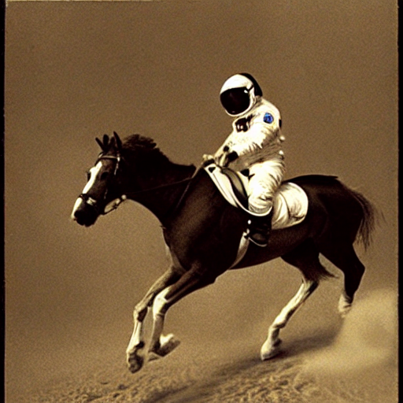

``` python
torch.manual_seed(1024)
pipe(prompt).images[0]
```

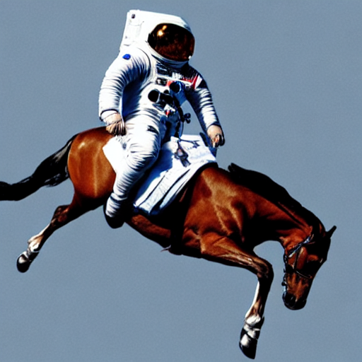

You will have noticed that running the pipeline shows a progress bar with a certain number of steps. This is because Stable Diffusion is based on a progressive denoising algorithm that is able to create a convincing image starting from pure random noise. Models in this family are known as *diffusion models*. Here’s an example of the process (from random noise at top to progressively improved images towards the bottom) of a model drawing handwritten digits, which we’ll build from scratch ourselves later in the course.

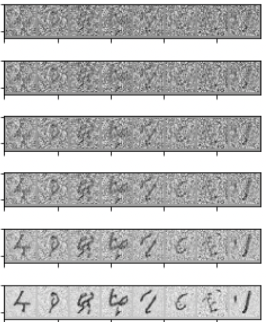

image.png

``` python
torch.manual_seed(1024)
pipe(prompt, num_inference_steps=3).images[0]
```

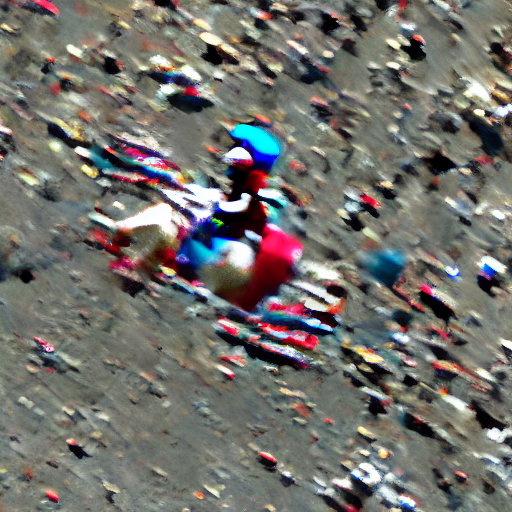

``` python
torch.manual_seed(1024)
pipe(prompt, num_inference_steps=16).images[0]
```

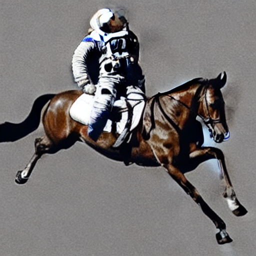

### Classifier-Free Guidance

``` python
def image_grid(imgs, rows, cols):
    w,h = imgs[0].size
    grid = Image.new('RGB', size=(cols*w, rows*h))
    for i, img in enumerate(imgs): grid.paste(img, box=(i%cols*w, i//cols*h))
    return grid
```

*Classifier-Free Guidance* is a method to increase the adherence of the output to the conditioning signal we used (the text).

Roughly speaking, the larger the guidance the more the model tries to represent the text prompt. However, large values tend to produce less diversity. The default is `7.5`, which represents a good compromise between variety and fidelity. This [blog post](https://benanne.github.io/2022/05/26/guidance.html) goes into deeper details on how it works.

We can generate multiple images for the same prompt by simply passing a list of prompts instead of a string.

``` python
num_rows,num_cols = 4,4
prompts = [prompt] * num_cols
```

``` python
images = concat(pipe(prompts, guidance_scale=g).images for g in [1.1,3,7,14])
```

``` python
image_grid(images, rows=num_rows, cols=num_cols)
```

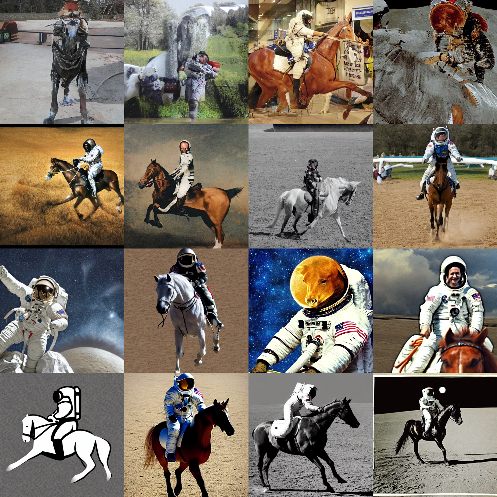

### Negative prompts

*Negative prompting* refers to the use of another prompt (instead of a completely unconditioned generation), and scaling the difference between generations of that prompt and the conditioned generation.

``` python
torch.manual_seed(1000)
prompt = "Labrador in the style of Vermeer"
pipe(prompt).images[0]
```

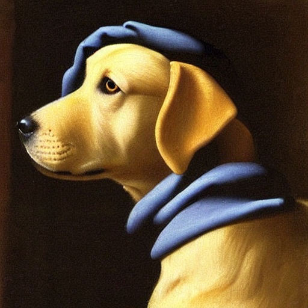

``` python
torch.manual_seed(1000)
pipe(prompt, negative_prompt="blue").images[0]
```

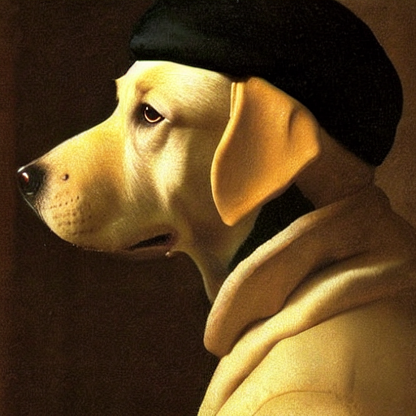

By using the negative prompt we move more towards the direction of the positive prompt, effectively reducing the importance of the negative prompt in our composition.

### Image to Image

Even though Stable Diffusion was trained to generate images, and optionally drive the generation using text conditioning, we can use the raw image diffusion process for other tasks.

For example, instead of starting from pure noise, we can start from an image an add a certain amount of noise to it. We are replacing the initial steps of the denoising and pretending our image is what the algorithm came up with. Then we continue the diffusion process from that state as usual.

This usually preserves the composition although details may change a lot. It’s great for sketches!

These operations (provide an initial image, add some noise to it and run diffusion from there) can be automatically performed by a special image to image pipeline: `StableDiffusionImg2ImgPipeline`. This is the source code for its [`__call__` method](https://github.com/huggingface/diffusers/blob/main/src/diffusers/pipelines/stable_diffusion/pipeline_stable_diffusion_img2img.py#L124).

``` python
from diffusers import StableDiffusionImg2ImgPipeline
from fastdownload import FastDownload
```

``` python
pipe = StableDiffusionImg2ImgPipeline.from_pretrained(
    "CompVis/stable-diffusion-v1-4",
    revision="fp16",
    torch_dtype=torch.float16,
).to("cuda")
```

    /home/thekkel/mambaforge/envs/cfast/lib/python3.11/site-packages/diffusers/pipelines/pipeline_utils.py:267: FutureWarning: You are loading the variant fp16 from CompVis/stable-diffusion-v1-4 via `revision='fp16'`. This behavior is deprecated and will be removed in diffusers v1. One should use `variant='fp16'` instead. However, it appears that CompVis/stable-diffusion-v1-4 currently does not have the required variant filenames in the 'main' branch. 
     The Diffusers team and community would be very grateful if you could open an issue: https://github.com/huggingface/diffusers/issues/new with the title 'CompVis/stable-diffusion-v1-4 is missing fp16 files' so that the correct variant file can be added.
      warnings.warn(

    /home/thekkel/mambaforge/envs/cfast/lib/python3.11/site-packages/transformers/models/clip/feature_extraction_clip.py:28: FutureWarning: The class CLIPFeatureExtractor is deprecated and will be removed in version 5 of Transformers. Please use CLIPImageProcessor instead.
      warnings.warn(

We’ll use as an example the following sketch created by [user VigilanteRogue81](https://huggingface.co/spaces/huggingface-projects/diffuse-the-rest/discussions/204).

``` python
file = './Data/grizzly0.jpg'
init_image = Image.open(file)
init_image
```

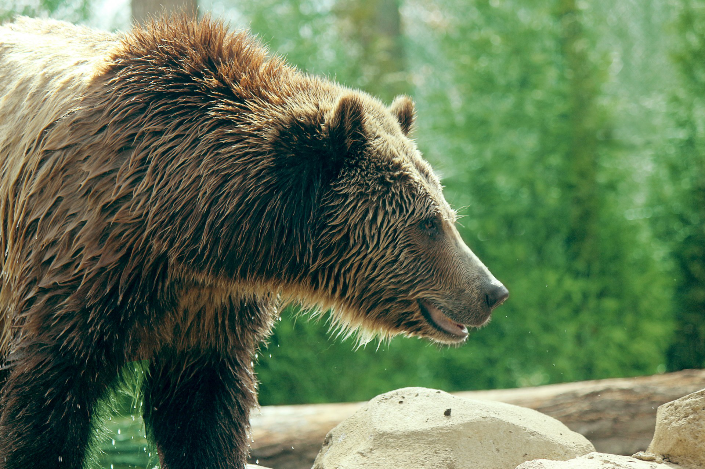

``` python
torch.manual_seed(1000)
prompt = "Bear in a dense forest, photorealistic 4K"
images = pipe(prompt=prompt, num_images_per_prompt=1, image=init_image, strength=0.8, num_inference_steps=50).images
```

``` python
image_grid(images, rows=1, cols=1)
```


When we get a composition we like we can use it as the next seed for another prompt and further change the results. For example, let’s take the third image above and try to use it to generate something in the style of Van Gogh.

``` python
init_image = images[0]
```

``` python
torch.manual_seed(1000)
prompt = "Oil painting of bear in a forest by Van Gogh"
images = pipe(prompt=prompt, num_images_per_prompt=1, image=init_image, strength=1, num_inference_steps=70).images
image_grid(images, rows=1, cols=1)
```

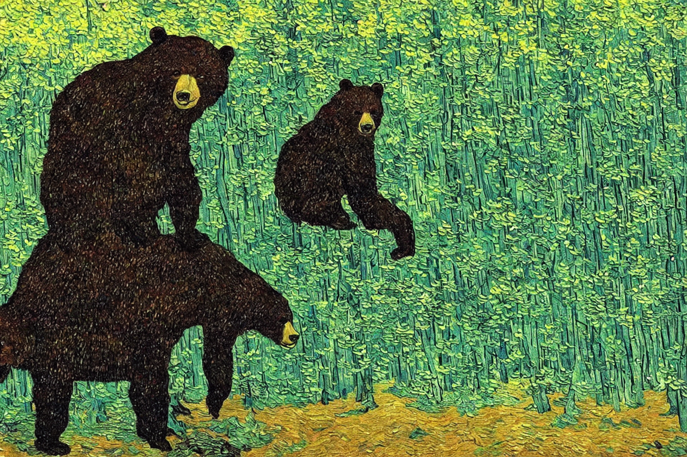

Creative people use different tools in a process of iterative refinement to come up with the ideas they have in mind. Here’s a [list with some suggestions](https://github.com/fastai/diffusion-nbs/blob/43a090286e5742f807d4ff58524c02a1888b3004/suggested_tools.md) to get started.

### Fine-tuning

[How we made the text-to-pokemon model at Lambda](https://lambdalabs.com/blog/how-to-fine-tune-stable-diffusion-how-we-made-the-text-to-pokemon-model-at-lambda/)


Girl with a pearl earring, Cute Obama creature, Donald Trump, Boris Johnson, Totoro, Hello Kitty

### Textual Inversion

Textual inversion is a process where you can quickly “teach” a new word to the text model and train its embeddings close to some visual representation. This is achieved by adding a new token to the vocabulary, freezing the weights of all the models (except the text encoder), and train with a few representative images.

This is a schematic representation of the process by the [authors of the paper](https://textual-inversion.github.io).


Textual Inversion diagram

------------------------------------------------------------------------

You can train your own tokens with photos you provide using [this training script](https://github.com/huggingface/diffusers/tree/main/examples/textual_inversion) or [Google Colab notebook](https://colab.research.google.com/github/huggingface/notebooks/blob/main/diffusers/sd_textual_inversion_training.ipynb). There’s also a [Colab notebook for inference](https://colab.research.google.com/github/huggingface/notebooks/blob/main/diffusers/stable_conceptualizer_inference.ipynb), but we’ll show below the steps we have to follow to add a trained token to the vocabulary and make it work the pre-trained Stable Diffusion model.

We’ll try an example using embeddings trained for [this style](https://huggingface.co/sd-concepts-library/indian-watercolor-portraits).

``` python
pipe = StableDiffusionPipeline.from_pretrained("CompVis/stable-diffusion-v1-4", revision="fp16", torch_dtype=torch.float16) 
pipe = pipe.to("cuda")
```

``` python
embeds_url = "https://huggingface.co/sd-concepts-library/indian-watercolor-portraits/resolve/main/learned_embeds.bin"
embeds_path = FastDownload().download(embeds_url)
embeds_dict = torch.load(str(embeds_path), map_location="cpu")
```

The embeddings for the new token are stored in a small PyTorch pickled dictionary, whose key is the new text token that was trained. Since the encoder of our pipeline does not know about this term, we need to manually append it.

``` python
tokenizer = pipe.tokenizer
text_encoder = pipe.text_encoder
new_token, embeds = next(iter(embeds_dict.items()))
embeds = embeds.to(text_encoder.dtype)
new_token
```

    '<watercolor-portrait>'

We add the new token to the tokenizer and the trained embeddings to the embeddings table.

``` python
assert tokenizer.add_tokens(new_token) == 1, "The token already exists!"
```

``` python
text_encoder.resize_token_embeddings(len(tokenizer))
new_token_id = tokenizer.convert_tokens_to_ids(new_token)
text_encoder.get_input_embeddings().weight.data[new_token_id] = embeds
```

We can now run inference and refer to the style as if it was another word in the dictionary.

``` python
torch.manual_seed(1000)
image = pipe("Woman reading in the style of <watercolor-portrait>").images[0]
image
```

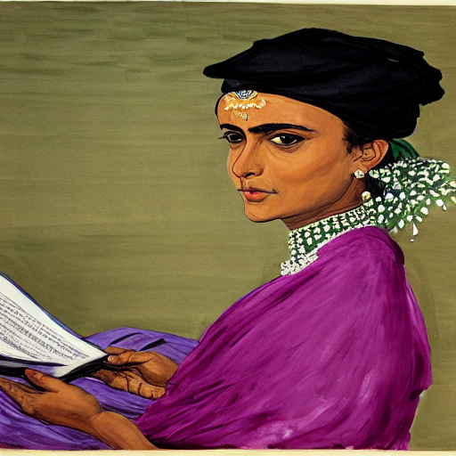

### Dreambooth

[Dreambooth](https://dreambooth.github.io) is a kind of fine-tuning that attempts to introduce new subjects by providing just a few images of the new subject. The goal is similar to that of [Textual Inversion](#Textual-Inversion), but the process is different. Instead of creating a new token as Textual Inversion does, we select an existing token in the vocabulary (usually a rarely used one), and fine-tune the model for a few hundred steps to bring that token close to the images we provide. This is a regular fine-tuning process in which all modules are unfrozen.

For example, we fine-tuned a model with a prompt like `"photo of a sks person"`, using the rare `sks` token to qualify the term `person`, and using photos of Jeremy as the targets. Let’s see how it works.

``` python
pipe = StableDiffusionPipeline.from_pretrained("pcuenq/jh_dreambooth_1000", torch_dtype=torch.float16)
pipe = pipe.to("cuda")
```

``` python
torch.manual_seed(1000)

prompt = "Painting of sks person in the style of Paul Signac"
images = pipe(prompt, num_images_per_prompt=4).images
image_grid(images, 1, 4)
```

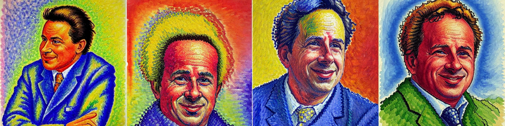

Fine-tuning with Dreambooth is finicky and sensitive to hyperparameters, as we are essentially asking the model to overfit the prompt to the supplied images. In some situations we observe problems such as catastrophic forgetting of the associated term (`"person"` in this case). The authors applied a technique called “prior preservation” to try to avoid it by performing a special regularization using other examples of the term, in addition to the ones we provided. The cool thing about this idea is that those examples can be easily generated by the pre-trained Stable Diffusion model itself! We did not use that method in the model we trained for the previous example.

Other ideas that may work include: use EMA so that the final weights preserve some of the previous knowledge, use progressive learning rates for fine-tuning, or combine the best of Textual Inversion with Dreambooth. These could make for some interesting projects to try out!

If you want to train your own Dreambooth model, you can use [this script](https://github.com/huggingface/diffusers/tree/main/examples/dreambooth) or [this Colab notebook](https://colab.research.google.com/github/huggingface/notebooks/blob/main/diffusers/sd_dreambooth_training.ipynb).

### What is Stable Diffusion

There are three main components in latent diffusion.

1.  An autoencoder (VAE).
2.  A [U-Net](https://colab.research.google.com/github/huggingface/notebooks/blob/main/diffusers/diffusers_intro.ipynb#scrollTo=wW8o1Wp0zRkq).
3.  A text-encoder, *e.g.* [CLIP’s Text Encoder](https://huggingface.co/docs/transformers/model_doc/clip#transformers.CLIPTextModel).

The output of the U-Net, being the noise residual, is used to compute a denoised latent image representation via a scheduler algorithm. Many different scheduler algorithms can be used for this computation, each having its pros and cons. For Stable Diffusion, we recommend using one of:

- [PNDM scheduler](https://github.com/huggingface/diffusers/blob/main/src/diffusers/schedulers/scheduling_pndm.py) (used by default)
- [DDIM scheduler](https://github.com/huggingface/diffusers/blob/main/src/diffusers/schedulers/scheduling_ddim.py)
- [K-LMS scheduler](https://github.com/huggingface/diffusers/blob/main/src/diffusers/schedulers/scheduling_lms_discrete.py)

### Latents and callbacks

Stable Diffusion is based on a particular type of diffusion model called **Latent Diffusion**, proposed in [High-Resolution Image Synthesis with Latent Diffusion Models](https://arxiv.org/abs/2112.10752).

General diffusion models are machine learning systems that are trained to *denoise* random gaussian noise step by step, to get to a sample of interest, such as an *image*. For a more detailed overview of how they work, check [this colab](https://colab.research.google.com/github/huggingface/notebooks/blob/main/diffusers/diffusers_intro.ipynb).

Diffusion models have shown to achieve state-of-the-art results for generating image data. But one downside of diffusion models is that the reverse denoising process is slow. In addition, these models consume a lot of memory because they operate in pixel space, which becomes unreasonably expensive when generating high-resolution images. Therefore, it is challenging to train these models and also use them for inference.

Latent diffusion can reduce the memory and compute complexity by applying the diffusion process over a lower dimensional *latent* space, instead of using the actual pixel space. This is the key difference between standard diffusion and latent diffusion models: **in latent diffusion the model is trained to generate latent (compressed) representations of the images.**

The Stable Diffusion pipeline can send intermediate latents to a callback function we provide. By running these latents through the image decoder (the `vae` component of the pipeline), we can see how the denoising process progresses and the image unfolds.

``` python
vae = pipe.vae
images = []

def latents_callback(i, t, latents):
    latents = 1 / 0.18215 * latents
    image = vae.decode(latents).sample[0]
    image = (image / 2 + 0.5).clamp(0, 1)
    image = image.cpu().permute(1, 2, 0).numpy()
    images.extend(pipe.numpy_to_pil(image))

prompt = "Portrait painting of Donald trump looking happy."
torch.manual_seed(9000)
final_image = pipe(prompt, callback=latents_callback, callback_steps=12).images[0]
images.append(final_image)
image_grid(images, rows=1, cols=len(images))
```

    /home/thekkel/mambaforge/envs/cfast/lib/python3.11/site-packages/diffusers/pipelines/stable_diffusion/pipeline_stable_diffusion.py:736: FutureWarning: `callback` is deprecated and will be removed in version 1.0.0. Passing `callback` as an input argument to `__call__` is deprecated, consider using `callback_on_step_end`
      deprecate(
    /home/thekkel/mambaforge/envs/cfast/lib/python3.11/site-packages/diffusers/pipelines/stable_diffusion/pipeline_stable_diffusion.py:742: FutureWarning: `callback_steps` is deprecated and will be removed in version 1.0.0. Passing `callback_steps` as an input argument to `__call__` is deprecated, consider using `callback_on_step_end`
      deprecate(


**Why is latent diffusion fast and efficient?**

Since the U-Net of latent diffusion models operates on a low dimensional space, it greatly reduces the memory and compute requirements compared to pixel-space diffusion models. For example, the autoencoder used in Stable Diffusion has a reduction factor of 8 but uses 4 channels instead of 3. This means that an image of shape `(3, 512, 512)` becomes `(4, 64, 64)` in latent space, which requires `8 × 8 × 3/4 = 48` times less memory.

This is why it’s possible to generate `512 × 512` images so quickly, even on 16GB Colab GPUs!

``` python
del pipe
```

## Looking inside the pipeline

The inference pipeline is just a small piece of code that plugs the components together and performs the inference loop. [This is all there it to is](https://github.com/huggingface/diffusers/blob/main/src/diffusers/pipelines/stable_diffusion/pipeline_stable_diffusion.py#L204).

We’ll go through the process of loading and plugging the pieces to see how we could have written it ourselves. We’ll start by loading all the modules that we need from their pretrained weights.

First, we need the text encoder and the tokenizer. These come from the text portion of a standard CLIP model, so we’ll use the weights released by Open AI.

``` python
from transformers import CLIPTextModel, CLIPTokenizer
```

``` python
tokenizer = CLIPTokenizer.from_pretrained("openai/clip-vit-large-patch14", torch_dtype=torch.float16)
text_encoder = CLIPTextModel.from_pretrained("openai/clip-vit-large-patch14", torch_dtype=torch.float16).to("cuda")
```

Next we’ll load the `vae` and the `unet`. These are distinct models whose weights are stored inside folders of the Stable Diffusion repository. We can use the `subfolder` argument to refer to [these locations](https://huggingface.co/CompVis/stable-diffusion-v1-4/tree/main).

``` python
from diffusers import AutoencoderKL, UNet2DConditionModel
```

``` python
# Here we use a different VAE to the original release, which has been fine-tuned for more steps
vae = AutoencoderKL.from_pretrained("stabilityai/sd-vae-ft-ema", torch_dtype=torch.float16).to("cuda")
unet = UNet2DConditionModel.from_pretrained("CompVis/stable-diffusion-v1-4", subfolder="unet", torch_dtype=torch.float16).to("cuda")
```

To make things a bit different, we’ll use another scheduler. The standard pipeline uses the [PNDM Scheduler](https://arxiv.org/abs/2202.09778), but we’ll use [Katherine Crowson’s](https://github.com/crowsonkb) excellent K-LMS scheduler.

We need to be careful to use the same noising schedule that was used during training. The schedule is defined by the number of noising steps and the amount of noise added at each step, which is derived from the *beta* parameters.

In the case of the k-LMS scheduler, this is how the betas evolve during the 1000 steps of the noising process used during training:

``` python
beta_start,beta_end = 0.00085,0.012
plt.plot(torch.linspace(beta_start**0.5, beta_end**0.5, 1000) ** 2)
plt.xlabel('Timestep')
plt.ylabel('beta');
```

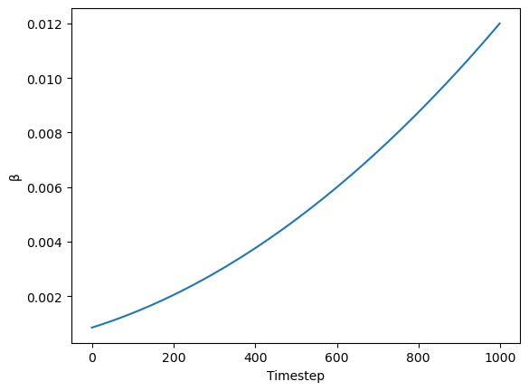

``` python
from diffusers import LMSDiscreteScheduler
```

``` python
scheduler = LMSDiscreteScheduler(beta_start=beta_start, beta_end=beta_end, beta_schedule="scaled_linear", num_train_timesteps=1000)
```

We now define the parameters we’ll use for generation.

In contrast with the previous examples, we set `num_inference_steps` to 70 to get an even more defined image.

``` python
prompt = ["a photograph of an astronaut riding a horse"]

height = 512
width = 512
num_inference_steps = 70
guidance_scale = 7.5
batch_size = 1
```

We tokenize the prompt. The model requires the same number of tokens for every prompt, so padding is used to ensure we meet the required length.

``` python
text_input = tokenizer(prompt, padding="max_length", max_length=tokenizer.model_max_length, truncation=True, return_tensors="pt")
text_input['input_ids']
```

    tensor([[49406,   320,  8853,   539,   550, 18376,  6765,   320,  4558, 49407,
             49407, 49407, 49407, 49407, 49407, 49407, 49407, 49407, 49407, 49407,
             49407, 49407, 49407, 49407, 49407, 49407, 49407, 49407, 49407, 49407,
             49407, 49407, 49407, 49407, 49407, 49407, 49407, 49407, 49407, 49407,
             49407, 49407, 49407, 49407, 49407, 49407, 49407, 49407, 49407, 49407,
             49407, 49407, 49407, 49407, 49407, 49407, 49407, 49407, 49407, 49407,
             49407, 49407, 49407, 49407, 49407, 49407, 49407, 49407, 49407, 49407,
             49407, 49407, 49407, 49407, 49407, 49407, 49407]])

``` python
tokenizer.decode(49407)
```

    '<|endoftext|>'

The attention mask uses zero to represent tokens we are not interested in. These are all of the padding tokens.

``` python
text_input['attention_mask']
```

    tensor([[1, 1, 1, 1, 1, 1, 1, 1, 1, 1, 0, 0, 0, 0, 0, 0, 0, 0, 0, 0, 0, 0, 0, 0,
             0, 0, 0, 0, 0, 0, 0, 0, 0, 0, 0, 0, 0, 0, 0, 0, 0, 0, 0, 0, 0, 0, 0, 0,
             0, 0, 0, 0, 0, 0, 0, 0, 0, 0, 0, 0, 0, 0, 0, 0, 0, 0, 0, 0, 0, 0, 0, 0,
             0, 0, 0, 0, 0]])

The text encoder gives us the embeddings for the text prompt we used.

``` python
text_embeddings = text_encoder(text_input.input_ids.to("cuda"))[0].half()
text_embeddings.shape
```

    torch.Size([1, 77, 768])

We also get the embeddings required to perform unconditional generation, which is achieved with an empty string: the model is free to go in whichever direction it wants as long as it results in a reasonably-looking image. These embeddings will be applied to apply classifier-free guidance.

``` python
max_length = text_input.input_ids.shape[-1]
uncond_input = tokenizer(
    [""] * batch_size, padding="max_length", max_length=max_length, return_tensors="pt"
)
uncond_embeddings = text_encoder(uncond_input.input_ids.to("cuda"))[0].half()
uncond_embeddings.shape
```

    torch.Size([1, 77, 768])

For classifier-free guidance, we need to do two forward passes. One with the conditioned input (`text_embeddings`), and another with the unconditional embeddings (`uncond_embeddings`). In practice, we can concatenate both into a single batch to avoid doing two forward passes.

``` python
text_embeddings = torch.cat([uncond_embeddings, text_embeddings])
```

To start the denoising process, we start from pure Gaussian (normal) noise. These are our initial latents.

``` python
torch.manual_seed(100)
latents = torch.randn((batch_size, unet.in_channels, height // 8, width // 8))
latents = latents.to("cuda").half()
latents.shape
```

    /tmp/ipykernel_60841/2512694209.py:3: FutureWarning: Accessing config attribute `in_channels` directly via 'UNet2DConditionModel' object attribute is deprecated. Please access 'in_channels' over 'UNet2DConditionModel's config object instead, e.g. 'unet.config.in_channels'.
      latents = torch.randn((batch_size, unet.in_channels, height // 8, width // 8))

    torch.Size([1, 4, 64, 64])

`4×64×64` is the input shape. The decoder will later transform this latent representation into a `3×512×512` image after the denoising process is complete.

Next, we initialize the scheduler with our chosen `num_inference_steps`. This will prepare the internal state to be used during denoising.

``` python
scheduler.set_timesteps(num_inference_steps)
```

We scale the initial noise by the standard deviation required by the scheduler. This value will depend on the particular scheduler we use.

``` python
latents = latents * scheduler.init_noise_sigma
```

We are ready to write the denoising loop. The timesteps go from `999` to `0` (1000 steps that were used during training) following a particular schedule.

``` python
scheduler.timesteps
```

    tensor([999.0000, 984.5217, 970.0435, 955.5652, 941.0870, 926.6087, 912.1304,
            897.6522, 883.1739, 868.6957, 854.2174, 839.7391, 825.2609, 810.7826,
            796.3043, 781.8261, 767.3478, 752.8696, 738.3913, 723.9130, 709.4348,
            694.9565, 680.4783, 666.0000, 651.5217, 637.0435, 622.5652, 608.0870,
            593.6087, 579.1304, 564.6522, 550.1739, 535.6957, 521.2174, 506.7391,
            492.2609, 477.7826, 463.3044, 448.8261, 434.3478, 419.8696, 405.3913,
            390.9131, 376.4348, 361.9565, 347.4783, 333.0000, 318.5217, 304.0435,
            289.5652, 275.0869, 260.6087, 246.1304, 231.6522, 217.1739, 202.6956,
            188.2174, 173.7391, 159.2609, 144.7826, 130.3044, 115.8261, 101.3478,
             86.8696,  72.3913,  57.9130,  43.4348,  28.9565,  14.4783,   0.0000])

``` python
scheduler.sigmas
```

    tensor([14.6146, 13.3974, 12.3033, 11.3184, 10.4301,  9.6279,  8.9020,  8.2443,
             7.6472,  7.1044,  6.6102,  6.1594,  5.7477,  5.3709,  5.0258,  4.7090,
             4.4178,  4.1497,  3.9026,  3.6744,  3.4634,  3.2680,  3.0867,  2.9183,
             2.7616,  2.6157,  2.4794,  2.3521,  2.2330,  2.1213,  2.0165,  1.9180,
             1.8252,  1.7378,  1.6552,  1.5771,  1.5031,  1.4330,  1.3664,  1.3030,
             1.2427,  1.1852,  1.1302,  1.0776,  1.0272,  0.9788,  0.9324,  0.8876,
             0.8445,  0.8029,  0.7626,  0.7236,  0.6858,  0.6490,  0.6131,  0.5781,
             0.5438,  0.5102,  0.4770,  0.4443,  0.4118,  0.3795,  0.3470,  0.3141,
             0.2805,  0.2455,  0.2084,  0.1672,  0.1174,  0.0292,  0.0000])

``` python
plt.plot(scheduler.timesteps, scheduler.sigmas[:-1]);
```

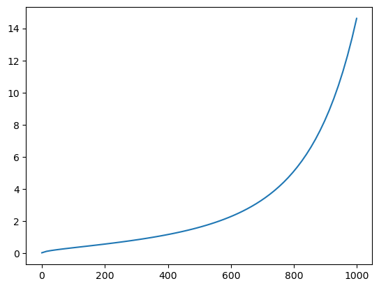

``` python
from tqdm.auto import tqdm
```

``` python
for i, t in enumerate(tqdm(scheduler.timesteps)):
    input = torch.cat([latents] * 2)
    input = scheduler.scale_model_input(input, t)

    # predict the noise residual
    with torch.no_grad(): pred = unet(input, t, encoder_hidden_states=text_embeddings).sample

    # perform guidance
    pred_uncond, pred_text = pred.chunk(2)
    pred = pred_uncond + guidance_scale * (pred_text - pred_uncond)

    # compute the "previous" noisy sample
    latents = scheduler.step(pred, t, latents).prev_sample
```

After this process complets our `latents` contain the denoised representation of the image. We use the `vae` decoder to convert it back to pixel space.

``` python
with torch.no_grad(): image = vae.decode(1 / 0.18215 * latents).sample
```

And finally, let’s convert the image to PIL so we can display it.

``` python
image = (image / 2 + 0.5).clamp(0, 1)
image = image[0].detach().cpu().permute(1, 2, 0).numpy()
image = (image * 255).round().astype("uint8")
Image.fromarray(image)
```

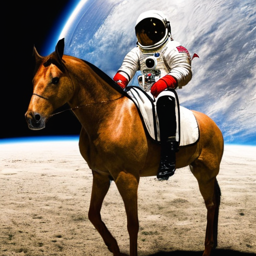

### Just the code

``` python
prompts = [
    'a photograph of an astronaut riding a horse',
    'an oil painting of an astronaut riding a horse in the style of grant wood'
]
```

``` python
text_input = tokenizer(prompts, padding="max_length", max_length=tokenizer.model_max_length, truncation=True, return_tensors="pt")
text_embeddings = text_encoder(text_input.input_ids.to("cuda"))[0].half()
```

``` python
max_length = text_input.input_ids.shape[-1]
uncond_input = tokenizer([""] * len(prompts), padding="max_length", max_length=max_length, return_tensors="pt")
uncond_embeddings = text_encoder(uncond_input.input_ids.to("cuda"))[0].half()
emb = torch.cat([uncond_embeddings, text_embeddings])
```

``` python
torch.manual_seed(100)
g = guidance_scale
```

``` python
latents = torch.randn((len(prompts), unet.in_channels, height//8, width//8))
scheduler.set_timesteps(num_inference_steps)
latents = latents.to("cuda").half() * scheduler.init_noise_sigma
```

    /tmp/ipykernel_60841/2293748509.py:2: FutureWarning: Accessing config attribute `in_channels` directly via 'UNet2DConditionModel' object attribute is deprecated. Please access 'in_channels' over 'UNet2DConditionModel's config object instead, e.g. 'unet.config.in_channels'.
      latents = torch.randn((len(prompts), unet.in_channels, height//8, width//8))

``` python
for i,ts in enumerate(tqdm(scheduler.timesteps)):
    inp = scheduler.scale_model_input(torch.cat([latents] * 2), ts)
    with torch.no_grad(): u,t = unet(inp, ts, encoder_hidden_states=emb).sample.chunk(2)
    pred = u + g*(t-u)
    latents = scheduler.step(pred, ts, latents).prev_sample
```

``` python
with torch.no_grad(): image = vae.decode(1 / 0.18215 * latents).sample
res = (image / 2 + 0.5).clamp(0, 1)
```

``` python
image = res[0].detach().cpu().permute(1, 2, 0).numpy()
image = (image * 255).round().astype("uint8")
Image.fromarray(image)
```


``` python
image = res[1].detach().cpu().permute(1, 2, 0).numpy()
image = (image * 255).round().astype("uint8")
Image.fromarray(image)
```

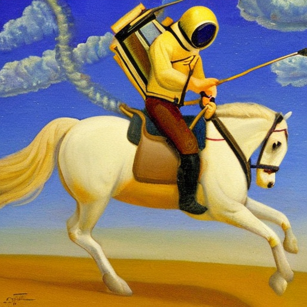

### Put it in functions

``` python
def text_enc(prompts, maxlen=None):
    if maxlen is None: maxlen = tokenizer.model_max_length
    inp = tokenizer(prompts, padding="max_length", max_length=maxlen, truncation=True, return_tensors="pt")
    return text_encoder(inp.input_ids.to("cuda"))[0].half()

def mk_img(t):
    image = (t/2+0.5).clamp(0,1).detach().cpu().permute(1, 2, 0).numpy()
    return Image.fromarray((image*255).round().astype("uint8"))
```

``` python
def mk_samples(prompts, g=7.5, seed=100, steps=70):
    bs = len(prompts)
    text = text_enc(prompts)
    uncond = text_enc([""] * bs, text.shape[1])
    emb = torch.cat([uncond, text])
    if seed: torch.manual_seed(seed)

    latents = torch.randn((bs, unet.in_channels, height//8, width//8))
    scheduler.set_timesteps(steps)
    latents = latents.to("cuda").half() * scheduler.init_noise_sigma

    for i,ts in enumerate(tqdm(scheduler.timesteps)):
        inp = scheduler.scale_model_input(torch.cat([latents] * 2), ts)
        with torch.no_grad(): u,t = unet(inp, ts, encoder_hidden_states=emb).sample.chunk(2)
        pred = u + g*(t-u)
        latents = scheduler.step(pred, ts, latents).prev_sample

    with torch.no_grad(): return vae.decode(1 / 0.18215 * latents).sample
```

``` python
images = mk_samples(prompts)
```

    /tmp/ipykernel_60841/2156907493.py:9: FutureWarning: Accessing config attribute `in_channels` directly via 'UNet2DConditionModel' object attribute is deprecated. Please access 'in_channels' over 'UNet2DConditionModel's config object instead, e.g. 'unet.config.in_channels'.
      latents = torch.randn((bs, unet.in_channels, height//8, width//8))

``` python
from IPython.display import display
```

``` python
for img in images: display(mk_img(img))
```


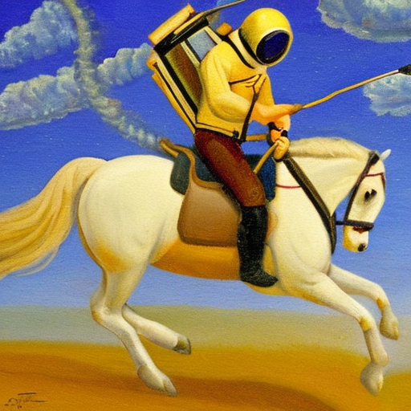

Back to top
