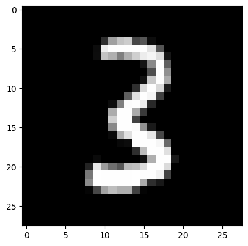

# Mini Batch

Mini Batch

Author

Benedict Thekkel

Exported source

``` python
import pickle,gzip,math,os,time,shutil,torch,matplotlib as mpl,numpy as np,matplotlib.pyplot as plt
from pathlib import Path
from torch import tensor,nn
import torch.nn.functional as F
```

``` python
from fastcore.test import test_close

torch.set_printoptions(precision=2, linewidth=140, sci_mode=False)
torch.manual_seed(1)
mpl.rcParams['image.cmap'] = 'gray'

path_data = Path('Data')
path_gz = path_data/'mnist.pkl.gz'
with gzip.open(path_gz, 'rb') as f: ((x_train, y_train), (x_valid, y_valid), _) = pickle.load(f, encoding='latin-1')
x_train, y_train, x_valid, y_valid = map(tensor, [x_train, y_train, x_valid, y_valid])
```

## Initial setup

### Data

``` python
n,m = x_train.shape
c = y_train.max()+1
nh = 20
```

Exported source

``` python
class Model(nn.Module):
    def __init__(self, n_in, nh, n_out):
        super().__init__()
        self.layers = [nn.Linear(n_in,nh), nn.ReLU(), nn.Linear(nh,n_out)]
        
    def __call__(self, x):
        for l in self.layers: x = l(x)
        return x
```

``` python
model = Model(m, nh, 10)
pred = model(x_train)
pred.shape
```

    torch.Size([50000, 10])

### Cross entropy loss

First, we will need to compute the softmax of our activations. This is defined by:

$$\hbox{softmax(x)}_{i} = \frac{e^{x_{i}}}{e^{x_{0}} + e^{x_{1}} + \cdots + e^{x_{n-1}}}$$

or more concisely:

$$\hbox{softmax(x)}_{i} = \frac{e^{x_{i}}}{\sum\limits_{0 \leq j \lt n} e^{x_{j}}}$$

In practice, we will need the log of the softmax when we calculate the loss.

Exported source

``` python
def log_softmax(x): return (x.exp()/(x.exp().sum(-1,keepdim=True))).log()
```

``` python
log_softmax(pred)
```

    tensor([[-1.92, -2.34, -2.38,  ..., -2.53, -2.64, -2.51],
            [-2.02, -2.34, -2.29,  ..., -2.56, -2.60, -2.45],
            [-1.90, -2.38, -2.31,  ..., -2.39, -2.59, -2.48],
            ...,
            [-1.97, -2.29, -2.28,  ..., -2.59, -2.64, -2.57],
            [-1.94, -2.35, -2.20,  ..., -2.56, -2.72, -2.58],
            [-2.04, -2.28, -2.26,  ..., -2.60, -2.65, -2.61]], grad_fn=<LogBackward0>)

Note that the formula

$$\log \left ( \frac{a}{b} \right ) = \log(a) - \log(b)$$

gives a simplification when we compute the log softmax

$$\log \left ( ab \right ) = \log(a) + \log(b)$$

Exported source

``` python
def log_softmax(x): return x - x.exp().sum(-1,keepdim=True).log()
```

Then, there is a way to compute the log of the sum of exponentials in a more stable way, called the [LogSumExp trick](https://en.wikipedia.org/wiki/LogSumExp). The idea is to use the following formula:

$$\log \left ( \sum_{j=1}^{n} e^{x_{j}} \right ) = \log \left ( e^{a} \sum_{j=1}^{n} e^{x_{j}-a} \right ) = a + \log \left ( \sum_{j=1}^{n} e^{x_{j}-a} \right )$$

where a is the maximum of the $x_{j}$.

Exported source

``` python
def logsumexp(x):
    m = x.max(-1)[0]
    return m + (x-m[:,None]).exp().sum(-1).log()
```

This way, we will avoid an overflow when taking the exponential of a big activation. In PyTorch, this is already implemented for us.

Exported source

``` python
def log_softmax(x): return x - x.logsumexp(-1,keepdim=True)
```

``` python
test_close(logsumexp(pred), pred.logsumexp(-1))
sm_pred = log_softmax(pred)
sm_pred
```

    tensor([[-1.92, -2.34, -2.38,  ..., -2.53, -2.64, -2.51],
            [-2.02, -2.34, -2.29,  ..., -2.56, -2.60, -2.45],
            [-1.90, -2.38, -2.31,  ..., -2.39, -2.59, -2.48],
            ...,
            [-1.97, -2.29, -2.28,  ..., -2.59, -2.64, -2.57],
            [-1.94, -2.35, -2.20,  ..., -2.56, -2.72, -2.58],
            [-2.04, -2.28, -2.26,  ..., -2.60, -2.65, -2.61]], grad_fn=<SubBackward0>)

The cross entropy loss for some target $x$ and some prediction $p(x)$ is given by:

$$-\sum x\, \log p(x)$$

But since our $x$s are 1-hot encoded (actually, they’re just the integer indices), this can be rewritten as $-\log(p_{i})$ where i is the index of the desired target.

This can be done using numpy-style [integer array indexing](https://docs.scipy.org/doc/numpy-1.13.0/reference/arrays.indexing.html#integer-array-indexing). Note that PyTorch supports all the tricks in the advanced indexing methods discussed in that link.

``` python
y_train[:3]
```

    tensor([5, 0, 4])

``` python
sm_pred[0,5],sm_pred[1,0],sm_pred[2,4]
```

    (tensor(-2.26, grad_fn=<SelectBackward0>),
     tensor(-2.02, grad_fn=<SelectBackward0>),
     tensor(-2.37, grad_fn=<SelectBackward0>))

``` python
sm_pred[[0,1,2], y_train[:3]]
```

    tensor([-2.26, -2.02, -2.37], grad_fn=<IndexBackward0>)

Exported source

``` python
def nll(input, target): return -input[range(target.shape[0]), target].mean()
```

``` python
loss = nll(sm_pred, y_train)
loss
```

    tensor(2.33, grad_fn=<NegBackward0>)

Then use PyTorch’s implementation.

``` python
test_close(F.nll_loss(F.log_softmax(pred, -1), y_train), loss, 1e-3)
```

In PyTorch, `F.log_softmax` and `F.nll_loss` are combined in one optimized function, `F.cross_entropy`.

``` python
test_close(F.cross_entropy(pred, y_train), loss, 1e-3)
```

## Basic training loop

Basically the training loop repeats over the following steps: - get the output of the model on a batch of inputs - compare the output to the labels we have and compute a loss - calculate the gradients of the loss with respect to every parameter of the model - update said parameters with those gradients to make them a little bit better

``` python
loss_func = F.cross_entropy
```

``` python
bs=50                  # batch size

xb = x_train[0:bs]     # a mini-batch from x
preds = model(xb)      # predictions
preds[0], preds.shape
```

    (tensor([ 0.37, -0.06, -0.10,  0.13,  0.04,  0.02,  0.05, -0.25, -0.35, -0.22], grad_fn=<SelectBackward0>),
     torch.Size([50, 10]))

``` python
yb = y_train[0:bs]
yb
```

    tensor([5, 0, 4, 1, 9, 2, 1, 3, 1, 4, 3, 5, 3, 6, 1, 7, 2, 8, 6, 9, 4, 0, 9, 1, 1, 2, 4, 3, 2, 7, 3, 8, 6, 9, 0, 5, 6, 0, 7, 6, 1, 8, 7, 9,
            3, 9, 8, 5, 9, 3])

``` python
loss_func(preds, yb)
```

    tensor(2.33, grad_fn=<NllLossBackward0>)

``` python
preds[:5]
```

    tensor([[ 0.37, -0.06, -0.10,  0.13,  0.04,  0.02,  0.05, -0.25, -0.35, -0.22],
            [ 0.23, -0.08, -0.03,  0.16,  0.00, -0.06,  0.01, -0.31, -0.35, -0.20],
            [ 0.37, -0.10, -0.03,  0.10, -0.09,  0.02, -0.05, -0.12, -0.32, -0.21],
            [ 0.26,  0.05,  0.08,  0.27,  0.06,  0.02,  0.13, -0.31, -0.36, -0.29],
            [ 0.28, -0.09,  0.07,  0.23,  0.12,  0.08,  0.03, -0.36, -0.35, -0.23]], grad_fn=<SliceBackward0>)

``` python
preds.argmax(dim=1)
```

    tensor([0, 0, 0, 3, 0, 0, 0, 0, 0, 0, 0, 0, 0, 3, 3, 0, 0, 0, 0, 0, 0, 0, 0, 0, 0, 0, 0, 0, 0, 3, 0, 0, 0, 0, 0, 0, 0, 0, 0, 0, 0, 3, 0, 0,
            0, 0, 0, 0, 0, 0])

Exported source

``` python
def accuracy(out, yb): return (out.argmax(dim=1)==yb).float().mean()
```

``` python
accuracy(preds, yb)
```

    tensor(0.08)

``` python
lr = 0.5   # learning rate
epochs = 10 # how many epochs to train for
```

Exported source

``` python
def report(loss, preds, yb): print(f'{loss:.2f}, {accuracy(preds, yb):.2f}')
```

``` python
xb,yb = x_train[:bs],y_train[:bs]
preds = model(xb)
report(loss_func(preds, yb), preds, yb)
```

    2.33, 0.08

``` python
for epoch in range(epochs):
    for i in range(0, n, bs):
        s = slice(i, min(n,i+bs))
        xb,yb = x_train[s],y_train[s]
        preds = model(xb)
        loss = loss_func(preds, yb)
        loss.backward()
        with torch.no_grad():
            for l in model.layers:
                if hasattr(l, 'weight'):
                    l.weight -= l.weight.grad * lr
                    l.bias   -= l.bias.grad   * lr
                    l.weight.grad.zero_()
                    l.bias  .grad.zero_()
    report(loss, preds, yb)
```

    0.12, 0.96
    0.15, 0.92
    0.11, 0.96
    0.12, 0.94
    0.10, 0.96
    0.08, 0.98
    0.09, 0.98
    0.08, 0.96
    0.07, 0.96
    0.08, 0.98

\$L = l(n(w,x)) N=n(w,x) and L= l(N) \$

\$ = \$

# Using parameters and optim

### Parameters

``` python
m1 = nn.Module()
m1.foo = nn.Linear(3,4)
m1
```

    Module(
      (foo): Linear(in_features=3, out_features=4, bias=True)
    )

``` python
list(m1.named_children())
```

    [('foo', Linear(in_features=3, out_features=4, bias=True))]

``` python
m1.named_children()
```

    <generator object Module.named_children>

``` python
list(m1.parameters())
```

    [Parameter containing:
     tensor([[ 0.57,  0.43, -0.30],
             [ 0.13, -0.32, -0.24],
             [ 0.51,  0.04,  0.22],
             [ 0.13, -0.17, -0.24]], requires_grad=True),
     Parameter containing:
     tensor([-0.01, -0.51, -0.39,  0.56], requires_grad=True)]

Exported source

``` python
class MLP(nn.Module):
    def __init__(self, n_in, nh, n_out):
        super().__init__()
        self.l1 = nn.Linear(n_in,nh)
        self.l2 = nn.Linear(nh,n_out)
        self.relu = nn.ReLU()
        
    def forward(self, x): return self.l2(self.relu(self.l1(x)))
```

``` python
model = MLP(m, nh, 10)
model.l1
```

    Linear(in_features=784, out_features=20, bias=True)

``` python
model
```

    MLP(
      (l1): Linear(in_features=784, out_features=20, bias=True)
      (l2): Linear(in_features=20, out_features=10, bias=True)
      (relu): ReLU()
    )

``` python
for name,l in model.named_children(): print(f"{name}: {l}")
```

    l1: Linear(in_features=784, out_features=20, bias=True)
    l2: Linear(in_features=20, out_features=10, bias=True)
    relu: ReLU()

``` python
for p in model.parameters(): print(p.shape)
```

    torch.Size([20, 784])
    torch.Size([20])
    torch.Size([10, 20])
    torch.Size([10])

Exported source

``` python
def fit():
    for epoch in range(epochs):
        for i in range(0, n, bs):
            s = slice(i, min(n,i+bs))
            xb,yb = x_train[s],y_train[s]
            preds = model(xb)
            loss = loss_func(preds, yb)
            loss.backward()
            with torch.no_grad():
                for p in model.parameters(): p -= p.grad * lr
                model.zero_grad()
        report(loss, preds, yb)
```

``` python
fit()
```

    0.22, 0.90
    0.21, 0.94
    0.21, 0.94
    0.22, 0.94
    0.21, 0.96
    0.21, 0.94
    0.19, 0.94
    0.19, 0.92
    0.18, 0.94
    0.17, 0.94

Behind the scenes, PyTorch overrides the `__setattr__` function in `nn.Module` so that the submodules you define are properly registered as parameters of the model.

Exported source

``` python
class MyModule:
    def __init__(self, n_in, nh, n_out):
        self._modules = {}
        self.l1 = nn.Linear(n_in,nh)
        self.l2 = nn.Linear(nh,n_out)

    def __setattr__(self,k,v):
        if not k.startswith("_"): self._modules[k] = v
        super().__setattr__(k,v)

    def __repr__(self): return f'{self._modules}'
    
    def parameters(self):
        for l in self._modules.values(): yield from l.parameters()
```

``` python
mdl = MyModule(m,nh,10)
mdl
```

    {'l1': Linear(in_features=784, out_features=20, bias=True), 'l2': Linear(in_features=20, out_features=10, bias=True)}

``` python
for p in mdl.parameters(): print(p.shape)
```

    torch.Size([20, 784])
    torch.Size([20])
    torch.Size([10, 20])
    torch.Size([10])

### Registering modules

Exported source

``` python
from functools import reduce
```

We can use the original `layers` approach, but we have to register the modules.

``` python
layers = [nn.Linear(m,nh), nn.ReLU(), nn.Linear(nh,10)]
```

Exported source

``` python
class Model(nn.Module):
    def __init__(self, layers):
        super().__init__()
        self.layers = layers
        for i,l in enumerate(self.layers): self.add_module(f'layer_{i}', l)

    def forward(self, x): return reduce(lambda val,layer: layer(val), self.layers, x)
```

``` python
model = Model(layers)
model
```

    Model(
      (layer_0): Linear(in_features=784, out_features=20, bias=True)
      (layer_1): ReLU()
      (layer_2): Linear(in_features=20, out_features=10, bias=True)
    )

``` python
model(xb).shape
```

    torch.Size([50, 10])

### nn.ModuleList

`nn.ModuleList` does this for us.

Exported source

``` python
class SequentialModel(nn.Module):
    def __init__(self, layers):
        super().__init__()
        self.layers = nn.ModuleList(layers)
        
    def forward(self, x):
        for l in self.layers: x = l(x)
        return x
```

``` python
model = SequentialModel(layers)
model
```

    SequentialModel(
      (layers): ModuleList(
        (0): Linear(in_features=784, out_features=20, bias=True)
        (1): ReLU()
        (2): Linear(in_features=20, out_features=10, bias=True)
      )
    )

``` python
fit()
```

    0.21, 0.92
    0.20, 0.96
    0.13, 0.98
    0.08, 0.98
    0.08, 0.98
    0.14, 0.94
    0.12, 0.94
    0.12, 0.94
    0.09, 0.96
    0.06, 0.98

### nn.Sequential

`nn.Sequential` is a convenient class which does the same as the above:

``` python
model = nn.Sequential(nn.Linear(m,nh), nn.ReLU(), nn.Linear(nh,10))
```

``` python
fit()
loss_func(model(xb), yb), accuracy(model(xb), yb)
```

    0.12, 0.94
    0.12, 0.98
    0.16, 0.96
    0.11, 0.98
    0.22, 0.96
    0.14, 0.96
    0.20, 0.96
    0.13, 0.98
    0.07, 0.98
    0.07, 0.96

    (tensor(0.02, grad_fn=<NllLossBackward0>), tensor(1.))

``` python
model
```

    Sequential(
      (0): Linear(in_features=784, out_features=20, bias=True)
      (1): ReLU()
      (2): Linear(in_features=20, out_features=10, bias=True)
    )

### optim

Exported source

``` python
class Optimizer():
    def __init__(self, params, lr=0.5): self.params,self.lr=list(params),lr

    def step(self):
        with torch.no_grad():
            for p in self.params: p -= p.grad * self.lr

    def zero_grad(self):
        for p in self.params: p.grad.data.zero_()
```

``` python
model = nn.Sequential(nn.Linear(m,nh), nn.ReLU(), nn.Linear(nh,10))
```

``` python
opt = Optimizer(model.parameters())
```

``` python
for epoch in range(epochs):
    for i in range(0, n, bs):
        s = slice(i, min(n,i+bs))
        xb,yb = x_train[s],y_train[s]
        preds = model(xb)
        loss = loss_func(preds, yb)
        loss.backward()
        opt.step()
        opt.zero_grad()
    report(loss, preds, yb)
```

    0.28, 0.90
    0.26, 0.92
    0.24, 0.92
    0.23, 0.92
    0.22, 0.92
    0.22, 0.90
    0.19, 0.92
    0.21, 0.90
    0.20, 0.94
    0.18, 0.94

PyTorch already provides this exact functionality in `optim.SGD` (it also handles stuff like momentum, which we’ll look at later)

Exported source

``` python
from torch import optim
```

Exported source

``` python
def get_model():
    model = nn.Sequential(nn.Linear(m,nh), nn.ReLU(), nn.Linear(nh,10))
    return model, optim.SGD(model.parameters(), lr=lr)
```

``` python
model,opt = get_model()
loss_func(model(xb), yb)
```

    tensor(2.30, grad_fn=<NllLossBackward0>)

``` python
for epoch in range(epochs):
    for i in range(0, n, bs):
        s = slice(i, min(n,i+bs))
        xb,yb = x_train[s],y_train[s]
        preds = model(xb)
        loss = loss_func(preds, yb)
        loss.backward()
        opt.step()
        opt.zero_grad()
    report(loss, preds, yb)
```

    0.22, 0.94
    0.15, 0.94
    0.11, 0.96
    0.09, 0.98
    0.09, 0.98
    0.09, 0.98
    0.09, 0.98
    0.08, 0.98
    0.05, 0.98
    0.06, 0.98

## Dataset and DataLoader

### Dataset

It’s clunky to iterate through minibatches of x and y values separately:

``` python
    xb = x_train[s]
    yb = y_train[s]
```

Instead, let’s do these two steps together, by introducing a [`Dataset`](https://bthek1.github.io/fastAIcourse/minibatch_training.html#dataset) class:

``` python
    xb,yb = train_ds[s]
```

Exported source

``` python
class Dataset():
    def __init__(self, x, y): self.x,self.y = x,y
    def __len__(self): return len(self.x)
    def __getitem__(self, i): return self.x[i],self.y[i]
```

``` python
train_ds,valid_ds = Dataset(x_train, y_train),Dataset(x_valid, y_valid)
assert len(train_ds)==len(x_train)
assert len(valid_ds)==len(x_valid)
```

``` python
xb,yb = train_ds[0:5]
assert xb.shape==(5,28*28)
assert yb.shape==(5,)
xb,yb
```

    (tensor([[0., 0., 0.,  ..., 0., 0., 0.],
             [0., 0., 0.,  ..., 0., 0., 0.],
             [0., 0., 0.,  ..., 0., 0., 0.],
             [0., 0., 0.,  ..., 0., 0., 0.],
             [0., 0., 0.,  ..., 0., 0., 0.]]),
     tensor([5, 0, 4, 1, 9]))

``` python
model,opt = get_model()
```

``` python
for epoch in range(epochs):
    for i in range(0, n, bs):
        xb,yb = train_ds[i:min(n,i+bs)]
        preds = model(xb)
        loss = loss_func(preds, yb)
        loss.backward()
        opt.step()
        opt.zero_grad()
    report(loss, preds, yb)
```

    0.29, 0.90
    0.26, 0.90
    0.25, 0.90
    0.21, 0.92
    0.22, 0.92
    0.20, 0.94
    0.24, 0.88
    0.24, 0.88
    0.25, 0.90
    0.22, 0.90

### DataLoader

Previously, our loop iterated over batches (xb, yb) like this:

``` python
for i in range(0, n, bs):
    xb,yb = train_ds[i:min(n,i+bs)]
    ...
```

Let’s make our loop much cleaner, using a data loader:

``` python
for xb,yb in train_dl:
    ...
```

Exported source

``` python
class DataLoader():
    def __init__(self, ds, bs): self.ds,self.bs = ds,bs
    def __iter__(self):
        for i in range(0, len(self.ds), self.bs): yield self.ds[i:i+self.bs]
```

``` python
train_dl = DataLoader(train_ds, bs)
valid_dl = DataLoader(valid_ds, bs)
```

``` python
xb,yb = next(iter(valid_dl))
xb.shape
```

    torch.Size([50, 784])

``` python
yb
```

    tensor([3, 8, 6, 9, 6, 4, 5, 3, 8, 4, 5, 2, 3, 8, 4, 8, 1, 5, 0, 5, 9, 7, 4, 1, 0, 3, 0, 6, 2, 9, 9, 4, 1, 3, 6, 8, 0, 7, 7, 6, 8, 9, 0, 3,
            8, 3, 7, 7, 8, 4])

``` python
plt.imshow(xb[0].view(28,28))
yb[0]
```

    tensor(3)



``` python
model,opt = get_model()
```

Exported source

``` python
def fit():
    for epoch in range(epochs):
        for xb,yb in train_dl:
            preds = model(xb)
            loss = loss_func(preds, yb)
            loss.backward()
            opt.step()
            opt.zero_grad()
        report(loss, preds, yb)
```

``` python
fit()
loss_func(model(xb), yb), accuracy(model(xb), yb)
```

    0.32, 0.90
    0.25, 0.90
    0.22, 0.90
    0.21, 0.92
    0.17, 0.94
    0.15, 0.94
    0.13, 0.96
    0.13, 0.94
    0.12, 0.96
    0.12, 0.98

    (tensor(0.15, grad_fn=<NllLossBackward0>), tensor(0.96))

### Random sampling

We want our training set to be in a random order, and that order should differ each iteration. But the validation set shouldn’t be randomized.

Exported source

``` python
import random
```

Exported source

``` python
class Sampler():
    def __init__(self, ds, shuffle=False): self.n,self.shuffle = len(ds),shuffle
    def __iter__(self):
        res = list(range(self.n))
        if self.shuffle: random.shuffle(res)
        return iter(res)
```

Exported source

``` python
from itertools import islice
```

``` python
ss = Sampler(train_ds)
```

``` python
it = iter(ss)
for o in range(5): print(next(it))
```

    0
    1
    2
    3
    4

``` python
list(islice(ss, 5))
```

    [0, 1, 2, 3, 4]

``` python
ss = Sampler(train_ds, shuffle=True)
list(islice(ss, 5))
```

    [38864, 48491, 457, 38117, 46961]

Exported source

``` python
import fastcore.all as fc
```

Exported source

``` python
class BatchSampler():
    def __init__(self, sampler, bs, drop_last=False): fc.store_attr()
    def __iter__(self): yield from fc.chunked(iter(self.sampler), self.bs, drop_last=self.drop_last)
```

``` python
batchs = BatchSampler(ss, 4)
list(islice(batchs, 5))
```

    [[48663, 21900, 25004, 10521],
     [2935, 15296, 32118, 49052],
     [9673, 12394, 26887, 23110],
     [11959, 11965, 44887, 23025],
     [7462, 42558, 2649, 48055]]

Exported source

``` python
def collate(b):
    xs,ys = zip(*b)
    return torch.stack(xs),torch.stack(ys)
```

Exported source

``` python
class DataLoader():
    def __init__(self, ds, batchs, collate_fn=collate): fc.store_attr()
    def __iter__(self): yield from (self.collate_fn(self.ds[i] for i in b) for b in self.batchs)
```

``` python
train_samp = BatchSampler(Sampler(train_ds, shuffle=True ), bs)
valid_samp = BatchSampler(Sampler(valid_ds, shuffle=False), bs)
```

``` python
train_dl = DataLoader(train_ds, batchs=train_samp)
valid_dl = DataLoader(valid_ds, batchs=valid_samp)
```

``` python
xb,yb = next(iter(valid_dl))
plt.imshow(xb[0].view(28,28))
yb[0]
```

    tensor(3)


``` python
xb.shape,yb.shape
```

    (torch.Size([50, 784]), torch.Size([50]))

``` python
model,opt = get_model()
```

``` python
fit()
```

    0.48, 0.86
    0.14, 0.96
    0.18, 0.94
    0.11, 0.96
    0.13, 0.98
    0.12, 0.94
    0.08, 0.98
    0.16, 0.96
    0.28, 0.94
    0.10, 0.96

### Multiprocessing DataLoader

Exported source

``` python
import torch.multiprocessing as mp
from fastcore.basics import store_attr
```

``` python
train_ds[[3,6,8,1]]
```

    (tensor([[0., 0., 0.,  ..., 0., 0., 0.],
             [0., 0., 0.,  ..., 0., 0., 0.],
             [0., 0., 0.,  ..., 0., 0., 0.],
             [0., 0., 0.,  ..., 0., 0., 0.]]),
     tensor([1, 1, 1, 0]))

``` python
train_ds.__getitem__([3,6,8,1])
```

    (tensor([[0., 0., 0.,  ..., 0., 0., 0.],
             [0., 0., 0.,  ..., 0., 0., 0.],
             [0., 0., 0.,  ..., 0., 0., 0.],
             [0., 0., 0.,  ..., 0., 0., 0.]]),
     tensor([1, 1, 1, 0]))

``` python
for o in map(train_ds.__getitem__, ([3,6],[8,1])): print(o)
```

    (tensor([[0., 0., 0.,  ..., 0., 0., 0.],
            [0., 0., 0.,  ..., 0., 0., 0.]]), tensor([1, 1]))
    (tensor([[0., 0., 0.,  ..., 0., 0., 0.],
            [0., 0., 0.,  ..., 0., 0., 0.]]), tensor([1, 0]))

Exported source

``` python
class DataLoader():
    def __init__(self, ds, batchs, n_workers=1, collate_fn=collate): fc.store_attr()
    def __iter__(self):
        with mp.Pool(self.n_workers) as ex: yield from ex.map(self.ds.__getitem__, iter(self.batchs))
```

``` python
train_dl = DataLoader(train_ds, batchs=train_samp, n_workers=2)
it = iter(train_dl)
```

``` python
xb,yb = next(it)
xb.shape,yb.shape
```

    (torch.Size([50, 784]), torch.Size([50]))

### PyTorch DataLoader

Exported source

``` python
from torch.utils.data import DataLoader, SequentialSampler, RandomSampler, BatchSampler
```

``` python
train_samp = BatchSampler(RandomSampler(train_ds),     bs, drop_last=False)
valid_samp = BatchSampler(SequentialSampler(valid_ds), bs, drop_last=False)
```

``` python
train_dl = DataLoader(train_ds, batch_sampler=train_samp, collate_fn=collate)
valid_dl = DataLoader(valid_ds, batch_sampler=valid_samp, collate_fn=collate)
```

``` python
model,opt = get_model()
fit()
loss_func(model(xb), yb), accuracy(model(xb), yb)
```

    0.21, 0.92
    0.33, 0.88
    0.21, 0.96
    0.31, 0.92
    0.10, 0.98
    0.09, 0.96
    0.21, 0.94
    0.15, 0.98
    0.23, 0.94
    0.03, 1.00

    (tensor(0.07, grad_fn=<NllLossBackward0>), tensor(0.96))

PyTorch can auto-generate the BatchSampler for us:

``` python
train_dl = DataLoader(train_ds, bs, sampler=RandomSampler(train_ds), collate_fn=collate)
valid_dl = DataLoader(valid_ds, bs, sampler=SequentialSampler(valid_ds), collate_fn=collate)
```

PyTorch can also generate the Sequential/RandomSamplers too:

``` python
train_dl = DataLoader(train_ds, bs, shuffle=True, drop_last=True, num_workers=2)
valid_dl = DataLoader(valid_ds, bs, shuffle=False, num_workers=2)
```

``` python
model,opt = get_model()
fit()

loss_func(model(xb), yb), accuracy(model(xb), yb)
```

    0.20, 0.92
    0.27, 0.96
    0.25, 0.92
    0.02, 1.00
    0.07, 1.00
    0.25, 0.92
    0.35, 0.94
    0.19, 0.90
    0.02, 1.00
    0.20, 0.94

    (tensor(0.06, grad_fn=<NllLossBackward0>), tensor(0.98))

Our dataset actually already knows how to sample a batch of indices all at once:

``` python
train_ds[[4,6,7]]
```

    (tensor([[0., 0., 0.,  ..., 0., 0., 0.],
             [0., 0., 0.,  ..., 0., 0., 0.],
             [0., 0., 0.,  ..., 0., 0., 0.]]),
     tensor([9, 1, 3]))

…that means that we can actually skip the batch_sampler and collate_fn entirely:

``` python
train_dl = DataLoader(train_ds, sampler=train_samp)
valid_dl = DataLoader(valid_ds, sampler=valid_samp)
```

``` python
xb,yb = next(iter(train_dl))
xb.shape,yb.shape
```

    (torch.Size([1, 50, 784]), torch.Size([1, 50]))

## Validation

You **always** should also have a [validation set](http://www.fast.ai/2017/11/13/validation-sets/), in order to identify if you are overfitting.

We will calculate and print the validation loss at the end of each epoch.

(Note that we always call `model.train()` before training, and `model.eval()` before inference, because these are used by layers such as `nn.BatchNorm2d` and `nn.Dropout` to ensure appropriate behaviour for these different phases.)

Exported source

``` python
def fit(epochs, model, loss_func, opt, train_dl, valid_dl):
    for epoch in range(epochs):
        model.train()
        for xb,yb in train_dl:
            loss = loss_func(model(xb), yb)
            loss.backward()
            opt.step()
            opt.zero_grad()

        model.eval()
        with torch.no_grad():
            tot_loss,tot_acc,count = 0.,0.,0
            for xb,yb in valid_dl:
                pred = model(xb)
                n = len(xb)
                count += n
                tot_loss += loss_func(pred,yb).item()*n
                tot_acc  += accuracy (pred,yb).item()*n
        print(epoch, tot_loss/count, tot_acc/count)
    return tot_loss/count, tot_acc/count
```

Exported source

``` python
def get_dls(train_ds, valid_ds, bs, **kwargs):
    return (DataLoader(train_ds, batch_size=bs, shuffle=True, **kwargs),
            DataLoader(valid_ds, batch_size=bs*2, **kwargs))
```

Now, our whole process of obtaining the data loaders and fitting the model can be run in 3 lines of code:

``` python
train_dl,valid_dl = get_dls(train_ds, valid_ds, bs)
model,opt = get_model()
```

``` python
%time loss,acc = fit(10, model, loss_func, opt, train_dl, valid_dl)
```

    0 0.20109995853155851 0.9422000014781952
    1 0.1778342595230788 0.9489000052213669
    2 0.19040836207568645 0.9405000030994415
    3 0.16341516491025687 0.9513000059127807
    4 0.1552597831375897 0.956200003027916
    5 0.15336507064756005 0.9582000058889389
    6 0.17772509098984302 0.9491000014543534
    7 0.15932741371914744 0.9568000066280365
    8 0.16316431357990951 0.9562000054121017
    9 0.1839916431158781 0.9480000025033951
    CPU times: user 27.6 s, sys: 40.1 s, total: 1min 7s
    Wall time: 11.3 s

Back to top
