# Convolutions

Convolutions

Author

Benedict Thekkel

Other forms of AI - multi level perceptron - convolution - transformer net works

``` python
import pickle,gzip,math,os,time,shutil,torch,matplotlib as mpl, numpy as np
import pandas as pd,matplotlib.pyplot as plt
from pathlib import Path
from torch import tensor

from torch.utils.data import DataLoader
from typing import Mapping
```

``` python
mpl.rcParams['image.cmap'] = 'gray'
```

``` python
path_data = Path('Data')
path_gz = path_data/'mnist.pkl.gz'
with gzip.open(path_gz, 'rb') as f: ((x_train, y_train), (x_valid, y_valid), _) = pickle.load(f, encoding='latin-1')
x_train, y_train, x_valid, y_valid = map(tensor, [x_train, y_train, x_valid, y_valid])
```

In the context of an image, a feature is a visually distinctive attribute. For example, the number 7 is characterized by a horizontal edge near the top of the digit, and a top-right to bottom-left diagonal edge underneath that.

It turns out that finding the edges in an image is a very common task in computer vision, and is surprisingly straightforward. To do it, we use a *convolution*. A convolution requires nothing more than multiplication, and addition.

### Understanding the Convolution Equations

To explain the math behind convolutions, fast.ai student Matt Kleinsmith came up with the very clever idea of showing [CNNs from different viewpoints](https://medium.com/impactai/cnns-from-different-viewpoints-fab7f52d159c).

Here’s the input:

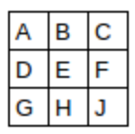

Here’s our kernel:

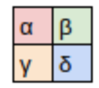

Since the filter fits in the image four times, we have four results:

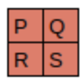

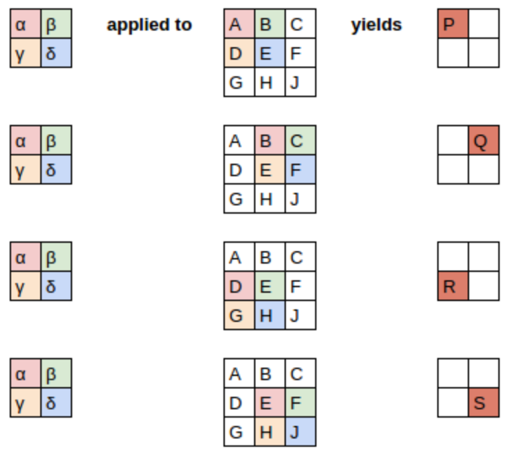

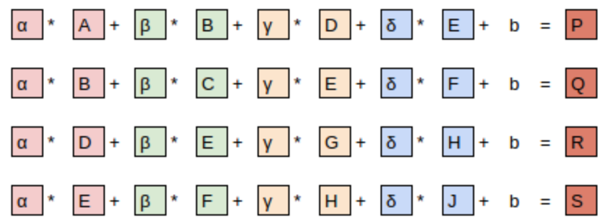

``` python
x_imgs = x_train.view(-1,28,28)
xv_imgs = x_valid.view(-1,28,28)
```

``` python
mpl.rcParams['figure.dpi'] = 30
```

``` python
im3 = x_imgs[7]
show_image(im3), im3.shape
```


``` python
top_edge = tensor([[-1,-1,-1],
                   [ 0, 0, 0],
                   [ 1, 1, 1]]).float()
```

We’re going to call this our kernel (because that’s what fancy computer vision researchers call these).

``` python
show_image(top_edge, noframe=True);
```


The filter will take any window of size 3×3 in our images, and if we name the pixel values like this:

$$\begin{matrix} a1 & a2 & a3 \\ a4 & a5 & a6 \\ a7 & a8 & a9 \end{matrix}$$

it will return $-a1-a2-a3+a7+a8+a9$.

``` python
df = pd.DataFrame(im3[:28,:28])

df.style.format(precision=2).set_properties(**{'font-size':'7pt'}).background_gradient('Greys')
```

|   | 0 | 1 | 2 | 3 | 4 | 5 | 6 | 7 | 8 | 9 | 10 | 11 | 12 | 13 | 14 | 15 | 16 | 17 | 18 | 19 | 20 | 21 | 22 | 23 | 24 | 25 | 26 | 27 |
|----|----|----|----|----|----|----|----|----|----|----|----|----|----|----|----|----|----|----|----|----|----|----|----|----|----|----|----|----|
| 0 | 0.00 | 0.00 | 0.00 | 0.00 | 0.00 | 0.00 | 0.00 | 0.00 | 0.00 | 0.00 | 0.00 | 0.00 | 0.00 | 0.00 | 0.00 | 0.00 | 0.00 | 0.00 | 0.00 | 0.00 | 0.00 | 0.00 | 0.00 | 0.00 | 0.00 | 0.00 | 0.00 | 0.00 |
| 1 | 0.00 | 0.00 | 0.00 | 0.00 | 0.00 | 0.00 | 0.00 | 0.00 | 0.00 | 0.00 | 0.00 | 0.00 | 0.00 | 0.00 | 0.00 | 0.00 | 0.00 | 0.00 | 0.00 | 0.00 | 0.00 | 0.00 | 0.00 | 0.00 | 0.00 | 0.00 | 0.00 | 0.00 |
| 2 | 0.00 | 0.00 | 0.00 | 0.00 | 0.00 | 0.00 | 0.00 | 0.00 | 0.00 | 0.00 | 0.00 | 0.00 | 0.00 | 0.00 | 0.00 | 0.00 | 0.00 | 0.00 | 0.00 | 0.00 | 0.00 | 0.00 | 0.00 | 0.00 | 0.00 | 0.00 | 0.00 | 0.00 |
| 3 | 0.00 | 0.00 | 0.00 | 0.00 | 0.00 | 0.00 | 0.00 | 0.00 | 0.00 | 0.00 | 0.00 | 0.00 | 0.00 | 0.00 | 0.00 | 0.00 | 0.00 | 0.00 | 0.00 | 0.00 | 0.00 | 0.00 | 0.00 | 0.00 | 0.00 | 0.00 | 0.00 | 0.00 |
| 4 | 0.00 | 0.00 | 0.00 | 0.00 | 0.00 | 0.00 | 0.00 | 0.00 | 0.00 | 0.00 | 0.00 | 0.00 | 0.00 | 0.00 | 0.00 | 0.00 | 0.00 | 0.00 | 0.00 | 0.00 | 0.00 | 0.00 | 0.00 | 0.00 | 0.00 | 0.00 | 0.00 | 0.00 |
| 5 | 0.00 | 0.00 | 0.00 | 0.00 | 0.00 | 0.00 | 0.00 | 0.00 | 0.00 | 0.00 | 0.00 | 0.15 | 0.17 | 0.41 | 1.00 | 0.99 | 0.99 | 0.99 | 0.99 | 0.99 | 0.68 | 0.02 | 0.00 | 0.00 | 0.00 | 0.00 | 0.00 | 0.00 |
| 6 | 0.00 | 0.00 | 0.00 | 0.00 | 0.00 | 0.00 | 0.00 | 0.00 | 0.00 | 0.17 | 0.54 | 0.88 | 0.88 | 0.98 | 0.99 | 0.98 | 0.98 | 0.98 | 0.98 | 0.98 | 0.98 | 0.62 | 0.05 | 0.00 | 0.00 | 0.00 | 0.00 | 0.00 |
| 7 | 0.00 | 0.00 | 0.00 | 0.00 | 0.00 | 0.00 | 0.00 | 0.00 | 0.00 | 0.70 | 0.98 | 0.98 | 0.98 | 0.98 | 0.99 | 0.98 | 0.98 | 0.98 | 0.98 | 0.98 | 0.98 | 0.98 | 0.23 | 0.00 | 0.00 | 0.00 | 0.00 | 0.00 |
| 8 | 0.00 | 0.00 | 0.00 | 0.00 | 0.00 | 0.00 | 0.00 | 0.00 | 0.00 | 0.43 | 0.98 | 0.98 | 0.90 | 0.52 | 0.52 | 0.52 | 0.52 | 0.74 | 0.98 | 0.98 | 0.98 | 0.98 | 0.23 | 0.00 | 0.00 | 0.00 | 0.00 | 0.00 |
| 9 | 0.00 | 0.00 | 0.00 | 0.00 | 0.00 | 0.00 | 0.00 | 0.00 | 0.00 | 0.02 | 0.11 | 0.11 | 0.09 | 0.00 | 0.00 | 0.00 | 0.00 | 0.05 | 0.88 | 0.98 | 0.98 | 0.67 | 0.03 | 0.00 | 0.00 | 0.00 | 0.00 | 0.00 |
| 10 | 0.00 | 0.00 | 0.00 | 0.00 | 0.00 | 0.00 | 0.00 | 0.00 | 0.00 | 0.00 | 0.00 | 0.00 | 0.00 | 0.00 | 0.00 | 0.00 | 0.00 | 0.33 | 0.95 | 0.98 | 0.98 | 0.56 | 0.00 | 0.00 | 0.00 | 0.00 | 0.00 | 0.00 |
| 11 | 0.00 | 0.00 | 0.00 | 0.00 | 0.00 | 0.00 | 0.00 | 0.00 | 0.00 | 0.00 | 0.00 | 0.00 | 0.00 | 0.00 | 0.00 | 0.00 | 0.34 | 0.74 | 0.98 | 0.98 | 0.98 | 0.05 | 0.00 | 0.00 | 0.00 | 0.00 | 0.00 | 0.00 |
| 12 | 0.00 | 0.00 | 0.00 | 0.00 | 0.00 | 0.00 | 0.00 | 0.00 | 0.00 | 0.00 | 0.00 | 0.00 | 0.00 | 0.00 | 0.36 | 0.83 | 0.96 | 0.98 | 0.98 | 0.98 | 0.80 | 0.04 | 0.00 | 0.00 | 0.00 | 0.00 | 0.00 | 0.00 |
| 13 | 0.00 | 0.00 | 0.00 | 0.00 | 0.00 | 0.00 | 0.00 | 0.00 | 0.00 | 0.12 | 0.49 | 0.75 | 0.75 | 0.75 | 0.99 | 0.98 | 0.98 | 0.98 | 0.93 | 0.40 | 0.11 | 0.00 | 0.00 | 0.00 | 0.00 | 0.00 | 0.00 | 0.00 |
| 14 | 0.00 | 0.00 | 0.00 | 0.00 | 0.00 | 0.00 | 0.00 | 0.00 | 0.18 | 0.87 | 0.98 | 0.98 | 0.98 | 0.98 | 0.99 | 0.98 | 0.98 | 0.98 | 0.69 | 0.00 | 0.00 | 0.00 | 0.00 | 0.00 | 0.00 | 0.00 | 0.00 | 0.00 |
| 15 | 0.00 | 0.00 | 0.00 | 0.00 | 0.00 | 0.00 | 0.00 | 0.00 | 0.18 | 0.87 | 0.99 | 0.99 | 0.99 | 0.99 | 1.00 | 0.99 | 0.99 | 0.99 | 0.99 | 0.29 | 0.00 | 0.00 | 0.00 | 0.00 | 0.00 | 0.00 | 0.00 | 0.00 |
| 16 | 0.00 | 0.00 | 0.00 | 0.00 | 0.00 | 0.00 | 0.00 | 0.00 | 0.00 | 0.12 | 0.48 | 0.20 | 0.17 | 0.17 | 0.17 | 0.17 | 0.56 | 0.98 | 0.98 | 0.29 | 0.00 | 0.00 | 0.00 | 0.00 | 0.00 | 0.00 | 0.00 | 0.00 |
| 17 | 0.00 | 0.00 | 0.00 | 0.00 | 0.00 | 0.00 | 0.00 | 0.00 | 0.00 | 0.00 | 0.00 | 0.00 | 0.00 | 0.00 | 0.00 | 0.00 | 0.06 | 0.98 | 0.98 | 0.29 | 0.00 | 0.00 | 0.00 | 0.00 | 0.00 | 0.00 | 0.00 | 0.00 |
| 18 | 0.00 | 0.00 | 0.00 | 0.00 | 0.00 | 0.00 | 0.00 | 0.00 | 0.00 | 0.00 | 0.00 | 0.00 | 0.00 | 0.00 | 0.00 | 0.00 | 0.34 | 0.98 | 0.98 | 0.29 | 0.00 | 0.00 | 0.00 | 0.00 | 0.00 | 0.00 | 0.00 | 0.00 |
| 19 | 0.00 | 0.00 | 0.00 | 0.00 | 0.00 | 0.00 | 0.02 | 0.29 | 0.04 | 0.00 | 0.00 | 0.00 | 0.00 | 0.00 | 0.00 | 0.38 | 0.95 | 0.98 | 0.98 | 0.29 | 0.00 | 0.00 | 0.00 | 0.00 | 0.00 | 0.00 | 0.00 | 0.00 |
| 20 | 0.00 | 0.00 | 0.00 | 0.00 | 0.00 | 0.24 | 0.71 | 0.98 | 0.11 | 0.00 | 0.00 | 0.00 | 0.00 | 0.07 | 0.36 | 0.93 | 0.98 | 0.98 | 0.95 | 0.25 | 0.00 | 0.00 | 0.00 | 0.00 | 0.00 | 0.00 | 0.00 | 0.00 |
| 21 | 0.00 | 0.00 | 0.00 | 0.00 | 0.00 | 0.81 | 0.98 | 0.98 | 0.57 | 0.52 | 0.52 | 0.52 | 0.52 | 0.79 | 0.99 | 0.98 | 0.98 | 0.73 | 0.32 | 0.00 | 0.00 | 0.00 | 0.00 | 0.00 | 0.00 | 0.00 | 0.00 | 0.00 |
| 22 | 0.00 | 0.00 | 0.00 | 0.00 | 0.00 | 0.81 | 0.98 | 0.98 | 0.98 | 0.98 | 0.98 | 0.98 | 0.98 | 0.98 | 0.99 | 0.90 | 0.60 | 0.03 | 0.00 | 0.00 | 0.00 | 0.00 | 0.00 | 0.00 | 0.00 | 0.00 | 0.00 | 0.00 |
| 23 | 0.00 | 0.00 | 0.00 | 0.00 | 0.00 | 0.19 | 0.61 | 0.98 | 0.98 | 0.98 | 0.98 | 0.98 | 0.85 | 0.81 | 0.57 | 0.18 | 0.00 | 0.00 | 0.00 | 0.00 | 0.00 | 0.00 | 0.00 | 0.00 | 0.00 | 0.00 | 0.00 | 0.00 |
| 24 | 0.00 | 0.00 | 0.00 | 0.00 | 0.00 | 0.00 | 0.03 | 0.40 | 0.92 | 0.98 | 0.67 | 0.40 | 0.09 | 0.00 | 0.00 | 0.00 | 0.00 | 0.00 | 0.00 | 0.00 | 0.00 | 0.00 | 0.00 | 0.00 | 0.00 | 0.00 | 0.00 | 0.00 |
| 25 | 0.00 | 0.00 | 0.00 | 0.00 | 0.00 | 0.00 | 0.00 | 0.00 | 0.00 | 0.00 | 0.00 | 0.00 | 0.00 | 0.00 | 0.00 | 0.00 | 0.00 | 0.00 | 0.00 | 0.00 | 0.00 | 0.00 | 0.00 | 0.00 | 0.00 | 0.00 | 0.00 | 0.00 |
| 26 | 0.00 | 0.00 | 0.00 | 0.00 | 0.00 | 0.00 | 0.00 | 0.00 | 0.00 | 0.00 | 0.00 | 0.00 | 0.00 | 0.00 | 0.00 | 0.00 | 0.00 | 0.00 | 0.00 | 0.00 | 0.00 | 0.00 | 0.00 | 0.00 | 0.00 | 0.00 | 0.00 | 0.00 |
| 27 | 0.00 | 0.00 | 0.00 | 0.00 | 0.00 | 0.00 | 0.00 | 0.00 | 0.00 | 0.00 | 0.00 | 0.00 | 0.00 | 0.00 | 0.00 | 0.00 | 0.00 | 0.00 | 0.00 | 0.00 | 0.00 | 0.00 | 0.00 | 0.00 | 0.00 | 0.00 | 0.00 | 0.00 |

``` python
(im3[3:6,14:17] * top_edge).sum()
```

    tensor(2.9727)

``` python
(im3[7:10,14:17] * top_edge).sum()
```

    tensor(-2.9570)

Exported source

``` python
def apply_kernel(row, col, kernel): return (im3[row-1:row+2,col-1:col+2] * kernel).sum()
```

``` python
apply_kernel(4,15,top_edge)
```

    tensor(2.9727)

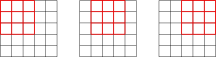

``` python
[[(i,j) for j in range(5)] for i in range(5)]
```

    [[(0, 0), (0, 1), (0, 2), (0, 3), (0, 4)],
     [(1, 0), (1, 1), (1, 2), (1, 3), (1, 4)],
     [(2, 0), (2, 1), (2, 2), (2, 3), (2, 4)],
     [(3, 0), (3, 1), (3, 2), (3, 3), (3, 4)],
     [(4, 0), (4, 1), (4, 2), (4, 3), (4, 4)]]

``` python
rng = range(1,27)
top_edge3 = tensor([[apply_kernel(i,j,top_edge) for j in rng] for i in rng])
show_image(top_edge3);
```

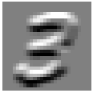

``` python
left_edge = tensor([[-1,0,1],
                    [-1,0,1],
                    [-1,0,1]]).float()
```

``` python
show_image(left_edge, noframe=False);
```


``` python
left_edge3 = tensor([[apply_kernel(i,j,left_edge) for j in rng] for i in rng])
show_image(left_edge3);
```

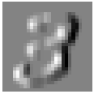

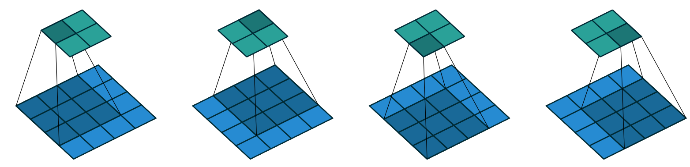

### Convolutions in PyTorch

Exported source

``` python
import torch.nn.functional as F
import torch
```

What to do if you have [2 months to complete your thesis](https://github.com/Yangqing/caffe/wiki/Convolution-in-Caffe:-a-memo)? Use [im2col](https://hal.inria.fr/inria-00112631/).

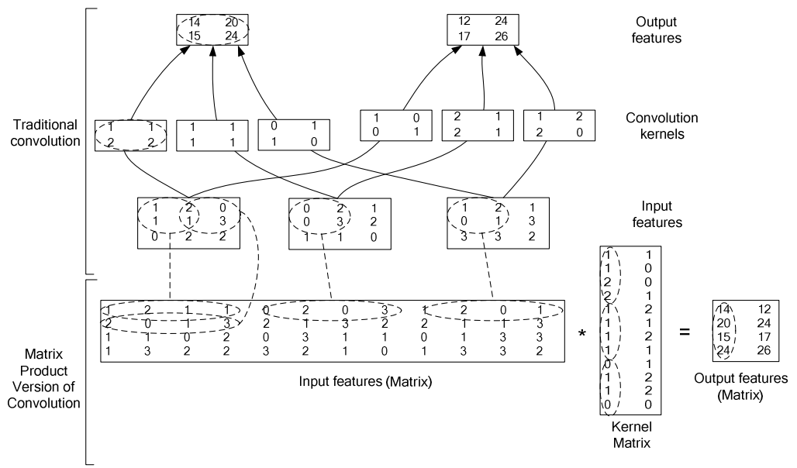

image.png

Here’s a sample [numpy implementation](https://github.com/3outeille/CNNumpy/blob/5394f13e7ed67a808a3e39fd381f168825d65ff5/src/fast/utils.py#L360).

``` python
inp = im3[None,None,:,:].float()
inp_unf = F.unfold(inp, (3,3))[0]
inp_unf.shape
```

    torch.Size([9, 676])

``` python
im3.shape, 26 * 26
```

    (torch.Size([28, 28]), 676)

``` python
w = left_edge.view(-1)
w.shape
```

    torch.Size([9])

``` python
out_unf = w@inp_unf
out_unf.shape
```

    torch.Size([676])

``` python
out = out_unf.view(26,26)
show_image(out);
```


``` python
%timeit -n 1 tensor([[apply_kernel(i,j,left_edge) for j in rng] for i in rng]);
```

    11.3 ms ± 629 µs per loop (mean ± std. dev. of 7 runs, 1 loop each)

``` python
%timeit -n 100 (w@F.unfold(inp, (3,3))[0]).view(26,26);
```

    39.7 µs ± 7.89 µs per loop (mean ± std. dev. of 7 runs, 100 loops each)

``` python
%timeit -n 100 F.conv2d(inp, left_edge[None,None])
```

    19.6 µs ± 9.05 µs per loop (mean ± std. dev. of 7 runs, 100 loops each)

``` python
diag1_edge = tensor([[ 0,-1, 1],
                     [-1, 1, 0],
                     [ 1, 0, 0]]).float()
```

``` python
show_image(diag1_edge, noframe=True);
```


``` python
diag2_edge = tensor([[ 1,-1, 0],
                     [ 0, 1,-1],
                     [ 0, 0, 1]]).float()
```

``` python
show_image(diag2_edge, noframe=False);
```


``` python
xb = x_imgs[:16][:,None]
xb.shape
```

    torch.Size([16, 1, 28, 28])

``` python
edge_kernels = torch.stack([left_edge, top_edge, diag1_edge, diag2_edge])[:,None]
edge_kernels.shape
```

    torch.Size([4, 1, 3, 3])

``` python
batch_features = F.conv2d(xb, edge_kernels)
batch_features.shape
```

    torch.Size([16, 4, 26, 26])

The output shape shows we gave 64 images in the mini-batch, 4 kernels, and 26×26 edge maps (we started with 28×28 images, but lost one pixel from each side as discussed earlier). We can see we get the same results as when we did this manually:

``` python
img0 = xb[1,0]
show_image(img0);
```

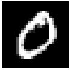

Exported source

``` python
from itertools import zip_longest
```

``` python
show_images([batch_features[1,i] for i in range(4)])
```

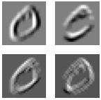

### Strides and Padding

With appropriate padding, we can ensure that the output activation map is the same size as the original image.

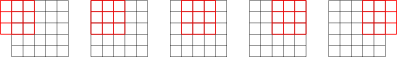

With a 5×5 input, 4×4 kernel, and 2 pixels of padding, we end up with a 6×6 activation map.

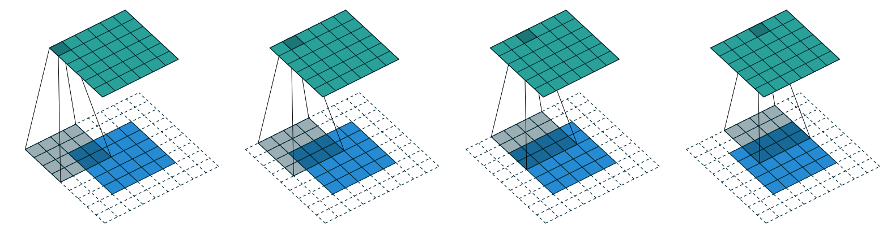

If we add a kernel of size `ks` by `ks` (with `ks` an odd number), the necessary padding on each side to keep the same shape is `ks//2`.

We could move over two pixels after each kernel application. This is known as a *stride-2* convolution.

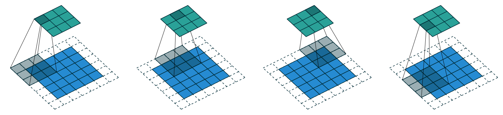

## Creating the CNN

``` python
n,m = x_train.shape
c = y_train.max()+1
nh = 50
```

``` python
model = nn.Sequential(nn.Linear(m,nh), nn.ReLU(), nn.Linear(nh,10))
```

``` python
broken_cnn = nn.Sequential(
    nn.Conv2d(1,30, kernel_size=3, padding=1),
    nn.ReLU(),
    nn.Conv2d(30,10, kernel_size=3, padding=1)
)
```

``` python
broken_cnn(xb).shape
```

    torch.Size([16, 10, 28, 28])

Exported source

``` python
def conv(ni, nf, ks=3, stride=2, act=True):
    res = nn.Conv2d(ni, nf, stride=stride, kernel_size=ks, padding=ks//2)
    if act: res = nn.Sequential(res, nn.ReLU())
    return res
```

Refactoring parts of your neural networks like this makes it much less likely you’ll get errors due to inconsistencies in your architectures, and makes it more obvious to the reader which parts of your layers are actually changing.

``` python
simple_cnn = nn.Sequential(
    conv(1 ,4),            #14x14
    conv(4 ,8),            #7x7
    conv(8 ,16),           #4x4
    conv(16,16),           #2x2
    conv(16,10, act=False), #1x1
    nn.Flatten(),
)
```

``` python
dimensions = [o.shape for o in model.parameters()]

parameters_per_layer = [np.product(o.shape) for o in model.parameters()]

parameters_total = tensor([np.product(o.shape) for o in model.parameters()]).sum()

model, dimensions, parameters_per_layer, parameters_total
```

    (Sequential(
       (0): Linear(in_features=784, out_features=50, bias=True)
       (1): ReLU()
       (2): Linear(in_features=50, out_features=10, bias=True)
     ),
     [torch.Size([50, 784]),
      torch.Size([50]),
      torch.Size([10, 50]),
      torch.Size([10])],
     [39200, 50, 500, 10],
     tensor(39760))

``` python
dimensions = [o.shape for o in simple_cnn.parameters()]

parameters_per_layer = [np.product(o.shape) for o in simple_cnn.parameters()]

parameters_total = tensor([np.product(o.shape) for o in simple_cnn.parameters()]).sum()

simple_cnn, dimensions, parameters_per_layer, parameters_total
```

    (Sequential(
       (0): Sequential(
         (0): Conv2d(1, 4, kernel_size=(3, 3), stride=(2, 2), padding=(1, 1))
         (1): ReLU()
       )
       (1): Sequential(
         (0): Conv2d(4, 8, kernel_size=(3, 3), stride=(2, 2), padding=(1, 1))
         (1): ReLU()
       )
       (2): Sequential(
         (0): Conv2d(8, 16, kernel_size=(3, 3), stride=(2, 2), padding=(1, 1))
         (1): ReLU()
       )
       (3): Sequential(
         (0): Conv2d(16, 16, kernel_size=(3, 3), stride=(2, 2), padding=(1, 1))
         (1): ReLU()
       )
       (4): Conv2d(16, 10, kernel_size=(3, 3), stride=(2, 2), padding=(1, 1))
       (5): Flatten(start_dim=1, end_dim=-1)
     ),
     [torch.Size([4, 1, 3, 3]),
      torch.Size([4]),
      torch.Size([8, 4, 3, 3]),
      torch.Size([8]),
      torch.Size([16, 8, 3, 3]),
      torch.Size([16]),
      torch.Size([16, 16, 3, 3]),
      torch.Size([16]),
      torch.Size([10, 16, 3, 3]),
      torch.Size([10])],
     [36, 4, 288, 8, 1152, 16, 2304, 16, 1440, 10],
     tensor(5274))

``` python
simple_cnn(xb).shape
```

    torch.Size([16, 10])

``` python
x_imgs = x_train.view(-1,1,28,28)
xv_imgs = x_valid.view(-1,1,28,28)
train_ds,valid_ds = Dataset(x_imgs, y_train),Dataset(xv_imgs, y_valid)
```

Exported source

``` python
def to_device(x, device=def_device):
    if isinstance(x, torch.Tensor): return x.to(device)
    if isinstance(x, Mapping): return {k:v.to(device) for k,v in x.items()}
    return type(x)(to_device(o, device) for o in x)

def collate_device(b): return to_device(default_collate(b))
```

``` python
from torch import optim

bs = 256
lr = 0.4
train_dl,valid_dl = get_dls(train_ds, valid_ds, bs, collate_fn=collate_device)
opt = optim.SGD(simple_cnn.parameters(), lr=lr)
```

``` python
loss,acc = fit(5, simple_cnn.to(def_device), F.cross_entropy, opt, train_dl, valid_dl)
```

    0 0.5696531332492828 0.8189000003814697
    1 0.17475426919460296 0.9438000001907348
    2 0.1348926905155182 0.9603000007629394
    3 0.11516531736850738 0.9650000008583068
    4 0.19701933751106263 0.9389000008583069

``` python
opt = optim.SGD(simple_cnn.parameters(), lr=lr/4)
loss,acc = fit(5, simple_cnn.to(def_device), F.cross_entropy, opt, train_dl, valid_dl)
```

    0 0.08551515686511993 0.9752999995231628
    1 0.09710506019592285 0.9714999994277954
    2 0.08652983202934265 0.9754999995231628
    3 0.08377773129940033 0.9766999995231629
    4 0.08503483123779297 0.9750999995231628

### Understanding Convolution Arithmetic

In an input of size `64x1x28x28` the axes are `batch,channel,height,width`. This is often represented as `NCHW` (where `N` refers to batch size). Tensorflow, on the other hand, uses `NHWC` axis order (aka “channels-last”). Channels-last is faster for many models, so recently it’s become more common to see this as an option in PyTorch too.

We have 1 input channel, 4 output channels, and a 3×3 kernel.

``` python
simple_cnn
```

    Sequential(
      (0): Sequential(
        (0): Conv2d(1, 4, kernel_size=(3, 3), stride=(2, 2), padding=(1, 1))
        (1): ReLU()
      )
      (1): Sequential(
        (0): Conv2d(4, 8, kernel_size=(3, 3), stride=(2, 2), padding=(1, 1))
        (1): ReLU()
      )
      (2): Sequential(
        (0): Conv2d(8, 16, kernel_size=(3, 3), stride=(2, 2), padding=(1, 1))
        (1): ReLU()
      )
      (3): Sequential(
        (0): Conv2d(16, 16, kernel_size=(3, 3), stride=(2, 2), padding=(1, 1))
        (1): ReLU()
      )
      (4): Conv2d(16, 10, kernel_size=(3, 3), stride=(2, 2), padding=(1, 1))
      (5): Flatten(start_dim=1, end_dim=-1)
    )

``` python
simple_cnn[0][0]
```

    Conv2d(1, 4, kernel_size=(3, 3), stride=(2, 2), padding=(1, 1))

``` python
conv1 = simple_cnn[0][0]
conv1.weight.shape
```

    torch.Size([4, 1, 3, 3])

``` python
conv1.bias.shape
```

    torch.Size([4])

The *receptive field* is the area of an image that is involved in the calculation of a layer. *conv-example.xlsx* shows the calculation of two stride-2 convolutional layers using an MNIST digit. Here’s what we see if we click on one of the cells in the *conv2* section, which shows the output of the second convolutional layer, and click *trace precedents*.

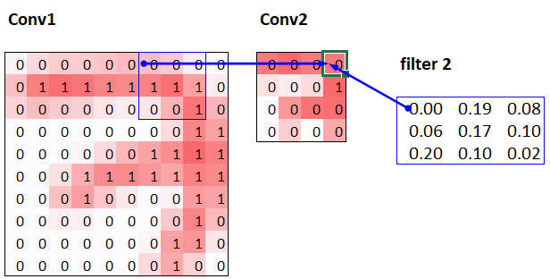

The blue highlighted cells are its *precedents*—that is, the cells used to calculate its value. These cells are the corresponding 3×3 area of cells from the input layer (on the left), and the cells from the filter (on the right). Click *trace precedents* again:

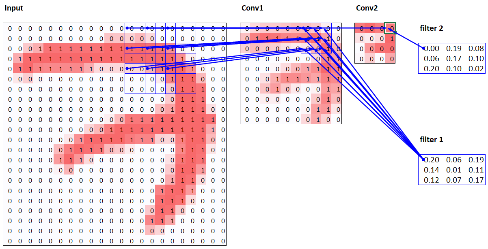

In this example, we have just two convolutional layers. We can see that a 7×7 area of cells in the input layer is used to calculate the single green cell in the Conv2 layer. This is the *receptive field*

The deeper we are in the network (specifically, the more stride-2 convs we have before a layer), the larger the receptive field for an activation in that layer.

## Color Images

A colour picture is a rank-3 tensor:

``` python
from torchvision.io import read_image
```

``` python
im = read_image('images/grizzly.jpg')
im.shape
```

    torch.Size([3, 1000, 846])

``` python
show_image(im.permute(1,2,0));
```


``` python
_,axs = plt.subplots(1,3)
for bear,ax,color in zip(im,axs,('Reds','Greens','Blues')): show_image(255-bear, ax=ax, cmap=color)
```

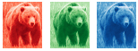

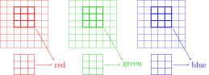

These are then all added together, to produce a single number, for each grid location, for each output feature.

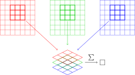

We have `ch_out` filters like this, so in the end, the result of our convolutional layer will be a batch of images with `ch_out` channels.

Back to top
