# Activation stats

Activation stats

Author

Benedict Thekkel

Exported source

``` python
from __future__ import annotations
import random,math,torch,numpy as np,matplotlib.pyplot as plt
import fastcore.all as fc
from functools import partial

from fastAIcourse.datasets import *
from fastAIcourse.learner import *
```

Exported source

``` python
import torch.nn.functional as F,matplotlib as mpl
from pathlib import Path
from operator import attrgetter,itemgetter
from contextlib import contextmanager

from torch import tensor,nn,optim
import torchvision.transforms.functional as TF
from datasets import load_dataset

from fastcore.test import test_close

torch.set_printoptions(precision=2, linewidth=140, sci_mode=False)
mpl.rcParams['figure.constrained_layout.use'] = True

import logging
logging.disable(logging.WARNING)
```

Exported source

``` python
def set_seed(seed, deterministic=False):
    torch.use_deterministic_algorithms(deterministic)
    torch.manual_seed(seed)
    random.seed(seed)
    np.random.seed(seed)
```

``` python
x,y = 'image','label'
name = "fashion_mnist"
dsd = load_dataset(name)
bs = 1024

@inplace
def transformi(b): b[x] = [TF.to_tensor(o) for o in b[x]]

tds = dsd.with_transform(transformi)
dls = DataLoaders.from_dd(tds, bs, num_workers=4)
dt = dls.train
```

## Baseline

Exported source

``` python
def conv(ni, nf, ks=3, act=True):
    res = nn.Conv2d(ni, nf, stride=2, kernel_size=ks, padding=ks//2)
    if act: res = nn.Sequential(res, nn.ReLU())
    return res

def cnn_layers():
    return [
        conv(1 ,8, ks=5),        #14x14
        conv(8 ,16),             #7x7
        conv(16,32),             #4x4
        conv(32,64),             #2x2
        conv(64,10, act=False),  #1x1
        nn.Flatten()]
```

We want to train quickly, so that means training at a high learning rate.

Exported source

``` python
from torcheval.metrics import MulticlassAccuracy
```

``` python
metrics = MetricsCB(accuracy=MulticlassAccuracy())
cbs = [TrainCB(), DeviceCB(), metrics, ProgressCB(plot=True)]
```

Exported source

``` python
def fit(model, epochs=1, xtra_cbs=None):
    learn = Learner(model, dls, loss_func=F.cross_entropy, lr=0.6, cbs=cbs+fc.L(xtra_cbs))
    learn.fit(epochs)
    return learn
```

``` python
set_seed(1)
learn = fit(nn.Sequential(*cnn_layers()))
```

| accuracy | loss  | epoch | train |
|----------|-------|-------|-------|
| 0.159    | 2.301 | 0     | train |
| 0.270    | 2.203 | 0     | eval  |


## Hooks

### Manual insertion

Exported source

``` python
class SequentialModel(nn.Module):
    def __init__(self, *layers):
        super().__init__()
        self.layers = nn.ModuleList(layers)
        self.act_means = [[] for _ in layers]
        self.act_stds  = [[] for _ in layers]
        
    def __call__(self, x):
        for i,l in enumerate(self.layers):
            x = l(x)
            self.act_means[i].append(to_cpu(x).mean())
            self.act_stds [i].append(to_cpu(x).std ())
        return x
    
    def __iter__(self): return iter(self.layers)
```

``` python
set_seed(1)
model = SequentialModel(*cnn_layers())
learn = fit(model)
```

| accuracy | loss  | epoch | train |
|----------|-------|-------|-------|
| 0.156    | 2.297 | 0     | train |
| 0.290    | 1.984 | 0     | eval  |

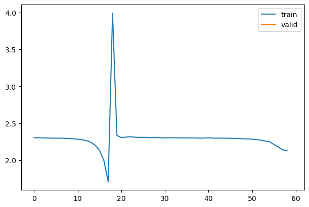

``` python
for l in model.act_means: plt.plot(l)
plt.legend(range(5));
```

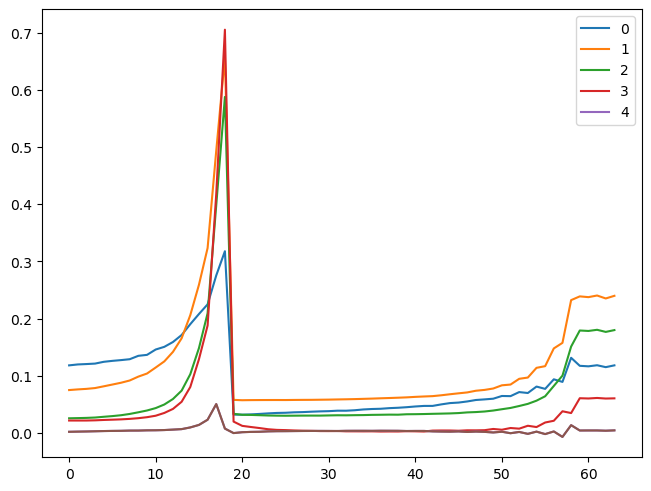

``` python
for l in model.act_stds: plt.plot(l)
plt.legend(range(5));
```

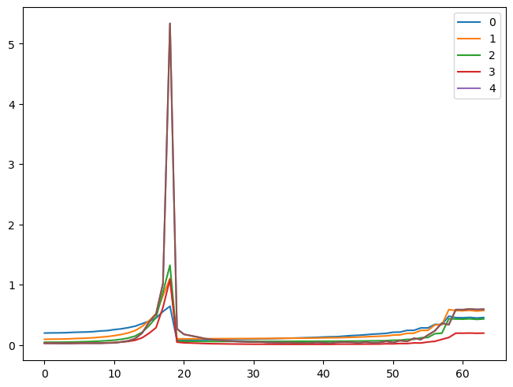

Ideally, mean is always about zero and std always around one.

### Pytorch hooks

Hooks are PyTorch object you can add to any nn.Module. A hook will be called when a layer, it is registered to, is executed during the forward pass (forward hook) or the backward pass (backward hook). Hooks don’t require us to rewrite the model.

``` python
set_seed(1)
model = nn.Sequential(*cnn_layers())
```

A hook is attached to a layer, and needs to have a function that takes three arguments: module, input, output. Here we store the mean and std of the output in the correct position of our list.

``` python
act_means = [[] for _ in model]
act_stds  = [[] for _ in model]
```

Exported source

``` python
def append_stats(i, mod, inp, outp):
    act_means[i].append(to_cpu(outp).mean())
    act_stds [i].append(to_cpu(outp).std())
```

``` python
for i,m in enumerate(model): 
    m.register_forward_hook(partial(append_stats, i))
```

``` python
fit(model)
```

| accuracy | loss  | epoch | train |
|----------|-------|-------|-------|
| 0.156    | 2.298 | 0     | train |
| 0.286    | 2.042 | 0     | eval  |


``` python
for o in act_means: plt.plot(o)
plt.legend(range(5));
```

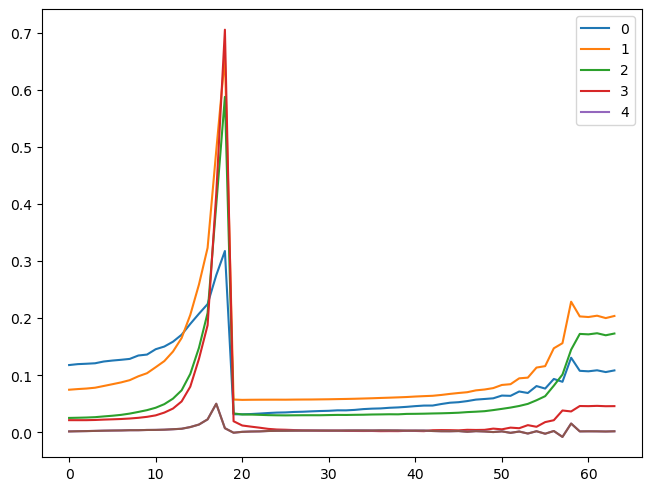

### Hook class

We can refactor this in a Hook class. It’s very important to remove the hooks when they are deleted, otherwise there will be references kept and the memory won’t be properly released when your model is deleted.

Exported source

``` python
class Hook():
    def __init__(self, m, f): self.hook = m.register_forward_hook(partial(f, self))
    def remove(self): self.hook.remove()
    def __del__(self): self.remove()
```

Exported source

``` python
def append_stats(hook, mod, inp, outp):
    if not hasattr(hook,'stats'): hook.stats = ([],[])
    acts = to_cpu(outp)
    hook.stats[0].append(acts.mean())
    hook.stats[1].append(acts.std())
```

``` python
set_seed(1)
model = nn.Sequential(*cnn_layers())
```

``` python
hooks = [Hook(l, append_stats) for l in model[:5].children()]
```

``` python
learn = fit(model)
```

| accuracy | loss  | epoch | train |
|----------|-------|-------|-------|
| 0.156    | 2.298 | 0     | train |
| 0.286    | 2.042 | 0     | eval  |


``` python
for h in hooks:
    plt.plot(h.stats[0])
    h.remove()
plt.legend(range(5));
```

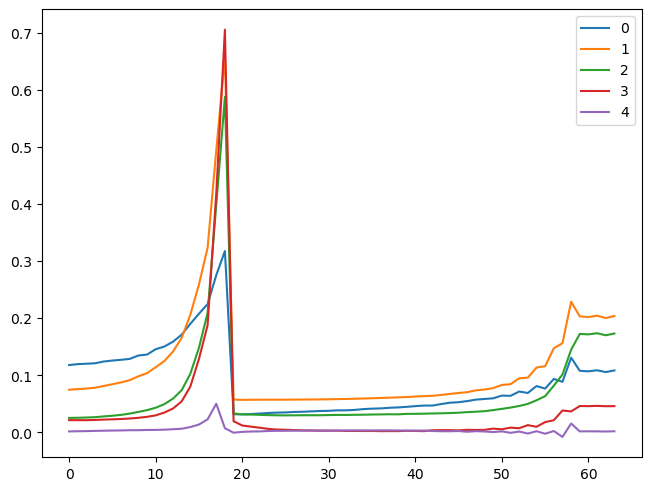

### A Hooks class

Exported source

``` python
class DummyCtxMgr:
    def __enter__(self, *args):
        print("let's go!")
        return self
    def __exit__ (self, *args): print("all done!")
    def hello(self): print("hello.")
```

``` python
with DummyCtxMgr() as dcm: dcm.hello()
```

    let's go!
    hello.
    all done!

Exported source

``` python
class DummyList(list):
    def __delitem__(self, i):
        print(f"Say bye to item {i}")
        super().__delitem__(i)
```

``` python
dml = DummyList([1,3,2])
dml
```

    [1, 3, 2]

``` python
del(dml[2])
dml
```

    Say bye to item 2

    [1, 3]

Exported source

``` python
class Hooks(list):
    def __init__(self, ms, f): super().__init__([Hook(m, f) for m in ms])
    def __enter__(self, *args): return self
    def __exit__ (self, *args): self.remove()
    def __del__(self): self.remove()
    def __delitem__(self, i):
        self[i].remove()
        super().__delitem__(i)
    def remove(self):
        for h in self: h.remove()
```

``` python
set_seed(1)
model = nn.Sequential(*cnn_layers())
```

``` python
with Hooks(model, append_stats) as hooks:
    fit(model)
    fig,axs = plt.subplots(1,2, figsize=(10,4))
    for h in hooks:
        for i in 0,1: axs[i].plot(h.stats[i])
    plt.legend(range(6));
```

| accuracy | loss  | epoch | train |
|----------|-------|-------|-------|
| 0.152    | 2.299 | 0     | train |
| 0.200    | 2.045 | 0     | eval  |

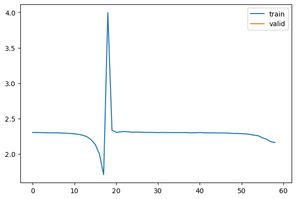

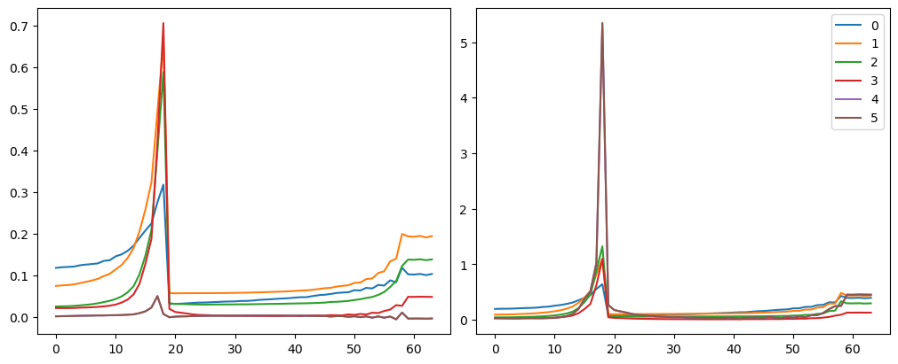

### HooksCallback

Exported source

``` python
class HooksCallback(Callback):
    def __init__(self, hookfunc, mod_filter=fc.noop, on_train=True, on_valid=False, mods=None):
        fc.store_attr()
        super().__init__()
    
    def before_fit(self, learn):
        if self.mods: mods=self.mods
        else: mods = fc.filter_ex(learn.model.modules(), self.mod_filter)
        self.hooks = Hooks(mods, partial(self._hookfunc, learn))

    def _hookfunc(self, learn, *args, **kwargs):
        if (self.on_train and learn.training) or (self.on_valid and not learn.training): self.hookfunc(*args, **kwargs)

    def after_fit(self, learn): self.hooks.remove()
    def __iter__(self): return iter(self.hooks)
    def __len__(self): return len(self.hooks)
```

``` python
hc = HooksCallback(append_stats, mod_filter=fc.risinstance(nn.Conv2d))
```

``` python
set_seed(1)
model = nn.Sequential(*cnn_layers())
fit(model, xtra_cbs=[hc]);
```

| accuracy | loss  | epoch | train |
|----------|-------|-------|-------|
| 0.162    | 2.301 | 0     | train |
| 0.326    | 2.131 | 0     | eval  |

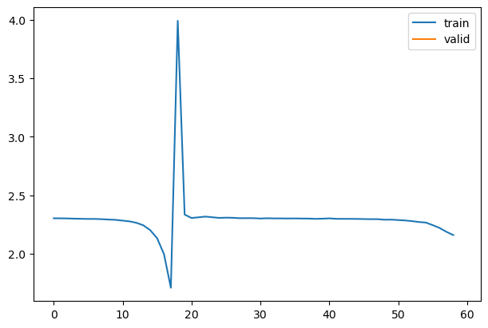

``` python
fig,axs = plt.subplots(1,2, figsize=(10,4))
for h in hc:
    for i in 0,1: axs[i].plot(h.stats[i])
plt.legend(range(6));
```

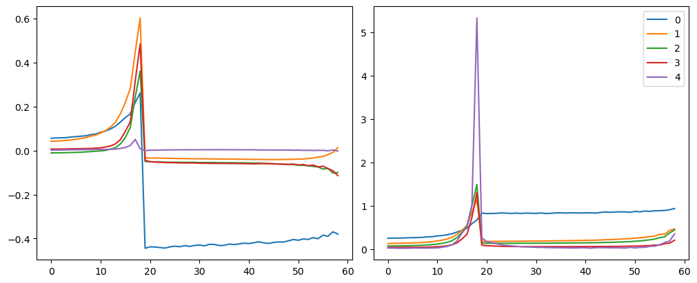

## Histograms

Exported source

``` python
def append_stats(hook, mod, inp, outp):
    if not hasattr(hook,'stats'): hook.stats = ([],[],[])
    acts = to_cpu(outp)
    hook.stats[0].append(acts.mean())
    hook.stats[1].append(acts.std())
    hook.stats[2].append(acts.abs().histc(40,0,10))
```

``` python
set_seed(1)
model = nn.Sequential(*cnn_layers())
hc = HooksCallback(append_stats, mod_filter=fc.risinstance(nn.Conv2d))
fit(model, xtra_cbs=[hc]);
```

| accuracy | loss  | epoch | train |
|----------|-------|-------|-------|
| 0.156    | 2.297 | 0     | train |
| 0.287    | 1.993 | 0     | eval  |


Exported source

``` python
# Thanks to @ste for initial version of histgram plotting code
def get_hist(h): return torch.stack(h.stats[2]).t().float().log1p()
```

``` python
fig,axes = get_grid(len(hc), figsize=(11,5))
for ax,h in zip(axes.flat, hc):
    show_image(get_hist(h), ax, origin='lower')
```


Exported source

``` python
def get_min(h):
    h1 = torch.stack(h.stats[2]).t().float()
    return h1[0]/h1.sum(0)
```

``` python
fig,axes = get_grid(len(hc), figsize=(11,5))
for ax,h in zip(axes.flatten(), hc):
    ax.plot(get_min(h))
    ax.set_ylim(0,1)
```


## ActivationStats

Exported source

``` python
class ActivationStats(HooksCallback):
    def __init__(self, mod_filter=fc.noop): super().__init__(append_stats, mod_filter)

    def color_dim(self, figsize=(11,5)):
        fig,axes = get_grid(len(self), figsize=figsize)
        for ax,h in zip(axes.flat, self):
            show_image(get_hist(h), ax, origin='lower')

    def dead_chart(self, figsize=(11,5)):
        fig,axes = get_grid(len(self), figsize=figsize)
        for ax,h in zip(axes.flatten(), self):
            ax.plot(get_min(h))
            ax.set_ylim(0,1)

    def plot_stats(self, figsize=(10,4)):
        fig,axs = plt.subplots(1,2, figsize=figsize)
        for h in self:
            for i in 0,1: axs[i].plot(h.stats[i])
        axs[0].set_title('Means')
        axs[1].set_title('Stdevs')
        plt.legend(fc.L.range(self))
```

``` python
astats = ActivationStats(fc.risinstance(nn.Conv2d))
```

``` python
set_seed(1)
model = nn.Sequential(*cnn_layers())
fit(model, xtra_cbs=[astats]);
```

| accuracy | loss  | epoch | train |
|----------|-------|-------|-------|
| 0.156    | 2.297 | 0     | train |
| 0.297    | 1.995 | 0     | eval  |


``` python
astats.color_dim()
```

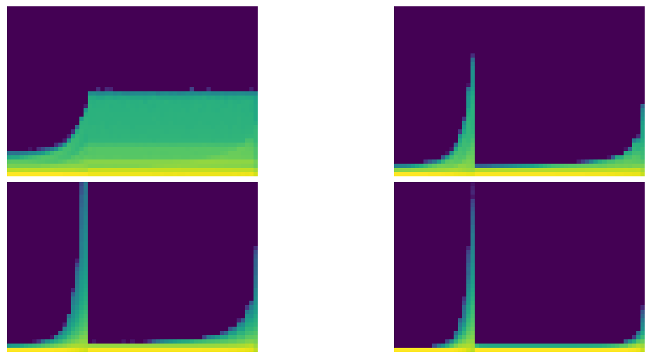

``` python
astats.dead_chart()
```

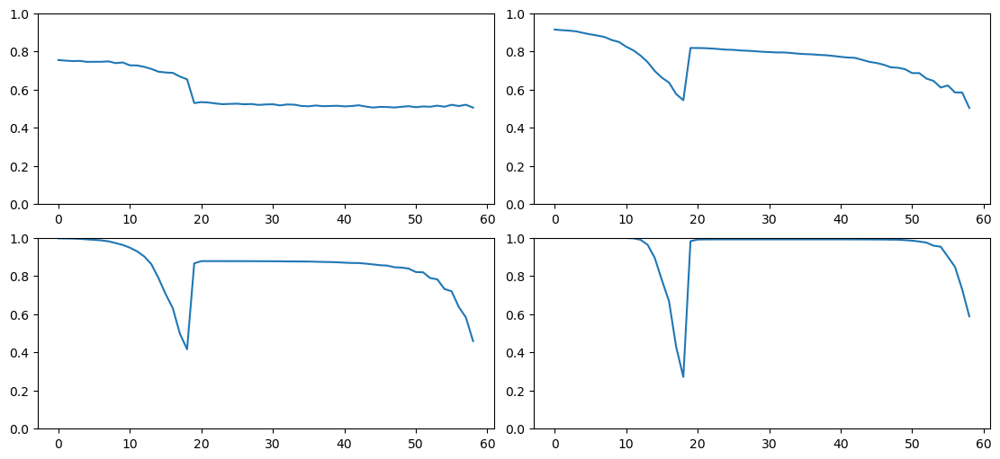

``` python
astats.plot_stats()
```

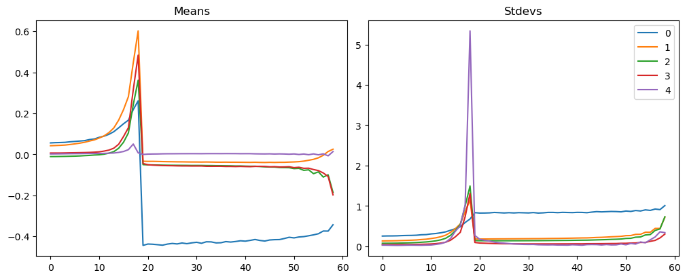

Back to top
