# Accelerated SGD

Accelerated SGD

Author

Benedict Thekkel

Exported source

``` python
import torch

from fastAIcourse.datasets import *
from fastAIcourse.conv import *
from fastAIcourse.learner import *
from fastAIcourse.activations import *
from fastAIcourse.init import *
```

Exported source

``` python
import pickle,gzip,math,os,time,shutil,torch,matplotlib as mpl,numpy as np,matplotlib.pyplot as plt
import fastcore.all as fc
from collections.abc import Mapping
from pathlib import Path
from operator import attrgetter,itemgetter
from functools import partial
from copy import copy
from contextlib import contextmanager

import torchvision.transforms.functional as TF,torch.nn.functional as F
from torch import tensor,nn,optim
from torch.utils.data import DataLoader,default_collate
from torch.nn import init
from torch.optim import lr_scheduler
from torcheval.metrics import MulticlassAccuracy
from datasets import load_dataset,load_dataset_builder
```

Exported source

``` python
from fastcore.test import test_close

torch.set_printoptions(precision=2, linewidth=140, sci_mode=False)
torch.manual_seed(1)

import logging
logging.disable(logging.WARNING)

set_seed(42)
```

``` python
xl,yl = 'image','label'
name = "fashion_mnist"
dsd = load_dataset(name)

bs = 1024
xmean,xstd = 0.28, 0.35

@inplace
def transformi(b): b[xl] = [(TF.to_tensor(o)-xmean)/xstd for o in b[xl]]

tds = dsd.with_transform(transformi)
dls = DataLoaders.from_dd(tds, bs, num_workers=4)
```

``` python
metrics = MetricsCB(accuracy=MulticlassAccuracy())
astats = ActivationStats(fc.risinstance(GeneralRelu))
cbs = [DeviceCB(), metrics, ProgressCB(plot=True), astats]
act_gr = partial(GeneralRelu, leak=0.1, sub=0.4)
iw = partial(init_weights, leaky=0.1)
lrf_cbs = [DeviceCB(), LRFinderCB()]
```

## Optimizers

### SGD

Exported source

``` python
class SGD:
    def __init__(self, params, lr, wd=0.):
        params = list(params)
        fc.store_attr()
        self.i = 0

    def step(self):
        with torch.no_grad():
            for p in self.params:
                self.reg_step(p)
                self.opt_step(p)
        self.i +=1

    def opt_step(self, p): p -= p.grad * self.lr
    def reg_step(self, p):
        if self.wd != 0: p *= 1 - self.lr*self.wd

    def zero_grad(self):
        for p in self.params: p.grad.data.zero_()
```

``` python
set_seed(42)
model = get_model(act_gr, norm=nn.BatchNorm2d).apply(iw)
learn = TrainLearner(model, dls, F.cross_entropy, lr=0.4, cbs=cbs, opt_func=SGD)
```

``` python
learn.fit(3)
```

| accuracy | loss  | epoch | train |
|----------|-------|-------|-------|
| 0.772    | 0.640 | 0     | train |
| 0.824    | 0.477 | 0     | eval  |
| 0.845    | 0.424 | 1     | train |
| 0.849    | 0.419 | 1     | eval  |
| 0.865    | 0.373 | 2     | train |
| 0.851    | 0.403 | 2     | eval  |

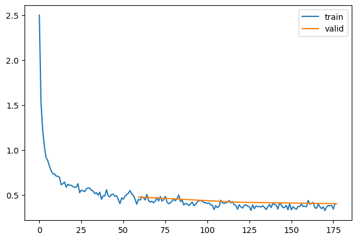

Consider the difference between *weight decay* and *L2 regularization*:

``` python
weight -= lr*wd*weight
```

…vs…

``` python
weight.grad += wd*weight
```

### Momentum

``` python
xs = torch.linspace(-4, 4, 100)
ys = 1 - (xs/3) ** 2 + torch.randn(100) * 0.1
```

``` python
_,axs = plt.subplots(2,2, figsize=(12,8))
betas = [0.5,0.7,0.9,0.99]
for beta,ax in zip(betas, axs.flatten()):
    ax.scatter(xs,ys)
    avg,res = 0,[]
    for yi in ys:
        avg = beta*avg + (1-beta)*yi
        res.append(avg)
    ax.plot(xs,np.array(res), color='red');
    ax.set_title(f'beta={beta}')
```

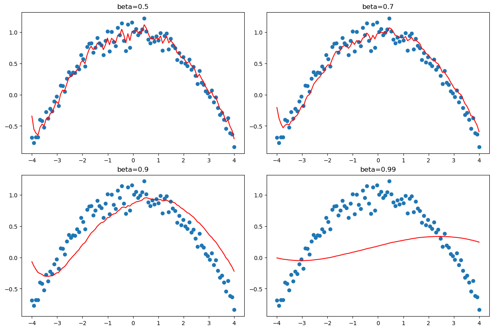

Exported source

``` python
class Momentum(SGD):
    def __init__(self, params, lr, wd=0., mom=0.9):
        super().__init__(params, lr=lr, wd=wd)
        self.mom=mom

    def opt_step(self, p):
        if not hasattr(p, 'grad_avg'): p.grad_avg = torch.zeros_like(p.grad)
        p.grad_avg = p.grad_avg*self.mom + p.grad*(1-self.mom)
        p -= self.lr * p.grad_avg
```

``` python
set_seed(42)
model = get_model(act_gr, norm=nn.BatchNorm2d).apply(iw)
learn = TrainLearner(model, dls, F.cross_entropy, lr=1.5, cbs=cbs, opt_func=Momentum)
```

``` python
learn.fit(3)
```

| accuracy | loss  | epoch | train |
|----------|-------|-------|-------|
| 0.787    | 0.597 | 0     | train |
| 0.848    | 0.417 | 0     | eval  |
| 0.869    | 0.360 | 1     | train |
| 0.861    | 0.368 | 1     | eval  |
| 0.885    | 0.315 | 2     | train |
| 0.871    | 0.360 | 2     | eval  |

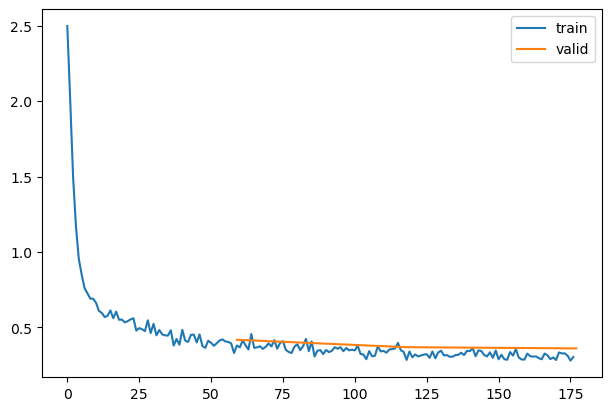

``` python
astats.color_dim()
```

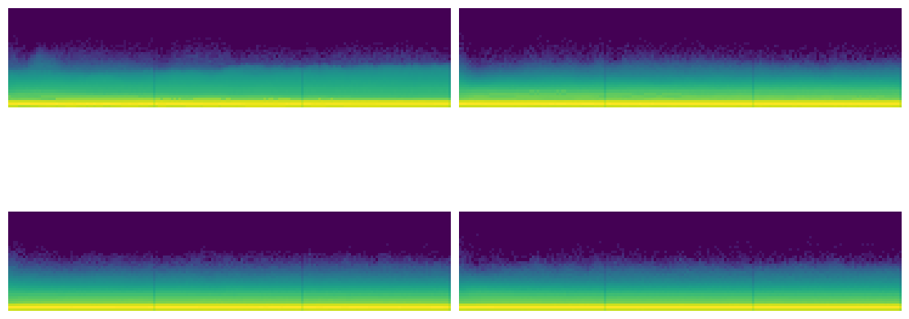

### RMSProp

Exported source

``` python
class RMSProp(SGD):
    def __init__(self, params, lr, wd=0., sqr_mom=0.99, eps=1e-5):
        super().__init__(params, lr=lr, wd=wd)
        self.sqr_mom,self.eps = sqr_mom,eps

    def opt_step(self, p):
        if not hasattr(p, 'sqr_avg'): p.sqr_avg = p.grad**2
        p.sqr_avg = p.sqr_avg*self.sqr_mom + p.grad**2*(1-self.sqr_mom)
        p -= self.lr * p.grad/(p.sqr_avg.sqrt() + self.eps)
```

``` python
set_seed(42)
model = get_model(act_gr, norm=nn.BatchNorm2d).apply(iw)
learn = TrainLearner(model, dls, F.cross_entropy, lr=3e-3, cbs=cbs, opt_func=RMSProp)
learn.fit(3)
```

| accuracy | loss  | epoch | train |
|----------|-------|-------|-------|
| 0.766    | 0.664 | 0     | train |
| 0.821    | 0.482 | 0     | eval  |
| 0.848    | 0.416 | 1     | train |
| 0.846    | 0.424 | 1     | eval  |
| 0.866    | 0.367 | 2     | train |
| 0.851    | 0.404 | 2     | eval  |

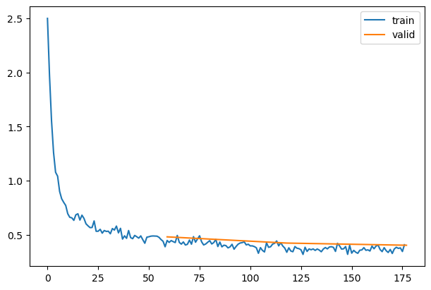

``` python
astats.color_dim()
```

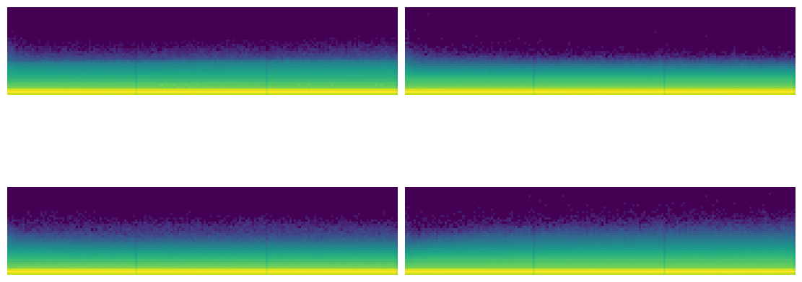

### Adam

Exported source

``` python
class Adam(SGD):
    def __init__(self, params, lr, wd=0., beta1=0.9, beta2=0.99, eps=1e-5):
        super().__init__(params, lr=lr, wd=wd)
        self.beta1,self.beta2,self.eps = beta1,beta2,eps

    def opt_step(self, p):
        if not hasattr(p, 'avg'): p.avg = torch.zeros_like(p.grad.data)
        if not hasattr(p, 'sqr_avg'): p.sqr_avg = torch.zeros_like(p.grad.data)
        p.avg = self.beta1*p.avg + (1-self.beta1)*p.grad
        unbias_avg = p.avg / (1 - (self.beta1**(self.i+1)))
        p.sqr_avg = self.beta2*p.sqr_avg + (1-self.beta2)*(p.grad**2)
        unbias_sqr_avg = p.sqr_avg / (1 - (self.beta2**(self.i+1)))
        p -= self.lr * unbias_avg / (unbias_sqr_avg + self.eps).sqrt()
```

``` python
set_seed(42)
model = get_model(act_gr, norm=nn.BatchNorm2d).apply(iw)
learn = TrainLearner(model, dls, F.cross_entropy, lr=6e-3, cbs=cbs, opt_func=Adam)
learn.fit(3)
```

| accuracy | loss  | epoch | train |
|----------|-------|-------|-------|
| 0.791    | 0.583 | 0     | train |
| 0.839    | 0.428 | 0     | eval  |
| 0.870    | 0.359 | 1     | train |
| 0.859    | 0.379 | 1     | eval  |
| 0.886    | 0.312 | 2     | train |
| 0.874    | 0.345 | 2     | eval  |

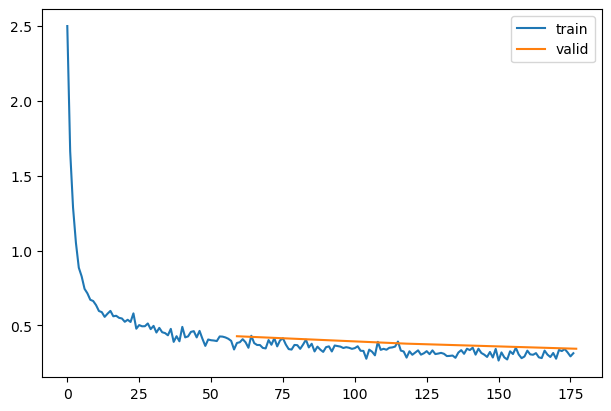

## Schedulers

We’ve already seen how we can easily write a custom LR-adjusting callback or [`Learner`](https://bthek1.github.io/fastAIcourse/learner.html#learner), or can use the predefined PyTorch schedulers. We’ll use the predefined ones for now since there’s nothing new to learn in implementing them ourselves.

``` python
dir(lr_scheduler)
```

    ['ChainedScheduler',
     'ConstantLR',
     'CosineAnnealingLR',
     'CosineAnnealingWarmRestarts',
     'Counter',
     'CyclicLR',
     'EPOCH_DEPRECATION_WARNING',
     'ExponentialLR',
     'LRScheduler',
     'LambdaLR',
     'LinearLR',
     'MultiStepLR',
     'MultiplicativeLR',
     'OneCycleLR',
     'Optimizer',
     'PolynomialLR',
     'ReduceLROnPlateau',
     'SequentialLR',
     'StepLR',
     '_LRScheduler',
     '__all__',
     '__builtins__',
     '__cached__',
     '__doc__',
     '__file__',
     '__loader__',
     '__name__',
     '__package__',
     '__spec__',
     '_enable_get_lr_call',
     'bisect_right',
     'inf',
     'math',
     'types',
     'warnings',
     'weakref',
     'wraps']

``` python
' '.join(o for o in dir(lr_scheduler) if o[0].isupper() and o[1].islower())
```

    'ChainedScheduler ConstantLR CosineAnnealingLR CosineAnnealingWarmRestarts Counter CyclicLR ExponentialLR LambdaLR LinearLR MultiStepLR MultiplicativeLR OneCycleLR Optimizer PolynomialLR ReduceLROnPlateau SequentialLR StepLR'

``` python
' '.join(filter(lambda x: x[0].isupper() and x[1].islower(), dir(lr_scheduler)))
```

    'ChainedScheduler ConstantLR CosineAnnealingLR CosineAnnealingWarmRestarts Counter CyclicLR ExponentialLR LambdaLR LinearLR MultiStepLR MultiplicativeLR OneCycleLR Optimizer PolynomialLR ReduceLROnPlateau SequentialLR StepLR'

``` python
learn = TrainLearner(get_model(), dls, F.cross_entropy, lr=6e-3, cbs=[DeviceCB(), SingleBatchCB()])
learn.fit(1)
```

``` python
opt = learn.opt
' '.join(o for o in dir(opt) if o[0]!='_')
```

    'add_param_group defaults load_state_dict param_groups profile_hook_step register_step_post_hook register_step_pre_hook state state_dict step zero_grad'

``` python
opt
```

    SGD (
    Parameter Group 0
        dampening: 0
        differentiable: False
        foreach: None
        lr: 0.006
        maximize: False
        momentum: 0
        nesterov: False
        weight_decay: 0
    )

``` python
param = next(iter(learn.model.parameters()))
st = opt.state[param]
```

``` python
st
```

    {'momentum_buffer': None}

``` python
len(opt.param_groups)
```

    1

``` python
pg = opt.param_groups[0]
```

``` python
list(pg)
```

    ['params',
     'lr',
     'momentum',
     'dampening',
     'weight_decay',
     'nesterov',
     'maximize',
     'foreach',
     'differentiable']

``` python
sched = lr_scheduler.CosineAnnealingLR(opt, 100)
```

``` python
sched.base_lrs
```

    [0.006]

``` python
sched.get_last_lr()
```

    [0.006]

Exported source

``` python
def sched_lrs(sched, steps):
    lrs = [sched.get_last_lr()]
    for i in range(steps):
        sched.optimizer.step()
        sched.step()
        lrs.append(sched.get_last_lr())
    plt.plot(lrs)
```

``` python
sched_lrs(sched, 110)
```

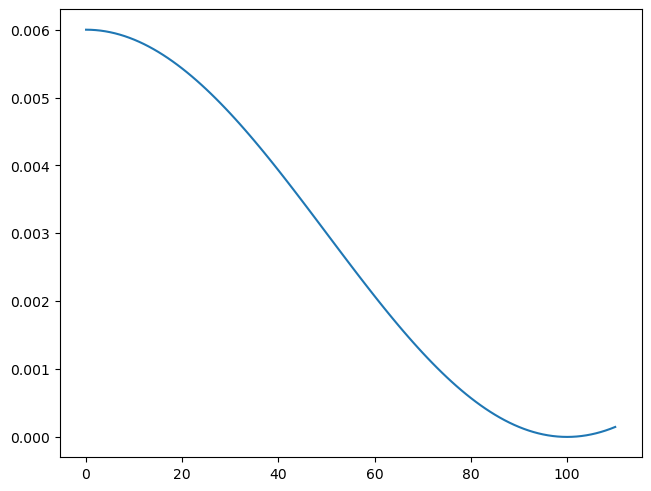

### Scheduler callbacks

Exported source

``` python
def _lr(cb): return cb.pg['lr']
```

``` python
len(dls.train)
```

    59

``` python
tmax = 3 * len(dls.train)
sched = partial(lr_scheduler.CosineAnnealingLR, T_max=tmax)
```

``` python
set_seed(42)
model = get_model(act_gr, norm=nn.BatchNorm2d).apply(iw)
rec = RecorderCB(lr=_lr)
xtra = [BatchSchedCB(sched),rec]
learn = TrainLearner(model, dls, F.cross_entropy, lr=2e-2, cbs=cbs+xtra, opt_func=optim.AdamW)
learn.fit(3)
```

| accuracy | loss  | epoch | train |
|----------|-------|-------|-------|
| 0.806    | 0.525 | 0     | train |
| 0.848    | 0.415 | 0     | eval  |
| 0.878    | 0.331 | 1     | train |
| 0.879    | 0.330 | 1     | eval  |
| 0.897    | 0.282 | 2     | train |
| 0.881    | 0.318 | 2     | eval  |

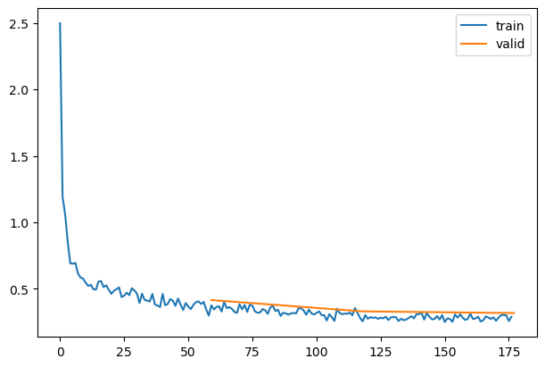

``` python
rec.plot()
```

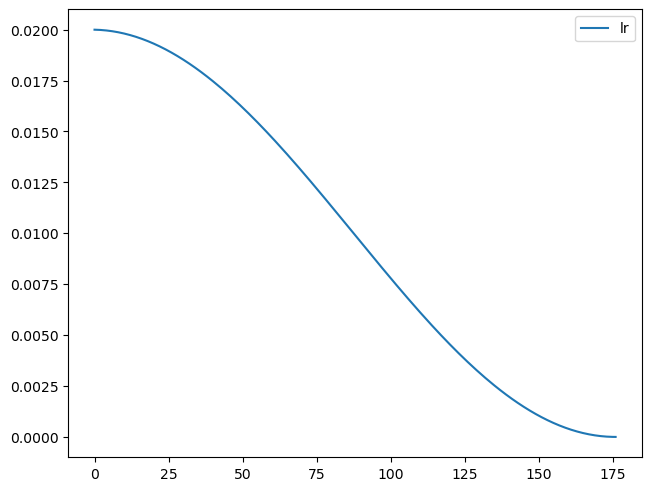

Exported source

``` python
class EpochSchedCB(BaseSchedCB):
    def after_epoch(self, learn): self._step(learn)
```

``` python
sched = partial(lr_scheduler.CosineAnnealingLR, T_max=3)
set_seed(42)
xtra = [EpochSchedCB(sched),rec]
model = get_model(act_gr, norm=nn.BatchNorm2d).apply(iw)
learn = TrainLearner(model, dls, F.cross_entropy, lr=2e-2, cbs=cbs+xtra, opt_func=optim.AdamW)
learn.fit(3)
```

| accuracy | loss  | epoch | train |
|----------|-------|-------|-------|
| 0.806    | 0.524 | 0     | train |
| 0.857    | 0.382 | 0     | eval  |
| 0.879    | 0.328 | 1     | train |
| 0.874    | 0.336 | 1     | eval  |
| 0.898    | 0.275 | 2     | train |
| 0.883    | 0.309 | 2     | eval  |

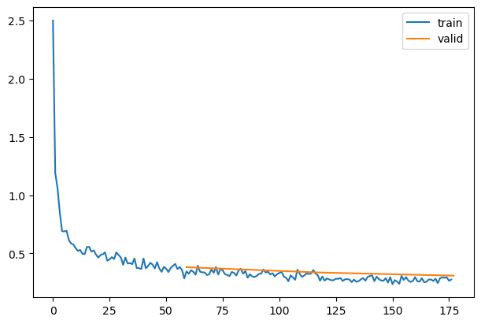

``` python
rec.plot()
```

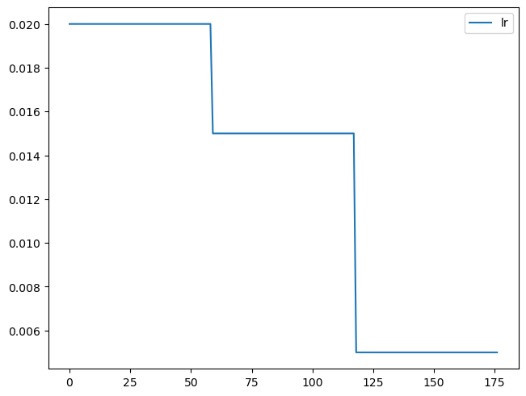

### 1cycle training

[Paper](https://arxiv.org/abs/1803.09820) by Leslie Smith.

``` python
def _beta1(cb): return cb.pg['betas'][0]
rec = RecorderCB(lr=_lr, mom=_beta1)
```

``` python
set_seed(42)
lr,epochs = 6e-2,5
model = get_model(act_gr, norm=nn.BatchNorm2d).apply(iw)
tmax = epochs * len(dls.train)
sched = partial(lr_scheduler.OneCycleLR, max_lr=lr, total_steps=tmax)
xtra = [BatchSchedCB(sched), rec]
learn = TrainLearner(model, dls, F.cross_entropy, lr=lr, cbs=cbs+xtra, opt_func=optim.AdamW)
learn.fit(epochs)
```

| accuracy | loss  | epoch | train |
|----------|-------|-------|-------|
| 0.767    | 0.660 | 0     | train |
| 0.842    | 0.462 | 0     | eval  |
| 0.855    | 0.391 | 1     | train |
| 0.859    | 0.396 | 1     | eval  |
| 0.884    | 0.312 | 2     | train |
| 0.881    | 0.327 | 2     | eval  |
| 0.906    | 0.254 | 3     | train |
| 0.895    | 0.284 | 3     | eval  |
| 0.920    | 0.215 | 4     | train |
| 0.900    | 0.271 | 4     | eval  |

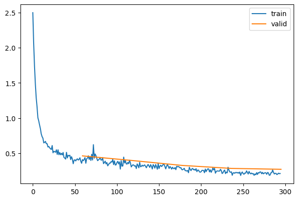

``` python
rec.plot()
```

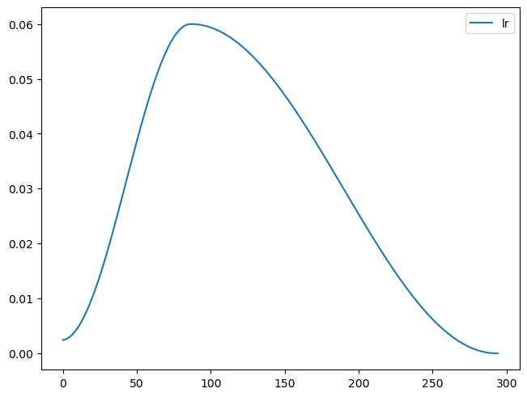

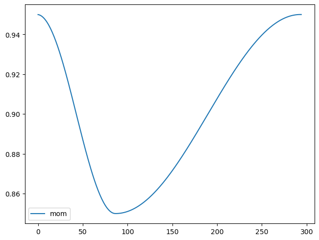

Back to top
