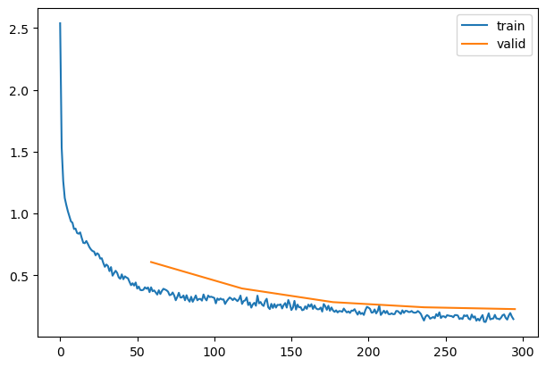
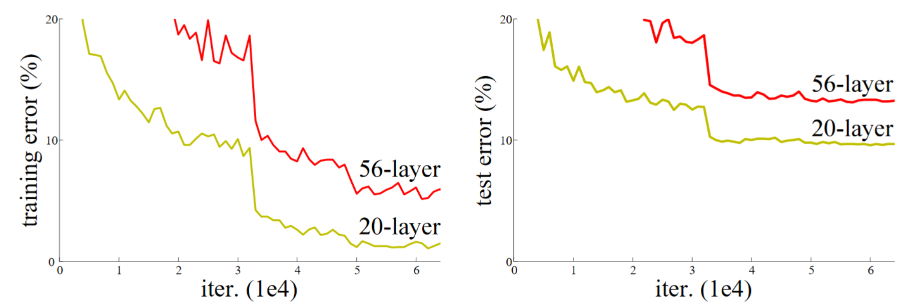
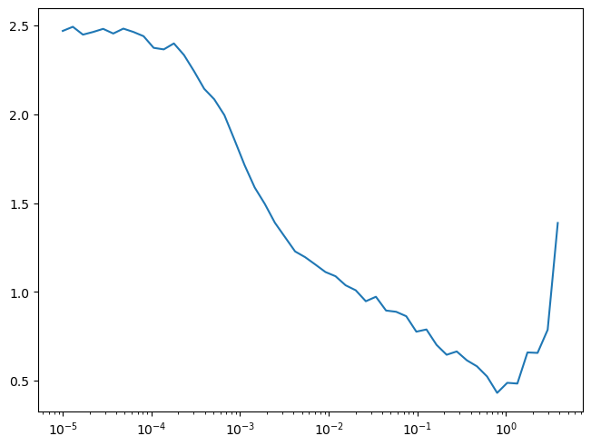
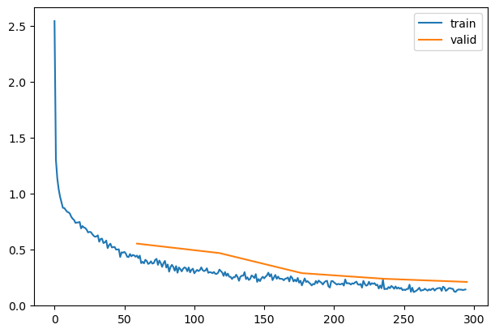
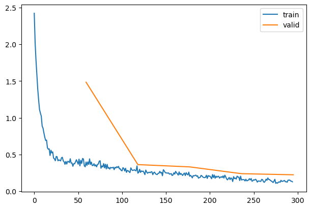

# ResNets

ResNets

Author

Benedict Thekkel

Exported source

``` python
import pickle,gzip,math,os,time,shutil,torch,matplotlib as mpl,numpy as np,matplotlib.pyplot as plt
import fastcore.all as fc
from collections.abc import Mapping
from pathlib import Path
from operator import attrgetter,itemgetter
from functools import partial
from copy import copy
from contextlib import contextmanager

import torchvision.transforms.functional as TF,torch.nn.functional as F
from torch import tensor,nn,optim
from torch.utils.data import DataLoader,default_collate
from torch.nn import init
from torch.optim import lr_scheduler
from torcheval.metrics import MulticlassAccuracy
from datasets import load_dataset,load_dataset_builder

from fastAIcourse.datasets import *
from fastAIcourse.conv import *
from fastAIcourse.learner import *
from fastAIcourse.activations import *
from fastAIcourse.init import *
from fastAIcourse.sgd import *
```

``` python
from fastcore.test import test_close

torch.set_printoptions(precision=2, linewidth=140, sci_mode=False)
torch.manual_seed(1)
mpl.rcParams['image.cmap'] = 'gray'

import logging
logging.disable(logging.WARNING)

set_seed(42)
```

``` python
xl,yl = 'image','label'
name = "fashion_mnist"
bs = 1024
xmean,xstd = 0.28, 0.35

@inplace
def transformi(b): b[xl] = [(TF.to_tensor(o)-xmean)/xstd for o in b[xl]]

dsd = load_dataset(name)
tds = dsd.with_transform(transformi)
dls = DataLoaders.from_dd(tds, bs, num_workers=4)
```

Exported source

``` python
act_gr = partial(GeneralRelu, leak=0.1, sub=0.4)
```

``` python
metrics = MetricsCB(accuracy=MulticlassAccuracy())
astats = ActivationStats(fc.risinstance(GeneralRelu))
cbs = [DeviceCB(), metrics, ProgressCB(plot=True), astats]
iw = partial(init_weights, leaky=0.1)
```

``` python
get_model??
```

    Signature:
    get_model(
        act=<class 'torch.nn.modules.activation.ReLU'>,
        nfs=None,
        norm=None,
    )
    Docstring: <no docstring>
    Source:   
    def get_model(act=nn.ReLU, nfs=None, norm=None):
        if nfs is None: nfs = [1,8,16,32,64]
        layers = [conv(nfs[i], nfs[i+1], act=act, norm=norm) for i in range(len(nfs)-1)]
        return nn.Sequential(*layers, conv(nfs[-1],10, act=None, norm=False, bias=True),
                             nn.Flatten()).to(def_device)
    File:      ~/BENEDICT_Only/Benedict_Projects/Benedict_ML/fastAIcourse/fastAIcourse/init.py
    Type:      function

## Going deeper

Exported source

``` python
def get_model(act=nn.ReLU, nfs=(8,16,32,64,128), norm=nn.BatchNorm2d):
    layers = [conv(1, 8, stride=1, act=act, norm=norm)]
    layers += [conv(nfs[i], nfs[i+1], act=act, norm=norm) for i in range(len(nfs)-1)]
    return nn.Sequential(*layers, conv(nfs[-1], 10, act=None, norm=norm, bias=True), nn.Flatten()).to(def_device)
```

``` python
set_seed(42)
lr,epochs = 6e-2,5
model = get_model(act_gr, norm=nn.BatchNorm2d).apply(iw)
tmax = epochs * len(dls.train)
sched = partial(lr_scheduler.OneCycleLR, max_lr=lr, total_steps=tmax)
xtra = [BatchSchedCB(sched)]
learn = TrainLearner(model, dls, F.cross_entropy, lr=lr, cbs=cbs+xtra, opt_func=optim.AdamW)
```

``` python
learn.fit(epochs)
```

| accuracy | loss  | epoch | train |
|----------|-------|-------|-------|
| 0.812    | 0.684 | 0     | train |
| 0.815    | 0.608 | 0     | eval  |
| 0.888    | 0.327 | 1     | train |
| 0.869    | 0.394 | 1     | eval  |
| 0.909    | 0.256 | 2     | train |
| 0.900    | 0.283 | 2     | eval  |
| 0.927    | 0.205 | 3     | train |
| 0.916    | 0.242 | 3     | eval  |
| 0.943    | 0.162 | 4     | train |
| 0.921    | 0.227 | 4     | eval  |



## Skip Connections

The ResNet (*residual network*) was introduced in 2015 by Kaiming He et al in the article [“Deep Residual Learning for Image Recognition”](https://arxiv.org/abs/1512.03385). The key idea is using a *skip connection* to allow deeper networks to train successfully.



Exported source

``` python
def _conv_block(ni, nf, stride, act=act_gr, norm=None, ks=3):
    return nn.Sequential(conv(ni, nf, stride=1, act=act, norm=norm, ks=ks),
                         conv(nf, nf, stride=stride, act=None, norm=norm, ks=ks))

class ResBlock(nn.Module):
    def __init__(self, ni, nf, stride=1, ks=3, act=act_gr, norm=None):
        super().__init__()
        self.convs = _conv_block(ni, nf, stride, act=act, ks=ks, norm=norm)
        self.idconv = fc.noop if ni==nf else conv(ni, nf, ks=1, stride=1, act=None)
        self.pool = fc.noop if stride==1 else nn.AvgPool2d(2, ceil_mode=True)
        self.act = act()

    def forward(self, x): return self.act(self.convs(x) + self.idconv(self.pool(x)))
```

**Post-lesson update**: Piotr Czapla noticed that we forgot to include `norm=norm` in the call to [`_conv_block`](https://bthek1.github.io/fastAIcourse/resnet.html#_conv_block) above, so the resnets in the lesson didn’t have batchnorm in the resblocks! After fixing this, we discovered that initializing the `conv2` batchnorm weights to zero makes things worse in every model we tried, so we removed that. That init method was originally introduced to handle training extremely deep models (much deeper than we use here) – it appears from this little test that it might be worse for less deep models.

Exported source

``` python
def get_model(act=nn.ReLU, nfs=(8,16,32,64,128,256), norm=nn.BatchNorm2d):
    layers = [ResBlock(1, 8, stride=1, act=act, norm=norm)]
    layers += [ResBlock(nfs[i], nfs[i+1], act=act, norm=norm, stride=2) for i in range(len(nfs)-1)]
    layers += [nn.Flatten(), nn.Linear(nfs[-1], 10, bias=False), nn.BatchNorm1d(10)]
    return nn.Sequential(*layers).to(def_device)
```

``` python
def _print_shape(hook, mod, inp, outp): print(type(mod).__name__, inp[0].shape, outp.shape)
model = get_model()
learn = TrainLearner(model, dls, F.cross_entropy, cbs=[DeviceCB(), SingleBatchCB()])
with Hooks(model, _print_shape) as hooks: learn.fit(1, train=False)
```

    ResBlock torch.Size([2048, 1, 28, 28]) torch.Size([2048, 8, 28, 28])
    ResBlock torch.Size([2048, 8, 28, 28]) torch.Size([2048, 16, 14, 14])
    ResBlock torch.Size([2048, 16, 14, 14]) torch.Size([2048, 32, 7, 7])
    ResBlock torch.Size([2048, 32, 7, 7]) torch.Size([2048, 64, 4, 4])
    ResBlock torch.Size([2048, 64, 4, 4]) torch.Size([2048, 128, 2, 2])
    ResBlock torch.Size([2048, 128, 2, 2]) torch.Size([2048, 256, 1, 1])
    Flatten torch.Size([2048, 256, 1, 1]) torch.Size([2048, 256])
    Linear torch.Size([2048, 256]) torch.Size([2048, 10])
    BatchNorm1d torch.Size([2048, 10]) torch.Size([2048, 10])

Exported source

``` python
@fc.patch
def summary(self:Learner):
    res = '|Module|Input|Output|Num params|\n|--|--|--|--|\n'
    tot = 0
    def _f(hook, mod, inp, outp):
        nonlocal res,tot
        nparms = sum(o.numel() for o in mod.parameters())
        tot += nparms
        res += f'|{type(mod).__name__}|{tuple(inp[0].shape)}|{tuple(outp.shape)}|{nparms}|\n'
    with Hooks(self.model, _f) as hooks: self.fit(1, lr=1, train=False, cbs=SingleBatchCB())
    print("Tot params: ", tot)
    if fc.IN_NOTEBOOK:
        from IPython.display import Markdown
        return Markdown(res)
    else: print(res)
```

``` python
TrainLearner(get_model(), dls, F.cross_entropy, cbs=DeviceCB()).summary()
```

    Tot params:  1228908

| Module      | Input              | Output             | Num params |
|-------------|--------------------|--------------------|------------|
| ResBlock    | (2048, 1, 28, 28)  | (2048, 8, 28, 28)  | 712        |
| ResBlock    | (2048, 8, 28, 28)  | (2048, 16, 14, 14) | 3696       |
| ResBlock    | (2048, 16, 14, 14) | (2048, 32, 7, 7)   | 14560      |
| ResBlock    | (2048, 32, 7, 7)   | (2048, 64, 4, 4)   | 57792      |
| ResBlock    | (2048, 64, 4, 4)   | (2048, 128, 2, 2)  | 230272     |
| ResBlock    | (2048, 128, 2, 2)  | (2048, 256, 1, 1)  | 919296     |
| Flatten     | (2048, 256, 1, 1)  | (2048, 256)        | 0          |
| Linear      | (2048, 256)        | (2048, 10)         | 2560       |
| BatchNorm1d | (2048, 10)         | (2048, 10)         | 20         |

``` python
model = get_model(act_gr, norm=nn.BatchNorm2d).apply(iw)
MomentumLearner(model, dls, F.cross_entropy, cbs=DeviceCB()).lr_find()
```



``` python
lr = 2e-2
tmax = epochs * len(dls.train)
sched = partial(lr_scheduler.OneCycleLR, max_lr=lr, total_steps=tmax)
xtra = [BatchSchedCB(sched)]
model = get_model(act_gr, norm=nn.BatchNorm2d).apply(iw)
learn = TrainLearner(model, dls, F.cross_entropy, lr=lr, cbs=cbs+xtra, opt_func=optim.AdamW)
```

``` python
learn.fit(epochs)
```

| accuracy | loss  | epoch | train |
|----------|-------|-------|-------|
| 0.824    | 0.687 | 0     | train |
| 0.834    | 0.553 | 0     | eval  |
| 0.896    | 0.344 | 1     | train |
| 0.847    | 0.468 | 1     | eval  |
| 0.916    | 0.252 | 2     | train |
| 0.903    | 0.288 | 2     | eval  |
| 0.935    | 0.196 | 3     | train |
| 0.917    | 0.238 | 3     | eval  |
| 0.954    | 0.145 | 4     | train |
| 0.929    | 0.210 | 4     | eval  |



``` python
import timm
from timm.models.resnet import BasicBlock, ResNet, Bottleneck
```

``` python
' '.join(timm.list_models('*resnet*'))
```

    'cspresnet50 cspresnet50d cspresnet50w eca_resnet33ts ecaresnet26t ecaresnet50d ecaresnet50d_pruned ecaresnet50t ecaresnet101d ecaresnet101d_pruned ecaresnet200d ecaresnet269d ecaresnetlight gcresnet33ts gcresnet50t inception_resnet_v2 lambda_resnet26rpt_256 lambda_resnet26t lambda_resnet50ts legacy_seresnet18 legacy_seresnet34 legacy_seresnet50 legacy_seresnet101 legacy_seresnet152 nf_ecaresnet26 nf_ecaresnet50 nf_ecaresnet101 nf_resnet26 nf_resnet50 nf_resnet101 nf_seresnet26 nf_seresnet50 nf_seresnet101 resnet10t resnet14t resnet18 resnet18d resnet26 resnet26d resnet26t resnet32ts resnet33ts resnet34 resnet34d resnet50 resnet50_gn resnet50c resnet50d resnet50s resnet50t resnet51q resnet61q resnet101 resnet101c resnet101d resnet101s resnet152 resnet152c resnet152d resnet152s resnet200 resnet200d resnetaa34d resnetaa50 resnetaa50d resnetaa101d resnetblur18 resnetblur50 resnetblur50d resnetblur101d resnetrs50 resnetrs101 resnetrs152 resnetrs200 resnetrs270 resnetrs350 resnetrs420 resnetv2_50 resnetv2_50d resnetv2_50d_evos resnetv2_50d_frn resnetv2_50d_gn resnetv2_50t resnetv2_50x1_bit resnetv2_50x3_bit resnetv2_101 resnetv2_101d resnetv2_101x1_bit resnetv2_101x3_bit resnetv2_152 resnetv2_152d resnetv2_152x2_bit resnetv2_152x4_bit seresnet18 seresnet33ts seresnet34 seresnet50 seresnet50t seresnet101 seresnet152 seresnet152d seresnet200d seresnet269d seresnetaa50d skresnet18 skresnet34 skresnet50 skresnet50d tresnet_l tresnet_m tresnet_v2_l tresnet_xl vit_base_resnet26d_224 vit_base_resnet50d_224 vit_small_resnet26d_224 vit_small_resnet50d_s16_224 wide_resnet50_2 wide_resnet101_2'

    resnet18:  block=BasicBlock, layers=[2, 2, 2, 2]
    resnet18d: block=BasicBlock, layers=[2, 2, 2, 2], stem_width=32, stem_type='deep', avg_down=True
    resnet10t: block=BasicBlock, layers=[1, 1, 1, 1], stem_width=32, stem_type='deep_tiered', avg_down=True

``` python
model = timm.create_model('resnet18d', in_chans=1, num_classes=10)
# model = ResNet(in_chans=1, block=BasicBlock, layers=[2,2,2,2], stem_width=32, avg_down=True)
```

``` python
lr = 2e-2
tmax = epochs * len(dls.train)
sched = partial(lr_scheduler.OneCycleLR, max_lr=lr, total_steps=tmax)
xtra = [BatchSchedCB(sched)]
learn = TrainLearner(model, dls, F.cross_entropy, lr=lr, cbs=cbs+xtra, opt_func=optim.AdamW)
```

``` python
learn.fit(epochs)
```

| accuracy | loss  | epoch | train |
|----------|-------|-------|-------|
| 0.780    | 0.632 | 0     | train |
| 0.596    | 1.484 | 0     | eval  |
| 0.877    | 0.328 | 1     | train |
| 0.867    | 0.363 | 1     | eval  |
| 0.908    | 0.248 | 2     | train |
| 0.884    | 0.332 | 2     | eval  |
| 0.928    | 0.192 | 3     | train |
| 0.912    | 0.239 | 3     | eval  |
| 0.947    | 0.143 | 4     | train |
| 0.917    | 0.224 | 4     | eval  |



Back to top
