# Augmentation

Augmentation

Author

Benedict Thekkel

Exported source

``` python
import torch,random
import fastcore.all as fc

from torch import nn
from torch.nn import init

from fastAIcourse.datasets import *
from fastAIcourse.conv import *
from fastAIcourse.learner import *
from fastAIcourse.activations import *
from fastAIcourse.init import *
from fastAIcourse.sgd import *
from fastAIcourse.resnet import *
```

Exported source

``` python
import pickle,gzip,math,os,time,shutil
import matplotlib as mpl,numpy as np,matplotlib.pyplot as plt
from collections.abc import Mapping
from pathlib import Path
from operator import attrgetter,itemgetter
from functools import partial
from copy import copy
from contextlib import contextmanager

import torchvision.transforms.functional as TF,torch.nn.functional as F
from torch import tensor,optim
from torch.utils.data import DataLoader,default_collate
from torch.optim import lr_scheduler
from torcheval.metrics import MulticlassAccuracy
from datasets import load_dataset,load_dataset_builder

from fastcore.test import test_close
from torch import distributions
```

``` python
torch.set_printoptions(precision=2, linewidth=140, sci_mode=False)
torch.manual_seed(1)
mpl.rcParams['image.cmap'] = 'gray_r'

import logging
logging.disable(logging.WARNING)

set_seed(42)

if fc.defaults.cpus>8: fc.defaults.cpus=8
```

``` python
xl,yl = 'image','label'
name = "fashion_mnist"
bs = 1024
xmean,xstd = 0.28, 0.35

@inplace
def transformi(b): b[xl] = [(TF.to_tensor(o)-xmean)/xstd for o in b[xl]]

dsd = load_dataset(name)
tds = dsd.with_transform(transformi)
dls = DataLoaders.from_dd(tds, bs, num_workers=fc.defaults.cpus)
```

``` python
metrics = MetricsCB(accuracy=MulticlassAccuracy())
astats = ActivationStats(fc.risinstance(GeneralRelu))
cbs = [DeviceCB(), metrics, ProgressCB(plot=True), astats]
act_gr = partial(GeneralRelu, leak=0.1, sub=0.4)
iw = partial(init_weights, leaky=0.1)
```

``` python
set_seed(42)
lr,epochs = 6e-2,5
```

## Going wider

Exported source

``` python
def get_model(act=nn.ReLU, nfs=(16,32,64,128,256,512), norm=nn.BatchNorm2d):
    layers = [ResBlock(1, 16, ks=5, stride=1, act=act, norm=norm)]
    layers += [ResBlock(nfs[i], nfs[i+1], act=act, norm=norm, stride=2) for i in range(len(nfs)-1)]
    layers += [nn.Flatten(), nn.Linear(nfs[-1], 10, bias=False), nn.BatchNorm1d(10)]
    return nn.Sequential(*layers)
```

``` python
lr = 1e-2
tmax = epochs * len(dls.train)
sched = partial(lr_scheduler.OneCycleLR, max_lr=lr, total_steps=tmax)
xtra = [BatchSchedCB(sched)]
model = get_model(act_gr, norm=nn.BatchNorm2d).apply(iw)
learn = TrainLearner(model, dls, F.cross_entropy, lr=lr, cbs=cbs+xtra, opt_func=optim.AdamW)
```

``` python
learn.fit(epochs)
```

| accuracy | loss  | epoch | train |
|----------|-------|-------|-------|
| 0.824    | 0.704 | 0     | train |
| 0.859    | 0.563 | 0     | eval  |
| 0.898    | 0.381 | 1     | train |
| 0.872    | 0.422 | 1     | eval  |
| 0.922    | 0.265 | 2     | train |
| 0.907    | 0.294 | 2     | eval  |
| 0.941    | 0.196 | 3     | train |
| 0.928    | 0.240 | 3     | eval  |
| 0.963    | 0.139 | 4     | train |
| 0.933    | 0.222 | 4     | eval  |

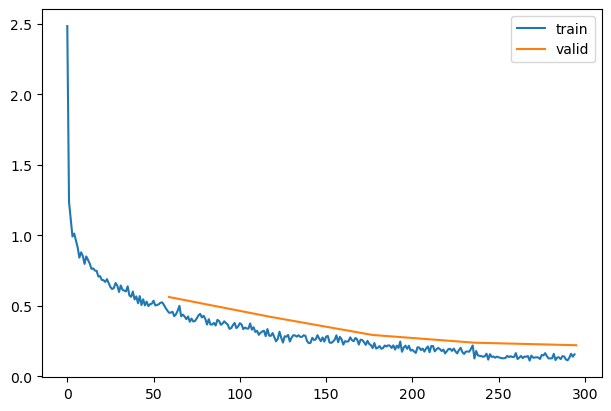

### Pooling

Exported source

``` python
class GlobalAvgPool(nn.Module):
    def forward(self, x): return x.mean((-2,-1))
```

Exported source

``` python
def get_model2(act=nn.ReLU, nfs=(16,32,64,128,256), norm=nn.BatchNorm2d):
    layers = [ResBlock(1, 16, ks=5, stride=1, act=act, norm=norm)]
    layers += [ResBlock(nfs[i], nfs[i+1], act=act, norm=norm, stride=2) for i in range(len(nfs)-1)]
    layers += [ResBlock(256, 512, act=act, norm=norm), GlobalAvgPool()]
    layers += [nn.Linear(512, 10, bias=False), nn.BatchNorm1d(10)]
    return nn.Sequential(*layers)
```

``` python
TrainLearner(get_model2(), dls, F.cross_entropy, lr=lr, cbs=[DeviceCB()]).summary()
```

    Tot params: 4907588; MFLOPS: 33.0

| Module        | Input              | Output             | Num params | MFLOPS |
|---------------|--------------------|--------------------|------------|--------|
| ResBlock      | (1024, 1, 28, 28)  | (1024, 16, 28, 28) | 6928       | 5.3    |
| ResBlock      | (1024, 16, 28, 28) | (1024, 32, 14, 14) | 14560      | 2.8    |
| ResBlock      | (1024, 32, 14, 14) | (1024, 64, 7, 7)   | 57792      | 2.8    |
| ResBlock      | (1024, 64, 7, 7)   | (1024, 128, 4, 4)  | 230272     | 3.7    |
| ResBlock      | (1024, 128, 4, 4)  | (1024, 256, 2, 2)  | 919296     | 3.7    |
| ResBlock      | (1024, 256, 2, 2)  | (1024, 512, 2, 2)  | 3673600    | 14.7   |
| GlobalAvgPool | (1024, 512, 2, 2)  | (1024, 512)        | 0          | 0.0    |
| Linear        | (1024, 512)        | (1024, 10)         | 5120       | 0.0    |
| BatchNorm1d   | (1024, 10)         | (1024, 10)         | 20         | 0.0    |

``` python
set_seed(42)
model = get_model2(act_gr, norm=nn.BatchNorm2d).apply(iw)
learn = TrainLearner(model, dls, F.cross_entropy, lr=lr, cbs=cbs+xtra, opt_func=optim.AdamW)
learn.fit(epochs)
```

| accuracy | loss  | epoch | train |
|----------|-------|-------|-------|
| 0.822    | 0.715 | 0     | train |
| 0.857    | 0.518 | 0     | eval  |
| 0.898    | 0.384 | 1     | train |
| 0.881    | 0.389 | 1     | eval  |
| 0.921    | 0.267 | 2     | train |
| 0.906    | 0.286 | 2     | eval  |
| 0.941    | 0.199 | 3     | train |
| 0.925    | 0.244 | 3     | eval  |
| 0.962    | 0.141 | 4     | train |
| 0.929    | 0.227 | 4     | eval  |

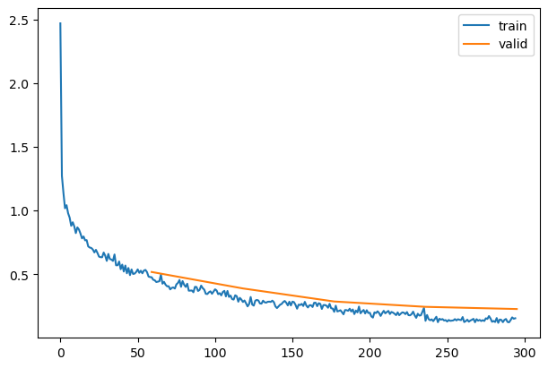

Exported source

``` python
def get_model3(act=nn.ReLU, nfs=(16,32,64,128,256), norm=nn.BatchNorm2d):
    layers = [ResBlock(1, 16, ks=5, stride=1, act=act, norm=norm)]
    layers += [ResBlock(nfs[i], nfs[i+1], act=act, norm=norm, stride=2) for i in range(len(nfs)-1)]
    layers += [GlobalAvgPool(), nn.Linear(256, 10, bias=False), nn.BatchNorm1d(10)]
    return nn.Sequential(*layers)
```

``` python
TrainLearner(get_model3(), dls, F.cross_entropy, lr=lr, cbs=[DeviceCB()]).summary()
```

    Tot params: 1231428; MFLOPS: 18.3

| Module        | Input              | Output             | Num params | MFLOPS |
|---------------|--------------------|--------------------|------------|--------|
| ResBlock      | (1024, 1, 28, 28)  | (1024, 16, 28, 28) | 6928       | 5.3    |
| ResBlock      | (1024, 16, 28, 28) | (1024, 32, 14, 14) | 14560      | 2.8    |
| ResBlock      | (1024, 32, 14, 14) | (1024, 64, 7, 7)   | 57792      | 2.8    |
| ResBlock      | (1024, 64, 7, 7)   | (1024, 128, 4, 4)  | 230272     | 3.7    |
| ResBlock      | (1024, 128, 4, 4)  | (1024, 256, 2, 2)  | 919296     | 3.7    |
| GlobalAvgPool | (1024, 256, 2, 2)  | (1024, 256)        | 0          | 0.0    |
| Linear        | (1024, 256)        | (1024, 10)         | 2560       | 0.0    |
| BatchNorm1d   | (1024, 10)         | (1024, 10)         | 20         | 0.0    |

``` python
[o.shape for o in get_model3()[0].parameters()]
```

``` python
set_seed(42)
model = get_model3(act_gr, norm=nn.BatchNorm2d).apply(iw)
learn = TrainLearner(model, dls, F.cross_entropy, lr=lr, cbs=cbs+xtra, opt_func=optim.AdamW)
learn.fit(epochs)
```

| accuracy | loss  | epoch | train |
|----------|-------|-------|-------|
| 0.810    | 0.758 | 0     | train |
| 0.871    | 0.450 | 0     | eval  |
| 0.895    | 0.401 | 1     | train |
| 0.897    | 0.339 | 1     | eval  |
| 0.919    | 0.276 | 2     | train |
| 0.895    | 0.319 | 2     | eval  |
| 0.939    | 0.207 | 3     | train |
| 0.927    | 0.246 | 3     | eval  |
| 0.960    | 0.152 | 4     | train |
| 0.929    | 0.230 | 4     | eval  |

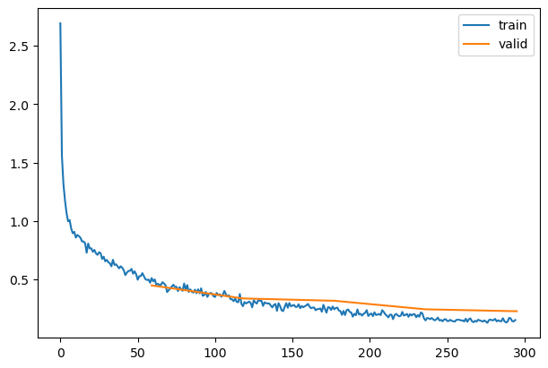

Exported source

``` python
def get_model4(act=nn.ReLU, nfs=(16,32,64,128,256), norm=nn.BatchNorm2d):
    layers = [conv(1, 16, ks=5, stride=1, act=act, norm=norm)]
    layers += [ResBlock(nfs[i], nfs[i+1], act=act, norm=norm, stride=2) for i in range(len(nfs)-1)]
    layers += [GlobalAvgPool(), nn.Linear(256, 10, bias=False), nn.BatchNorm1d(10)]
    return nn.Sequential(*layers)
```

``` python
[o.shape for o in get_model4()[0].parameters()]
```

    [torch.Size([16, 1, 5, 5]),
     torch.Size([16]),
     torch.Size([16]),
     torch.Size([16])]

``` python
TrainLearner(get_model4(), dls, F.cross_entropy, lr=lr, cbs=[DeviceCB()]).summary()
```

    Tot params: 1224948; MFLOPS: 13.3

| Module        | Input              | Output             | Num params | MFLOPS |
|---------------|--------------------|--------------------|------------|--------|
| Sequential    | (1024, 1, 28, 28)  | (1024, 16, 28, 28) | 448        | 0.3    |
| ResBlock      | (1024, 16, 28, 28) | (1024, 32, 14, 14) | 14560      | 2.8    |
| ResBlock      | (1024, 32, 14, 14) | (1024, 64, 7, 7)   | 57792      | 2.8    |
| ResBlock      | (1024, 64, 7, 7)   | (1024, 128, 4, 4)  | 230272     | 3.7    |
| ResBlock      | (1024, 128, 4, 4)  | (1024, 256, 2, 2)  | 919296     | 3.7    |
| GlobalAvgPool | (1024, 256, 2, 2)  | (1024, 256)        | 0          | 0.0    |
| Linear        | (1024, 256)        | (1024, 10)         | 2560       | 0.0    |
| BatchNorm1d   | (1024, 10)         | (1024, 10)         | 20         | 0.0    |

``` python
set_seed(42)
model = get_model4(act_gr, norm=nn.BatchNorm2d).apply(iw)
learn = TrainLearner(model, dls, F.cross_entropy, lr=lr, cbs=cbs+xtra, opt_func=optim.AdamW)
learn.fit(epochs)
```

| accuracy | loss  | epoch | train |
|----------|-------|-------|-------|
| 0.804    | 0.782 | 0     | train |
| 0.869    | 0.474 | 0     | eval  |
| 0.898    | 0.393 | 1     | train |
| 0.892    | 0.366 | 1     | eval  |
| 0.918    | 0.277 | 2     | train |
| 0.896    | 0.340 | 2     | eval  |
| 0.940    | 0.202 | 3     | train |
| 0.923    | 0.244 | 3     | eval  |
| 0.961    | 0.148 | 4     | train |
| 0.925    | 0.238 | 4     | eval  |

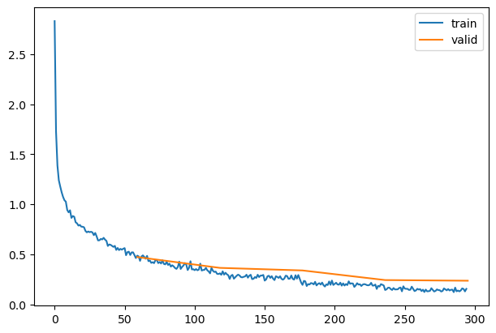

## Data augmentation

After 20 epochs without augmentation:

    {'accuracy': '0.999', 'loss': '0.012', 'epoch': 19, 'train': True}
    {'accuracy': '0.924', 'loss': '0.284', 'epoch': 19, 'train': False}

With batchnorm, weight decay doesn’t really regularize.

Exported source

``` python
from torchvision import transforms
```

``` python
def tfm_batch(b, tfm_x=fc.noop, tfm_y = fc.noop): return tfm_x(b[0]),tfm_y(b[1])

tfms = nn.Sequential(transforms.RandomCrop(28, padding=4),
                     transforms.RandomHorizontalFlip())

augcb = BatchTransformCB(partial(tfm_batch, tfm_x=tfms), on_val=False)
model = get_model()
learn = TrainLearner(model, dls, F.cross_entropy, lr=lr, cbs=[SingleBatchCB(), augcb])
```

``` python
learn.fit(1)
```

``` python
xb,yb = learn.batch
show_images(xb[:16], imsize=1.5)
```


Exported source

``` python
@fc.patch
@fc.delegates(show_images)
def show_image_batch(self:Learner, max_n=9, cbs=None, **kwargs):
    self.fit(1, cbs=[SingleBatchCB()]+fc.L(cbs))
    show_images(self.batch[0][:max_n], **kwargs)
```

``` python
learn.show_image_batch(max_n=16, imsize=(1.5))
```


``` python
tfms = nn.Sequential(transforms.RandomCrop(28, padding=1),
                     transforms.RandomHorizontalFlip())
augcb = BatchTransformCB(partial(tfm_batch, tfm_x=tfms), on_val=False)
```

``` python
set_seed(42)
epochs = 20
lr = 1e-2
tmax = epochs * len(dls.train)
sched = partial(lr_scheduler.OneCycleLR, max_lr=lr, total_steps=tmax)
xtra = [BatchSchedCB(sched), augcb]
model = get_model(act_gr, norm=nn.BatchNorm2d).apply(iw)
learn = TrainLearner(model, dls, F.cross_entropy, lr=lr, cbs=cbs+xtra, opt_func=optim.AdamW)
learn.fit(epochs)
```

| accuracy | loss  | epoch | train |
|----------|-------|-------|-------|
| 0.764    | 0.879 | 0     | train |
| 0.824    | 0.604 | 0     | eval  |
| 0.858    | 0.597 | 1     | train |
| 0.869    | 0.495 | 1     | eval  |
| 0.877    | 0.477 | 2     | train |
| 0.823    | 0.520 | 2     | eval  |
| 0.887    | 0.392 | 3     | train |
| 0.874    | 0.378 | 3     | eval  |
| 0.894    | 0.336 | 4     | train |
| 0.877    | 0.394 | 4     | eval  |
| 0.906    | 0.288 | 5     | train |
| 0.904    | 0.281 | 5     | eval  |
| 0.914    | 0.258 | 6     | train |
| 0.858    | 0.400 | 6     | eval  |
| 0.919    | 0.236 | 7     | train |
| 0.914    | 0.252 | 7     | eval  |
| 0.923    | 0.223 | 8     | train |
| 0.919    | 0.234 | 8     | eval  |
| 0.930    | 0.198 | 9     | train |
| 0.922    | 0.222 | 9     | eval  |
| 0.934    | 0.189 | 10    | train |
| 0.922    | 0.222 | 10    | eval  |
| 0.940    | 0.173 | 11    | train |
| 0.930    | 0.205 | 11    | eval  |
| 0.943    | 0.164 | 12    | train |
| 0.927    | 0.207 | 12    | eval  |
| 0.949    | 0.148 | 13    | train |
| 0.932    | 0.193 | 13    | eval  |
| 0.952    | 0.139 | 14    | train |
| 0.937    | 0.185 | 14    | eval  |
| 0.959    | 0.121 | 15    | train |
| 0.939    | 0.180 | 15    | eval  |
| 0.962    | 0.111 | 16    | train |
| 0.939    | 0.181 | 16    | eval  |
| 0.966    | 0.102 | 17    | train |
| 0.941    | 0.180 | 17    | eval  |
| 0.970    | 0.093 | 18    | train |
| 0.943    | 0.175 | 18    | eval  |
| 0.971    | 0.090 | 19    | train |
| 0.944    | 0.174 | 19    | eval  |

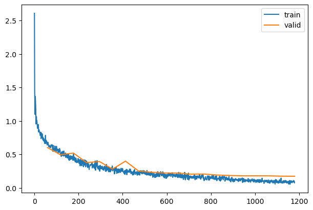

A custom collation function could let you do per-item transformations.

``` python
mdl_path = Path('models')
mdl_path.mkdir(exist_ok=True)
torch.save(learn.model, mdl_path/'data_aug.pkl')
```

## Test time augmentation (TTA)

Exported source

``` python
class CapturePreds(Callback):
    def before_fit(self, learn): self.all_inps,self.all_preds,self.all_targs = [],[],[]
    def after_batch(self, learn):
        self.all_inps. append(to_cpu(learn.batch[0]))
        self.all_preds.append(to_cpu(learn.preds))
        self.all_targs.append(to_cpu(learn.batch[1]))
    def after_fit(self, learn):
        self.all_preds,self.all_targs,self.all_inps = map(torch.cat, [self.all_preds,self.all_targs,self.all_inps])
```

Exported source

``` python
@fc.patch
def capture_preds(self: Learner, cbs=None, inps=False):
    cp = CapturePreds()
    self.fit(1, train=False, cbs=[cp]+fc.L(cbs))
    res = cp.all_preds,cp.all_targs
    if inps: res = res+(cp.all_inps,)
    return res
```

``` python
ap1, at = learn.capture_preds()
```

| accuracy | loss  | epoch | train |
|----------|-------|-------|-------|
| 0.944    | 0.174 | 0     | eval  |

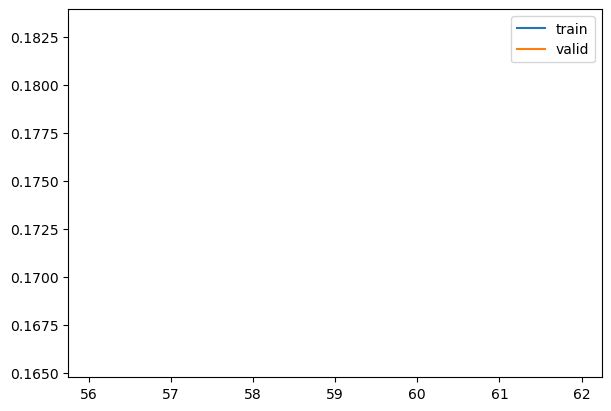

``` python
ttacb = BatchTransformCB(partial(tfm_batch, tfm_x=TF.hflip), on_val=True)
ap2, at = learn.capture_preds(cbs=[ttacb])
```

| accuracy | loss  | epoch | train |
|----------|-------|-------|-------|
| 0.942    | 0.175 | 0     | eval  |


``` python
ap1.shape,ap2.shape,at.shape
```

    (torch.Size([10000, 10]), torch.Size([10000, 10]), torch.Size([10000]))

``` python
ap = torch.stack([ap1,ap2]).mean(0).argmax(1)
```

``` python
round((ap==at).float().mean().item(), 3)
```

    0.946

## Random erase

``` python
xb,_ = next(iter(dls.train))
xbt = xb[:16]
```

``` python
xm,xs = xbt.mean(),xbt.std()
```

``` python
xbt.min(), xbt.max()
```

    (tensor(-0.80), tensor(2.06))

``` python
pct = 0.2
```

``` python
szx = int(pct*xbt.shape[-2])
szy = int(pct*xbt.shape[-1])
stx = int(random.random()*(1-pct)*xbt.shape[-2])
sty = int(random.random()*(1-pct)*xbt.shape[-1])
stx,sty,szx,szy
```

    (14, 0, 5, 5)

``` python
init.normal_(xbt[:,:,stx:stx+szx,sty:sty+szy], mean=xm, std=xs);
```

``` python
show_images(xbt, imsize=1.5)
```


``` python
xbt.min(), xbt.max()
```

    (tensor(-3.36), tensor(2.56))

Exported source

``` python
def _rand_erase1(x, pct, xm, xs, mn, mx):
    szx = int(pct*x.shape[-2])
    szy = int(pct*x.shape[-1])
    stx = int(random.random()*(1-pct)*x.shape[-2])
    sty = int(random.random()*(1-pct)*x.shape[-1])
    init.normal_(x[:,:,stx:stx+szx,sty:sty+szy], mean=xm, std=xs)
    x.clamp_(mn, mx)
```

``` python
xb,_ = next(iter(dls.train))
xbt = xb[:16]
_rand_erase1(xbt, 0.2, xbt.mean(), xbt.std(), xbt.min(), xbt.max())
show_images(xbt, imsize=1.5)
```


``` python
xbt.mean(),xbt.std(),xbt.min(), xbt.max()
```

    (tensor(0.09), tensor(1.04), tensor(-0.80), tensor(2.06))

Exported source

``` python
def rand_erase(x, pct=0.2, max_num = 4):
    xm,xs,mn,mx = x.mean(),x.std(),x.min(),x.max()
    num = random.randint(0, max_num)
    for i in range(num): _rand_erase1(x, pct, xm, xs, mn, mx)
#     print(num)
    return x
```

``` python
xb,_ = next(iter(dls.train))
xbt = xb[:16]
rand_erase(xbt, 0.2, 4)
show_images(xbt, imsize=1.5)
```

Exported source

``` python
class RandErase(nn.Module):
    def __init__(self, pct=0.2, max_num=4):
        super().__init__()
        self.pct,self.max_num = pct,max_num
    def forward(self, x): return rand_erase(x, self.pct, self.max_num)
```

``` python
tfms = nn.Sequential(transforms.RandomCrop(28, padding=1),
                     transforms.RandomHorizontalFlip(),
                     RandErase())
augcb = BatchTransformCB(partial(tfm_batch, tfm_x=tfms), on_val=False)
```

``` python
model = get_model()
learn = TrainLearner(model, dls, F.cross_entropy, lr=lr, cbs=[DeviceCB(), SingleBatchCB(), augcb])
learn.fit(1)
xb,yb = learn.batch
show_images(xb[:16], imsize=1.5)
```


``` python
epochs = 20
lr = 2e-2
tmax = epochs * len(dls.train)
sched = partial(lr_scheduler.OneCycleLR, max_lr=lr, total_steps=tmax)
xtra = [BatchSchedCB(sched), augcb]
model = get_model(act_gr, norm=nn.BatchNorm2d).apply(iw)
learn = TrainLearner(model, dls, F.cross_entropy, lr=lr, cbs=cbs+xtra, opt_func=optim.AdamW)
learn.fit(epochs)
```

| accuracy | loss  | epoch | train |
|----------|-------|-------|-------|
| 0.760    | 0.871 | 0     | train |
| 0.813    | 0.607 | 0     | eval  |
| 0.842    | 0.596 | 1     | train |
| 0.845    | 0.472 | 1     | eval  |
| 0.856    | 0.480 | 2     | train |
| 0.856    | 0.427 | 2     | eval  |
| 0.866    | 0.405 | 3     | train |
| 0.856    | 0.421 | 3     | eval  |
| 0.872    | 0.374 | 4     | train |
| 0.822    | 0.491 | 4     | eval  |
| 0.885    | 0.323 | 5     | train |
| 0.880    | 0.363 | 5     | eval  |
| 0.895    | 0.295 | 6     | train |
| 0.852    | 0.456 | 6     | eval  |
| 0.899    | 0.278 | 7     | train |
| 0.869    | 0.368 | 7     | eval  |
| 0.907    | 0.257 | 8     | train |
| 0.901    | 0.301 | 8     | eval  |
| 0.912    | 0.244 | 9     | train |
| 0.910    | 0.260 | 9     | eval  |
| 0.917    | 0.231 | 10    | train |
| 0.916    | 0.229 | 10    | eval  |
| 0.922    | 0.215 | 11    | train |
| 0.921    | 0.220 | 11    | eval  |
| 0.926    | 0.206 | 12    | train |
| 0.928    | 0.201 | 12    | eval  |
| 0.930    | 0.191 | 13    | train |
| 0.924    | 0.208 | 13    | eval  |
| 0.933    | 0.185 | 14    | train |
| 0.921    | 0.219 | 14    | eval  |
| 0.938    | 0.172 | 15    | train |
| 0.929    | 0.198 | 15    | eval  |
| 0.941    | 0.163 | 16    | train |
| 0.936    | 0.178 | 16    | eval  |
| 0.944    | 0.153 | 17    | train |
| 0.939    | 0.172 | 17    | eval  |
| 0.947    | 0.146 | 18    | train |
| 0.940    | 0.169 | 18    | eval  |
| 0.949    | 0.142 | 19    | train |
| 0.939    | 0.172 | 19    | eval  |


## Random copy

``` python
xb,_ = next(iter(dls.train))
xbt = xb[:16]
```

``` python
szx = int(pct*xbt.shape[-2])
szy = int(pct*xbt.shape[-1])
stx1 = int(random.random()*(1-pct)*xbt.shape[-2])
sty1 = int(random.random()*(1-pct)*xbt.shape[-1])
stx2 = int(random.random()*(1-pct)*xbt.shape[-2])
sty2 = int(random.random()*(1-pct)*xbt.shape[-1])
stx1,sty1,stx2,sty2,szx,szy
```

    (9, 18, 3, 7, 5, 5)

``` python
xbt[:,:,stx1:stx1+szx,sty1:sty1+szy] = xbt[:,:,stx2:stx2+szx,sty2:sty2+szy]
```

``` python
show_images(xbt, imsize=1.5)
```


Exported source

``` python
def _rand_copy1(x, pct):
    szx = int(pct*x.shape[-2])
    szy = int(pct*x.shape[-1])
    stx1 = int(random.random()*(1-pct)*x.shape[-2])
    sty1 = int(random.random()*(1-pct)*x.shape[-1])
    stx2 = int(random.random()*(1-pct)*x.shape[-2])
    sty2 = int(random.random()*(1-pct)*x.shape[-1])
    x[:,:,stx1:stx1+szx,sty1:sty1+szy] = x[:,:,stx2:stx2+szx,sty2:sty2+szy]
```

``` python
xb,_ = next(iter(dls.train))
xbt = xb[:16]
_rand_copy1(xbt, 0.2)
show_images(xbt, imsize=1.5)
```


Exported source

``` python
def rand_copy(x, pct=0.2, max_num = 4):
    num = random.randint(0, max_num)
    for i in range(num): _rand_copy1(x, pct)
#     print(num)
    return x
```

``` python
xb,_ = next(iter(dls.train))
xbt = xb[:16]
rand_copy(xbt, 0.2, 4)
show_images(xbt, imsize=1.5)
```


Exported source

``` python
class RandCopy(nn.Module):
    def __init__(self, pct=0.2, max_num=4):
        super().__init__()
        self.pct,self.max_num = pct,max_num
    def forward(self, x): return rand_copy(x, self.pct, self.max_num)
```

``` python
tfms = nn.Sequential(transforms.RandomCrop(28, padding=1),
                     transforms.RandomHorizontalFlip(),
                     RandCopy())
augcb = BatchTransformCB(partial(tfm_batch, tfm_x=tfms), on_val=False)
```

``` python
model = get_model()
learn = TrainLearner(model, dls, F.cross_entropy, lr=lr, cbs=[DeviceCB(), SingleBatchCB(), augcb])
learn.fit(1)
xb,yb = learn.batch
show_images(xb[:16], imsize=1.5)
```


``` python
set_seed(1)
epochs = 20
lr = 1e-2
tmax = epochs * len(dls.train)
sched = partial(lr_scheduler.OneCycleLR, max_lr=lr, total_steps=tmax)
xtra = [BatchSchedCB(sched), augcb]
model = get_model(act_gr, norm=nn.BatchNorm2d).apply(iw)
learn = TrainLearner(model, dls, F.cross_entropy, lr=lr, cbs=cbs+xtra, opt_func=optim.AdamW)
learn.fit(epochs)
```

| accuracy | loss  | epoch | train |
|----------|-------|-------|-------|
| 0.739    | 0.940 | 0     | train |
| 0.810    | 0.599 | 0     | eval  |
| 0.832    | 0.656 | 1     | train |
| 0.842    | 0.534 | 1     | eval  |
| 0.849    | 0.558 | 2     | train |
| 0.838    | 0.487 | 2     | eval  |
| 0.858    | 0.467 | 3     | train |
| 0.827    | 0.528 | 3     | eval  |
| 0.873    | 0.394 | 4     | train |
| 0.860    | 0.418 | 4     | eval  |
| 0.885    | 0.344 | 5     | train |
| 0.868    | 0.391 | 5     | eval  |
| 0.891    | 0.321 | 6     | train |
| 0.885    | 0.334 | 6     | eval  |
| 0.899    | 0.293 | 7     | train |
| 0.906    | 0.261 | 7     | eval  |
| 0.910    | 0.258 | 8     | train |
| 0.913    | 0.242 | 8     | eval  |
| 0.913    | 0.249 | 9     | train |
| 0.897    | 0.294 | 9     | eval  |
| 0.914    | 0.242 | 10    | train |
| 0.921    | 0.229 | 10    | eval  |
| 0.922    | 0.221 | 11    | train |
| 0.923    | 0.215 | 11    | eval  |
| 0.925    | 0.212 | 12    | train |
| 0.927    | 0.206 | 12    | eval  |
| 0.929    | 0.200 | 13    | train |
| 0.925    | 0.209 | 13    | eval  |
| 0.934    | 0.189 | 14    | train |
| 0.918    | 0.226 | 14    | eval  |
| 0.937    | 0.177 | 15    | train |
| 0.933    | 0.187 | 15    | eval  |
| 0.942    | 0.167 | 16    | train |
| 0.937    | 0.178 | 16    | eval  |
| 0.944    | 0.159 | 17    | train |
| 0.939    | 0.171 | 17    | eval  |
| 0.946    | 0.152 | 18    | train |
| 0.939    | 0.170 | 18    | eval  |
| 0.951    | 0.142 | 19    | train |
| 0.940    | 0.171 | 19    | eval  |


``` python
model2 = get_model(act_gr, norm=nn.BatchNorm2d).apply(iw)
learn2 = TrainLearner(model2, dls, F.cross_entropy, lr=lr, cbs=cbs+xtra, opt_func=optim.AdamW)
learn2.fit(epochs)
```

| accuracy | loss  | epoch | train |
|----------|-------|-------|-------|
| 0.745    | 0.935 | 0     | train |
| 0.823    | 0.573 | 0     | eval  |
| 0.838    | 0.648 | 1     | train |
| 0.863    | 0.455 | 1     | eval  |
| 0.853    | 0.542 | 2     | train |
| 0.812    | 0.598 | 2     | eval  |
| 0.860    | 0.471 | 3     | train |
| 0.864    | 0.408 | 3     | eval  |
| 0.871    | 0.398 | 4     | train |
| 0.858    | 0.438 | 4     | eval  |
| 0.884    | 0.348 | 5     | train |
| 0.898    | 0.295 | 5     | eval  |
| 0.896    | 0.308 | 6     | train |
| 0.883    | 0.345 | 6     | eval  |
| 0.901    | 0.284 | 7     | train |
| 0.891    | 0.298 | 7     | eval  |
| 0.899    | 0.290 | 8     | train |
| 0.903    | 0.284 | 8     | eval  |
| 0.916    | 0.243 | 9     | train |
| 0.905    | 0.271 | 9     | eval  |
| 0.914    | 0.245 | 10    | train |
| 0.916    | 0.243 | 10    | eval  |
| 0.919    | 0.227 | 11    | train |
| 0.922    | 0.227 | 11    | eval  |
| 0.925    | 0.211 | 12    | train |
| 0.923    | 0.220 | 12    | eval  |
| 0.930    | 0.197 | 13    | train |
| 0.932    | 0.198 | 13    | eval  |
| 0.934    | 0.186 | 14    | train |
| 0.930    | 0.201 | 14    | eval  |
| 0.938    | 0.173 | 15    | train |
| 0.934    | 0.194 | 15    | eval  |
| 0.943    | 0.163 | 16    | train |
| 0.929    | 0.205 | 16    | eval  |
| 0.943    | 0.160 | 17    | train |
| 0.938    | 0.183 | 17    | eval  |
| 0.946    | 0.152 | 18    | train |
| 0.938    | 0.183 | 18    | eval  |
| 0.947    | 0.150 | 19    | train |
| 0.937    | 0.185 | 19    | eval  |

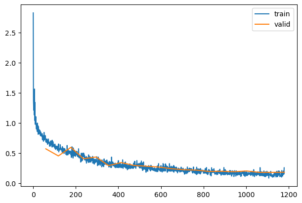

``` python
mdl_path = Path('models')
torch.save(learn.model,  mdl_path/'randcopy1.pkl')
torch.save(learn2.model, mdl_path/'randcopy2.pkl')
```

``` python
cp1 = CapturePreds()
learn.fit(1, train=False, cbs=cp1)
```

| accuracy | loss  | epoch | train |
|----------|-------|-------|-------|
| 0.940    | 0.171 | 0     | eval  |

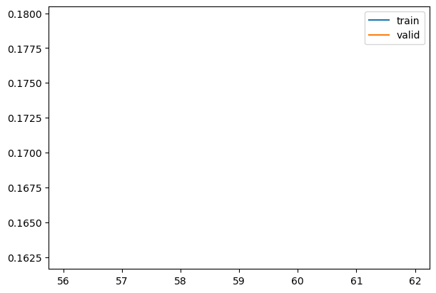

``` python
cp2 = CapturePreds()
learn2.fit(1, train=False, cbs=cp2)
```

| accuracy | loss  | epoch | train |
|----------|-------|-------|-------|
| 0.937    | 0.185 | 0     | eval  |

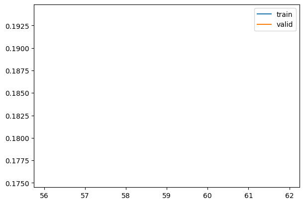

``` python
ap = torch.stack([cp1.all_preds,cp2.all_preds]).mean(0).argmax(1)
```

``` python
round((ap==cp1.all_targs).float().mean().item(), 3)
```

    0.942

## Dropout

``` python
p = 0.1
dist = distributions.binomial.Binomial(probs=1-p)
dist.sample((10,))
```

    tensor([1., 1., 1., 1., 1., 1., 1., 1., 1., 1.])

Exported source

``` python
class Dropout(nn.Module):
    def __init__(self, p=0.1):
        super().__init__()
        self.p = p

    def forward(self, x):
        if not self.training: return x
        dist = distributions.binomial.Binomial(tensor(1.0).to(x.device), probs=1-self.p)
        return x * dist.sample(x.size()) * 1/(1-self.p)
```

Exported source

``` python
def get_dropmodel(act=nn.ReLU, nfs=(16,32,64,128,256,512), norm=nn.BatchNorm2d, drop=0.0):
    layers = [ResBlock(1, 16, ks=5, stride=1, act=act, norm=norm), nn.Dropout2d(drop)]
    layers += [ResBlock(nfs[i], nfs[i+1], act=act, norm=norm, stride=2) for i in range(len(nfs)-1)]
    layers += [nn.Flatten(), Dropout(drop), nn.Linear(nfs[-1], 10, bias=False), nn.BatchNorm1d(10)]
    return nn.Sequential(*layers)
```

``` python
set_seed(42)
epochs=5
lr = 1e-2
tmax = epochs * len(dls.train)
sched = partial(lr_scheduler.OneCycleLR, max_lr=lr, total_steps=tmax)
xtra = [BatchSchedCB(sched)]
model = get_dropmodel(act_gr, norm=nn.BatchNorm2d, drop=0.1).apply(iw)
learn = TrainLearner(model, dls, F.cross_entropy, lr=lr, cbs=cbs+xtra, opt_func=optim.AdamW)
```

``` python
learn.fit(epochs)
```

| accuracy | loss  | epoch | train |
|----------|-------|-------|-------|
| 0.809    | 0.745 | 0     | train |
| 0.854    | 0.482 | 0     | eval  |
| 0.894    | 0.392 | 1     | train |
| 0.892    | 0.340 | 1     | eval  |
| 0.917    | 0.277 | 2     | train |
| 0.910    | 0.278 | 2     | eval  |
| 0.937    | 0.208 | 3     | train |
| 0.927    | 0.234 | 3     | eval  |
| 0.956    | 0.155 | 4     | train |
| 0.930    | 0.225 | 4     | eval  |

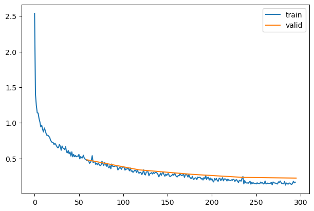

Exported source

``` python
class TTD_CB(Callback):
    def before_epoch(self, learn):
        learn.model.apply(lambda m: m.train() if isinstance(m, (nn.Dropout,nn.Dropout2d)) else None)
```

## Augment 2

Exported source

``` python
@inplace
def transformi(b): b[xl] = [(TF.to_tensor(o)*2-1) for o in b[xl]]
```

``` python
tds = dsd.with_transform(transformi)
dls = DataLoaders.from_dd(tds, bs, num_workers=fc.defaults.cpus)
```

``` python
set_seed(42)
epochs = 20
lr = 1e-2
tmax = epochs * len(dls.train)
sched = partial(lr_scheduler.OneCycleLR, max_lr=lr, total_steps=tmax)
xtra = [BatchSchedCB(sched), augcb]
model = get_model(act_gr, norm=nn.BatchNorm2d).apply(iw)
learn = TrainLearner(model, dls, F.cross_entropy, lr=lr, cbs=cbs+xtra, opt_func=optim.AdamW)
learn.fit(epochs)
```

| accuracy | loss  | epoch | train |
|----------|-------|-------|-------|
| 0.742    | 0.932 | 0     | train |
| 0.798    | 0.623 | 0     | eval  |
| 0.832    | 0.663 | 1     | train |
| 0.785    | 0.712 | 1     | eval  |
| 0.855    | 0.535 | 2     | train |
| 0.848    | 0.496 | 2     | eval  |
| 0.854    | 0.486 | 3     | train |
| 0.790    | 0.620 | 3     | eval  |
| 0.867    | 0.412 | 4     | train |
| 0.865    | 0.390 | 4     | eval  |
| 0.885    | 0.344 | 5     | train |
| 0.880    | 0.353 | 5     | eval  |
| 0.887    | 0.335 | 6     | train |
| 0.873    | 0.377 | 6     | eval  |
| 0.899    | 0.292 | 7     | train |
| 0.908    | 0.260 | 7     | eval  |
| 0.904    | 0.274 | 8     | train |
| 0.897    | 0.286 | 8     | eval  |
| 0.905    | 0.266 | 9     | train |
| 0.909    | 0.258 | 9     | eval  |
| 0.915    | 0.240 | 10    | train |
| 0.917    | 0.232 | 10    | eval  |
| 0.920    | 0.227 | 11    | train |
| 0.913    | 0.243 | 11    | eval  |
| 0.924    | 0.214 | 12    | train |
| 0.922    | 0.216 | 12    | eval  |
| 0.929    | 0.202 | 13    | train |
| 0.930    | 0.201 | 13    | eval  |
| 0.934    | 0.185 | 14    | train |
| 0.933    | 0.191 | 14    | eval  |
| 0.934    | 0.183 | 15    | train |
| 0.936    | 0.182 | 15    | eval  |
| 0.941    | 0.166 | 16    | train |
| 0.938    | 0.179 | 16    | eval  |
| 0.943    | 0.163 | 17    | train |
| 0.940    | 0.177 | 17    | eval  |
| 0.945    | 0.158 | 18    | train |
| 0.938    | 0.180 | 18    | eval  |
| 0.947    | 0.152 | 19    | train |
| 0.940    | 0.177 | 19    | eval  |

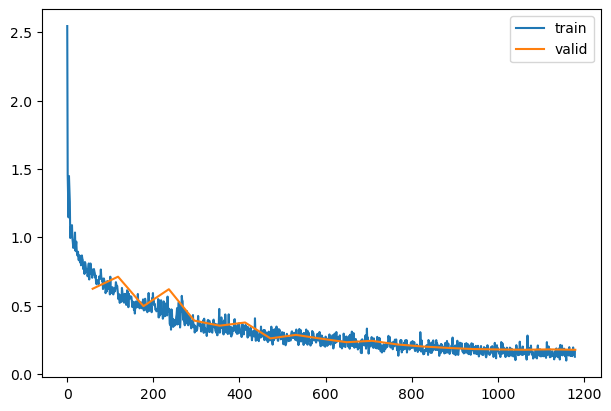

``` python
torch.save(learn.model, 'models/data_aug2.pkl')
```

Back to top
