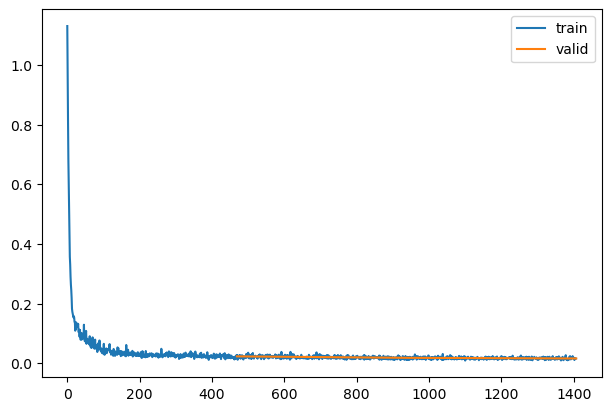
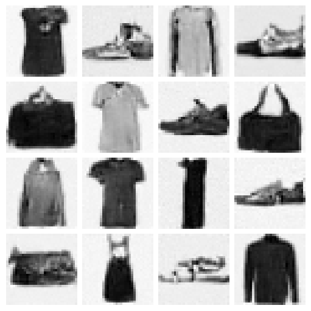

# Denoising Diffusion Probabilistic Models with miniai

Denoising Diffusion Probabilistic Models with miniai

Author

Benedict Thekkel

Now that we written our own barebones training library, let’s make some progress towards exploring diffusion model and building Stable Diffusion from scratch.

We’ll start with building and training the model described in the seminal 2020 paper [Denoising Diffusion Probabilistic Models](https://arxiv.org/abs/2006.11239) (DDPM). For more context, while diffusion models were technically invented [back in 2015](https://arxiv.org/abs/1503.03585), diffusion models flew under the radar until this 2020 paper since they were complicated and difficult to train. The 2020 paper introducing DDPMs made some crucial assumptions that significantly simplify the model training and generation processes, as we will see here. Later versions of diffusion models all build upon the same framework introduced in this paper.

Let’s get started and train our own DDPM!

## Imports

We’ll start with some imports.

``` python
torch.set_printoptions(precision=2, linewidth=140, sci_mode=False)
torch.manual_seed(1)
mpl.rcParams['image.cmap'] = 'gray_r'

import logging
logging.disable(logging.WARNING)

set_seed(42)

if fc.defaults.cpus>8: fc.defaults.cpus=8
```

``` python
mpl.rcParams['image.cmap'] = 'gray'
logging.disable(logging.WARNING)
```

## Load the dataset

We will load the dataset from HuggingFace Hub:

------------------------------------------------------------------------

``` python
x,y = 'image','label'
name = "fashion_mnist"
dsd = load_dataset(name)
```

To make life simpler (mostly with the model architecture), we’ll resize the 28x28 images to 32x32:

Exported source

``` python
@inplace
def transformi(b): b[x] = [TF.resize(TF.to_tensor(o), (32,32), antialias=True) for o in b[x]]
```

Let’s set our batch size and create our DataLoaders with this batch size. we can confirm the shapes are correct. Note that while we do get the labels for the dataset, we actuallydon’t care about that for our task of **unconditional** image generation.

``` python
set_seed(42)
bs = 128
tds = dsd.with_transform(transformi)
dls = DataLoaders.from_dd(tds, bs, num_workers=8)
dt = dls.train
xb,yb = next(iter(dt))
xb.shape,yb[:10]
```

    (torch.Size([128, 1, 32, 32]), tensor([5, 7, 4, 7, 3, 8, 9, 5, 3, 1]))

## Create model

We will create a U-net. A U-net looks something like this:


The DDPM U-net is a modification of this with some modern tricks like using attention.

We will cover how U-nets are created and how modules like attention work in future lessons. For now, we’ll import the U-net from the diffusers library:

``` python
from diffusers import UNet2DModel
```

``` python
model = UNet2DModel(in_channels=1, out_channels=1, block_out_channels=(32, 64, 128, 128))
```

## Training - easy with a callback!

DDPM is trained quite simply in a few steps: 1. randomly select some timesteps in an iterative noising process. 2. Add noise corresponding to this timestep to the original image. For increasing timesteps, the variance of the noise increases. 3. Pass in this noisy image and the timestep to our model 4. Model is trained with an MSE loss between the model output and the amount of noise added to the image

We will implement this in a callback. The callback will randomly select the timestep and create the noisy image before setting up our input and ground truth tensors for the model forward pass and loss calculation.

After training, we need to sample from this model. This is an iterative denoising process starting from pure noise. We simply keep removing noise predicted by the neural network, but we do it with an expected noise schedule that is reverse of what we saw during training. This is also done in our callback.

Exported source

``` python
class DDPMCB(TrainCB):
    order = DeviceCB.order+1
    def __init__(self, n_steps, beta_min, beta_max):
        super().__init__()
        self.n_steps,self.betamin,self.betamax = n_steps,beta_min,beta_max
        # variance schedule, linearly increased with timestep
        self.beta = torch.linspace(self.betamin, self.betamax, self.n_steps)
        self.alpha = 1. - self.beta 
        self.alphabar = torch.cumprod(self.alpha, dim=0)
        self.sigma = self.beta.sqrt()

    def predict(self, learn): learn.preds = learn.model(*learn.batch[0]).sample
    
    def before_batch(self, learn):
        device = learn.batch[0].device
        eps = torch.randn(learn.batch[0].shape, device=device)  # noise, x_T
        x0 = learn.batch[0] # original images, x_0
        self.alphabar = self.alphabar.to(device)
        n = x0.shape[0]
        # select random timesteps
        t = torch.randint(0, self.n_steps, (n,), device=device, dtype=torch.long)
        alphabar_t = self.alphabar[t].reshape(-1, 1, 1, 1).to(device)
        xt = alphabar_t.sqrt()*x0 + (1-alphabar_t).sqrt()*eps #noisify the image
        # input to our model is noisy image and timestep, ground truth is the noise 
        learn.batch = ((xt, t), eps)
    
    @torch.no_grad()
    def sample(self, model, sz):
        device = next(model.parameters()).device
        x_t = torch.randn(sz, device=device)
        preds = []
        for t in reversed(range(self.n_steps)):
            t_batch = torch.full((x_t.shape[0],), t, device=device, dtype=torch.long)
            z = (torch.randn(x_t.shape) if t > 0 else torch.zeros(x_t.shape)).to(device)
            alphabar_t1 = self.alphabar[t-1]  if t > 0 else torch.tensor(1)
            bbar_t = 1 - self.alphabar[t]
            bbar_t1 = 1 - alphabar_t1
            noise_pred = learn.model(x_t, t_batch).sample
            x_0_hat = ((x_t - bbar_t.sqrt() * noise_pred)/self.alphabar[t].sqrt()).clamp(-1,1)
            x0_coeff = alphabar_t1.sqrt()*(1-self.alpha[t])/bbar_t
            xt_coeff = self.alpha[t].sqrt()*bbar_t1/bbar_t
            x_t = x_0_hat*x0_coeff + x_t*xt_coeff + self.sigma[t]*z
            preds.append(x_t.cpu())
        return preds
```

Okay now we’re ready to train a model!

Let’s create our [`Learner`](https://bthek1.github.io/fastAIcourse/learner.html#learner). We’ll add our callbacks and train with MSE loss.

We specify the number of timesteps and the minimum and maximum variance for the DDPM model.

``` python
lr = 4e-3
epochs = 3
tmax = epochs * len(dls.train)
sched = partial(lr_scheduler.OneCycleLR, max_lr=lr, total_steps=tmax)
ddpm_cb = DDPMCB(n_steps=1000, beta_min=0.0001, beta_max=0.02)
cbs = [ddpm_cb, DeviceCB(), ProgressCB(plot=True), MetricsCB(), BatchSchedCB(sched)]
learn = Learner(model, dls, nn.MSELoss(), lr=lr, cbs=cbs, opt_func=optim.Adam)
```

Now let’s run the fit function:

``` python
learn.fit(epochs)
```

| loss  | epoch | train |
|-------|-------|-------|
| 0.053 | 0     | train |
| 0.023 | 0     | eval  |
| 0.020 | 1     | train |
| 0.018 | 1     | eval  |
| 0.017 | 2     | train |
| 0.016 | 2     | eval  |



``` python
mdl_path = Path('models')
mdl_path.mkdir(exist_ok=True)
```

``` python
torch.save(learn.model, mdl_path/'fashion_ddpm.pkl')
```

``` python
learn.model = torch.load(mdl_path/'fashion_ddpm.pkl')
```

## Inference

Now that we’ve trained our model, let’s generate some images with our model:

``` python
set_seed(42)
samples = ddpm_cb.sample(learn.model, (16, 1, 32, 32))
len(samples)
```

    1000

``` python
show_images(-samples[-1], figsize=(5,5))
```



Let’s visualize the sampling process:

``` python
[999]*10
```

    [999, 999, 999, 999, 999, 999, 999, 999, 999, 999]

``` python
import matplotlib.animation as animation
from IPython.display import display, HTML

fig,ax = plt.subplots(figsize=(3,3))
def _show_i(i): return show_image(-samples[i][9], ax=ax, animated=True).get_images()
r = L.range(700,900, 4)+L.range(900,1000,1)+[999]*10
ims = r.map(_show_i)

animate = animation.ArtistAnimation(fig, ims, interval=50, blit=True, repeat_delay=3000)

HTML(animate.to_jshtml())
```

    Using matplotlib backend: <object object>

    QStandardPaths: wrong permissions on runtime directory /run/user/1000/, 0755 instead of 0700

Once Loop Reflect

Note that I only take the steps between 800 and 1000 since most of the previous steps are actually quite noisy. This is a limitation of the noise schedule used for small images, and papers like [Improved DDPM](https://arxiv.org/abs/2102.09672) suggest other noise schedules for this purpose! (Some potential homework: try out the noise schedule from Improved DDPM and see if it helps.)

Back to top
