# Setup

\- skip_showdoc: true

Author

Benedict Thekkel

``` python
import pickle,gzip,math,os,time,shutil,torch,random,timm,torchvision,io,PIL
import fastcore.all as fc,matplotlib as mpl,numpy as np,matplotlib.pyplot as plt
from collections.abc import Mapping
from pathlib import Path
from operator import attrgetter,itemgetter
from functools import partial
from copy import copy
from contextlib import contextmanager

import torchvision.transforms.functional as TF,torch.nn.functional as F
import torchvision.transforms as trans
from torchvision import transforms
from torch import tensor,nn,optim
from torch.utils.data import DataLoader,default_collate
from torch.nn import init
from torch.optim import lr_scheduler
from torcheval.metrics import MulticlassAccuracy
from datasets import load_dataset,load_dataset_builder
from fastcore.foundation import L, store_attr

from fastAIcourse.datasets import *
from fastAIcourse.conv import *
from fastAIcourse.learner import *
from fastAIcourse.activations import *
from fastAIcourse.init import *
from fastAIcourse.sgd import *
from fastAIcourse.resnet import *
```

``` python
# Image URLs for demos. Change as desired.
face_url = "https://images.pexels.com/photos/2690323/pexels-photo-2690323.jpeg?w=256"
spiderweb_url = "https://images.pexels.com/photos/34225/spider-web-with-water-beads-network-dewdrop.jpg?w=256"
```

# Loading Images

``` python
def download_image(url):
    imgb = fc.urlread(url, decode=False) 
    return torchvision.io.decode_image(tensor(list(imgb), dtype=torch.uint8)).float()/255.
```

``` python
content_im = download_image(face_url).to(def_device)
print('content_im.shape:', content_im.shape)
show_image(content_im);
```

    content_im.shape: torch.Size([3, 256, 256])

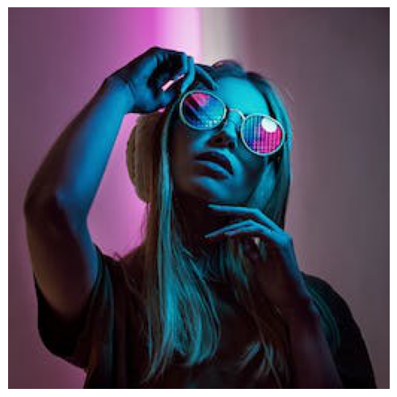

``` python
content_im.min(),content_im.max() # Check bounds
```

    (tensor(0., device='cuda:0'), tensor(1., device='cuda:0'))

# Optimizing Images

``` python
class LengthDataset():
    def __init__(self, length=1): self.length=length
    def __len__(self): return self.length
    def __getitem__(self, idx): return 0,0

def get_dummy_dls(length=100):
    return DataLoaders(DataLoader(LengthDataset(length), batch_size=1), # Train
                       DataLoader(LengthDataset(1), batch_size=1))      # Valid (length 1)
```

``` python
class TensorModel(nn.Module):
    def __init__(self, t):
        super().__init__()
        self.t = nn.Parameter(t.clone())
    def forward(self, x=0): return self.t
```

``` python
model = TensorModel(torch.rand_like(content_im))
show_image(model());
```

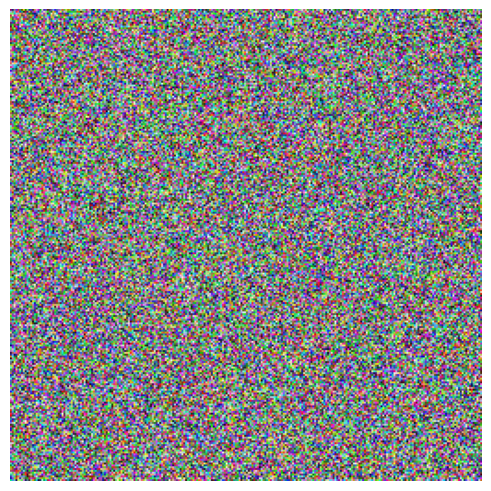

``` python
[p.shape for p in model.parameters()]
```

    [torch.Size([3, 256, 256])]

``` python
class ImageOptCB(TrainCB):
    def predict(self, learn): learn.preds = learn.model()
    def get_loss(self, learn): learn.loss = learn.loss_func(learn.preds)
```

``` python
def loss_fn_mse(im):
    return F.mse_loss(im, content_im)
```

``` python
model = TensorModel(torch.rand_like(content_im))
cbs = [ImageOptCB(), ProgressCB(), MetricsCB(), DeviceCB()]
learn = Learner(model, get_dummy_dls(100), loss_fn_mse, 
                lr=1e-2, cbs=cbs, opt_func=torch.optim.Adam)
learn.fit(1)
```

| loss  | epoch | train |
|-------|-------|-------|
| 0.041 | 0     | train |
| 0.001 | 0     | eval  |

``` python
# Result (left) vs target image (right):
show_images([learn.model().clip(0, 1), content_im]);
```

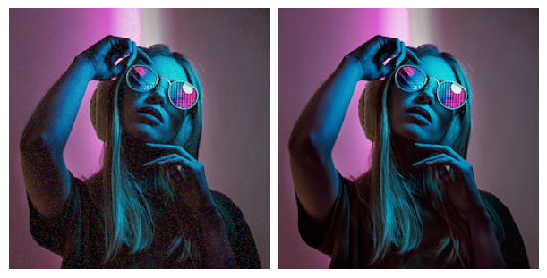

## Viewing progress

It would be great if we could see what is happening over time. You could save individual images and turn them into a video, but for quick feedback we can also log images every few iterations and display them in a grid in `after_fit`:

``` python
class ImageLogCB(Callback):
    order = ProgressCB.order + 1
    def __init__(self, log_every=10): store_attr(); self.images=[]; self.i=0
    def after_batch(self, learn): 
        if self.i%self.log_every == 0: self.images.append(to_cpu(learn.preds.clip(0, 1)))
        self.i += 1
    def after_fit(self, learn): show_images(self.images)
```

``` python
model = TensorModel(torch.rand_like(content_im))
learn = Learner(model, get_dummy_dls(150), loss_fn_mse, 
                lr=1e-2, cbs=cbs, opt_func=torch.optim.Adam)
learn.fit(1, cbs=[ImageLogCB(30)])
```

| loss  | epoch | train |
|-------|-------|-------|
| 0.028 | 0     | train |
| 0.000 | 0     | eval  |

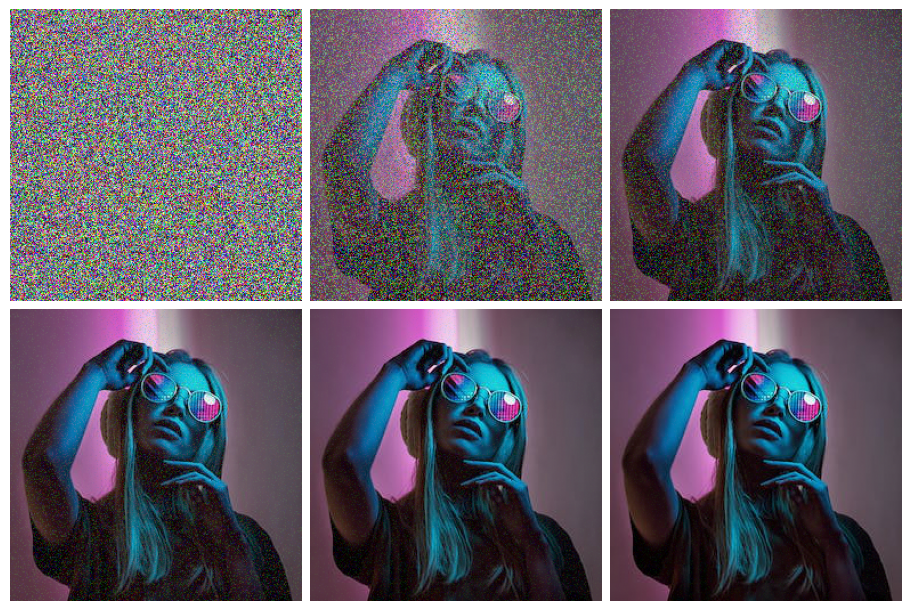

## Getting Features from VGG16

We’re going to peek inside a small CNN and extract the outputs of different layers.

### Load VGG network


vgg diag

``` python
print(timm.list_models('*vgg*'))
```

    ['repvgg_a2', 'repvgg_b0', 'repvgg_b1', 'repvgg_b1g4', 'repvgg_b2', 'repvgg_b2g4', 'repvgg_b3', 'repvgg_b3g4', 'vgg11', 'vgg11_bn', 'vgg13', 'vgg13_bn', 'vgg16', 'vgg16_bn', 'vgg19', 'vgg19_bn']

``` python
vgg16 = timm.create_model('vgg16', pretrained=True).to(def_device).features
```

``` python
vgg16
```

    Sequential(
      (0): Conv2d(3, 64, kernel_size=(3, 3), stride=(1, 1), padding=(1, 1))
      (1): ReLU(inplace=True)
      (2): Conv2d(64, 64, kernel_size=(3, 3), stride=(1, 1), padding=(1, 1))
      (3): ReLU(inplace=True)
      (4): MaxPool2d(kernel_size=2, stride=2, padding=0, dilation=1, ceil_mode=False)
      (5): Conv2d(64, 128, kernel_size=(3, 3), stride=(1, 1), padding=(1, 1))
      (6): ReLU(inplace=True)
      (7): Conv2d(128, 128, kernel_size=(3, 3), stride=(1, 1), padding=(1, 1))
      (8): ReLU(inplace=True)
      (9): MaxPool2d(kernel_size=2, stride=2, padding=0, dilation=1, ceil_mode=False)
      (10): Conv2d(128, 256, kernel_size=(3, 3), stride=(1, 1), padding=(1, 1))
      (11): ReLU(inplace=True)
      (12): Conv2d(256, 256, kernel_size=(3, 3), stride=(1, 1), padding=(1, 1))
      (13): ReLU(inplace=True)
      (14): Conv2d(256, 256, kernel_size=(3, 3), stride=(1, 1), padding=(1, 1))
      (15): ReLU(inplace=True)
      (16): MaxPool2d(kernel_size=2, stride=2, padding=0, dilation=1, ceil_mode=False)
      (17): Conv2d(256, 512, kernel_size=(3, 3), stride=(1, 1), padding=(1, 1))
      (18): ReLU(inplace=True)
      (19): Conv2d(512, 512, kernel_size=(3, 3), stride=(1, 1), padding=(1, 1))
      (20): ReLU(inplace=True)
      (21): Conv2d(512, 512, kernel_size=(3, 3), stride=(1, 1), padding=(1, 1))
      (22): ReLU(inplace=True)
      (23): MaxPool2d(kernel_size=2, stride=2, padding=0, dilation=1, ceil_mode=False)
      (24): Conv2d(512, 512, kernel_size=(3, 3), stride=(1, 1), padding=(1, 1))
      (25): ReLU(inplace=True)
      (26): Conv2d(512, 512, kernel_size=(3, 3), stride=(1, 1), padding=(1, 1))
      (27): ReLU(inplace=True)
      (28): Conv2d(512, 512, kernel_size=(3, 3), stride=(1, 1), padding=(1, 1))
      (29): ReLU(inplace=True)
      (30): MaxPool2d(kernel_size=2, stride=2, padding=0, dilation=1, ceil_mode=False)
    )

### Normalize Images

This model expacts images normalized with the same stats as those used during training, which in this case requires the stats of the ImageNet dataset. Previously we were working with single-channel images, and so normalizing was pretty straightforward. With three channels, we need to think a bit more about shapes and boradcasting rules:

``` python
imagenet_mean = tensor([0.485, 0.456, 0.406])
imagenet_std = tensor([0.229, 0.224, 0.225])
```

``` python
# Try 1 (won't work):
# (content_im - imagenet_mean) / imagenet_std
```

``` python
imagenet_mean.shape
```

    torch.Size([3])

``` python
content_im.shape
```

    torch.Size([3, 256, 256])

``` python
imagenet_mean[:,None,None].shape
```

    torch.Size([3, 1, 1])

``` python
# Try 2:
def normalize(im):
    imagenet_mean = tensor([0.485, 0.456, 0.406])[:,None,None].to(im.device)
    imagenet_std = tensor([0.229, 0.224, 0.225])[:,None,None].to(im.device)
    return (im - imagenet_mean) / imagenet_std
```

``` python
normalize(content_im).min(), normalize(content_im).max()
```

    (tensor(-2.12, device='cuda:0'), tensor(2.64, device='cuda:0'))

``` python
normalize(content_im).mean(dim=(1, 2))
```

    tensor([-0.97, -0.96, -0.42], device='cuda:0')

``` python
# And with torchvision transforms:
normalize = trans.Normalize(mean=[0.485, 0.456, 0.406], std=[0.229, 0.224, 0.225])
```

``` python
normalize(content_im).min(), normalize(content_im).max()
```

    (tensor(-2.12, device='cuda:0'), tensor(2.64, device='cuda:0'))

### Get intermediate representations, take 1:

We want to feed some data through the network, storing thr outputs of different layers. Here’s one way to do this:

``` python
def calc_features(imgs, target_layers=(18, 25)): 
    x = normalize(imgs)
    feats = []
    for i, layer in enumerate(vgg16[:max(target_layers)+1]):
        x = layer(x)
        if i in target_layers:
            feats.append(x.clone())
    return feats
```

``` python
# Testing it out to see the shapes of the resulting feature maps:
feats = calc_features(content_im)
[f.shape for f in feats]
```

    [torch.Size([512, 32, 32]), torch.Size([512, 16, 16])]

``` python
# Homework: Can you do this using hooks?
```

### What’s the point?

You may remember us looking at https://distill.pub/2017/feature-visualization/ and talking about how deep CNNs ‘learn’ to classify images. Early layers tend to capture gradients and textures, while later layers tend towards more complex types of feature. We’re going to exploit this hierarchy for artistic purposes, but being able to choose what kind of feature you’d like to use when comparing images has a number of other useful applications.

# Optimizing an Image with Content Loss

To start with, let’s try optimizing an image by comparing it’s features (from two later layers) with those from the target image. If our theory is right, we should see the structure of the target emerge from the noise without necessarily seeing a perfect re-production of the target like we did in the previous MSE loss example.

``` python
class ContentLossToTarget():
    def __init__(self, target_im, target_layers=(18, 25)):
        fc.store_attr()
        with torch.no_grad():
            self.target_features = calc_features(target_im, target_layers)
    def __call__(self, input_im): 
        return sum((f1-f2).pow(2).mean() for f1, f2 in 
               zip(calc_features(input_im, self.target_layers), self.target_features))
```

``` python
loss_function_perceptual = ContentLossToTarget(content_im)
model = TensorModel(torch.rand_like(content_im))
learn = Learner(model, get_dummy_dls(150), loss_function_perceptual, 
                lr=1e-2, cbs=cbs, opt_func=torch.optim.Adam)
learn.fit(1, cbs=[ImageLogCB(log_every=30)])
```

| loss  | epoch | train |
|-------|-------|-------|
| 4.974 | 0     | train |
| 1.529 | 0     | eval  |

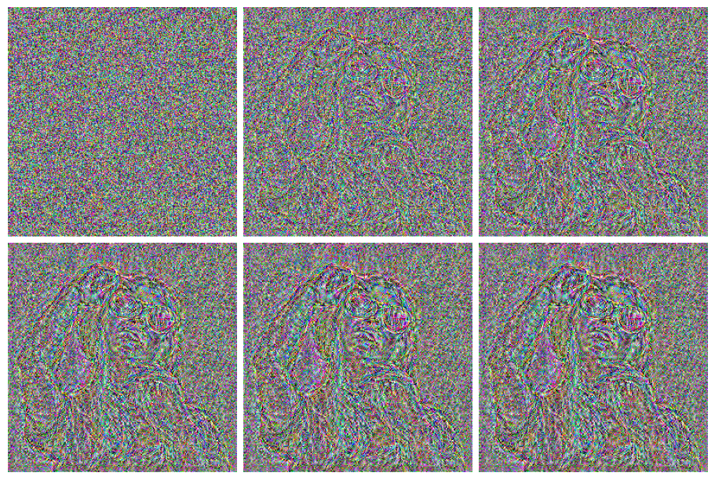

**Choosing the layers determines the kind of features that are important:**

``` python
loss_function_perceptual = ContentLossToTarget(content_im, target_layers=(1, 6))
model = TensorModel(torch.rand_like(content_im))
learn = Learner(model, get_dummy_dls(150), loss_function_perceptual, 
                lr=1e-2, cbs=cbs, opt_func=torch.optim.Adam)
learn.fit(1, cbs=[ImageLogCB(log_every=30)])
```

| loss  | epoch | train |
|-------|-------|-------|
| 2.389 | 0     | train |
| 0.373 | 0     | eval  |

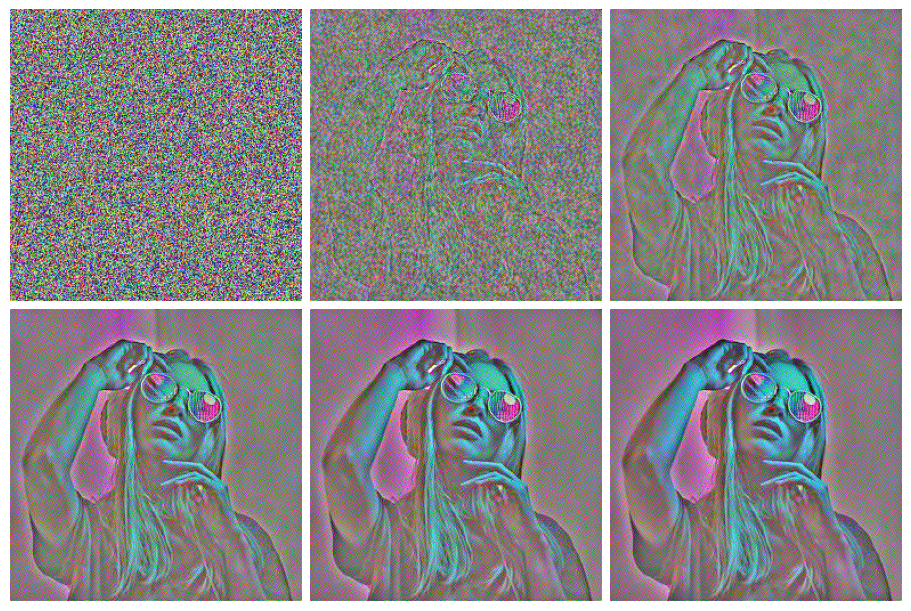

# Style Loss with Gram Matrix

So, we know how to extract feature maps. The next thing we’d like to do is find a way to capture the **style** of an input image, based on those early layers and the kinds of textural feature that they learn. Unfortunately, we can’t just compare the feature maps from some early layers since these ‘maps’ encode information spatially - which we don’t want!

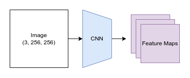

feature_map_extraction.png

So, we need a way to measure what **kinds** of style features are present, and ideally which kinds occur together, without worrying about **where** these features occur in the image.

Enter something called the Gram Matrix. The idea here is that we’ll measure the **correlation** between features. Given a feature map with `f` features in an `h` x `w` grid, we’ll flatten out the spatial component and then for every feature we’ll take the dot product of that row with itself, giving an `f` x `f` matrix as the result. Each entry in this matrix quantifies how correlated the relevant pair of features are and how frequently they occur - exactly what we want. In this diagram each feature is represented as a colored dot.

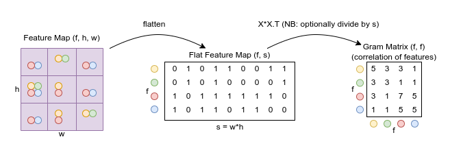

gram_calculation.png

Re-creating the diagram operations in code:

``` python
t = tensor([[0, 1, 0, 1, 1, 0, 0, 1, 1],
            [0, 1, 0, 1, 0, 0, 0, 0, 1],
            [1, 0, 1, 1, 1, 1, 1, 1, 0],
            [1, 0, 1, 1, 0, 1, 1, 0, 0]])
```

``` python
torch.einsum('fs, gs -> fg', t, t)
```

    tensor([[5, 3, 3, 1],
            [3, 3, 1, 1],
            [3, 1, 7, 5],
            [1, 1, 5, 5]])

``` python
t.matmul(t.T) # Alternate approach
```

    tensor([[5, 3, 3, 1],
            [3, 3, 1, 1],
            [3, 1, 7, 5],
            [1, 1, 5, 5]])

### Trying it out

``` python
style_im = download_image(spiderweb_url).to(def_device)
show_image(style_im);
```

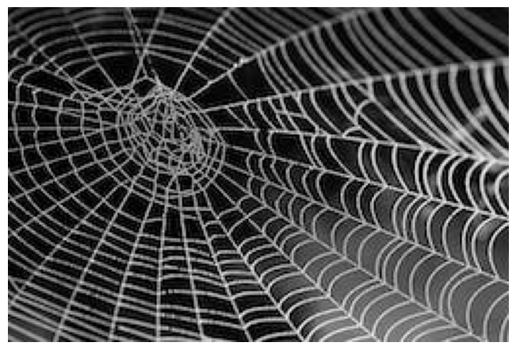

``` python
def calc_grams(img, target_layers=(1, 6, 11, 18, 25)):
    return L(torch.einsum('chw, dhw -> cd', x, x) / (x.shape[-2]*x.shape[-1]) # 'bchw, bdhw -> bcd' if batched
            for x in calc_features(img, target_layers))
```

``` python
style_grams = calc_grams(style_im)
```

``` python
[g.shape for g in style_grams] # The gram matrices for features from different layers
```

    [torch.Size([64, 64]),
     torch.Size([128, 128]),
     torch.Size([256, 256]),
     torch.Size([512, 512]),
     torch.Size([512, 512])]

``` python
style_grams.attrgot('shape') # The magic of fastcore's L
```

    (#5) [torch.Size([64, 64]),torch.Size([128, 128]),torch.Size([256, 256]),torch.Size([512, 512]),torch.Size([512, 512])]

``` python
class StyleLossToTarget():
    def __init__(self, target_im, target_layers=(1, 6, 11, 18, 25)):
        fc.store_attr()
        with torch.no_grad(): self.target_grams = calc_grams(target_im, target_layers)
    def __call__(self, input_im): 
        return sum((f1-f2).pow(2).mean() for f1, f2 in 
               zip(calc_grams(input_im, self.target_layers), self.target_grams))
```

``` python
style_loss = StyleLossToTarget(style_im)
```

``` python
style_loss(content_im)
```

    tensor(460.04, device='cuda:0', grad_fn=<AddBackward0>)

## Style Transfer

``` python
def image_to_tensor(path, rotate = 0, size = (256,256)):
    from PIL import Image
    from torchvision import transforms
    # Define the file path of your image
    image_path = path
    # Open the image using PIL
    image_pil = Image.open(image_path)

    # Define the transformation to convert the image to a PyTorch tensor
    transform = transforms.ToTensor()

    # Apply the transformation to the image
    image_tensor = transform(image_pil)
    image_tensor = image_tensor.rot90(k = rotate, dims =(1,2))
    
    # Downsize the image tensor to size
    downsized_image_tensor = F.interpolate(image_tensor.unsqueeze(0), size=size, mode='bilinear', align_corners=False)
    downsized_image_tensor = downsized_image_tensor.squeeze(0)

    # Print the shape of the resulting tensor
    print("Tensor shape:", downsized_image_tensor.shape)
    return downsized_image_tensor
```

``` python
original_path = 'Data/galaxy.jpg'
original = image_to_tensor(original_path, 0, size=(512, 512)).to(def_device)
show_image(original);
```

    Tensor shape: torch.Size([3, 512, 512])

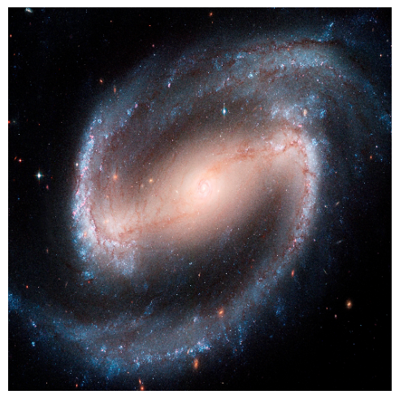

``` python
art_path = 'Data/art.jpg'
art = image_to_tensor(art_path, size=(512, 512)).to(def_device)
show_image(art);
```

    Tensor shape: torch.Size([3, 512, 512])

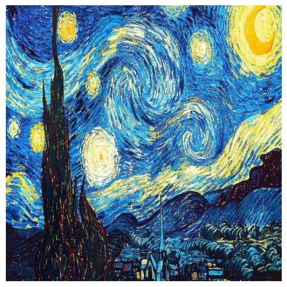

``` python
model = TensorModel(original) # Start from content image
style_loss = StyleLossToTarget(art)
content_loss = ContentLossToTarget(original)
cbs = [ImageOptCB(), ProgressCB(), MetricsCB(), DeviceCB()]
def combined_loss(x):
    return style_loss(x) + content_loss(x) * 0.5
learn = Learner(model, get_dummy_dls(150), combined_loss, lr=3e-2, cbs=cbs, opt_func=torch.optim.Adam)
learn.fit(1, cbs=[ImageLogCB(30)])
```

| loss  | epoch | train |
|-------|-------|-------|
| 8.123 | 0     | train |
| 4.497 | 0     | eval  |

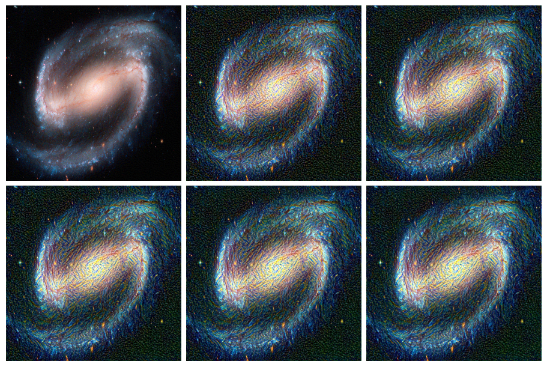

``` python
original_path = 'Data/original.jpg'
original1 = image_to_tensor(original_path, -1, size=(512, 512)).to(def_device)
show_image(original1);
```

    Tensor shape: torch.Size([3, 512, 512])


``` python
model = TensorModel(original1) # Start from content image
style_loss = StyleLossToTarget(art)
content_loss = ContentLossToTarget(original1)
cbs = [ImageOptCB(), ProgressCB(), MetricsCB(), DeviceCB()]
def combined_loss(x):
    return style_loss(x) + content_loss(x) * 0.5
learn = Learner(model, get_dummy_dls(150), combined_loss, lr=3e-2, cbs=cbs, opt_func=torch.optim.Adam)
learn.fit(1, cbs=[ImageLogCB(30)])
```

| loss  | epoch | train |
|-------|-------|-------|
| 8.568 | 0     | train |
| 5.177 | 0     | eval  |

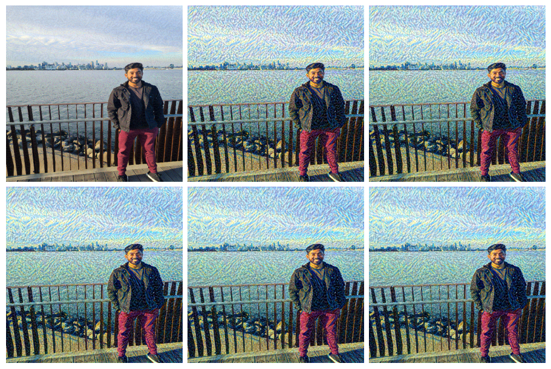

``` python
model = TensorModel(content_im) # Start from content image
style_loss = StyleLossToTarget(style_im)
content_loss = ContentLossToTarget(content_im)
def combined_loss(x):
    return style_loss(x) + content_loss(x)
learn = Learner(model, get_dummy_dls(150), combined_loss, lr=1e-2, cbs=cbs, opt_func=torch.optim.Adam)
learn.fit(1, cbs=[ImageLogCB(30)])
```

| loss   | epoch | train |
|--------|-------|-------|
| 79.014 | 0     | train |
| 46.737 | 0     | eval  |

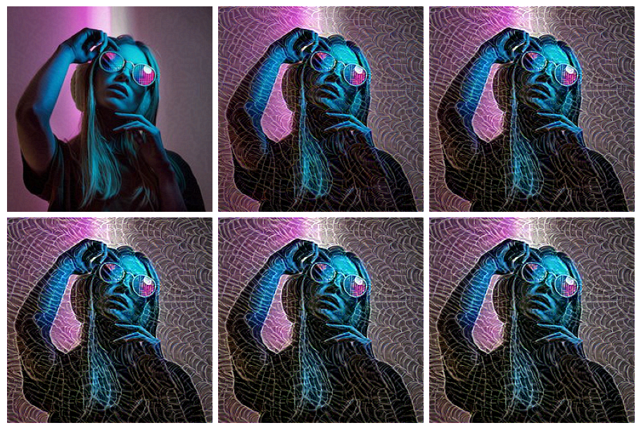

``` python
show_image(learn.model().clip(0, 1)); # View the final result
```

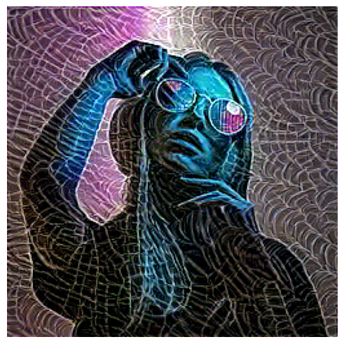

And trying with random starting image, weighting the style loss lower, using different layers:

``` python
model = TensorModel(torch.rand_like(content_im))
style_loss = StyleLossToTarget(style_im)
content_loss = ContentLossToTarget(content_im, target_layers=(6, 18, 25))
def combined_loss(x):
    return style_loss(x) * 0.2 + content_loss(x)
learn = Learner(model, get_dummy_dls(300), combined_loss, lr=5e-2, cbs=cbs, opt_func=torch.optim.Adam)
learn.fit(1, cbs=[ImageLogCB(60)])
```

| loss   | epoch | train |
|--------|-------|-------|
| 47.008 | 0     | train |
| 38.026 | 0     | eval  |

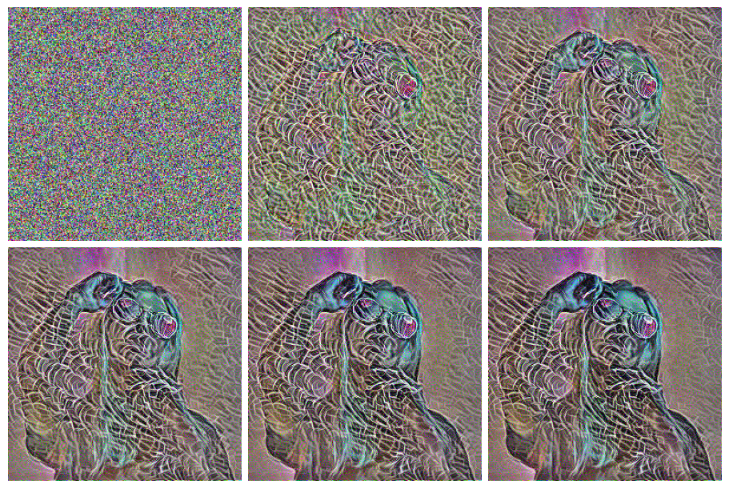

## For Comparison: non-miniai version

``` python
content_im.shape, style_im.shape
```

    (torch.Size([3, 256, 256]), torch.Size([3, 171, 256]))

``` python
content_im = download_image(face_url).to(def_device)
copy = download_image(face_url).to(def_device)
print('content_im.shape:', content_im.shape)
```

    content_im.shape: torch.Size([3, 256, 256])

``` python
show_image(content_im);
```


``` python
# The image to be optimized
from tqdm import tqdm  
content_im = download_image(face_url).to(def_device)
copy = download_image(face_url).to(def_device)

im = torch.rand(3, 256, 256).to(def_device)
im = copy
im.requires_grad = True


# Set up the optimizer
opt = torch.optim.Adam([im], lr=5e-2)

# Define the loss function
style_loss = StyleLossToTarget(style_im)
content_loss = ContentLossToTarget(content_im)

def combined_loss(x):
    return style_loss(x) * 0.7 + content_loss(x)

# Optimization loop
for i in tqdm(range(10)):
    loss = combined_loss(im)
    loss.backward()
    opt.step()
    opt.zero_grad()
    
# Show the result
show_image(im.clip(0, 1));
```

    100%|█████████████████████████████████████████████████████████████████████████████████████████████████| 10/10 [00:00<00:00, 17.57it/s]

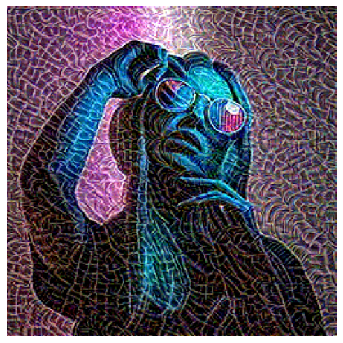

``` python
# Show the result
show_image(content_im.clip(0, 1));
```


What do you think are some pros and cons? How would this look once we start displaying progress, testing different configurations and so on?

Back to top
