# Denoising Diffusion Probabilistic Models with miniai

\- skip_showdoc: true

Author

Benedict Thekkel

## Imports

``` python
from torcheval.metrics import MulticlassAccuracy
from datasets import load_dataset,load_dataset_builder

mpl.rcParams['image.cmap'] = 'gray_r'
logging.disable(logging.WARNING)
```

## Load the dataset

``` python
xl,yl = 'image','label'
name = "fashion_mnist"
dsd = load_dataset(name)

@inplace
def transformi(b): b[xl] = [F.pad(TF.to_tensor(o), (2,2,2,2)) for o in b[xl]]

bs = 128
tds = dsd.with_transform(transformi)
dls = DataLoaders.from_dd(tds, bs, num_workers=8)
```

``` python
dt = dls.train
xb,yb = next(iter(dt))
```

``` python
show_images(xb[:16], imsize=1.5)
```

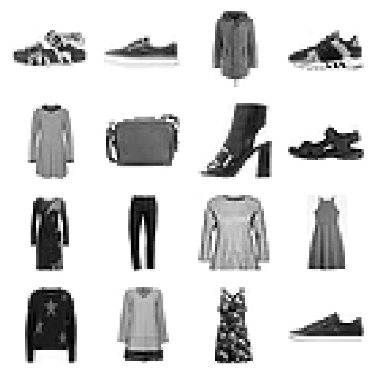

``` python
betamin,betamax,n_steps = 0.0001,0.02,1000
beta = torch.linspace(betamin, betamax, n_steps)
alpha = 1.-beta
alphabar = alpha.cumprod(dim=0)
sigma = beta.sqrt()
```

``` python
plt.plot(beta);
```

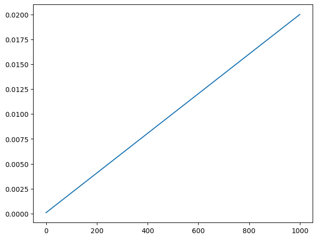

``` python
plt.plot(sigma);
```

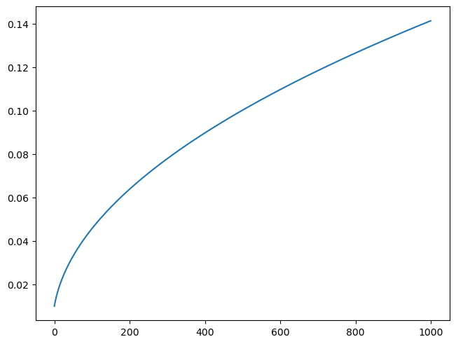

``` python
plt.plot(alphabar);
```

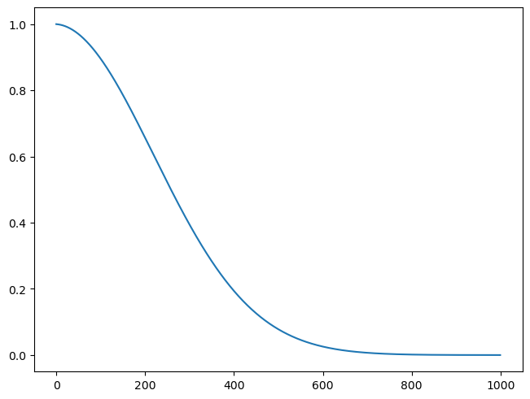

Exported source

``` python
def noisify(x0, alphabar):
    device = x0.device
    n = len(x0)
    t = torch.randint(0, n_steps, (n,), dtype=torch.long)
    eps = torch.randn(x0.shape, device=device)
    alphabar_t = alphabar[t].reshape(-1, 1, 1, 1).to(device)
    xt = alphabar_t.sqrt()*x0 + (1-alphabar_t).sqrt()*eps
    return (xt, t.to(device)), eps
```

``` python
(xt,t),eps = noisify(xb[:25],alphabar)
t
```

    tensor([ 26, 335, 620, 924, 950, 113, 378,  14, 210, 954, 231, 572, 315, 295, 567, 706, 749, 876,  73, 111, 899, 213, 541, 769, 287])

``` python
titles = fc.map_ex(t, '{}')
show_images(xt, imsize=1.5, titles=titles)
```

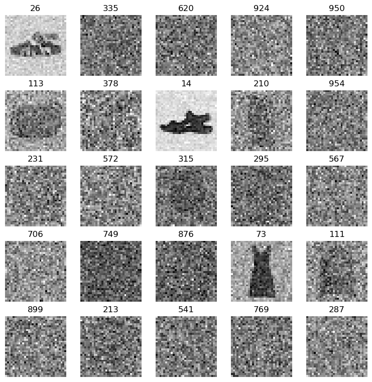

## Training

Exported source

``` python
from diffusers import UNet2DModel
```

Exported source

``` python
@torch.no_grad()
def sample(model, sz, alpha, alphabar, sigma, n_steps):
    device = next(model.parameters()).device
    x_t = torch.randn(sz, device=device)
    preds = []
    for t in reversed(range(n_steps)):
        t_batch = torch.full((x_t.shape[0],), t, device=device, dtype=torch.long)
        z = (torch.randn(x_t.shape) if t > 0 else torch.zeros(x_t.shape)).to(device)
        alphabar_t1 = alphabar[t-1]  if t > 0 else torch.tensor(1)
        bbar_t = 1 - alphabar[t]
        bbar_t1 = 1 - alphabar_t1
        x_0_hat = ((x_t - bbar_t.sqrt() * learn.model((x_t, t_batch)))/alphabar[t].sqrt()).clamp(-1,1)
        x_t = x_0_hat * alphabar_t1.sqrt()*(1-alpha[t])/bbar_t + x_t * alpha[t].sqrt()*bbar_t1/bbar_t + sigma[t]*z
        preds.append(x_t.cpu())
    return preds
```

Exported source

``` python
class DDPMCB(Callback):
    order = DeviceCB.order+1
    def __init__(self, n_steps, beta_min, beta_max):
        super().__init__()
        fc.store_attr()
        self.beta = torch.linspace(self.beta_min, self.beta_max, self.n_steps)
        self.alpha = 1. - self.beta 
        self.alphabar = torch.cumprod(self.alpha, dim=0)
        self.sigma = self.beta.sqrt()
    
    def before_batch(self, learn): learn.batch = noisify(learn.batch[0], self.alphabar)
    def sample(self, model, sz): return sample(model, sz, self.alpha, self.alphabar, self.sigma, self.n_steps)
```

Exported source

``` python
class UNet(UNet2DModel):
    def forward(self, x): return super().forward(*x).sample
```

``` python
ddpm_cb = DDPMCB(n_steps=1000, beta_min=0.0001, beta_max=0.02)
```

``` python
model = UNet(in_channels=1, out_channels=1, block_out_channels=(16, 32, 64, 64), norm_num_groups=8)

learn = TrainLearner(model, dls, nn.MSELoss())
learn.fit(train=False, cbs=[ddpm_cb,SingleBatchCB()])
(xt,t),eps = learn.batch
show_images(xt[:25], titles=fc.map_ex(t[:25], '{}'), imsize=1.5)
```

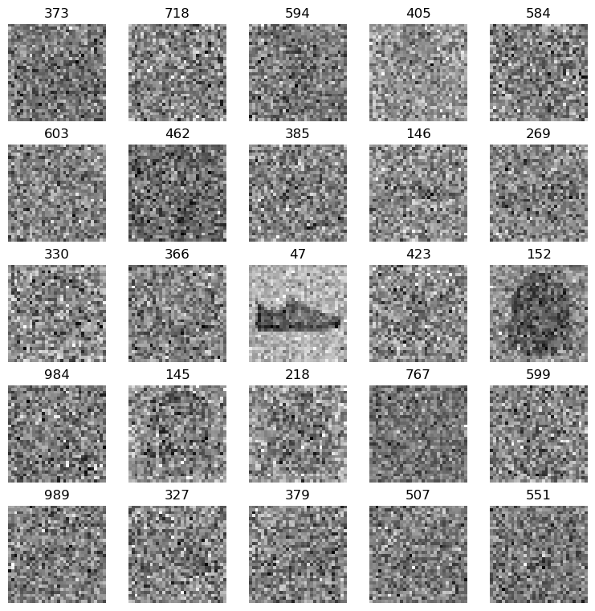

``` python
lr = 5e-3
epochs = 3

tmax = epochs * len(dls.train)
sched = partial(lr_scheduler.OneCycleLR, max_lr=lr, total_steps=tmax)
cbs = [ddpm_cb, DeviceCB(), ProgressCB(plot=True), MetricsCB(), BatchSchedCB(sched)]
```

``` python
model = UNet(in_channels=1, out_channels=1, block_out_channels=(16, 32, 64, 128), norm_num_groups=8)
```

Exported source

``` python
def init_ddpm(model):
    for o in model.down_blocks:
        for p in o.resnets:
            p.conv2.weight.data.zero_()
            for p in fc.L(o.downsamplers): init.orthogonal_(p.conv.weight)

    for o in model.up_blocks:
        for p in o.resnets: p.conv2.weight.data.zero_()

    model.conv_out.weight.data.zero_()
```

``` python
init_ddpm(model)
```

``` python
opt_func = partial(optim.Adam, eps=1e-5)
```

``` python
learn = TrainLearner(model, dls, nn.MSELoss(), lr=lr, cbs=cbs, opt_func=opt_func)
```

``` python
learn.fit(epochs)
```

| loss  | epoch | train |
|-------|-------|-------|
| 0.131 | 0     | train |
| 0.024 | 0     | eval  |
| 0.022 | 1     | train |
| 0.022 | 1     | eval  |
| 0.019 | 2     | train |
| 0.020 | 2     | eval  |

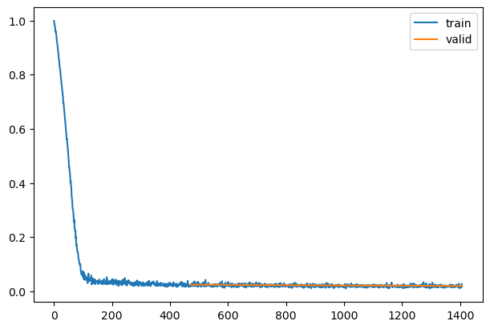

``` python
mdl_path = Path('models')
```

``` python
torch.save(learn.model, mdl_path/'fashion_ddpm2.pkl')
```

``` python
learn.model = torch.load(mdl_path/'fashion_ddpm2.pkl')
```

## Sampling

``` python
samples = ddpm_cb.sample(learn.model, (16, 1, 32, 32))
```

``` python
show_images(samples[-1], figsize=(5,5))
```

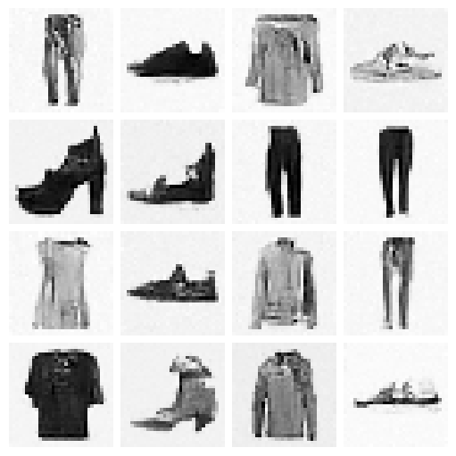

## Mixed Precision

``` python
bs = 512
```

``` python
next(iter(DataLoader(tds['train'], batch_size=2)))
```

    {'image': tensor([[[[0., 0., 0.,  ..., 0., 0., 0.],
               [0., 0., 0.,  ..., 0., 0., 0.],
               [0., 0., 0.,  ..., 0., 0., 0.],
               ...,
               [0., 0., 0.,  ..., 0., 0., 0.],
               [0., 0., 0.,  ..., 0., 0., 0.],
               [0., 0., 0.,  ..., 0., 0., 0.]]],
     
     
             [[[0., 0., 0.,  ..., 0., 0., 0.],
               [0., 0., 0.,  ..., 0., 0., 0.],
               [0., 0., 0.,  ..., 0., 0., 0.],
               ...,
               [0., 0., 0.,  ..., 0., 0., 0.],
               [0., 0., 0.,  ..., 0., 0., 0.],
               [0., 0., 0.,  ..., 0., 0., 0.]]]]),
     'label': tensor([9, 0])}

Exported source

``` python
def collate_ddpm(b): return noisify(default_collate(b)[xl], alphabar)
def dl_ddpm(ds): return DataLoader(ds, batch_size=bs, collate_fn=collate_ddpm, num_workers=4)
```

``` python
dls = DataLoaders(dl_ddpm(tds['train']), dl_ddpm(tds['test']))
```

Exported source

``` python
class MixedPrecision(TrainCB):
    order = DeviceCB.order+10
    
    def before_fit(self, learn): self.scaler = torch.cuda.amp.GradScaler()

    def before_batch(self, learn):
        self.autocast = torch.autocast("cuda", dtype=torch.float16)
        self.autocast.__enter__()

    def after_loss(self, learn): self.autocast.__exit__(None, None, None)
        
    def backward(self, learn): self.scaler.scale(learn.loss).backward()

    def step(self, learn):
        self.scaler.step(learn.opt)
        self.scaler.update()
```

``` python
lr = 1e-2
epochs = 3
tmax = epochs * len(dls.train)
sched = partial(lr_scheduler.OneCycleLR, max_lr=lr, total_steps=tmax)
cbs = [DeviceCB(), MixedPrecision(), ProgressCB(plot=True), MetricsCB(), BatchSchedCB(sched)]
model = UNet(in_channels=1, out_channels=1, block_out_channels=(16, 32, 64, 128), norm_num_groups=8)
init_ddpm(model)
learn = Learner(model, dls, nn.MSELoss(), lr=lr, cbs=cbs, opt_func=opt_func)
```

``` python
learn.fit(epochs)
```

| loss | epoch | train |
|------|-------|-------|
| nan  | 0     | train |
| nan  | 0     | eval  |
| nan  | 1     | train |
| nan  | 1     | eval  |
| nan  | 2     | train |
| nan  | 2     | eval  |

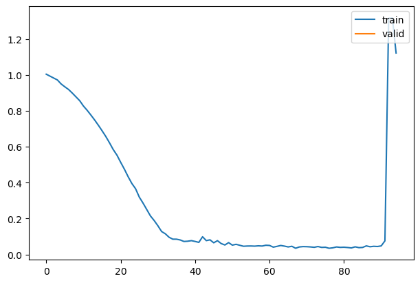

``` python
samples = sample(learn.model, (32, 1, 32, 32), alpha, alphabar, sigma, n_steps)
```

``` python
show_images(samples[-1][:25], imsize=1.5)
```

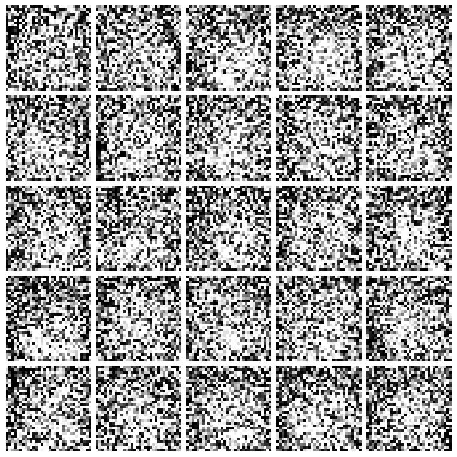

``` python
torch.save(learn.model, 'models/fashion_ddpm_mp.pkl')
```

## Accelerate

`pip install accelerate` before running this section.

Exported source

``` python
from accelerate import Accelerator
```

Exported source

``` python
class AccelerateCB(TrainCB):
    order = DeviceCB.order+10
    def __init__(self, n_inp=1, mixed_precision="fp16"):
        super().__init__(n_inp=n_inp)
        self.acc = Accelerator(mixed_precision=mixed_precision)
        
    def before_fit(self, learn):
        learn.model,learn.opt,learn.dls.train,learn.dls.valid = self.acc.prepare(
            learn.model, learn.opt, learn.dls.train, learn.dls.valid)

    def backward(self, learn): self.acc.backward(learn.loss)
```

Exported source

``` python
def noisify(x0, alphabar):
    device = x0.device
    n = len(x0)
    t = torch.randint(0, n_steps, (n,), dtype=torch.long)
    eps = torch.randn(x0.shape, device=device)
    alphabar_t = alphabar[t].reshape(-1, 1, 1, 1).to(device)
    xt = alphabar_t.sqrt()*x0 + (1-alphabar_t).sqrt()*eps
    return xt, t.to(device), eps
```

``` python
dls = DataLoaders(dl_ddpm(tds['train']), dl_ddpm(tds['test']))
```

Exported source

``` python
class DDPMCB2(Callback):
    def after_predict(self, learn): learn.preds = learn.preds.sample
```

``` python
model = UNet2DModel(in_channels=1, out_channels=1, block_out_channels=(16, 32, 64, 128), norm_num_groups=8)
init_ddpm(model)
cbs = [DDPMCB2(), DeviceCB(), ProgressCB(plot=True), MetricsCB(), BatchSchedCB(sched), AccelerateCB(n_inp=2)]
learn = Learner(model, dls, nn.MSELoss(), lr=lr, cbs=cbs, opt_func=opt_func)
```

``` python
learn.fit(epochs)
```

| loss  | epoch | train |
|-------|-------|-------|
| 0.201 | 0     | train |
| 0.031 | 0     | eval  |
| 0.025 | 1     | train |
| 0.022 | 1     | eval  |
| 0.022 | 2     | train |
| 0.021 | 2     | eval  |

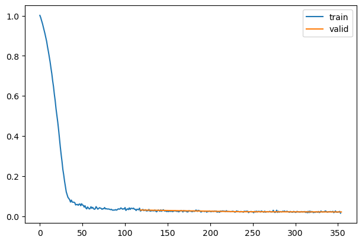

## A sneaky trick

Exported source

``` python
class MultDL:
    def __init__(self, dl, mult=2): self.dl,self.mult = dl,mult
    def __len__(self): return len(self.dl)*self.mult
    def __iter__(self):
        for o in self.dl:
            for i in range(self.mult): yield o
```

``` python
dls.train = MultDL(dls.train)
```

Back to top
