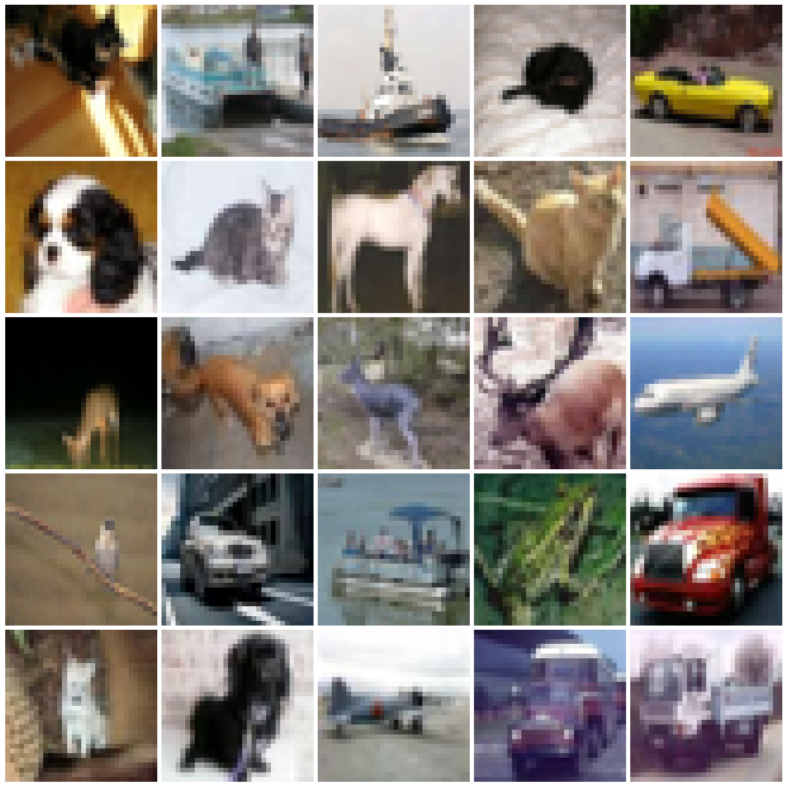
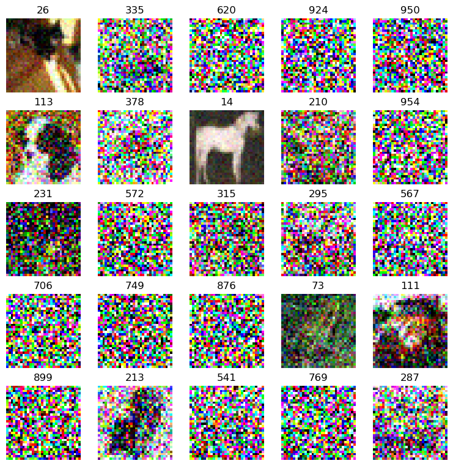
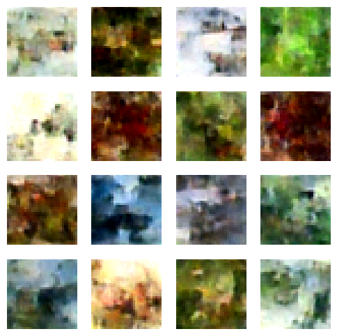
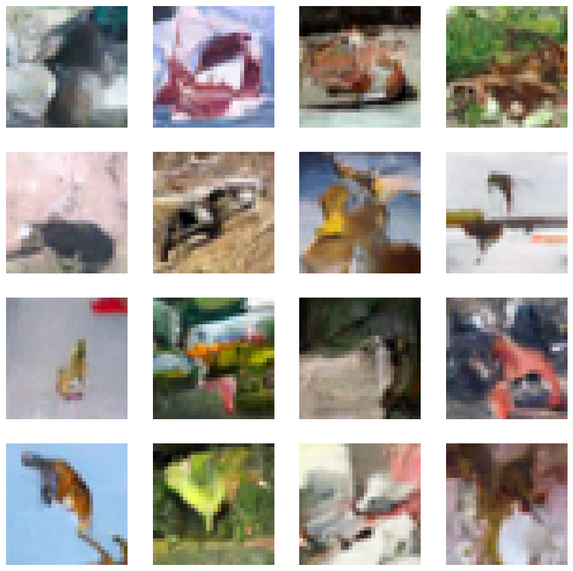

# CIFAR 10 image classifications

CIFAR 10 image classifications

Author

Benedict Thekkel

``` python
from diffusers import UNet2DModel

import pickle,gzip,math,os,time,shutil,torch,random,logging
import fastcore.all as fc,matplotlib as mpl,numpy as np,matplotlib.pyplot as plt
from collections.abc import Mapping
from pathlib import Path
from functools import partial

from fastcore.foundation import L
import torchvision.transforms.functional as TF,torch.nn.functional as F
from torch import tensor,nn,optim
from torch.utils.data import DataLoader,default_collate
from torch.nn import init
from torch.optim import lr_scheduler

from fastAIcourse.datasets import *
from fastAIcourse.conv import *
from fastAIcourse.learner import *
from fastAIcourse.activations import *
from fastAIcourse.init import *
from fastAIcourse.sgd import *
from fastAIcourse.resnet import *
from fastAIcourse.augment import *
from fastAIcourse.accel import *
```

``` python
from torcheval.metrics import MulticlassAccuracy
from datasets import load_dataset,load_dataset_builder

mpl.rcParams['image.cmap'] = 'gray_r'
logging.disable(logging.WARNING)
```

``` python
xl,yl = 'img','label'
name = "cifar10"
dsd = load_dataset(name)

@inplace
def transformi(b): b[xl] = [TF.to_tensor(o)-0.5 for o in b[xl]]

bs = 32
tds = dsd.with_transform(transformi)
dls = DataLoaders.from_dd(tds, bs, num_workers=8)
```

``` python
dt = dls.train
xb,yb = next(iter(dt))
```

``` python
xb.shape
```

    torch.Size([32, 3, 32, 32])

``` python
show_images(xb[:25]+0.5)
```



``` python
from types import SimpleNamespace
def linear_sched(betamin=0.0001,betamax=0.02,n_steps=1000):
    beta = torch.linspace(betamin, betamax, n_steps)
    return SimpleNamespace(a=1.-beta, abar=(1.-beta).cumprod(dim=0), sig=beta.sqrt())
```

``` python
n_steps = 1000
lin_abar = linear_sched(betamax=0.01)
alphabar = lin_abar.abar
alpha = lin_abar.a
sigma = lin_abar.sig
```

``` python
def noisify(x0, alphabar):
    device = x0.device
    n = len(x0)
    t = torch.randint(0, n_steps, (n,), dtype=torch.long)
    eps = torch.randn(x0.shape, device=device)
    alphabar_t = alphabar[t].reshape(-1, 1, 1, 1).to(device)
    xt = alphabar_t.sqrt()*x0 + (1-alphabar_t).sqrt()*eps
    return (xt, t.to(device)), eps
```

``` python
(xt,t),eps = noisify(xb[:25],alphabar)
t
```

    tensor([ 26, 335, 620, 924, 950, 113, 378,  14, 210, 954, 231, 572, 315, 295, 567, 706, 749, 876,  73, 111, 899, 213, 541, 769, 287])

``` python
titles = fc.map_ex(t[:25], '{}')
show_images(xt[:25].clip(-0.5, 0.5) + 0.5, imsize=1.5, titles=titles)
```



# Training

``` python
class UNet(UNet2DModel):
    def forward(self, x): return super().forward(*x).sample
    
def init_ddpm(model):
    for o in model.down_blocks:
        for p in o.resnets:
            p.conv2.weight.data.zero_()
            for p in fc.L(o.downsamplers): init.orthogonal_(p.conv.weight)

    for o in model.up_blocks:
        for p in o.resnets: p.conv2.weight.data.zero_()

    model.conv_out.weight.data.zero_()
    
def collate_ddpm(b): return noisify(default_collate(b)[xl], alphabar)
def dl_ddpm(ds, nw=4): return DataLoader(ds, batch_size=bs, collate_fn=collate_ddpm, num_workers=nw)
```

``` python
dls = DataLoaders(dl_ddpm(tds['train']), dl_ddpm(tds['test']))
```

``` python
# The model we've been using for FashionMNIST
model = UNet(in_channels=3, out_channels=3, block_out_channels=(32, 64, 128, 256), norm_num_groups=8)
sum(p.numel() for p in model.parameters())
```

    15891907

``` python
# The default is a much larger model:
model = UNet(in_channels=3, out_channels=3)
sum(p.numel() for p in model.parameters())
```

    274056163

``` python
clean_mem() # Free up some memory
```

``` python
lr = 1e-3
epochs = 1
opt_func = partial(optim.AdamW, eps=1e-5)
tmax = epochs * len(dls.train)
sched = partial(lr_scheduler.OneCycleLR, max_lr=lr, total_steps=tmax)
cbs = [DeviceCB(), MixedPrecision(), ProgressCB(plot=True), MetricsCB(), BatchSchedCB(sched)]
model = UNet(in_channels=3, out_channels=3)
init_ddpm(model)
learn = Learner(model, dls, nn.MSELoss(), lr=lr, cbs=cbs, opt_func=opt_func)
```

``` python
learn.fit(epochs)
```

``` python
from tqdm import tqdm
```

``` python
@torch.no_grad()
def sample(model, sz):
    ps = next(model.parameters())
    x_t = torch.randn(sz).to(ps)
    preds = []
    for t in reversed(tqdm(range(n_steps))):
        t_batch = torch.full((x_t.shape[0],), t, device=ps.device, dtype=torch.long)
        z = (torch.randn(x_t.shape) if t > 0 else torch.zeros(x_t.shape)).to(ps)
        alphabar_t1 = alphabar[t-1]  if t > 0 else torch.tensor(1)
        bbar_t = 1-alphabar[t]
        bbar_t1 = 1-alphabar_t1
        noise = model((x_t, t_batch))
        x_0_hat = ((x_t - bbar_t.sqrt() * noise)/alphabar[t].sqrt())
        x_t = x_0_hat * alphabar_t1.sqrt()*(1-alpha[t])/bbar_t + x_t * alpha[t].sqrt()*bbar_t1/bbar_t + sigma[t]*z
        preds.append(x_t.float().cpu())
    return preds
```

``` python
%%time
samples = sample(model, (bs, 3, 32, 32))
```

``` python
s = (samples[-1] + 0.5).clamp(0,1)
show_images(s[:16], imsize=1.5)
```



# W&B CB

``` python
import wandb

class WandBCB(MetricsCB):
    order=100
    def __init__(self, config, *ms, project='ddpm_cifar10', **metrics):
        fc.store_attr()
        super().__init__(*ms, **metrics)
        
    def before_fit(self, learn): wandb.init(project=self.project, config=self.config)
    def after_fit(self, learn): wandb.finish()

    def _log(self, d): 
        if self.train: 
            wandb.log({'train_'+m:float(d[m]) for m in self.all_metrics})
        else: 
            wandb.log({'val_'+m:float(d[m]) for m in self.all_metrics})
            wandb.log({'samples':self.sample_figure(learn)})
        print(d)

        
    def sample_figure(self, learn):
        with torch.no_grad():
            samples = sample(learn.model, (16, 3, 32, 32))
        s = (samples[-1] + 0.5).clamp(0,1)
        plt.clf()
        fig, axs = get_grid(16)
        for im,ax in zip(s[:16], axs.flat): show_image(im, ax=ax)
        return fig

    def after_batch(self, learn):
        super().after_batch(learn) 
        wandb.log({'loss':learn.loss})
```

``` python
lr = 1e-3
epochs = 10
opt_func = partial(optim.AdamW, eps=1e-5)
tmax = epochs * len(dls.train)
sched = partial(lr_scheduler.OneCycleLR, max_lr=lr, total_steps=tmax)
wandbcb =  WandBCB(config={'lr':lr, 'epochs':epochs, 'comments':'default unet logging test'})
cbs = [DeviceCB(), MixedPrecision(), ProgressCB(plot=True), wandbcb, BatchSchedCB(sched)]
model = model = UNet(in_channels=3, out_channels=3)
init_ddpm(model)
learn = Learner(model, dls, nn.MSELoss(), lr=lr, cbs=cbs, opt_func=opt_func)
```

``` python
learn.fit(epochs)
```

    Failed to detect the name of this notebook, you can set it manually with the WANDB_NOTEBOOK_NAME environment variable to enable code saving.
    wandb: Currently logged in as: johnowhitaker. Use `wandb login --relogin` to force relogin

wandb version 0.13.9 is available! To upgrade, please run: \$ pip install wandb --upgrade

Tracking run with wandb version 0.13.3

Run data is saved locally in `/home/ubuntu/new_course22p2_folder/nbs/wandb/run-20230119_052202-1jgoyqoq`

Syncing run **[serene-wildflower-15](https://wandb.ai/johnowhitaker/ddpm_cifar10/runs/1jgoyqoq)** to [Weights & Biases](https://wandb.ai/johnowhitaker/ddpm_cifar10) ([docs](https://wandb.me/run))\

    {'loss': '0.062', 'epoch': 0, 'train': 'train'}
    {'loss': '0.029', 'epoch': 0, 'train': 'eval'}
    {'loss': '0.028', 'epoch': 1, 'train': 'train'}
    {'loss': '0.028', 'epoch': 1, 'train': 'eval'}
    {'loss': '0.027', 'epoch': 2, 'train': 'train'}
    {'loss': '0.028', 'epoch': 2, 'train': 'eval'}
    {'loss': '0.026', 'epoch': 3, 'train': 'train'}
    {'loss': '0.026', 'epoch': 3, 'train': 'eval'}
    {'loss': '0.026', 'epoch': 4, 'train': 'train'}
    {'loss': '0.026', 'epoch': 4, 'train': 'eval'}
    {'loss': '0.025', 'epoch': 5, 'train': 'train'}
    {'loss': '0.025', 'epoch': 5, 'train': 'eval'}
    {'loss': '0.025', 'epoch': 6, 'train': 'train'}
    {'loss': '0.024', 'epoch': 6, 'train': 'eval'}
    {'loss': '0.024', 'epoch': 7, 'train': 'train'}
    {'loss': '0.024', 'epoch': 7, 'train': 'eval'}
    {'loss': '0.024', 'epoch': 8, 'train': 'train'}
    {'loss': '0.025', 'epoch': 8, 'train': 'eval'}
    {'loss': '0.024', 'epoch': 9, 'train': 'train'}
    {'loss': '0.024', 'epoch': 9, 'train': 'eval'}

Waiting for W&B process to finish... **(success).**

### Run history:

\

|            |                                          |
|------------|------------------------------------------|
| loss       | ▄▅▄▅▇▃▄▄▃▅▇▄▅▅▂▄▄▄▃▅▅▆▄█▅▄▃▆▄▆▇▅▁▃█▂▃▄▃▅ |
| train_loss | █▂▂▁▁▁▁▁▁▁                               |
| val_loss   | █▇▇▄▄▂▁▁▂▁                               |

\

### Run summary:

\

|            |         |
|------------|---------|
| loss       | 0.01746 |
| train_loss | 0.024   |
| val_loss   | 0.024   |

\

Synced **serene-wildflower-15**: [https://wandb.ai/johnowhitaker/ddpm_cifar10/runs/1jgoyqoq](https://wandb.ai/johnowhitaker/ddpm_cifar10/runs/1jgoyqoq)\
Synced 6 W&B file(s), 10 media file(s), 0 artifact file(s) and 0 other file(s)

Find logs at: `./wandb/run-20230119_052202-1jgoyqoq/logs`

    <Figure size 640x480 with 0 Axes>

    <Figure size 1200x1200 with 0 Axes>

    <Figure size 1200x1200 with 0 Axes>

    <Figure size 1200x1200 with 0 Axes>

    <Figure size 1200x1200 with 0 Axes>

    <Figure size 1200x1200 with 0 Axes>

    <Figure size 1200x1200 with 0 Axes>

    <Figure size 1200x1200 with 0 Axes>

    <Figure size 1200x1200 with 0 Axes>

    <Figure size 1200x1200 with 0 Axes>



Back to top
