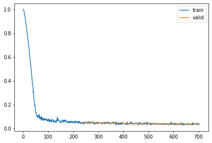
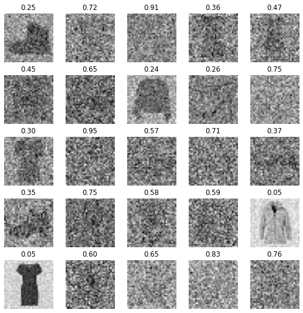
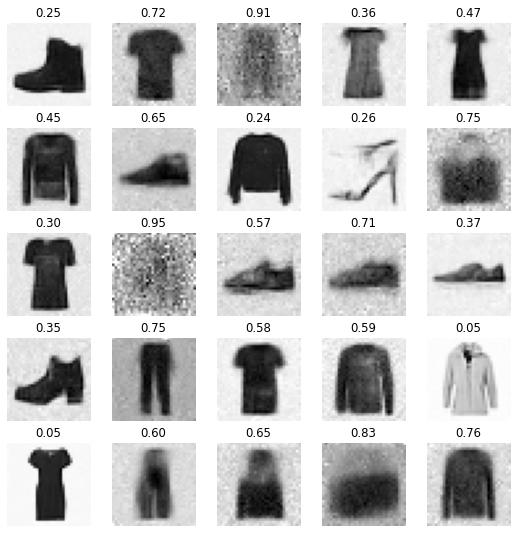
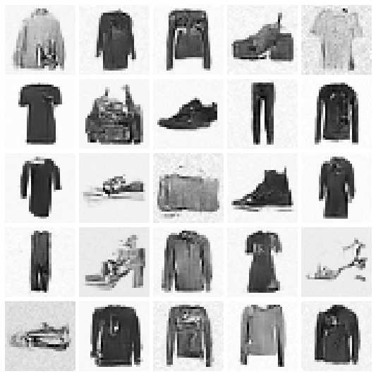

# cosine schedule

cosine schedule

Author

Benedict Thekkel

``` python
import torch
if torch.cuda.is_available():
    device = torch.cuda.current_device()
    print(f"GPU Name: {torch.cuda.get_device_name(device)}")
    print(f"GPU Memory Total: {torch.cuda.get_device_properties(device).total_memory / (1024**3):.2f} GB")
    print(f"GPU Memory Free: {torch.cuda.get_device_properties(device).total_memory / (1024**3):.2f} GB")
    print(f"Compute Capability: {torch.cuda.get_device_capability(device)}")
else:
    print("No GPU available. Using CPU.")
```

    GPU Name: NVIDIA GeForce RTX 2060
    GPU Memory Total: 6.00 GB
    GPU Memory Free: 6.00 GB
    Compute Capability: (7, 5)

``` python
import os
```

``` python
import timm, torch, random, datasets, math, fastcore.all as fc, numpy as np, matplotlib as mpl, matplotlib.pyplot as plt
import k_diffusion as K, torchvision.transforms as T
import torchvision.transforms.functional as TF,torch.nn.functional as F

from torch.utils.data import DataLoader,default_collate
from pathlib import Path
from torch.nn import init
from fastcore.foundation import L
from torch import nn,tensor
from datasets import load_dataset
from operator import itemgetter
from torcheval.metrics import MulticlassAccuracy
from functools import partial
from torch.optim import lr_scheduler
from torch import optim

from fastAIcourse.datasets import *
from fastAIcourse.conv import *
from fastAIcourse.learner import *
from fastAIcourse.activations import *
from fastAIcourse.init import *
from fastAIcourse.sgd import *
from fastAIcourse.resnet import *
from fastAIcourse.augment import *
from fastAIcourse.accel import *
```

``` python
from fastprogress import progress_bar
from diffusers import UNet2DModel, DDIMPipeline, DDPMPipeline, DDIMScheduler, DDPMScheduler
```

``` python
torch.set_printoptions(precision=4, linewidth=140, sci_mode=False)
torch.manual_seed(1)
mpl.rcParams['image.cmap'] = 'gray_r'
mpl.rcParams['figure.dpi'] = 70

import logging
logging.disable(logging.WARNING)

set_seed(42)
if fc.defaults.cpus>8: fc.defaults.cpus=8
```

``` python
xl,yl = 'image','label'
name = "fashion_mnist"
bs = 256
dsd = load_dataset(name)
```

``` python
def abar(t): return (t*math.pi/2).cos()**2
def inv_abar(x): return x.sqrt().acos()*2/math.pi
```

``` python
def noisify(x0):
    device = x0.device
    n = len(x0)
    t = torch.rand(n,).to(x0).clamp(0,0.999)
    eps = torch.randn(x0.shape, device=device)
    abar_t = abar(t).reshape(-1, 1, 1, 1).to(device)
    xt = abar_t.sqrt()*x0 + (1-abar_t).sqrt()*eps
    return (xt, t.to(device)), eps
```

``` python
def collate_ddpm(b): return noisify(default_collate(b)[xl])
def dl_ddpm(ds): return DataLoader(ds, batch_size=bs, collate_fn=collate_ddpm, num_workers=4)
```

``` python
@inplace
def transformi(b): b[xl] = [F.pad(TF.to_tensor(o), (2,2,2,2))-0.5 for o in b[xl]]

tds = dsd.with_transform(transformi)
dls = DataLoaders(dl_ddpm(tds['train']), dl_ddpm(tds['test']))

dl = dls.train
(xt,t),eps = b = next(iter(dl))
```

``` python
show_images(xt[:25], imsize=1.5, titles=fc.map_ex(t[:25], '{:.02f}'))
```


``` python
class UNet(UNet2DModel):
    def forward(self, x): return super().forward(*x).sample
```

``` python
def init_ddpm(model):
    for o in model.down_blocks:
        for p in o.resnets:
            p.conv2.weight.data.zero_()
            for p in fc.L(o.downsamplers): init.orthogonal_(p.conv.weight)

    for o in model.up_blocks:
        for p in o.resnets: p.conv2.weight.data.zero_()

    model.conv_out.weight.data.zero_()
```

``` python
lr = 4e-3
epochs = 3
opt_func = partial(optim.Adam, eps=1e-5)
tmax = epochs * len(dls.train)
sched = partial(lr_scheduler.OneCycleLR, max_lr=lr, total_steps=tmax)
cbs = [DeviceCB(), MixedPrecision(), ProgressCB(plot=True), MetricsCB(), BatchSchedCB(sched)]
model = UNet(in_channels=1, out_channels=1, block_out_channels=(32, 64, 128, 256), norm_num_groups=8)
init_ddpm(model)
learn = Learner(model, dls, nn.MSELoss(), lr=lr, cbs=cbs, opt_func=opt_func)
```

``` python
learn.fit(epochs)
```

| loss  | epoch | train |
|-------|-------|-------|
| 0.185 | 0     | train |
| 0.050 | 0     | eval  |
| 0.045 | 1     | train |
| 0.042 | 1     | eval  |
| 0.039 | 2     | train |
| 0.039 | 2     | eval  |



``` python
torch.save(learn.model, 'models/fashion_cos2.pkl')
```

``` python
model = learn.model = torch.load('models/fashion_cos2.pkl').cuda()
```

``` python
def denoise(x_t, noise, t):
    device = x_t.device
    abar_t = abar(t).reshape(-1, 1, 1, 1).to(device)
    return ((x_t-(1-abar_t).sqrt()*noise) / abar_t.sqrt()).clamp(-1,1)
```

``` python
with torch.no_grad(): noise=learn.model((xt.cuda(),t.cuda()))
```

``` python
show_images(xt[:25], imsize=1.5, titles=fc.map_ex(t[:25], '{:.02f}'))
```



``` python
show_images(denoise(xt.cuda(),noise,t.cuda())[:25].clamp(-1,1), imsize=1.5, titles=fc.map_ex(t[:25], '{:.02f}'))
```



## Sampling

``` python
from fastAIcourse.fid import ImageEval
```

``` python
cmodel = torch.load('models/data_aug2.pkl')
del(cmodel[8])
del(cmodel[7])

@inplace
def transformi(b): b[xl] = [F.pad(TF.to_tensor(o), (2,2,2,2))*2-1 for o in b[xl]]

bs = 2048
tds = dsd.with_transform(transformi)
dls = DataLoaders.from_dd(tds, bs, num_workers=fc.defaults.cpus)

dt = dls.train
xb,yb = next(iter(dt))

ie = ImageEval(cmodel, dls, cbs=[DeviceCB()])
```

``` python
sz = (2048,1,32,32)
```

``` python
sz = (256,1,32,32)
```

``` python
def ddim_step(x_t, noise, abar_t, abar_t1, bbar_t, bbar_t1, eta, sig):
    sig = ((bbar_t1/bbar_t).sqrt() * (1-abar_t/abar_t1).sqrt()) * eta
    x_0_hat = ((x_t-(1-abar_t).sqrt()*noise) / abar_t.sqrt()).clamp(-1.5,1.5)
    if bbar_t1<=sig**2+0.01: sig=0.  # set to zero if very small or NaN
    x_t = abar_t1.sqrt()*x_0_hat + (bbar_t1-sig**2).sqrt()*noise
    x_t += sig * torch.randn(x_t.shape).to(x_t)
    return x_0_hat,x_t
```

``` python
@torch.no_grad()
def sample(f, model, sz, steps, eta=1.):
    ts = torch.linspace(1-1/steps,0,steps)
    x_t = torch.randn(sz).to(model.device)
    preds = []
    for i,t in enumerate(progress_bar(ts)):
        abar_t = abar(t)
        noise = model((x_t, t))
        abar_t1 = abar(t-1/steps) if t>=1/steps else torch.tensor(1)
#         print(abar_t,abar_t1,x_t.min(),x_t.max())
        x_0_hat,x_t = f(x_t, noise, abar_t, abar_t1, 1-abar_t, 1-abar_t1, eta, 1-((i+1)/100))
        preds.append(x_0_hat.float().cpu())
    return preds
```

``` python
# set_seed(42)
preds = sample(ddim_step, model, sz, steps=100, eta=1.)
s = (preds[-1]*2)
s.min(),s.max(),s.shape
```

100.00% \[100/100 00:49\<00:00\]

    (tensor(-1.3284), tensor(1.5739), torch.Size([256, 1, 32, 32]))

``` python
show_images(s[:25], imsize=1.5)
```



``` python
ie.fid(s),ie.kid(s),s.shape
```

    (44.0902099609375, 0.06875649839639664, torch.Size([256, 1, 32, 32]))

``` python
preds = sample(ddim_step, model, sz, steps=100, eta=1.)
ie.fid(preds[-1]*2)
```

100.00% \[100/100 00:49\<00:00\]

    43.769775390625

``` python
preds = sample(ddim_step, model, sz, steps=50, eta=1.)
ie.fid(preds[-1]*2)
```

100.00% \[50/50 00:24\<00:00\]

    45.24609375

Back to top
