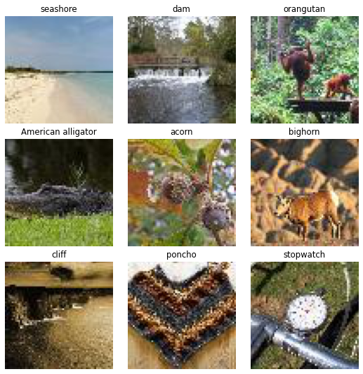
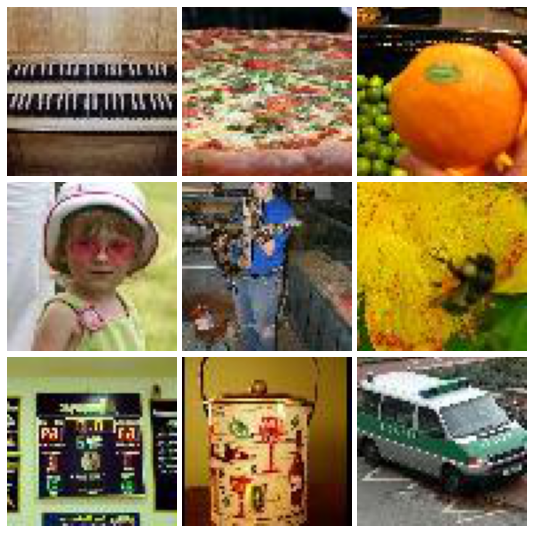
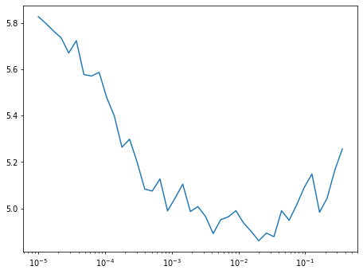
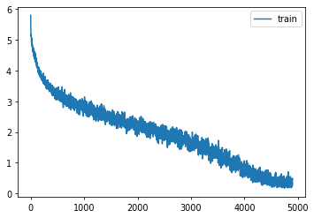
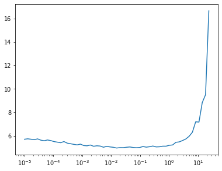
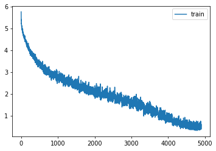
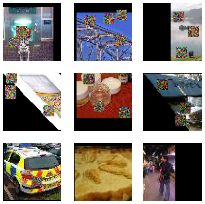
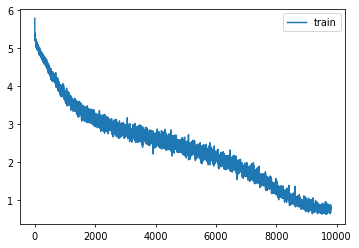

# Tiny ImageNet

A ResNet classifier on Tiny ImageNet: the baseline run, then deeper and with more augmentation

Author

Benedict Thekkel

``` python
import os
# os.environ['CUDA_VISIBLE_DEVICES']='2'
```

``` python
import shutil,timm,os,torch,random,datasets,math
import fastcore.all as fc, numpy as np, matplotlib as mpl, matplotlib.pyplot as plt
import k_diffusion as K, torchvision.transforms as T
import torchvision.transforms.functional as TF,torch.nn.functional as F

from torch.utils.data import DataLoader,default_collate
from pathlib import Path
from torch.nn import init
from fastcore.foundation import L
from torch import nn,tensor
from operator import itemgetter
from torcheval.metrics import MulticlassAccuracy
from functools import partial
from torch.optim import lr_scheduler
from torch import optim
from torchvision.io import read_image,ImageReadMode
from glob import glob

from fastAIcourse.datasets import *
from fastAIcourse.conv import *
from fastAIcourse.learner import *
from fastAIcourse.activations import *
from fastAIcourse.init import *
from fastAIcourse.sgd import *
from fastAIcourse.resnet import *
from fastAIcourse.augment import *
from fastAIcourse.accel import *
from fastAIcourse.training import *
```

``` python
from fastprogress import progress_bar
```

``` python
torch.set_printoptions(precision=5, linewidth=140, sci_mode=False)
torch.manual_seed(1)
mpl.rcParams['figure.dpi'] = 70

set_seed(42)
if fc.defaults.cpus>8: fc.defaults.cpus=8
```

## Data processing

``` python
path_data = Path('Data')
path_data.mkdir(exist_ok=True)
path = path_data/'tiny-imagenet-200'
```

``` python
url = 'http://cs231n.stanford.edu/tiny-imagenet-200.zip'
if not path.exists():
    path_zip = fc.urlsave(url, path_data)
    shutil.unpack_archive('Data/tiny-imagenet-200.zip', 'data')
```

``` python
bs = 512
```

``` python
class TinyDS:
    def __init__(self, path):
        self.path = Path(path)
        self.files = glob(str(path/'**/*.JPEG'), recursive=True)
    def __len__(self): return len(self.files)
    def __getitem__(self, i): return self.files[i],Path(self.files[i]).parent.parent.name
```

``` python
tds = TinyDS(path/'train')
```

``` python
tds[0]
```

    ('Data/tiny-imagenet-200/train/n02074367/images/n02074367_322.JPEG',
     'n02074367')

``` python
path_anno = path/'val'/'val_annotations.txt'
anno = dict(o.split('\t')[:2] for o in path_anno.read_text().splitlines())
```

``` python
class TinyValDS(TinyDS):
    def __getitem__(self, i): return self.files[i],anno[os.path.basename(self.files[i])]
```

``` python
vds = TinyValDS(path/'val')
```

``` python
vds[0]
```

    ('Data/tiny-imagenet-200/val/images/val_240.JPEG', 'n02883205')

``` python
len(tds)
```

    100000

``` python
class TfmDS:
    def __init__(self, ds, tfmx=fc.noop, tfmy=fc.noop): self.ds,self.tfmx,self.tfmy = ds,tfmx,tfmy
    def __len__(self): return len(self.ds)
    def __getitem__(self, i):
        x,y = self.ds[i]
        return self.tfmx(x),self.tfmy(y)
```

``` python
id2str = (path/'wnids.txt').read_text().splitlines()
str2id = {v:k for k,v in enumerate(id2str)}
```

``` python
xmean,xstd = (tensor([0.47565, 0.40303, 0.31555]), tensor([0.28858, 0.24402, 0.26615]))
```

``` python
def tfmx(x):
    img = read_image(x, mode=ImageReadMode.RGB)/255
    return (img-xmean[:,None,None])/xstd[:,None,None]
```

``` python
def tfmy(y): return tensor(str2id[y])
```

``` python
tfm_tds = TfmDS(tds, tfmx, tfmy)
tfm_vds = TfmDS(vds, tfmx, tfmy)
```

``` python
xi,yi = tfm_tds[0]
id2str[yi]
```

    'n02074367'

``` python
def denorm(x): return (x*xstd[:,None,None]+xmean[:,None,None]).clip(0,1)
```

``` python
show_image(denorm(xi));
```


``` python
dltrn = DataLoader(tfm_tds, batch_size=bs, shuffle=True, num_workers=8)
```

``` python
xb,yb = b = next(iter(dltrn))
```

``` python
show_image(denorm(xb[0]));
```


``` python
all_synsets = [o.split('\t') for o in (path/'words.txt').read_text().splitlines()]
synsets = {k:v.split(',', maxsplit=1)[0] for k,v in all_synsets if k in id2str}
```

``` python
titles = [synsets[id2str[o]] for o in yb]
', '.join(titles[:20])
```

    'seashore, dam, orangutan, American alligator, acorn, bighorn, cliff, poncho, stopwatch, monarch, cliff dwelling, poncho, chest, mantis, standard poodle, gazelle, dam, sombrero, barn, projectile'

``` python
show_images(denorm(xb[:9]), titles=titles[:9], imsize=2.5)
```



``` python
dls = DataLoaders(*get_dls(tfm_tds, tfm_vds, bs=bs, num_workers=8))
```

## Basic model

``` python
def tfm_batch(b, tfm_x=fc.noop, tfm_y = fc.noop): return tfm_x(b[0]),tfm_y(b[1])
```

``` python
tfms = nn.Sequential(T.Pad(4), T.RandomCrop(64),
                     T.RandomHorizontalFlip(),
                     RandErase())
augcb = BatchTransformCB(partial(tfm_batch, tfm_x=tfms), on_val=False)
```

``` python
act_gr = partial(GeneralRelu, leak=0.1, sub=0.4)
iw = partial(init_weights, leaky=0.1)
```

``` python
nfs = (32,64,128,256,512,1024)
```

``` python
def get_dropmodel(act=act_gr, nfs=nfs, norm=nn.BatchNorm2d, drop=0.1):
    layers = [nn.Conv2d(3, nfs[0], 5, padding=2)]
#     layers += [ResBlock(nfs[0], nfs[0], ks=3, stride=1, act=act, norm=norm)]
    layers += [ResBlock(nfs[i], nfs[i+1], act=act, norm=norm, stride=2)
               for i in range(len(nfs)-1)]
    layers += [nn.AdaptiveAvgPool2d(1), nn.Flatten(), nn.Dropout(drop)]
    layers += [nn.Linear(nfs[-1], 200, bias=False), nn.BatchNorm1d(200)]
    return nn.Sequential(*layers).apply(iw)
```

``` python
learn = TrainLearner(get_dropmodel(), dls, F.cross_entropy, cbs=[SingleBatchCB(), augcb, DeviceCB()])
learn.fit(1)
xb,yb = learn.batch
show_images(denorm(xb.cpu())[:9], imsize=2.5)
```



``` python
learn.summary()
```

    Tot params: 19775824; MFLOPS: 303.7

| Module            | Input              | Output             | Num params | MFLOPS |
|-------------------|--------------------|--------------------|------------|--------|
| Conv2d            | (512, 3, 64, 64)   | (512, 32, 64, 64)  | 2432       | 9.8    |
| ResBlock          | (512, 32, 64, 64)  | (512, 64, 32, 32)  | 57792      | 58.7   |
| ResBlock          | (512, 64, 32, 32)  | (512, 128, 16, 16) | 230272     | 58.7   |
| ResBlock          | (512, 128, 16, 16) | (512, 256, 8, 8)   | 919296     | 58.7   |
| ResBlock          | (512, 256, 8, 8)   | (512, 512, 4, 4)   | 3673600    | 58.7   |
| ResBlock          | (512, 512, 4, 4)   | (512, 1024, 2, 2)  | 14687232   | 58.7   |
| AdaptiveAvgPool2d | (512, 1024, 2, 2)  | (512, 1024, 1, 1)  | 0          | 0.0    |
| Flatten           | (512, 1024, 1, 1)  | (512, 1024)        | 0          | 0.0    |
| Dropout           | (512, 1024)        | (512, 1024)        | 0          | 0.0    |
| Linear            | (512, 1024)        | (512, 200)         | 204800     | 0.2    |
| BatchNorm1d       | (512, 200)         | (512, 200)         | 400        | 0.0    |

``` python
opt_func = partial(optim.AdamW, eps=1e-5)
```

``` python
lr_cbs = [DeviceCB(), augcb, MixedPrecision(), ProgressCB()]
```

``` python
learn = Learner(get_dropmodel(), dls, F.cross_entropy, cbs=lr_cbs, opt_func=opt_func)
learn.lr_find()
```

0.00% \[0/10 00:00\<?\]

20.92% \[41/196 03:15\<12:20 5.256\]



``` python
metrics = MetricsCB(accuracy=MulticlassAccuracy())
cbs = [DeviceCB(), metrics, ProgressCB(plot=True), MixedPrecision()]
```

``` python
epochs = 25
lr = 0.1
tmax = epochs * len(dls.train)
sched = partial(lr_scheduler.OneCycleLR, max_lr=lr, total_steps=tmax)
xtra = [BatchSchedCB(sched), augcb]
learn = Learner(get_dropmodel(), dls, F.cross_entropy, lr=lr, cbs=cbs+xtra, opt_func=opt_func)
```

``` python
learn.fit(epochs)
```

| accuracy | loss  | epoch | train |
|----------|-------|-------|-------|
| 0.112    | 4.370 | 0     | train |
| 0.169    | 3.852 | 0     | eval  |
| 0.224    | 3.580 | 1     | train |
| 0.245    | 3.385 | 1     | eval  |
| 0.272    | 3.244 | 2     | train |
| 0.241    | 3.557 | 2     | eval  |
| 0.306    | 3.025 | 3     | train |
| 0.228    | 3.717 | 3     | eval  |
| 0.336    | 2.856 | 4     | train |
| 0.280    | 3.414 | 4     | eval  |
| 0.356    | 2.741 | 5     | train |
| 0.252    | 3.563 | 5     | eval  |
| 0.381    | 2.611 | 6     | train |
| 0.328    | 3.046 | 6     | eval  |
| 0.406    | 2.480 | 7     | train |
| 0.311    | 3.181 | 7     | eval  |
| 0.426    | 2.379 | 8     | train |
| 0.356    | 2.861 | 8     | eval  |
| 0.453    | 2.255 | 9     | train |
| 0.353    | 2.905 | 9     | eval  |
| 0.471    | 2.166 | 10    | train |
| 0.381    | 2.751 | 10    | eval  |
| 0.489    | 2.070 | 11    | train |
| 0.388    | 2.806 | 11    | eval  |
| 0.513    | 1.963 | 12    | train |
| 0.451    | 2.325 | 12    | eval  |
| 0.531    | 1.870 | 13    | train |
| 0.455    | 2.388 | 13    | eval  |
| 0.554    | 1.753 | 14    | train |
| 0.478    | 2.210 | 14    | eval  |
| 0.587    | 1.610 | 15    | train |
| 0.510    | 2.089 | 15    | eval  |
| 0.617    | 1.470 | 16    | train |
| 0.524    | 2.032 | 16    | eval  |
| 0.655    | 1.311 | 17    | train |
| 0.537    | 1.999 | 17    | eval  |
| 0.695    | 1.142 | 18    | train |
| 0.547    | 1.980 | 18    | eval  |
| 0.743    | 0.944 | 19    | train |
| 0.566    | 1.912 | 19    | eval  |
| 0.794    | 0.748 | 20    | train |
| 0.581    | 1.889 | 20    | eval  |
| 0.842    | 0.579 | 21    | train |
| 0.586    | 1.890 | 21    | eval  |
| 0.877    | 0.461 | 22    | train |
| 0.594    | 1.857 | 22    | eval  |
| 0.906    | 0.367 | 23    | train |
| 0.594    | 1.874 | 23    | eval  |
| 0.910    | 0.351 | 24    | train |
| 0.593    | 1.889 | 24    | eval  |



``` python
torch.save(learn.model, 'models/inettiny-basic-25')
```

## Deeper

``` python
def res_blocks(n_bk, ni, nf, stride=1, ks=3, act=act_gr, norm=None):
    return nn.Sequential(*[
        ResBlock(ni if i==0 else nf, nf, stride=stride if i==n_bk-1 else 1, ks=ks, act=act, norm=norm)
        for i in range(n_bk)])
```

``` python
nbks = (3,2,2,1,1)
```

``` python
def get_dropmodel(act=act_gr, nfs=nfs, nbks=nbks, norm=nn.BatchNorm2d, drop=0.2):
    layers = [ResBlock(3, nfs[0], ks=5, stride=1, act=act, norm=norm)]
    layers += [res_blocks(nbks[i], nfs[i], nfs[i+1], act=act, norm=norm, stride=2)
               for i in range(len(nfs)-1)]
    layers += [nn.AdaptiveAvgPool2d(1), nn.Flatten(), nn.Dropout(drop)]
    layers += [nn.Linear(nfs[-1], 200, bias=False), nn.BatchNorm1d(200)]
    return nn.Sequential(*layers).apply(iw)
```

``` python
learn = TrainLearner(get_dropmodel(), dls, F.cross_entropy, cbs=[SingleBatchCB(), augcb, DeviceCB()])
learn.fit(1)
xb,yb = learn.batch
show_images(denorm(xb.cpu())[:9], imsize=2.5)
```


``` python
learn.summary()
```

    Tot params: 21426800; MFLOPS: 710.9

| Module            | Input              | Output             | Num params | MFLOPS |
|-------------------|--------------------|--------------------|------------|--------|
| ResBlock          | (512, 3, 64, 64)   | (512, 32, 64, 64)  | 28320      | 115.1  |
| Sequential        | (512, 32, 64, 64)  | (512, 64, 32, 32)  | 206016     | 209.7  |
| Sequential        | (512, 64, 32, 32)  | (512, 128, 16, 16) | 525952     | 134.2  |
| Sequential        | (512, 128, 16, 16) | (512, 256, 8, 8)   | 2100480    | 134.2  |
| Sequential        | (512, 256, 8, 8)   | (512, 512, 4, 4)   | 3673600    | 58.7   |
| Sequential        | (512, 512, 4, 4)   | (512, 1024, 2, 2)  | 14687232   | 58.7   |
| AdaptiveAvgPool2d | (512, 1024, 2, 2)  | (512, 1024, 1, 1)  | 0          | 0.0    |
| Flatten           | (512, 1024, 1, 1)  | (512, 1024)        | 0          | 0.0    |
| Dropout           | (512, 1024)        | (512, 1024)        | 0          | 0.0    |
| Linear            | (512, 1024)        | (512, 200)         | 204800     | 0.2    |
| BatchNorm1d       | (512, 200)         | (512, 200)         | 400        | 0.0    |

``` python
opt_func = partial(optim.AdamW, eps=1e-5)
```

``` python
learn = Learner(get_dropmodel(), dls, F.cross_entropy, cbs=lr_cbs, opt_func=opt_func)
learn.lr_find()
```

0.00% \[0/10 00:00\<00:00\]

28.57% \[56/196 00:19\<00:49 9.499\]



``` python
metrics = MetricsCB(accuracy=MulticlassAccuracy())
cbs = [DeviceCB(), metrics, ProgressCB(plot=True), MixedPrecision()]

epochs = 25
lr = 3e-2
tmax = epochs * len(dls.train)
sched = partial(lr_scheduler.OneCycleLR, max_lr=lr, total_steps=tmax)
xtra = [BatchSchedCB(sched), augcb]
learn = Learner(get_dropmodel(), dls, F.cross_entropy, lr=lr, cbs=cbs+xtra, opt_func=opt_func)
```

``` python
learn.fit(epochs)
```

| accuracy | loss  | epoch | train |
|----------|-------|-------|-------|
| 0.073    | 4.595 | 0     | train |
| 0.099    | 4.283 | 0     | eval  |
| 0.175    | 3.825 | 1     | train |
| 0.192    | 3.682 | 1     | eval  |
| 0.238    | 3.393 | 2     | train |
| 0.203    | 3.798 | 2     | eval  |
| 0.291    | 3.075 | 3     | train |
| 0.248    | 3.404 | 3     | eval  |
| 0.329    | 2.873 | 4     | train |
| 0.275    | 3.290 | 4     | eval  |
| 0.359    | 2.709 | 5     | train |
| 0.352    | 2.843 | 5     | eval  |
| 0.386    | 2.569 | 6     | train |
| 0.357    | 2.794 | 6     | eval  |
| 0.417    | 2.423 | 7     | train |
| 0.389    | 2.662 | 7     | eval  |
| 0.439    | 2.305 | 8     | train |
| 0.418    | 2.449 | 8     | eval  |
| 0.465    | 2.183 | 9     | train |
| 0.418    | 2.449 | 9     | eval  |
| 0.484    | 2.081 | 10    | train |
| 0.429    | 2.423 | 10    | eval  |
| 0.505    | 1.998 | 11    | train |
| 0.465    | 2.254 | 11    | eval  |
| 0.527    | 1.889 | 12    | train |
| 0.435    | 2.413 | 12    | eval  |
| 0.548    | 1.796 | 13    | train |
| 0.494    | 2.174 | 13    | eval  |
| 0.571    | 1.681 | 14    | train |
| 0.491    | 2.162 | 14    | eval  |
| 0.594    | 1.579 | 15    | train |
| 0.537    | 1.955 | 15    | eval  |
| 0.619    | 1.462 | 16    | train |
| 0.539    | 1.974 | 16    | eval  |
| 0.654    | 1.313 | 17    | train |
| 0.573    | 1.818 | 17    | eval  |
| 0.686    | 1.178 | 18    | train |
| 0.585    | 1.785 | 18    | eval  |
| 0.724    | 1.024 | 19    | train |
| 0.590    | 1.752 | 19    | eval  |
| 0.761    | 0.872 | 20    | train |
| 0.611    | 1.704 | 20    | eval  |
| 0.800    | 0.723 | 21    | train |
| 0.611    | 1.686 | 21    | eval  |
| 0.831    | 0.616 | 22    | train |
| 0.619    | 1.679 | 22    | eval  |
| 0.857    | 0.530 | 23    | train |
| 0.620    | 1.686 | 23    | eval  |
| 0.866    | 0.501 | 24    | train |
| 0.618    | 1.684 | 24    | eval  |



``` python
torch.save(learn.model, 'models/inettiny-custom-25')
```

## More augmentation

``` python
aug_tfms = nn.Sequential(T.Pad(4), T.RandomCrop(64),
                     T.RandomHorizontalFlip(),
                     T.TrivialAugmentWide())

norm_tfm = T.Normalize(xmean, xstd)
erase_tfm = RandErase()
```

``` python
from PIL import Image
```

``` python
def tfmx(x, aug=False):
    x = Image.open(x).convert('RGB')
    if aug: x = aug_tfms(x)
    x = TF.to_tensor(x)
    x = norm_tfm(x)
    if aug: x = erase_tfm(x[None])[0]
    return x
```

``` python
tfm_tds = TfmDS(tds, partial(tfmx, aug=True), tfmy)
tfm_vds = TfmDS(vds, tfmx, tfmy)
```

``` python
dls = DataLoaders(*get_dls(tfm_tds, tfm_vds, bs=bs, num_workers=8))
```

``` python
def conv(ni, nf, ks=3, stride=1, act=nn.ReLU, norm=None, bias=True):
    layers = []
    if norm: layers.append(norm(ni))
    if act : layers.append(act())
    layers.append(nn.Conv2d(ni, nf, stride=stride, kernel_size=ks, padding=ks//2, bias=bias))
    return nn.Sequential(*layers)

def _conv_block(ni, nf, stride, act=act_gr, norm=None, ks=3):
    return nn.Sequential(conv(ni, nf, stride=1     , act=act, norm=norm, ks=ks),
                         conv(nf, nf, stride=stride, act=act, norm=norm, ks=ks))

class ResBlock(nn.Module):
    def __init__(self, ni, nf, stride=1, ks=3, act=act_gr, norm=None):
        super().__init__()
        self.convs = _conv_block(ni, nf, stride, act=act, ks=ks, norm=norm)
        self.idconv = fc.noop if ni==nf else conv(ni, nf, ks=1, stride=1, act=None, norm=norm)
        self.pool = fc.noop if stride==1 else nn.AvgPool2d(2, ceil_mode=True)

    def forward(self, x): return self.convs(x) + self.idconv(self.pool(x))

def get_dropmodel(act=act_gr, nfs=nfs, nbks=nbks, norm=nn.BatchNorm2d, drop=0.2):
    layers = [nn.Conv2d(3, nfs[0], 5, padding=2)]
    layers += [res_blocks(nbks[i], nfs[i], nfs[i+1], act=act, norm=norm, stride=2)
               for i in range(len(nfs)-1)]
    layers += [act_gr(), norm(nfs[-1]), nn.AdaptiveAvgPool2d(1), nn.Flatten(), nn.Dropout(drop)]
    layers += [nn.Linear(nfs[-1], 200, bias=False), nn.BatchNorm1d(200)]
    return nn.Sequential(*layers).apply(iw)
```

``` python
def get_model(): return get_dropmodel(nbks=(4,3,3,2,1), drop=0.1)
```

``` python
learn = TrainLearner(get_model(), dls, F.cross_entropy, cbs=[SingleBatchCB(), DeviceCB()])
learn.fit(1)
xb,yb = learn.batch
show_images(denorm(xb.cpu())[:9], imsize=2.5)
```



``` python
epochs = 50
lr = 0.1
tmax = epochs * len(dls.train)
sched = partial(lr_scheduler.OneCycleLR, max_lr=lr, total_steps=tmax)
xtra = [BatchSchedCB(sched)]
learn = Learner(get_model(), dls, F.cross_entropy, lr=lr, cbs=cbs+xtra, opt_func=opt_func)
```

``` python
learn.fit(epochs)
```

| accuracy | loss  | epoch | train |
|----------|-------|-------|-------|
| 0.026    | 5.044 | 0     | train |
| 0.035    | 4.920 | 0     | eval  |
| 0.052    | 4.712 | 1     | train |
| 0.075    | 4.434 | 1     | eval  |
| 0.086    | 4.417 | 2     | train |
| 0.108    | 4.135 | 2     | eval  |
| 0.121    | 4.149 | 3     | train |
| 0.141    | 4.008 | 3     | eval  |
| 0.153    | 3.908 | 4     | train |
| 0.180    | 3.725 | 4     | eval  |
| 0.182    | 3.706 | 5     | train |
| 0.203    | 3.588 | 5     | eval  |
| 0.212    | 3.532 | 6     | train |
| 0.175    | 3.909 | 6     | eval  |
| 0.236    | 3.393 | 7     | train |
| 0.244    | 3.477 | 7     | eval  |
| 0.254    | 3.289 | 8     | train |
| 0.212    | 3.779 | 8     | eval  |
| 0.269    | 3.196 | 9     | train |
| 0.296    | 3.069 | 9     | eval  |
| 0.286    | 3.110 | 10    | train |
| 0.318    | 2.962 | 10    | eval  |
| 0.297    | 3.041 | 11    | train |
| 0.237    | 3.614 | 11    | eval  |
| 0.308    | 2.978 | 12    | train |
| 0.319    | 2.962 | 12    | eval  |
| 0.320    | 2.922 | 13    | train |
| 0.327    | 2.917 | 13    | eval  |
| 0.331    | 2.867 | 14    | train |
| 0.251    | 3.495 | 14    | eval  |
| 0.341    | 2.810 | 15    | train |
| 0.306    | 3.130 | 15    | eval  |
| 0.352    | 2.769 | 16    | train |
| 0.370    | 2.665 | 16    | eval  |
| 0.364    | 2.707 | 17    | train |
| 0.310    | 3.141 | 17    | eval  |
| 0.370    | 2.673 | 18    | train |
| 0.385    | 2.654 | 18    | eval  |
| 0.376    | 2.642 | 19    | train |
| 0.384    | 2.647 | 19    | eval  |
| 0.384    | 2.594 | 20    | train |
| 0.328    | 3.035 | 20    | eval  |
| 0.392    | 2.554 | 21    | train |
| 0.298    | 3.251 | 21    | eval  |
| 0.401    | 2.515 | 22    | train |
| 0.383    | 2.665 | 22    | eval  |
| 0.409    | 2.472 | 23    | train |
| 0.397    | 2.596 | 23    | eval  |
| 0.418    | 2.430 | 24    | train |
| 0.374    | 2.836 | 24    | eval  |
| 0.429    | 2.378 | 25    | train |
| 0.417    | 2.603 | 25    | eval  |
| 0.436    | 2.343 | 26    | train |
| 0.403    | 2.647 | 26    | eval  |
| 0.445    | 2.293 | 27    | train |
| 0.387    | 2.714 | 27    | eval  |
| 0.457    | 2.238 | 28    | train |
| 0.427    | 2.439 | 28    | eval  |
| 0.467    | 2.175 | 29    | train |
| 0.460    | 2.317 | 29    | eval  |
| 0.481    | 2.126 | 30    | train |
| 0.457    | 2.280 | 30    | eval  |
| 0.492    | 2.065 | 31    | train |
| 0.459    | 2.333 | 31    | eval  |
| 0.506    | 2.000 | 32    | train |
| 0.508    | 2.073 | 32    | eval  |
| 0.519    | 1.934 | 33    | train |
| 0.505    | 2.095 | 33    | eval  |
| 0.535    | 1.859 | 34    | train |
| 0.509    | 2.084 | 34    | eval  |
| 0.552    | 1.778 | 35    | train |
| 0.484    | 2.218 | 35    | eval  |
| 0.570    | 1.702 | 36    | train |
| 0.532    | 1.971 | 36    | eval  |
| 0.588    | 1.616 | 37    | train |
| 0.561    | 1.867 | 37    | eval  |
| 0.612    | 1.522 | 38    | train |
| 0.576    | 1.841 | 38    | eval  |
| 0.630    | 1.437 | 39    | train |
| 0.578    | 1.788 | 39    | eval  |
| 0.660    | 1.322 | 40    | train |
| 0.585    | 1.772 | 40    | eval  |
| 0.680    | 1.232 | 41    | train |
| 0.596    | 1.708 | 41    | eval  |
| 0.703    | 1.141 | 42    | train |
| 0.614    | 1.664 | 42    | eval  |
| 0.730    | 1.036 | 43    | train |
| 0.631    | 1.618 | 43    | eval  |
| 0.751    | 0.954 | 44    | train |
| 0.635    | 1.591 | 44    | eval  |
| 0.768    | 0.891 | 45    | train |
| 0.642    | 1.598 | 45    | eval  |
| 0.783    | 0.832 | 46    | train |
| 0.647    | 1.565 | 46    | eval  |
| 0.793    | 0.800 | 47    | train |
| 0.650    | 1.564 | 47    | eval  |
| 0.800    | 0.770 | 48    | train |
| 0.649    | 1.566 | 48    | eval  |
| 0.803    | 0.761 | 49    | train |
| 0.649    | 1.561 | 49    | eval  |



``` python
torch.save(learn.model, 'models/inettiny-trivaug-50')
```

Back to top
