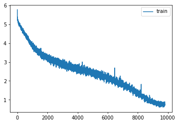

# Tiny ImageNet, Widish

A wider ResNet on Tiny ImageNet, for comparison with the baseline

Author

Benedict Thekkel

``` python
import os
# os.environ['CUDA_VISIBLE_DEVICES']='2'
```

``` python
import shutil,timm,os,torch,random,datasets,math,warnings
import fastcore.all as fc, numpy as np, matplotlib as mpl, matplotlib.pyplot as plt
import k_diffusion as K, torchvision.transforms as T
import torchvision.transforms.functional as TF,torch.nn.functional as F

from torch.utils.data import DataLoader,default_collate
from pathlib import Path
from torch.nn import init
from fastcore.foundation import L
from torch import nn,tensor
from operator import itemgetter
from torcheval.metrics import MulticlassAccuracy
from functools import partial
from torch.optim import lr_scheduler
from torch import optim
from torchvision.io import read_image,ImageReadMode
from glob import glob

from fastAIcourse.datasets import *
from fastAIcourse.conv import *
from fastAIcourse.learner import *
from fastAIcourse.activations import *
from fastAIcourse.init import *
from fastAIcourse.sgd import *
from fastAIcourse.resnet import *
from fastAIcourse.augment import *
from fastAIcourse.accel import *
from fastAIcourse.training import *
```

``` python
from fastprogress import progress_bar
```

``` python
torch.set_printoptions(precision=5, linewidth=140, sci_mode=False)
torch.manual_seed(1)
mpl.rcParams['figure.dpi'] = 70

set_seed(42)
if fc.defaults.cpus>8: fc.defaults.cpus=8
```

``` python
path_data = Path('data')
path_data.mkdir(exist_ok=True)
path = path_data/'tiny-imagenet-200'

url = 'http://cs231n.stanford.edu/tiny-imagenet-200.zip'
if not path.exists():
    path_zip = fc.urlsave(url, path_data)
    shutil.unpack_archive('data/tiny-imagenet-200.zip', 'data')

bs = 512

class TinyDS:
    def __init__(self, path):
        self.path = Path(path)
        self.files = glob(str(path/'**/*.JPEG'), recursive=True)
    def __len__(self): return len(self.files)
    def __getitem__(self, i): return self.files[i],Path(self.files[i]).parent.parent.name

tds = TinyDS(path/'train')
```

``` python
path_anno = path/'val'/'val_annotations.txt'
anno = dict(o.split('\t')[:2] for o in path_anno.read_text().splitlines())
```

``` python
class TinyValDS(TinyDS):
    def __getitem__(self, i): return self.files[i],anno[os.path.basename(self.files[i])]
```

``` python
vds = TinyValDS(path/'val')
```

``` python
class TfmDS:
    def __init__(self, ds, tfmx=fc.noop, tfmy=fc.noop): self.ds,self.tfmx,self.tfmy = ds,tfmx,tfmy
    def __len__(self): return len(self.ds)
    def __getitem__(self, i):
        x,y = self.ds[i]
        return self.tfmx(x),self.tfmy(y)
```

``` python
id2str = (path/'wnids.txt').read_text().splitlines()
str2id = {v:k for k,v in enumerate(id2str)}
```

``` python
xmean,xstd = (tensor([0.47565, 0.40303, 0.31555]), tensor([0.28858, 0.24402, 0.26615]))
```

``` python
def tfmx(x):
    img = read_image(x, mode=ImageReadMode.RGB)/255
    return (img-xmean[:,None,None])/xstd[:,None,None]

def tfmy(y): return tensor(str2id[y])

tfm_tds = TfmDS(tds, tfmx, tfmy)
tfm_vds = TfmDS(vds, tfmx, tfmy)

def denorm(x): return (x*xstd[:,None,None]+xmean[:,None,None]).clip(0,1)

all_synsets = [o.split('\t') for o in (path/'words.txt').read_text().splitlines()]
synsets = {k:v.split(',', maxsplit=1)[0] for k,v in all_synsets if k in id2str}

dls = DataLoaders(*get_dls(tfm_tds, tfm_vds, bs=bs, num_workers=8))
```

``` python
def tfm_batch(b, tfm_x=fc.noop, tfm_y = fc.noop): return tfm_x(b[0]),tfm_y(b[1])

tfms = nn.Sequential(T.Pad(4), T.RandomCrop(64),
                     T.RandomHorizontalFlip(),
                     RandErase())
augcb = BatchTransformCB(partial(tfm_batch, tfm_x=tfms), on_val=False)

act_gr = partial(GeneralRelu, leak=0.1, sub=0.4)
iw = partial(init_weights, leaky=0.1)

nfs = (32,64,128,256,512,1024)

def get_dropmodel(act=act_gr, nfs=nfs, norm=nn.BatchNorm2d, drop=0.1):
    layers = [nn.Conv2d(3, nfs[0], 5, padding=2)]
#     layers += [ResBlock(nfs[0], nfs[0], ks=3, stride=1, act=act, norm=norm)]
    layers += [ResBlock(nfs[i], nfs[i+1], act=act, norm=norm, stride=2)
               for i in range(len(nfs)-1)]
    layers += [nn.AdaptiveAvgPool2d(1), nn.Flatten(), nn.Dropout(drop)]
    layers += [nn.Linear(nfs[-1], 200, bias=False), nn.BatchNorm1d(200)]
    return nn.Sequential(*layers).apply(iw)
```

``` python
def res_blocks(n_bk, ni, nf, stride=1, ks=3, act=act_gr, norm=None):
    return nn.Sequential(*[
        ResBlock(ni if i==0 else nf, nf, stride=stride if i==n_bk-1 else 1, ks=ks, act=act, norm=norm)
        for i in range(n_bk)])

nbks = (3,2,2,1,1)

def get_dropmodel(act=act_gr, nfs=nfs, nbks=nbks, norm=nn.BatchNorm2d, drop=0.2):
    layers = [ResBlock(3, nfs[0], ks=5, stride=1, act=act, norm=norm)]
    layers += [res_blocks(nbks[i], nfs[i], nfs[i+1], act=act, norm=norm, stride=2)
               for i in range(len(nfs)-1)]
    layers += [nn.AdaptiveAvgPool2d(1), nn.Flatten(), nn.Dropout(drop)]
    layers += [nn.Linear(nfs[-1], 200, bias=False), nn.BatchNorm1d(200)]
    return nn.Sequential(*layers).apply(iw)
```

``` python
opt_func = partial(optim.AdamW, eps=1e-5)
```

``` python
metrics = MetricsCB(accuracy=MulticlassAccuracy())
cbs = [DeviceCB(), metrics, ProgressCB(plot=True), MixedPrecision()]

epochs = 25
lr = 3e-2
tmax = epochs * len(dls.train)
sched = partial(lr_scheduler.OneCycleLR, max_lr=lr, total_steps=tmax)
xtra = [BatchSchedCB(sched), augcb]
learn = Learner(get_dropmodel(), dls, F.cross_entropy, lr=lr, cbs=cbs+xtra, opt_func=opt_func)
```

``` python
aug_tfms = nn.Sequential(T.Pad(4), T.RandomCrop(64),
                     T.RandomHorizontalFlip(),
                     T.TrivialAugmentWide())

norm_tfm = T.Normalize(xmean, xstd)
erase_tfm = RandErase()

from PIL import Image

def tfmx(x, aug=False):
    x = Image.open(x).convert('RGB')
    if aug: x = aug_tfms(x)
    x = TF.to_tensor(x)
    x = norm_tfm(x)
    if aug: x = erase_tfm(x[None])[0]
    return x

tfm_tds = TfmDS(tds, partial(tfmx, aug=True), tfmy)
tfm_vds = TfmDS(vds, tfmx, tfmy)

dls = DataLoaders(*get_dls(tfm_tds, tfm_vds, bs=bs, num_workers=8))
```

``` python
def conv(ni, nf, ks=3, stride=1, act=nn.ReLU, norm=None, bias=True):
    layers = []
    if norm: layers.append(norm(ni))
    if act : layers.append(act())
    layers.append(nn.Conv2d(ni, nf, stride=stride, kernel_size=ks, padding=ks//2, bias=bias))
    return nn.Sequential(*layers)

def _conv_block(ni, nf, stride, act=act_gr, norm=None, ks=3):
    return nn.Sequential(conv(ni, nf, stride=1     , act=act, norm=norm, ks=ks),
                         conv(nf, nf, stride=stride, act=act, norm=norm, ks=ks))

class ResBlock(nn.Module):
    def __init__(self, ni, nf, stride=1, ks=3, act=act_gr, norm=None):
        super().__init__()
        self.convs = _conv_block(ni, nf, stride, act=act, ks=ks, norm=norm)
        self.idconv = fc.noop if ni==nf else conv(ni, nf, ks=1, stride=1, act=None, norm=norm)
        self.pool = fc.noop if stride==1 else nn.AvgPool2d(2, ceil_mode=True)

    def forward(self, x): return self.convs(x) + self.idconv(self.pool(x))
```

``` python
def get_dropmodel(act=act_gr, nfs=nfs, nbks=nbks, norm=nn.BatchNorm2d, drop=0.2):
    layers = [nn.Conv2d(3, nfs[0], 5, padding=2)]
    layers += [res_blocks(nbks[i], nfs[i], nfs[i+1], act=act, norm=norm, stride=2)
               for i in range(len(nfs)-1)]
    layers += [act_gr(), norm(nfs[-1]), nn.AdaptiveAvgPool2d(1), nn.Flatten(), nn.Dropout(drop)]
    layers += [nn.Linear(nfs[-1], 200, bias=False), nn.BatchNorm1d(200)]
    return nn.Sequential(*layers).apply(iw)
```

``` python
epochs = 50
lr = 0.1
tmax = epochs * len(dls.train)
sched = partial(lr_scheduler.OneCycleLR, max_lr=lr, total_steps=tmax)
xtra = [BatchSchedCB(sched)]
model = get_dropmodel(nbks=(1,2,4,2,2), nfs=(32, 64, 128, 512, 768, 1024), drop=0.1)
learn = Learner(model, dls, F.cross_entropy, lr=lr, cbs=cbs+xtra, opt_func=opt_func)
```

``` python
learn.fit(epochs)
```

| accuracy | loss  | epoch | train |
|----------|-------|-------|-------|
| 0.022    | 5.068 | 0     | train |
| 0.037    | 4.833 | 0     | eval  |
| 0.046    | 4.766 | 1     | train |
| 0.065    | 4.545 | 1     | eval  |
| 0.072    | 4.501 | 2     | train |
| 0.078    | 4.342 | 2     | eval  |
| 0.099    | 4.268 | 3     | train |
| 0.135    | 3.958 | 3     | eval  |
| 0.137    | 4.010 | 4     | train |
| 0.134    | 4.026 | 4     | eval  |
| 0.166    | 3.801 | 5     | train |
| 0.162    | 3.899 | 5     | eval  |
| 0.195    | 3.635 | 6     | train |
| 0.212    | 3.536 | 6     | eval  |
| 0.214    | 3.503 | 7     | train |
| 0.242    | 3.391 | 7     | eval  |
| 0.237    | 3.382 | 8     | train |
| 0.260    | 3.325 | 8     | eval  |
| 0.252    | 3.293 | 9     | train |
| 0.300    | 3.074 | 9     | eval  |
| 0.269    | 3.202 | 10    | train |
| 0.287    | 3.198 | 10    | eval  |
| 0.286    | 3.118 | 11    | train |
| 0.295    | 3.080 | 11    | eval  |
| 0.296    | 3.055 | 12    | train |
| 0.307    | 3.070 | 12    | eval  |
| 0.309    | 2.984 | 13    | train |
| 0.323    | 3.021 | 13    | eval  |
| 0.319    | 2.931 | 14    | train |
| 0.334    | 2.866 | 14    | eval  |
| 0.333    | 2.868 | 15    | train |
| 0.312    | 2.970 | 15    | eval  |
| 0.343    | 2.813 | 16    | train |
| 0.283    | 3.314 | 16    | eval  |
| 0.353    | 2.762 | 17    | train |
| 0.368    | 2.690 | 17    | eval  |
| 0.362    | 2.713 | 18    | train |
| 0.329    | 2.986 | 18    | eval  |
| 0.368    | 2.680 | 19    | train |
| 0.374    | 2.743 | 19    | eval  |
| 0.377    | 2.635 | 20    | train |
| 0.372    | 2.705 | 20    | eval  |
| 0.386    | 2.587 | 21    | train |
| 0.379    | 2.755 | 21    | eval  |
| 0.394    | 2.551 | 22    | train |
| 0.378    | 2.689 | 22    | eval  |
| 0.402    | 2.505 | 23    | train |
| 0.396    | 2.563 | 23    | eval  |
| 0.411    | 2.469 | 24    | train |
| 0.429    | 2.437 | 24    | eval  |
| 0.420    | 2.416 | 25    | train |
| 0.423    | 2.477 | 25    | eval  |
| 0.431    | 2.366 | 26    | train |
| 0.406    | 2.596 | 26    | eval  |
| 0.439    | 2.328 | 27    | train |
| 0.403    | 2.525 | 27    | eval  |
| 0.449    | 2.273 | 28    | train |
| 0.424    | 2.490 | 28    | eval  |
| 0.462    | 2.215 | 29    | train |
| 0.477    | 2.181 | 29    | eval  |
| 0.471    | 2.172 | 30    | train |
| 0.474    | 2.224 | 30    | eval  |
| 0.486    | 2.103 | 31    | train |
| 0.518    | 2.009 | 31    | eval  |
| 0.502    | 2.027 | 32    | train |
| 0.495    | 2.119 | 32    | eval  |
| 0.513    | 1.969 | 33    | train |
| 0.478    | 2.217 | 33    | eval  |
| 0.529    | 1.890 | 34    | train |
| 0.516    | 2.058 | 34    | eval  |
| 0.544    | 1.827 | 35    | train |
| 0.532    | 1.925 | 35    | eval  |
| 0.565    | 1.731 | 36    | train |
| 0.557    | 1.866 | 36    | eval  |
| 0.580    | 1.662 | 37    | train |
| 0.557    | 1.877 | 37    | eval  |
| 0.603    | 1.565 | 38    | train |
| 0.585    | 1.726 | 38    | eval  |
| 0.623    | 1.471 | 39    | train |
| 0.590    | 1.725 | 39    | eval  |
| 0.646    | 1.369 | 40    | train |
| 0.602    | 1.683 | 40    | eval  |
| 0.671    | 1.263 | 41    | train |
| 0.607    | 1.690 | 41    | eval  |
| 0.696    | 1.169 | 42    | train |
| 0.616    | 1.649 | 42    | eval  |
| 0.720    | 1.069 | 43    | train |
| 0.629    | 1.608 | 43    | eval  |
| 0.742    | 0.983 | 44    | train |
| 0.634    | 1.594 | 44    | eval  |
| 0.761    | 0.912 | 45    | train |
| 0.639    | 1.579 | 45    | eval  |
| 0.779    | 0.847 | 46    | train |
| 0.642    | 1.567 | 46    | eval  |
| 0.791    | 0.801 | 47    | train |
| 0.645    | 1.558 | 47    | eval  |
| 0.797    | 0.774 | 48    | train |
| 0.647    | 1.553 | 48    | eval  |
| 0.802    | 0.766 | 49    | train |
| 0.644    | 1.556 | 49    | eval  |



``` python
torch.save(learn.model, 'models/inettiny-widish-50')
```

Back to top
