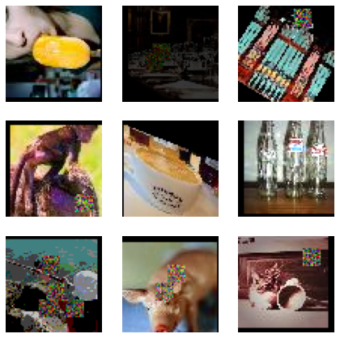
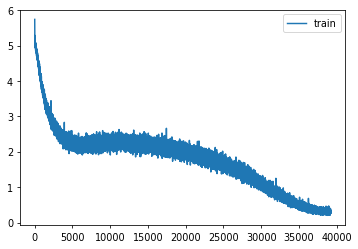

# Tiny ImageNet 200

The Tiny ImageNet classifier trained for 200 epochs

Author

Benedict Thekkel

``` python
import os
os.environ['CUDA_VISIBLE_DEVICES']='1'
```

``` python
import shutil,timm,os,torch,random,datasets,math
import fastcore.all as fc, numpy as np, matplotlib as mpl, matplotlib.pyplot as plt
import k_diffusion as K, torchvision.transforms as T
import torchvision.transforms.functional as TF,torch.nn.functional as F

from torch.utils.data import DataLoader,default_collate
from pathlib import Path
from torch.nn import init
from fastcore.foundation import L
from torch import nn,tensor
from operator import itemgetter
from torcheval.metrics import MulticlassAccuracy
from functools import partial
from torch.optim import lr_scheduler
from torch import optim
from torchvision.io import read_image,ImageReadMode
from glob import glob

from fastAIcourse.datasets import *
from fastAIcourse.conv import *
from fastAIcourse.learner import *
from fastAIcourse.activations import *
from fastAIcourse.init import *
from fastAIcourse.sgd import *
from fastAIcourse.resnet import *
from fastAIcourse.augment import *
from fastAIcourse.accel import *
from fastAIcourse.training import *
```

``` python
from fastprogress import progress_bar
```

``` python
torch.set_printoptions(precision=5, linewidth=140, sci_mode=False)
torch.manual_seed(1)
mpl.rcParams['figure.dpi'] = 70

set_seed(42)
if fc.defaults.cpus>8: fc.defaults.cpus=8
```

## Data processing

``` python
path_data = Path('data')
path_data.mkdir(exist_ok=True)
path = path_data/'tiny-imagenet-200'
```

``` python
url = 'http://cs231n.stanford.edu/tiny-imagenet-200.zip'
if not path.exists():
    path_zip = fc.urlsave(url, path_data)
    shutil.unpack_archive('data/tiny-imagenet-200.zip', 'data')
```

``` python
bs = 512
```

``` python
class TinyDS:
    def __init__(self, path):
        self.path = Path(path)
        self.files = glob(str(path/'**/*.JPEG'), recursive=True)
    def __len__(self): return len(self.files)
    def __getitem__(self, i): return self.files[i],Path(self.files[i]).parent.parent.name
```

``` python
tds = TinyDS(path/'train')
```

``` python
path_anno = path/'val'/'val_annotations.txt'
anno = dict(o.split('\t')[:2] for o in path_anno.read_text().splitlines())
```

``` python
class TinyValDS(TinyDS):
    def __getitem__(self, i): return self.files[i],anno[os.path.basename(self.files[i])]
```

``` python
vds = TinyValDS(path/'val')
```

``` python
class TfmDS:
    def __init__(self, ds, tfmx=fc.noop, tfmy=fc.noop): self.ds,self.tfmx,self.tfmy = ds,tfmx,tfmy
    def __len__(self): return len(self.ds)
    def __getitem__(self, i):
        x,y = self.ds[i]
        return self.tfmx(x),self.tfmy(y)
```

``` python
id2str = (path/'wnids.txt').read_text().splitlines()
str2id = {v:k for k,v in enumerate(id2str)}
```

``` python
xmean,xstd = (tensor([0.47565, 0.40303, 0.31555]), tensor([0.28858, 0.24402, 0.26615]))
```

``` python
def tfmy(y): return tensor(str2id[y])
```

``` python
def denorm(x): return (x*xstd[:,None,None]+xmean[:,None,None]).clip(0,1)
```

``` python
all_synsets = [o.split('\t') for o in (path/'words.txt').read_text().splitlines()]
synsets = {k:v.split(',', maxsplit=1)[0] for k,v in all_synsets if k in id2str}
```

``` python
def tfm_batch(b, tfm_x=fc.noop, tfm_y = fc.noop): return tfm_x(b[0]),tfm_y(b[1])
```

``` python
act_gr = partial(GeneralRelu, leak=0.1, sub=0.4)
iw = partial(init_weights, leaky=0.1)
```

``` python
nfs = (32,64,128,256,512,1024)
```

``` python
opt_func = partial(optim.AdamW, eps=1e-5)
```

``` python
nbks=(3,3,2,2,1)
```

``` python
def conv(ni, nf, ks=3, stride=1, act=nn.ReLU, norm=None, bias=True):
    layers = []
    if norm: layers.append(norm(ni))
    if act : layers.append(act())
    layers.append(nn.Conv2d(ni, nf, stride=stride, kernel_size=ks, padding=ks//2, bias=bias))
    return nn.Sequential(*layers)

def _conv_block(ni, nf, stride, act=act_gr, norm=None, ks=3):
    return nn.Sequential(conv(ni, nf, stride=1     , act=act, norm=norm, ks=ks),
                         conv(nf, nf, stride=stride, act=act, norm=norm, ks=ks))

class ResBlock(nn.Module):
    def __init__(self, ni, nf, stride=1, ks=3, act=act_gr, norm=None):
        super().__init__()
        self.convs = _conv_block(ni, nf, stride, act=act, ks=ks, norm=norm)
        self.idconv = fc.noop if ni==nf else conv(ni, nf, ks=1, stride=1, act=None, norm=norm)
        self.pool = fc.noop if stride==1 else nn.AvgPool2d(2, ceil_mode=True)

    def forward(self, x): return self.convs(x) + self.idconv(self.pool(x))

def res_blocks(n_bk, ni, nf, stride=1, ks=3, act=act_gr, norm=None):
    return nn.Sequential(*[
        ResBlock(ni if i==0 else nf, nf, stride=stride if i==n_bk-1 else 1, ks=ks, act=act, norm=norm)
        for i in range(n_bk)])

def get_dropmodel(act=act_gr, nfs=nfs, nbks=nbks, norm=nn.BatchNorm2d, drop=0.2):
    layers = [nn.Conv2d(3, nfs[0], 5, padding=2)]
    layers += [res_blocks(nbks[i], nfs[i], nfs[i+1], act=act, norm=norm, stride=2)
               for i in range(len(nfs)-1)]
    layers += [act_gr(), norm(nfs[-1]), nn.AdaptiveAvgPool2d(1), nn.Flatten(), nn.Dropout(drop)]
    layers += [nn.Linear(nfs[-1], 200, bias=False), nn.BatchNorm1d(200)]
    return nn.Sequential(*layers).apply(iw)
```

``` python
metrics = MetricsCB(accuracy=MulticlassAccuracy())
cbs = [DeviceCB(), metrics, ProgressCB(plot=True), MixedPrecision()]
```

``` python
aug_tfms = nn.Sequential(T.Pad(4), T.RandomCrop(64),
                     T.RandomHorizontalFlip(),
                     T.TrivialAugmentWide())

norm_tfm = T.Normalize(xmean, xstd)
erase_tfm = RandErase()
```

``` python
from PIL import Image
```

``` python
def tfmx(x, aug=False):
    x = Image.open(x).convert('RGB')
    if aug: x = aug_tfms(x)
    x = TF.to_tensor(x)
    x = norm_tfm(x)
    if aug: x = erase_tfm(x[None])[0]
    return x
```

``` python
tfm_tds = TfmDS(tds, partial(tfmx, aug=True), tfmy)
tfm_vds = TfmDS(vds, tfmx, tfmy)
```

``` python
dls = DataLoaders(*get_dls(tfm_tds, tfm_vds, bs=bs, num_workers=8))
```

``` python
def get_model(): return get_dropmodel(drop=0.1)
```

``` python
learn = TrainLearner(get_model(), dls, F.cross_entropy, cbs=[SingleBatchCB(), DeviceCB()])
learn.fit(1)
xb,yb = learn.batch
show_images(denorm(xb.cpu())[:9], imsize=2.5)
```



``` python
epochs = 200
lr = 0.1
tmax = epochs * len(dls.train)
sched = partial(lr_scheduler.OneCycleLR, max_lr=lr, total_steps=tmax)
xtra = [BatchSchedCB(sched)]
learn = Learner(get_model(), dls, F.cross_entropy, lr=lr, cbs=cbs+xtra, opt_func=opt_func)
```

``` python
learn.fit(epochs)
```

| accuracy | loss  | epoch | train |
|----------|-------|-------|-------|
| 0.025    | 5.057 | 0     | train |
| 0.043    | 4.807 | 0     | eval  |
| 0.049    | 4.768 | 1     | train |
| 0.065    | 4.521 | 1     | eval  |
| 0.079    | 4.500 | 2     | train |
| 0.111    | 4.182 | 2     | eval  |
| 0.116    | 4.207 | 3     | train |
| 0.159    | 3.827 | 3     | eval  |
| 0.152    | 3.950 | 4     | train |
| 0.193    | 3.615 | 4     | eval  |
| 0.185    | 3.721 | 5     | train |
| 0.242    | 3.316 | 5     | eval  |
| 0.220    | 3.516 | 6     | train |
| 0.286    | 3.062 | 6     | eval  |
| 0.246    | 3.361 | 7     | train |
| 0.306    | 2.962 | 7     | eval  |
| 0.270    | 3.209 | 8     | train |
| 0.309    | 3.030 | 8     | eval  |
| 0.293    | 3.089 | 9     | train |
| 0.344    | 2.780 | 9     | eval  |
| 0.312    | 2.971 | 10    | train |
| 0.355    | 2.753 | 10    | eval  |
| 0.335    | 2.863 | 11    | train |
| 0.384    | 2.627 | 11    | eval  |
| 0.350    | 2.779 | 12    | train |
| 0.381    | 2.646 | 12    | eval  |
| 0.365    | 2.699 | 13    | train |
| 0.388    | 2.619 | 13    | eval  |
| 0.379    | 2.624 | 14    | train |
| 0.409    | 2.542 | 14    | eval  |
| 0.390    | 2.571 | 15    | train |
| 0.410    | 2.514 | 15    | eval  |
| 0.405    | 2.504 | 16    | train |
| 0.405    | 2.563 | 16    | eval  |
| 0.410    | 2.461 | 17    | train |
| 0.426    | 2.462 | 17    | eval  |
| 0.419    | 2.422 | 18    | train |
| 0.442    | 2.390 | 18    | eval  |
| 0.427    | 2.378 | 19    | train |
| 0.451    | 2.348 | 19    | eval  |
| 0.434    | 2.346 | 20    | train |
| 0.413    | 2.565 | 20    | eval  |
| 0.439    | 2.311 | 21    | train |
| 0.371    | 2.858 | 21    | eval  |
| 0.447    | 2.283 | 22    | train |
| 0.390    | 2.787 | 22    | eval  |
| 0.449    | 2.278 | 23    | train |
| 0.434    | 2.446 | 23    | eval  |
| 0.452    | 2.255 | 24    | train |
| 0.444    | 2.351 | 24    | eval  |
| 0.455    | 2.235 | 25    | train |
| 0.438    | 2.416 | 25    | eval  |
| 0.458    | 2.231 | 26    | train |
| 0.457    | 2.326 | 26    | eval  |
| 0.459    | 2.215 | 27    | train |
| 0.455    | 2.349 | 27    | eval  |
| 0.464    | 2.204 | 28    | train |
| 0.442    | 2.400 | 28    | eval  |
| 0.464    | 2.200 | 29    | train |
| 0.344    | 3.163 | 29    | eval  |
| 0.467    | 2.188 | 30    | train |
| 0.403    | 2.749 | 30    | eval  |
| 0.463    | 2.205 | 31    | train |
| 0.407    | 2.692 | 31    | eval  |
| 0.465    | 2.196 | 32    | train |
| 0.400    | 2.628 | 32    | eval  |
| 0.462    | 2.206 | 33    | train |
| 0.467    | 2.278 | 33    | eval  |
| 0.465    | 2.202 | 34    | train |
| 0.452    | 2.303 | 34    | eval  |
| 0.462    | 2.203 | 35    | train |
| 0.452    | 2.377 | 35    | eval  |
| 0.464    | 2.200 | 36    | train |
| 0.437    | 2.443 | 36    | eval  |
| 0.465    | 2.207 | 37    | train |
| 0.436    | 2.428 | 37    | eval  |
| 0.462    | 2.200 | 38    | train |
| 0.423    | 2.565 | 38    | eval  |
| 0.463    | 2.210 | 39    | train |
| 0.357    | 3.034 | 39    | eval  |
| 0.460    | 2.221 | 40    | train |
| 0.396    | 2.672 | 40    | eval  |
| 0.459    | 2.225 | 41    | train |
| 0.450    | 2.317 | 41    | eval  |
| 0.459    | 2.230 | 42    | train |
| 0.446    | 2.407 | 42    | eval  |
| 0.458    | 2.237 | 43    | train |
| 0.397    | 2.638 | 43    | eval  |
| 0.459    | 2.236 | 44    | train |
| 0.439    | 2.424 | 44    | eval  |
| 0.456    | 2.243 | 45    | train |
| 0.445    | 2.336 | 45    | eval  |
| 0.455    | 2.253 | 46    | train |
| 0.412    | 2.652 | 46    | eval  |
| 0.453    | 2.254 | 47    | train |
| 0.380    | 2.760 | 47    | eval  |
| 0.456    | 2.248 | 48    | train |
| 0.400    | 2.701 | 48    | eval  |
| 0.453    | 2.256 | 49    | train |
| 0.409    | 2.691 | 49    | eval  |
| 0.451    | 2.264 | 50    | train |
| 0.354    | 3.238 | 50    | eval  |
| 0.452    | 2.267 | 51    | train |
| 0.434    | 2.413 | 51    | eval  |
| 0.450    | 2.265 | 52    | train |
| 0.431    | 2.499 | 52    | eval  |
| 0.452    | 2.260 | 53    | train |
| 0.447    | 2.352 | 53    | eval  |
| 0.452    | 2.267 | 54    | train |
| 0.442    | 2.383 | 54    | eval  |
| 0.447    | 2.271 | 55    | train |
| 0.405    | 2.598 | 55    | eval  |
| 0.451    | 2.266 | 56    | train |
| 0.418    | 2.584 | 56    | eval  |
| 0.450    | 2.268 | 57    | train |
| 0.419    | 2.531 | 57    | eval  |
| 0.452    | 2.263 | 58    | train |
| 0.457    | 2.286 | 58    | eval  |
| 0.451    | 2.262 | 59    | train |
| 0.351    | 3.086 | 59    | eval  |
| 0.449    | 2.270 | 60    | train |
| 0.387    | 2.717 | 60    | eval  |
| 0.456    | 2.243 | 61    | train |
| 0.427    | 2.532 | 61    | eval  |
| 0.456    | 2.241 | 62    | train |
| 0.408    | 2.488 | 62    | eval  |
| 0.455    | 2.249 | 63    | train |
| 0.405    | 2.625 | 63    | eval  |
| 0.456    | 2.239 | 64    | train |
| 0.420    | 2.485 | 64    | eval  |
| 0.456    | 2.237 | 65    | train |
| 0.411    | 2.518 | 65    | eval  |
| 0.457    | 2.239 | 66    | train |
| 0.417    | 2.590 | 66    | eval  |
| 0.457    | 2.230 | 67    | train |
| 0.354    | 2.970 | 67    | eval  |
| 0.458    | 2.229 | 68    | train |
| 0.424    | 2.444 | 68    | eval  |
| 0.460    | 2.219 | 69    | train |
| 0.347    | 2.992 | 69    | eval  |
| 0.463    | 2.212 | 70    | train |
| 0.395    | 2.699 | 70    | eval  |
| 0.463    | 2.207 | 71    | train |
| 0.339    | 3.148 | 71    | eval  |
| 0.464    | 2.200 | 72    | train |
| 0.353    | 3.148 | 72    | eval  |
| 0.464    | 2.201 | 73    | train |
| 0.434    | 2.422 | 73    | eval  |
| 0.466    | 2.198 | 74    | train |
| 0.424    | 2.551 | 74    | eval  |
| 0.471    | 2.179 | 75    | train |
| 0.393    | 2.710 | 75    | eval  |
| 0.468    | 2.183 | 76    | train |
| 0.405    | 2.624 | 76    | eval  |
| 0.465    | 2.194 | 77    | train |
| 0.417    | 2.578 | 77    | eval  |
| 0.471    | 2.172 | 78    | train |
| 0.440    | 2.477 | 78    | eval  |
| 0.471    | 2.164 | 79    | train |
| 0.392    | 2.752 | 79    | eval  |
| 0.473    | 2.161 | 80    | train |
| 0.424    | 2.490 | 80    | eval  |
| 0.473    | 2.164 | 81    | train |
| 0.420    | 2.547 | 81    | eval  |
| 0.476    | 2.147 | 82    | train |
| 0.394    | 2.779 | 82    | eval  |
| 0.475    | 2.155 | 83    | train |
| 0.400    | 2.747 | 83    | eval  |
| 0.477    | 2.138 | 84    | train |
| 0.397    | 2.684 | 84    | eval  |
| 0.481    | 2.134 | 85    | train |
| 0.442    | 2.428 | 85    | eval  |
| 0.479    | 2.122 | 86    | train |
| 0.371    | 2.966 | 86    | eval  |
| 0.482    | 2.123 | 87    | train |
| 0.410    | 2.634 | 87    | eval  |
| 0.481    | 2.121 | 88    | train |
| 0.442    | 2.399 | 88    | eval  |
| 0.482    | 2.111 | 89    | train |
| 0.461    | 2.331 | 89    | eval  |
| 0.487    | 2.092 | 90    | train |
| 0.435    | 2.423 | 90    | eval  |
| 0.487    | 2.092 | 91    | train |
| 0.414    | 2.691 | 91    | eval  |
| 0.486    | 2.089 | 92    | train |
| 0.384    | 2.826 | 92    | eval  |
| 0.493    | 2.062 | 93    | train |
| 0.462    | 2.385 | 93    | eval  |
| 0.494    | 2.056 | 94    | train |
| 0.460    | 2.318 | 94    | eval  |
| 0.493    | 2.056 | 95    | train |
| 0.418    | 2.625 | 95    | eval  |
| 0.497    | 2.045 | 96    | train |
| 0.444    | 2.455 | 96    | eval  |
| 0.495    | 2.043 | 97    | train |
| 0.484    | 2.159 | 97    | eval  |
| 0.503    | 2.016 | 98    | train |
| 0.417    | 2.637 | 98    | eval  |
| 0.504    | 2.016 | 99    | train |
| 0.384    | 2.846 | 99    | eval  |
| 0.503    | 2.016 | 100   | train |
| 0.494    | 2.186 | 100   | eval  |
| 0.504    | 2.008 | 101   | train |
| 0.436    | 2.522 | 101   | eval  |
| 0.509    | 1.988 | 102   | train |
| 0.445    | 2.428 | 102   | eval  |
| 0.508    | 1.986 | 103   | train |
| 0.488    | 2.131 | 103   | eval  |
| 0.512    | 1.973 | 104   | train |
| 0.485    | 2.196 | 104   | eval  |
| 0.515    | 1.959 | 105   | train |
| 0.486    | 2.231 | 105   | eval  |
| 0.515    | 1.953 | 106   | train |
| 0.461    | 2.331 | 106   | eval  |
| 0.522    | 1.924 | 107   | train |
| 0.477    | 2.287 | 107   | eval  |
| 0.522    | 1.920 | 108   | train |
| 0.452    | 2.439 | 108   | eval  |
| 0.522    | 1.921 | 109   | train |
| 0.493    | 2.176 | 109   | eval  |
| 0.525    | 1.909 | 110   | train |
| 0.488    | 2.259 | 110   | eval  |
| 0.528    | 1.894 | 111   | train |
| 0.477    | 2.305 | 111   | eval  |
| 0.532    | 1.879 | 112   | train |
| 0.485    | 2.224 | 112   | eval  |
| 0.536    | 1.862 | 113   | train |
| 0.485    | 2.244 | 113   | eval  |
| 0.538    | 1.850 | 114   | train |
| 0.451    | 2.439 | 114   | eval  |
| 0.540    | 1.842 | 115   | train |
| 0.482    | 2.231 | 115   | eval  |
| 0.545    | 1.824 | 116   | train |
| 0.506    | 2.124 | 116   | eval  |
| 0.548    | 1.803 | 117   | train |
| 0.461    | 2.427 | 117   | eval  |
| 0.550    | 1.797 | 118   | train |
| 0.510    | 2.132 | 118   | eval  |
| 0.555    | 1.774 | 119   | train |
| 0.504    | 2.124 | 119   | eval  |
| 0.556    | 1.767 | 120   | train |
| 0.447    | 2.468 | 120   | eval  |
| 0.560    | 1.748 | 121   | train |
| 0.472    | 2.329 | 121   | eval  |
| 0.563    | 1.736 | 122   | train |
| 0.488    | 2.283 | 122   | eval  |
| 0.568    | 1.714 | 123   | train |
| 0.466    | 2.340 | 123   | eval  |
| 0.568    | 1.710 | 124   | train |
| 0.464    | 2.382 | 124   | eval  |
| 0.574    | 1.686 | 125   | train |
| 0.451    | 2.466 | 125   | eval  |
| 0.578    | 1.668 | 126   | train |
| 0.518    | 2.113 | 126   | eval  |
| 0.584    | 1.647 | 127   | train |
| 0.495    | 2.331 | 127   | eval  |
| 0.585    | 1.635 | 128   | train |
| 0.496    | 2.276 | 128   | eval  |
| 0.589    | 1.619 | 129   | train |
| 0.452    | 2.528 | 129   | eval  |
| 0.594    | 1.596 | 130   | train |
| 0.534    | 2.063 | 130   | eval  |
| 0.596    | 1.587 | 131   | train |
| 0.522    | 2.098 | 131   | eval  |
| 0.600    | 1.561 | 132   | train |
| 0.535    | 1.996 | 132   | eval  |
| 0.606    | 1.536 | 133   | train |
| 0.539    | 1.994 | 133   | eval  |
| 0.609    | 1.528 | 134   | train |
| 0.506    | 2.207 | 134   | eval  |
| 0.610    | 1.513 | 135   | train |
| 0.515    | 2.208 | 135   | eval  |
| 0.620    | 1.477 | 136   | train |
| 0.542    | 1.923 | 136   | eval  |
| 0.625    | 1.460 | 137   | train |
| 0.521    | 2.127 | 137   | eval  |
| 0.627    | 1.438 | 138   | train |
| 0.518    | 2.218 | 138   | eval  |
| 0.635    | 1.417 | 139   | train |
| 0.515    | 2.151 | 139   | eval  |
| 0.641    | 1.387 | 140   | train |
| 0.555    | 1.921 | 140   | eval  |
| 0.646    | 1.364 | 141   | train |
| 0.526    | 2.154 | 141   | eval  |
| 0.648    | 1.355 | 142   | train |
| 0.544    | 2.087 | 142   | eval  |
| 0.654    | 1.325 | 143   | train |
| 0.558    | 1.904 | 143   | eval  |
| 0.661    | 1.300 | 144   | train |
| 0.551    | 2.035 | 144   | eval  |
| 0.667    | 1.281 | 145   | train |
| 0.537    | 2.157 | 145   | eval  |
| 0.671    | 1.253 | 146   | train |
| 0.558    | 1.982 | 146   | eval  |
| 0.678    | 1.233 | 147   | train |
| 0.553    | 2.052 | 147   | eval  |
| 0.682    | 1.216 | 148   | train |
| 0.547    | 2.070 | 148   | eval  |
| 0.690    | 1.180 | 149   | train |
| 0.571    | 1.968 | 149   | eval  |
| 0.699    | 1.144 | 150   | train |
| 0.578    | 1.882 | 150   | eval  |
| 0.702    | 1.136 | 151   | train |
| 0.574    | 1.972 | 151   | eval  |
| 0.711    | 1.098 | 152   | train |
| 0.571    | 1.981 | 152   | eval  |
| 0.716    | 1.073 | 153   | train |
| 0.589    | 1.899 | 153   | eval  |
| 0.725    | 1.044 | 154   | train |
| 0.561    | 2.112 | 154   | eval  |
| 0.728    | 1.036 | 155   | train |
| 0.592    | 1.967 | 155   | eval  |
| 0.733    | 1.005 | 156   | train |
| 0.567    | 2.035 | 156   | eval  |
| 0.741    | 0.978 | 157   | train |
| 0.573    | 2.003 | 157   | eval  |
| 0.749    | 0.947 | 158   | train |
| 0.599    | 1.874 | 158   | eval  |
| 0.755    | 0.929 | 159   | train |
| 0.596    | 1.894 | 159   | eval  |
| 0.766    | 0.892 | 160   | train |
| 0.600    | 1.913 | 160   | eval  |
| 0.770    | 0.866 | 161   | train |
| 0.606    | 1.850 | 161   | eval  |
| 0.777    | 0.839 | 162   | train |
| 0.604    | 1.852 | 162   | eval  |
| 0.786    | 0.814 | 163   | train |
| 0.592    | 1.922 | 163   | eval  |
| 0.789    | 0.800 | 164   | train |
| 0.604    | 1.832 | 164   | eval  |
| 0.796    | 0.769 | 165   | train |
| 0.613    | 1.781 | 165   | eval  |
| 0.801    | 0.747 | 166   | train |
| 0.617    | 1.826 | 166   | eval  |
| 0.808    | 0.731 | 167   | train |
| 0.609    | 1.871 | 167   | eval  |
| 0.817    | 0.695 | 168   | train |
| 0.621    | 1.781 | 168   | eval  |
| 0.825    | 0.669 | 169   | train |
| 0.622    | 1.788 | 169   | eval  |
| 0.828    | 0.656 | 170   | train |
| 0.624    | 1.763 | 170   | eval  |
| 0.835    | 0.631 | 171   | train |
| 0.635    | 1.761 | 171   | eval  |
| 0.842    | 0.605 | 172   | train |
| 0.641    | 1.699 | 172   | eval  |
| 0.845    | 0.589 | 173   | train |
| 0.629    | 1.740 | 173   | eval  |
| 0.852    | 0.566 | 174   | train |
| 0.621    | 1.812 | 174   | eval  |
| 0.859    | 0.542 | 175   | train |
| 0.637    | 1.716 | 175   | eval  |
| 0.860    | 0.533 | 176   | train |
| 0.646    | 1.710 | 176   | eval  |
| 0.866    | 0.509 | 177   | train |
| 0.652    | 1.685 | 177   | eval  |
| 0.870    | 0.495 | 178   | train |
| 0.654    | 1.644 | 178   | eval  |
| 0.876    | 0.472 | 179   | train |
| 0.652    | 1.638 | 179   | eval  |
| 0.882    | 0.452 | 180   | train |
| 0.654    | 1.630 | 180   | eval  |
| 0.884    | 0.443 | 181   | train |
| 0.653    | 1.651 | 181   | eval  |
| 0.889    | 0.424 | 182   | train |
| 0.661    | 1.592 | 182   | eval  |
| 0.893    | 0.412 | 183   | train |
| 0.661    | 1.584 | 183   | eval  |
| 0.896    | 0.403 | 184   | train |
| 0.663    | 1.595 | 184   | eval  |
| 0.899    | 0.391 | 185   | train |
| 0.666    | 1.572 | 185   | eval  |
| 0.903    | 0.372 | 186   | train |
| 0.669    | 1.551 | 186   | eval  |
| 0.905    | 0.366 | 187   | train |
| 0.668    | 1.561 | 187   | eval  |
| 0.907    | 0.354 | 188   | train |
| 0.670    | 1.540 | 188   | eval  |
| 0.909    | 0.346 | 189   | train |
| 0.672    | 1.526 | 189   | eval  |
| 0.911    | 0.342 | 190   | train |
| 0.674    | 1.522 | 190   | eval  |
| 0.912    | 0.335 | 191   | train |
| 0.676    | 1.521 | 191   | eval  |
| 0.915    | 0.327 | 192   | train |
| 0.675    | 1.507 | 192   | eval  |
| 0.915    | 0.323 | 193   | train |
| 0.675    | 1.504 | 193   | eval  |
| 0.919    | 0.312 | 194   | train |
| 0.675    | 1.507 | 194   | eval  |
| 0.917    | 0.318 | 195   | train |
| 0.676    | 1.505 | 195   | eval  |
| 0.917    | 0.315 | 196   | train |
| 0.679    | 1.502 | 196   | eval  |
| 0.918    | 0.311 | 197   | train |
| 0.677    | 1.504 | 197   | eval  |
| 0.918    | 0.315 | 198   | train |
| 0.676    | 1.505 | 198   | eval  |
| 0.919    | 0.309 | 199   | train |
| 0.675    | 1.502 | 199   | eval  |



``` python
torch.save(learn.model, 'models/inettiny-trivaug-200')
```

Back to top
