# Super-Resolution

Upscaling Tiny ImageNet images: denoising autoencoder, U-Net, perceptual loss and cross-convs

Author

Benedict Thekkel

``` python
import os
# os.environ['CUDA_VISIBLE_DEVICES']='1'
```

``` python
import timm, torch, random, datasets, math, fastcore.all as fc, numpy as np, matplotlib as mpl, matplotlib.pyplot as plt
import torchvision.transforms as T
import torchvision.transforms.functional as TF,torch.nn.functional as F

from torch.utils.data import DataLoader,default_collate
from pathlib import Path
from torch.nn import init
from fastcore.foundation import L
from torch import nn,tensor
from datasets import load_dataset
from operator import itemgetter
from torcheval.metrics import MulticlassAccuracy
from functools import partial
from torch.optim import lr_scheduler
from torch import optim
from torchvision.io import read_image,ImageReadMode

from fastAIcourse.datasets import *
from fastAIcourse.conv import *
from fastAIcourse.learner import *
from fastAIcourse.activations import *
from fastAIcourse.init import *
from fastAIcourse.sgd import *
from fastAIcourse.resnet import *
from fastAIcourse.augment import *
from fastAIcourse.accel import *
from fastAIcourse.training import *
```

``` python
from fastprogress import progress_bar
from glob import glob
```

``` python
torch.set_printoptions(precision=5, linewidth=140, sci_mode=False)
torch.manual_seed(1)
mpl.rcParams['figure.dpi'] = 70

set_seed(42)
if fc.defaults.cpus>8: fc.defaults.cpus=8
```

## Data processing

``` python
path = Path.home()/'data'/'tiny-imagenet-200'
bs = 512
# bs = 32
xmean,xstd = (tensor([0.47565, 0.40303, 0.31555]), tensor([0.28858, 0.24402, 0.26615]))
```

``` python
tfms = nn.Sequential(T.Pad(8), T.RandomCrop(64), T.RandomHorizontalFlip())
```

``` python
class TinyDS:
    def __init__(self, path):
        self.path = Path(path)
        self.files = glob(str(path/'**/*.JPEG'), recursive=True)
    def __len__(self): return len(self.files)
    def __getitem__(self, i):
        img = read_image(self.files[i], mode=ImageReadMode.RGB)/255
        return tfms((img-xmean[:,None,None])/xstd[:,None,None])

class TfmDS:
    def __init__(self, ds, tfmx=fc.noop, tfmy=fc.noop): self.ds,self.tfmx,self.tfmy = ds,tfmx,tfmy
    def __len__(self): return len(self.ds)
    def __getitem__(self, i):
        item = self.ds[i]
        return self.tfmx(item),self.tfmy(item)

def denorm(x): return (x*xstd[:,None,None]+xmean[:,None,None]).clamp(0,1)
```

``` python
def tfmx(x, erase=True):
    x = TF.resize(x, (32,32))[None]
    x = F.interpolate(x, scale_factor=2)
    if erase: x = rand_erase(x)
    return x[0]
```

``` python
tds = TinyDS(path/'train')
vds = TinyDS(path/'val')

tfm_tds = TfmDS(tds, tfmx)
tfm_vds = TfmDS(vds, partial(tfmx, erase=False))

dls = DataLoaders(*get_dls(tfm_tds, tfm_vds, bs=bs, num_workers=8))
```

``` python
xb,yb = next(iter(dls.train))
```

``` python
show_images(denorm(xb[:4]), imsize=2.5)
```

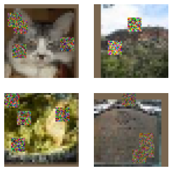

``` python
show_images(denorm(yb[:4]), imsize=2.5)
```


## Denoising autoencoder

``` python
def up_block(ni, nf, ks=3, act=act_gr, norm=None):
    return nn.Sequential(nn.UpsamplingNearest2d(scale_factor=2),
                         ResBlock(ni, nf, ks=ks, act=act, norm=norm))
```

``` python
def get_model(act=act_gr, nfs=(32,64,128,256,512,1024), norm=nn.BatchNorm2d, drop=0.1):
    layers = [ResBlock(3, nfs[0], ks=5, stride=1, act=act, norm=norm)]
    layers += [ResBlock(nfs[i], nfs[i+1], act=act, norm=norm, stride=2) for i in range(len(nfs)-1)]
    layers += [up_block(nfs[i], nfs[i-1], act=act, norm=norm) for i in range(len(nfs)-1,0,-1)]
    layers += [ResBlock(nfs[0], 3, act=nn.Identity, norm=norm)]
    return nn.Sequential(*layers).apply(iw)
```

``` python
iw = partial(init_weights, leaky=0.1)
```

``` python
metrics = MetricsCB()
cbs = [DeviceCB(), metrics, ProgressCB(plot=True), MixedPrecision()]
lr_cbs = [DeviceCB(), ProgressCB(), MixedPrecision()]
opt_func = partial(optim.AdamW, eps=1e-5)
```

``` python
Learner(get_model().apply(iw), dls, F.mse_loss, cbs=lr_cbs, opt_func=opt_func).lr_find(start_lr=1e-4, gamma=1.2)
```

0.00% \[0/10 00:00\<00:00\]

12.24% \[24/196 00:06\<00:45 1.320\]

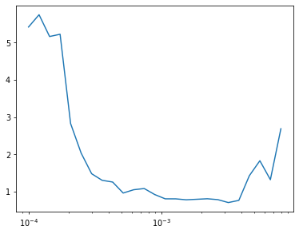

``` python
epochs = 5
lr = 1e-3
tmax = epochs * len(dls.train)
sched = partial(lr_scheduler.OneCycleLR, max_lr=lr, total_steps=tmax)
xtra = [BatchSchedCB(sched)]
learn = Learner(get_model().apply(iw), dls, F.mse_loss, lr=lr, cbs=cbs+xtra, opt_func=opt_func)
```

``` python
learn.fit(epochs)
```

| loss  | epoch | train |
|-------|-------|-------|
| 0.584 | 0     | train |
| 0.361 | 0     | eval  |
| 0.314 | 1     | train |
| 0.268 | 1     | eval  |
| 0.252 | 2     | train |
| 0.225 | 2     | eval  |
| 0.228 | 3     | train |
| 0.211 | 3     | eval  |
| 0.220 | 4     | train |
| 0.207 | 4     | eval  |

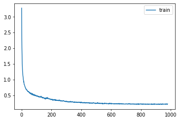

``` python
p,t,inp = learn.capture_preds(inps=True)
```

| loss  | epoch | train |
|-------|-------|-------|
| 0.207 | 0     | eval  |

``` python
show_images(denorm(inp[:9]), imsize=2)
```


``` python
show_images(denorm(p[:9]), imsize=2)
```


## Unet

``` python
del(learn)
clean_mem()
```

``` python
class TinyUnet(nn.Module):
    def __init__(self, act=act_gr, nfs=(32,64,128,256,512,1024), norm=nn.BatchNorm2d):
        super().__init__()
        self.start = ResBlock(3, nfs[0], stride=1, act=act, norm=norm)
        self.dn = nn.ModuleList([ResBlock(nfs[i], nfs[i+1], act=act, norm=norm, stride=2)
                                 for i in range(len(nfs)-1)])
        self.up = nn.ModuleList([up_block(nfs[i], nfs[i-1], act=act, norm=norm)
                                 for i in range(len(nfs)-1,0,-1)])
        self.up += [ResBlock(nfs[0], 3, act=act, norm=norm)]
        self.end = ResBlock(3, 3, act=nn.Identity, norm=norm)

    def forward(self, x):
        layers = []
        layers.append(x)
        x = self.start(x)
        for l in self.dn:
            layers.append(x)
            x = l(x)
        n = len(layers)
        for i,l in enumerate(self.up):
            if i!=0: x += layers[n-i]
            x = l(x)
        return self.end(x+layers[0])
```

``` python
def zero_wgts(l):
    with torch.no_grad():
        l.weight.zero_()
        l.bias.zero_()
```

``` python
model = TinyUnet()
```

``` python
last_res = model.up[-1]
zero_wgts(last_res.convs[-1][-1])
zero_wgts(last_res.idconv[0])
zero_wgts(model.end.convs[-1][-1])
```

``` python
Learner(model, dls, F.mse_loss, cbs=lr_cbs, opt_func=opt_func).lr_find(start_lr=1e-4, gamma=1.2)
```

0.00% \[0/10 00:00\<00:00\]

17.35% \[34/196 00:08\<00:38 0.270\]

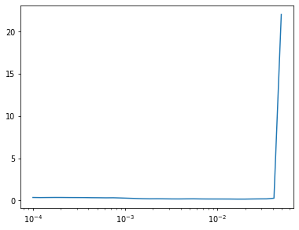

``` python
model = TinyUnet()
```

``` python
last_res = model.up[-1]
zero_wgts(last_res.convs[-1][-1])
zero_wgts(last_res.idconv[0])
zero_wgts(model.end.convs[-1][-1])
```

``` python
epochs = 20
lr = 1e-2
tmax = epochs * len(dls.train)
sched = partial(lr_scheduler.OneCycleLR, max_lr=lr, total_steps=tmax)
xtra = [BatchSchedCB(sched)]
learn = Learner(model, dls, F.mse_loss, lr=lr, cbs=cbs+xtra, opt_func=opt_func)
```

``` python
learn.fit(epochs)
```

| loss  | epoch | train |
|-------|-------|-------|
| 0.163 | 0     | train |
| 0.086 | 0     | eval  |
| 0.107 | 1     | train |
| 0.082 | 1     | eval  |
| 0.097 | 2     | train |
| 0.080 | 2     | eval  |
| 0.094 | 3     | train |
| 0.079 | 3     | eval  |
| 0.092 | 4     | train |
| 0.077 | 4     | eval  |
| 0.091 | 5     | train |
| 0.077 | 5     | eval  |
| 0.090 | 6     | train |
| 0.076 | 6     | eval  |
| 0.089 | 7     | train |
| 0.076 | 7     | eval  |
| 0.088 | 8     | train |
| 0.075 | 8     | eval  |
| 0.088 | 9     | train |
| 0.075 | 9     | eval  |
| 0.087 | 10    | train |
| 0.075 | 10    | eval  |
| 0.087 | 11    | train |
| 0.075 | 11    | eval  |
| 0.086 | 12    | train |
| 0.074 | 12    | eval  |
| 0.086 | 13    | train |
| 0.074 | 13    | eval  |
| 0.086 | 14    | train |
| 0.074 | 14    | eval  |
| 0.086 | 15    | train |
| 0.074 | 15    | eval  |
| 0.085 | 16    | train |
| 0.073 | 16    | eval  |
| 0.085 | 17    | train |
| 0.073 | 17    | eval  |
| 0.085 | 18    | train |
| 0.073 | 18    | eval  |
| 0.085 | 19    | train |
| 0.073 | 19    | eval  |

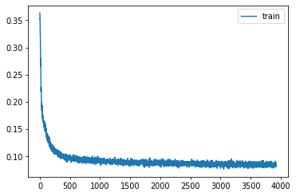

``` python
p,t,inp = learn.capture_preds(inps=True)
```

| loss  | epoch | train |
|-------|-------|-------|
| 0.073 | 0     | eval  |

``` python
show_images(denorm(inp[:9]), imsize=2)
```


``` python
show_images(denorm(p[:9]), imsize=2)
```


``` python
show_images(denorm(t[:9]), imsize=2)
```

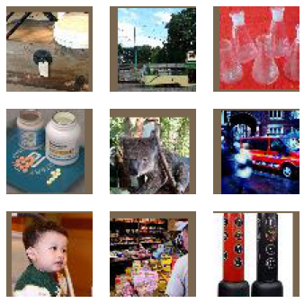

## Perceptual loss

``` python
# del(learn)
# clean_mem()
```

``` python
cmodel = torch.load('models/inettiny-custom-25').cuda()
```

``` python
xb,yb = next(iter(dls.valid))
with torch.autocast('cuda'),torch.no_grad(): preds = to_cpu(cmodel(yb.cuda().half()))
preds.shape
```

    torch.Size([1024, 200])

``` python
id2str = (path/'wnids.txt').read_text().splitlines()
all_synsets = [o.split('\t') for o in (path/'words.txt').read_text().splitlines()]
synsets = {k:v.split(',', maxsplit=1)[0] for k,v in all_synsets if k in id2str}
```

``` python
titles = [synsets[id2str[o]] for o in preds.argmax(dim=1)]
show_images(denorm(yb[:16]), imsize=2, titles=titles[:16])
```

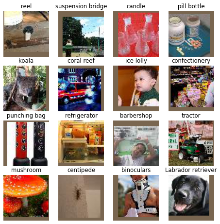

``` python
for i in range(4,len(cmodel)): del(cmodel[4])
```

``` python
learn.model = torch.load('models/superres-cross.pkl')
```

``` python
with torch.autocast('cuda'),torch.no_grad():
    feat = to_cpu(cmodel(yb.cuda())).float()
    t = to_cpu(learn.model(yb.cuda())).float()
    pred_feat = to_cpu(cmodel(t.cuda())).float()

feat.shape
```

    torch.Size([1024, 256, 8, 8])

``` python
def comb_loss(inp, tgt):
    with torch.autocast('cuda'):
        with torch.no_grad(): tgt_feat = cmodel(tgt).float()
        inp_feat = cmodel(inp).float()
    feat_loss = F.mse_loss(inp_feat, tgt_feat)
    return F.mse_loss(inp,tgt) + feat_loss/10
```

``` python
def get_unet():
    model = TinyUnet()
    last_res = model.up[-1]
    zero_wgts(last_res.convs[-1][-1])
    zero_wgts(last_res.idconv[0])
    zero_wgts(model.end.convs[-1][-1])
    return model
```

``` python
Learner(get_unet(), dls, comb_loss, cbs=lr_cbs, opt_func=opt_func).lr_find(start_lr=1e-4, gamma=1.2)
```

0.00% \[0/10 00:00\<00:00\]

16.84% \[33/196 00:10\<00:50 0.735\]

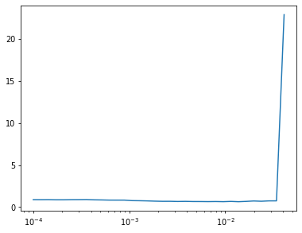

``` python
epochs = 20
lr = 1e-2
tmax = epochs * len(dls.train)
sched = partial(lr_scheduler.OneCycleLR, max_lr=lr, total_steps=tmax)
xtra = [BatchSchedCB(sched)]
learn = Learner(get_unet(), dls, comb_loss, lr=lr, cbs=cbs+xtra, opt_func=opt_func)
```

``` python
learn.fit(epochs)
```

| loss  | epoch | train |
|-------|-------|-------|
| 0.602 | 0     | train |
| 0.385 | 0     | eval  |
| 0.477 | 1     | train |
| 0.354 | 1     | eval  |
| 0.434 | 2     | train |
| 0.348 | 2     | eval  |
| 0.415 | 3     | train |
| 0.343 | 3     | eval  |
| 0.404 | 4     | train |
| 0.337 | 4     | eval  |
| 0.397 | 5     | train |
| 0.336 | 5     | eval  |
| 0.390 | 6     | train |
| 0.339 | 6     | eval  |
| 0.384 | 7     | train |
| 0.328 | 7     | eval  |
| 0.381 | 8     | train |
| 0.329 | 8     | eval  |
| 0.378 | 9     | train |
| 0.321 | 9     | eval  |
| 0.374 | 10    | train |
| 0.321 | 10    | eval  |
| 0.370 | 11    | train |
| 0.316 | 11    | eval  |
| 0.368 | 12    | train |
| 0.312 | 12    | eval  |
| 0.365 | 13    | train |
| 0.313 | 13    | eval  |
| 0.362 | 14    | train |
| 0.310 | 14    | eval  |
| 0.360 | 15    | train |
| 0.306 | 15    | eval  |
| 0.357 | 16    | train |
| 0.305 | 16    | eval  |
| 0.355 | 17    | train |
| 0.303 | 17    | eval  |
| 0.354 | 18    | train |
| 0.302 | 18    | eval  |
| 0.354 | 19    | train |
| 0.303 | 19    | eval  |

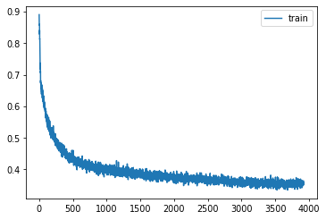

``` python
p,t,inp = learn.capture_preds(inps=True)
```

| loss  | epoch | train |
|-------|-------|-------|
| 0.303 | 0     | eval  |

``` python
show_images(denorm(inp[:9]), imsize=2)
```


``` python
show_images(denorm(p[:9]), imsize=2)
```


``` python
show_images(denorm(t[:9]), imsize=2)
```


## Perceptual loss

``` python
model = get_unet()
```

``` python
pmodel = torch.load('models/inettiny-custom-25')
model.start.load_state_dict(pmodel[0].state_dict())
for i in range(5): model.dn[i].load_state_dict(pmodel[i+1].state_dict())
```

``` python
for o in model.dn.parameters(): o.requires_grad_(False)
```

``` python
epochs = 1
lr = 3e-3
tmax = epochs * len(dls.train)
sched = partial(lr_scheduler.OneCycleLR, max_lr=lr, total_steps=tmax)
xtra = [BatchSchedCB(sched)]
learn = Learner(model, dls, comb_loss, lr=lr, cbs=cbs+xtra, opt_func=opt_func)
```

``` python
learn.fit(epochs)
```

| loss  | epoch | train |
|-------|-------|-------|
| 0.444 | 0     | train |
| 0.255 | 0     | eval  |

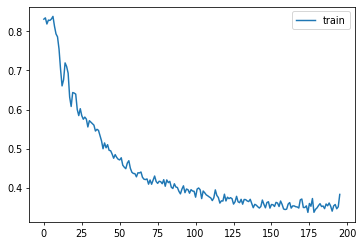

``` python
for o in model.dn.parameters(): o.requires_grad_(True)
```

``` python
epochs = 20
lr = 3e-3
tmax = epochs * len(dls.train)
sched = partial(lr_scheduler.OneCycleLR, max_lr=lr, total_steps=tmax)
xtra = [BatchSchedCB(sched)]
learn = Learner(model, dls, comb_loss, lr=lr, cbs=cbs+xtra, opt_func=opt_func)
```

``` python
learn.fit(epochs)
```

| loss  | epoch | train |
|-------|-------|-------|
| 0.344 | 0     | train |
| 0.249 | 0     | eval  |
| 0.327 | 1     | train |
| 0.246 | 1     | eval  |
| 0.309 | 2     | train |
| 0.252 | 2     | eval  |
| 0.296 | 3     | train |
| 0.243 | 3     | eval  |
| 0.287 | 4     | train |
| 0.226 | 4     | eval  |
| 0.279 | 5     | train |
| 0.232 | 5     | eval  |
| 0.274 | 6     | train |
| 0.226 | 6     | eval  |
| 0.268 | 7     | train |
| 0.221 | 7     | eval  |
| 0.265 | 8     | train |
| 0.240 | 8     | eval  |
| 0.261 | 9     | train |
| 0.215 | 9     | eval  |
| 0.258 | 10    | train |
| 0.226 | 10    | eval  |
| 0.256 | 11    | train |
| 0.213 | 11    | eval  |
| 0.253 | 12    | train |
| 0.213 | 12    | eval  |
| 0.250 | 13    | train |
| 0.205 | 13    | eval  |
| 0.248 | 14    | train |
| 0.207 | 14    | eval  |
| 0.247 | 15    | train |
| 0.202 | 15    | eval  |
| 0.245 | 16    | train |
| 0.202 | 16    | eval  |
| 0.244 | 17    | train |
| 0.199 | 17    | eval  |
| 0.243 | 18    | train |
| 0.199 | 18    | eval  |
| 0.243 | 19    | train |
| 0.198 | 19    | eval  |

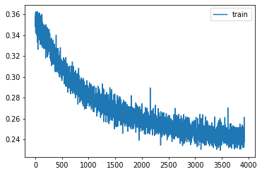

``` python
torch.save(learn.model, 'models/superres-pcp.pkl')
# learn.model = torch.load('models/superres-pcp.pkl').cuda()
```

``` python
p,t,inp = learn.capture_preds(inps=True)
```

| loss  | epoch | train |
|-------|-------|-------|
| 0.198 | 0     | eval  |

``` python
show_images(denorm(inp[:9]), imsize=2)
```


``` python
show_images(denorm(p[:9]), imsize=2)
```


``` python
show_images(denorm(t[:9]), imsize=2)
```


``` python
torch.save(learn.model, 'models/superres-pcp.pkl')
# learn.model = torch.load('models/superres-pcp.pkl').cuda()
```

## Cross-convs

``` python
def cross_conv(nf, act, norm):
    return nn.Sequential(
        ResBlock(nf, nf, act=act, norm=norm),
        nn.Conv2d(nf, nf, 3, padding=1)
    )
```

``` python
class TinyUnet(nn.Module):
    def __init__(self, act=act_gr, nfs=(32,64,128,256,512,1024), norm=nn.BatchNorm2d):
        super().__init__()
        self.start = ResBlock(3, nfs[0], ks=5, stride=1, act=act, norm=norm)
        self.dn = nn.ModuleList([ResBlock(nfs[i], nfs[i+1], act=act, norm=norm, stride=2)
                                 for i in range(len(nfs)-1)])
        self.xs = nn.ModuleList([cross_conv(nfs[i], act, norm)
                                 for i in range(len(nfs)-1,0,-1)])
        self.xs += [cross_conv(nfs[0], act, norm)]
        self.up = nn.ModuleList([up_block(nfs[i], nfs[i-1], act=act, norm=norm)
                                 for i in range(len(nfs)-1,0,-1)])
        self.up += [ResBlock(nfs[0], 3, act=act, norm=norm)]
        self.end = ResBlock(3, 3, act=nn.Identity, norm=norm)

    def forward(self, x):
        layers = []
        layers.append(x)
        x = self.start(x)
        for i,l in enumerate(self.dn):
            layers.append(x)
            x = l(x)
        n = len(layers)
        for i,l in enumerate(self.up):
            if i!=0: x += self.xs[i](layers[n-i])
            x = l(x)
        return self.end(x+layers[0])
```

``` python
pmodel = torch.load('models/inettiny-custom-25')
```

``` python
model = get_unet()
```

``` python
model.start.load_state_dict(pmodel[0].state_dict())
for i in range(5): model.dn[i].load_state_dict(pmodel[i+1].state_dict())
for o in model.dn.parameters(): o.requires_grad_(False)
```

``` python
epochs = 1
lr = 3e-3
tmax = epochs * len(dls.train)
sched = partial(lr_scheduler.OneCycleLR, max_lr=lr, total_steps=tmax)
xtra = [BatchSchedCB(sched)]
learn = Learner(model, dls, comb_loss, lr=lr, cbs=cbs+xtra, opt_func=opt_func)
```

``` python
learn.fit(epochs)
```

| loss  | epoch | train |
|-------|-------|-------|
| 0.422 | 0     | train |
| 0.243 | 0     | eval  |

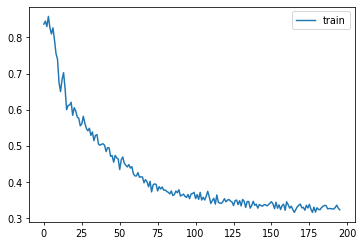

``` python
for o in model.dn.parameters(): o.requires_grad_(True)
```

``` python
epochs = 20
lr = 1e-2
tmax = epochs * len(dls.train)
sched = partial(lr_scheduler.OneCycleLR, max_lr=lr, total_steps=tmax)
xtra = [BatchSchedCB(sched)]
learn = Learner(model, dls, comb_loss, lr=lr, cbs=cbs+xtra, opt_func=opt_func)
```

``` python
learn.fit(epochs)
```

| loss  | epoch | train |
|-------|-------|-------|
| 0.316 | 0     | train |
| 0.234 | 0     | eval  |
| 0.294 | 1     | train |
| 0.222 | 1     | eval  |
| 0.282 | 2     | train |
| 0.221 | 2     | eval  |
| 0.275 | 3     | train |
| 0.224 | 3     | eval  |
| 0.269 | 4     | train |
| 0.223 | 4     | eval  |
| 0.264 | 5     | train |
| 0.221 | 5     | eval  |
| 0.259 | 6     | train |
| 0.215 | 6     | eval  |
| 0.254 | 7     | train |
| 0.208 | 7     | eval  |
| 0.249 | 8     | train |
| 0.206 | 8     | eval  |
| 0.246 | 9     | train |
| 0.211 | 9     | eval  |
| 0.243 | 10    | train |
| 0.202 | 10    | eval  |
| 0.240 | 11    | train |
| 0.199 | 11    | eval  |
| 0.237 | 12    | train |
| 0.199 | 12    | eval  |
| 0.235 | 13    | train |
| 0.197 | 13    | eval  |
| 0.232 | 14    | train |
| 0.193 | 14    | eval  |
| 0.230 | 15    | train |
| 0.192 | 15    | eval  |
| 0.227 | 16    | train |
| 0.191 | 16    | eval  |
| 0.226 | 17    | train |
| 0.190 | 17    | eval  |
| 0.224 | 18    | train |
| 0.189 | 18    | eval  |
| 0.224 | 19    | train |
| 0.189 | 19    | eval  |

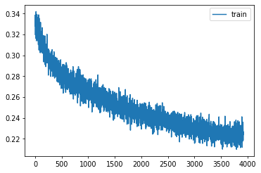

``` python
p,t,inp = learn.capture_preds(inps=True)
```

| loss  | epoch | train |
|-------|-------|-------|
| 0.189 | 0     | eval  |

``` python
show_images(denorm(inp[:9]), imsize=2)
```


``` python
show_images(denorm(p[:9]), imsize=2)
```


``` python
show_images(denorm(t[:9]), imsize=2)
```


``` python
torch.save(learn.model, 'models/superres-cross.pkl')
# learn.model = torch.load('models/superres-pcp.pkl').cuda()
```

Back to top
