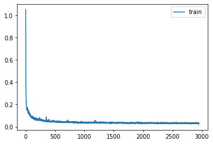
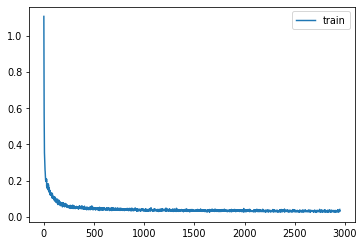
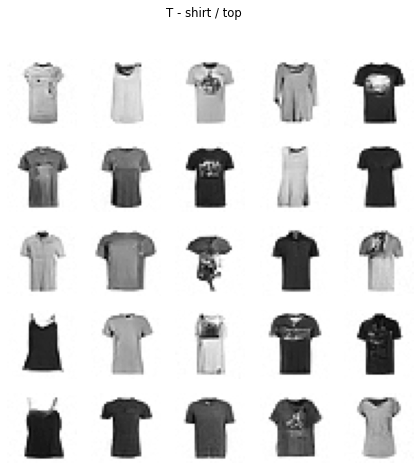

# Conditioned Diffusion

A diffusion U-Net with attention, guided by a class condition

Author

Benedict Thekkel

``` python
import os
os.environ['CUDA_VISIBLE_DEVICES']='1'
```

``` python
torch.set_printoptions(precision=4, linewidth=140, sci_mode=False)
torch.manual_seed(1)
mpl.rcParams['image.cmap'] = 'gray_r'
mpl.rcParams['figure.dpi'] = 70

import logging
logging.disable(logging.WARNING)

set_seed(42)
if fc.defaults.cpus>8: fc.defaults.cpus=8
```

``` python
xl,yl = 'image','label'
name = "fashion_mnist"
bs = 512
dsd = load_dataset(name)
```

``` python
@inplace
def transformi(b): b[xl] = [F.pad(TF.to_tensor(o), (2,2,2,2))-0.5 for o in b[xl]]

tds = dsd.with_transform(transformi)
dls = DataLoaders(dl_ddpm(tds['train']), dl_ddpm(tds['test']))

dl = dls.train
(xt,t),eps = b = next(iter(dl))
```

## Train

Based on Diffusers

``` python
# This version is giving poor results - use the cell below instead
class SelfAttention(nn.Module):
    def __init__(self, ni, attn_chans):
        super().__init__()
        self.attn = nn.MultiheadAttention(ni, ni//attn_chans, batch_first=True)
        self.norm = nn.BatchNorm2d(ni)

    def forward(self, x):
        n,c,h,w = x.shape
        x = self.norm(x).view(n, c, -1).transpose(1, 2)
        x = self.attn(x, x, x, need_weights=False)[0]
        return x.transpose(1,2).reshape(n,c,h,w)
```

``` python
lr = 1e-2
epochs = 25
opt_func = partial(optim.Adam, eps=1e-5)
tmax = epochs * len(dls.train)
sched = partial(lr_scheduler.OneCycleLR, max_lr=lr, total_steps=tmax)
cbs = [DeviceCB(), ProgressCB(plot=True), MetricsCB(), BatchSchedCB(sched), MixedPrecision()]
model = EmbUNetModel(in_channels=1, out_channels=1, nfs=(32,64,128,256), num_layers=2)
learn = Learner(model, dls, nn.MSELoss(), lr=lr, cbs=cbs, opt_func=opt_func)
```

``` python
learn.fit(epochs)
```

| loss  | epoch | train |
|-------|-------|-------|
| 0.150 | 0     | train |
| 0.086 | 0     | eval  |
| 0.069 | 1     | train |
| 0.171 | 1     | eval  |
| 0.057 | 2     | train |
| 0.071 | 2     | eval  |
| 0.050 | 3     | train |
| 0.055 | 3     | eval  |
| 0.045 | 4     | train |
| 0.050 | 4     | eval  |
| 0.043 | 5     | train |
| 0.073 | 5     | eval  |
| 0.041 | 6     | train |
| 0.044 | 6     | eval  |
| 0.039 | 7     | train |
| 0.044 | 7     | eval  |
| 0.038 | 8     | train |
| 0.043 | 8     | eval  |
| 0.038 | 9     | train |
| 0.058 | 9     | eval  |
| 0.038 | 10    | train |
| 0.044 | 10    | eval  |
| 0.036 | 11    | train |
| 0.042 | 11    | eval  |
| 0.035 | 12    | train |
| 0.038 | 12    | eval  |
| 0.035 | 13    | train |
| 0.039 | 13    | eval  |
| 0.034 | 14    | train |
| 0.036 | 14    | eval  |
| 0.034 | 15    | train |
| 0.036 | 15    | eval  |
| 0.034 | 16    | train |
| 0.034 | 16    | eval  |
| 0.034 | 17    | train |
| 0.035 | 17    | eval  |
| 0.033 | 18    | train |
| 0.033 | 18    | eval  |
| 0.033 | 19    | train |
| 0.033 | 19    | eval  |
| 0.033 | 20    | train |
| 0.033 | 20    | eval  |
| 0.033 | 21    | train |
| 0.032 | 21    | eval  |
| 0.032 | 22    | train |
| 0.034 | 22    | eval  |
| 0.032 | 23    | train |
| 0.032 | 23    | eval  |
| 0.032 | 24    | train |
| 0.033 | 24    | eval  |



## Sampling

``` python
from miniai.fid import ImageEval
```

``` python
cmodel = torch.load('models/data_aug2.pkl')
del(cmodel[8])
del(cmodel[7])

@inplace
def transformi(b): b[xl] = [F.pad(TF.to_tensor(o), (2,2,2,2))*2-1 for o in b[xl]]

bs = 2048
tds = dsd.with_transform(transformi)
dls = DataLoaders.from_dd(tds, bs, num_workers=fc.defaults.cpus)

dt = dls.train
xb,yb = next(iter(dt))

ie = ImageEval(cmodel, dls, cbs=[DeviceCB()])
```

``` python
sz = (2048,1,32,32)
```

``` python
# set_seed(42)
preds = sample(ddim_step, model, sz, steps=100, eta=1.)
s = (preds[-1]*2)
s.min(),s.max(),s.shape
```

100.00% \[100/100 00:53\<00:00\]

    (tensor(-1.0918), tensor(1.4292), torch.Size([2048, 1, 32, 32]))

``` python
show_images(s[:25].clamp(-1,1), imsize=1.5)
```


``` python
ie.fid(s),ie.kid(s),s.shape
```

    (4.058064770194278, 0.010895456187427044, torch.Size([2048, 1, 32, 32]))

``` python
preds = sample(ddim_step, model, sz, steps=100, eta=1.)
ie.fid(preds[-1]*2)
```

100.00% \[100/100 00:53\<00:00\]

    5.320260029850715

``` python
preds = sample(ddim_step, model, sz, steps=50, eta=1.)
ie.fid(preds[-1]*2)
```

100.00% \[50/50 00:26\<00:00\]

    5.243807277315682

``` python
preds = sample(ddim_step, model, sz, steps=50, eta=1.)
ie.fid(preds[-1]*2)
```

100.00% \[50/50 00:26\<00:00\]

    4.963977301033992

## Conditional model

``` python
def collate_ddpm(b):
    b = default_collate(b)
    (xt,t),eps = noisify(b[xl])
    return (xt,t,b[yl]),eps
```

``` python
@inplace
def transformi(b): b[xl] = [F.pad(TF.to_tensor(o), (2,2,2,2))-0.5 for o in b[xl]]

tds = dsd.with_transform(transformi)
dls = DataLoaders(dl_ddpm(tds['train']), dl_ddpm(tds['test']))

dl = dls.train
(xt,t,c),eps = b = next(iter(dl))
```

``` python
class CondUNetModel(nn.Module):
    def __init__( self, n_classes, in_channels=3, out_channels=3, nfs=(224,448,672,896), num_layers=1):
        super().__init__()
        self.conv_in = nn.Conv2d(in_channels, nfs[0], kernel_size=3, padding=1)
        self.n_temb = nf = nfs[0]
        n_emb = nf*4
        self.cond_emb = nn.Embedding(n_classes, n_emb)
        self.emb_mlp = nn.Sequential(lin(self.n_temb, n_emb, norm=nn.BatchNorm1d),
                                     lin(n_emb, n_emb))
        self.downs = nn.ModuleList()
        for i in range(len(nfs)):
            ni = nf
            nf = nfs[i]
            self.downs.append(DownBlock(n_emb, ni, nf, add_down=i!=len(nfs)-1, num_layers=num_layers))
        self.mid_block = EmbResBlock(n_emb, nfs[-1])

        rev_nfs = list(reversed(nfs))
        nf = rev_nfs[0]
        self.ups = nn.ModuleList()
        for i in range(len(nfs)):
            prev_nf = nf
            nf = rev_nfs[i]
            ni = rev_nfs[min(i+1, len(nfs)-1)]
            self.ups.append(UpBlock(n_emb, ni, prev_nf, nf, add_up=i!=len(nfs)-1, num_layers=num_layers+1))
        self.conv_out = pre_conv(nfs[0], out_channels, act=nn.SiLU, norm=nn.BatchNorm2d, bias=False)

    def forward(self, inp):
        x,t,c = inp
        temb = timestep_embedding(t, self.n_temb)
        cemb = self.cond_emb(c)
        emb = self.emb_mlp(temb) + cemb
        x = self.conv_in(x)
        saved = [x]
        for block in self.downs: x = block(x, emb)
        saved += [p for o in self.downs for p in o.saved]
        x = self.mid_block(x, emb)
        for block in self.ups: x = block(x, emb, saved)
        return self.conv_out(x)
```

``` python
lr = 1e-2
epochs = 25
opt_func = partial(optim.Adam, eps=1e-5)
tmax = epochs * len(dls.train)
sched = partial(lr_scheduler.OneCycleLR, max_lr=lr, total_steps=tmax)
cbs = [DeviceCB(), ProgressCB(plot=True), MetricsCB(), BatchSchedCB(sched), MixedPrecision()]
model = CondUNetModel(10, in_channels=1, out_channels=1, nfs=(32,64,128,256), num_layers=2)
learn = Learner(model, dls, nn.MSELoss(), lr=lr, cbs=cbs, opt_func=opt_func)
```

``` python
learn.fit(epochs)
```

| loss  | epoch | train |
|-------|-------|-------|
| 0.178 | 0     | train |
| 0.099 | 0     | eval  |
| 0.072 | 1     | train |
| 0.066 | 1     | eval  |
| 0.053 | 2     | train |
| 0.053 | 2     | eval  |
| 0.047 | 3     | train |
| 0.050 | 3     | eval  |
| 0.045 | 4     | train |
| 0.045 | 4     | eval  |
| 0.042 | 5     | train |
| 0.048 | 5     | eval  |
| 0.041 | 6     | train |
| 0.060 | 6     | eval  |
| 0.039 | 7     | train |
| 0.042 | 7     | eval  |
| 0.037 | 8     | train |
| 0.039 | 8     | eval  |
| 0.037 | 9     | train |
| 0.051 | 9     | eval  |
| 0.036 | 10    | train |
| 0.039 | 10    | eval  |
| 0.035 | 11    | train |
| 0.041 | 11    | eval  |
| 0.035 | 12    | train |
| 0.041 | 12    | eval  |
| 0.034 | 13    | train |
| 0.035 | 13    | eval  |
| 0.034 | 14    | train |
| 0.035 | 14    | eval  |
| 0.034 | 15    | train |
| 0.036 | 15    | eval  |
| 0.033 | 16    | train |
| 0.037 | 16    | eval  |
| 0.033 | 17    | train |
| 0.032 | 17    | eval  |
| 0.032 | 18    | train |
| 0.036 | 18    | eval  |
| 0.032 | 19    | train |
| 0.033 | 19    | eval  |
| 0.032 | 20    | train |
| 0.032 | 20    | eval  |
| 0.032 | 21    | train |
| 0.033 | 21    | eval  |
| 0.032 | 22    | train |
| 0.033 | 22    | eval  |
| 0.031 | 23    | train |
| 0.032 | 23    | eval  |
| 0.031 | 24    | train |
| 0.033 | 24    | eval  |



``` python
sz = (256,1,32,32)
```

``` python
lbls = dsd['train'].features[yl].names
lbls
```

    ['T - shirt / top',
     'Trouser',
     'Pullover',
     'Dress',
     'Coat',
     'Sandal',
     'Shirt',
     'Sneaker',
     'Bag',
     'Ankle boot']

``` python
set_seed(42)
cid = 0
preds = sample(cid, ddim_step, model, sz, steps=100, eta=1.)
s = (preds[-1]*2)
show_images(s[:25].clamp(-1,1), imsize=1.5, suptitle=lbls[cid])
```

100.00% \[100/100 00:02\<00:00\]



``` python
set_seed(42)
cid = 0
preds = sample(cid, ddim_step, model, sz, steps=100, eta=0.)
s = (preds[-1]*2)
show_images(s[:25].clamp(-1,1), imsize=1.5, suptitle=lbls[cid])
```

100.00% \[100/100 00:02\<00:00\]


Back to top
